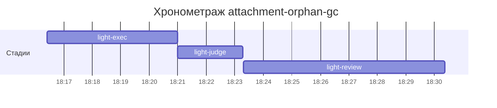

# Хронометраж: attachment-orphan-gc

Обновлено: 2026-09-27T18:30:22+05:00

## Стадии

| Стадия | Начало | Конец | Длит. | Ожидание | Чистое | Рестарты | Переделки |
|---|---|---|---|---|---|---|---|
| light-exec | 27.09 18:16 | 27.09 18:20 | 4м 34с | — | 4м 34с | — | — |
| light-judge | 27.09 18:20 | 27.09 18:23 | 2м 18с | — | 2м 18с | — | 1м 05с |
| light-review | 27.09 18:23 | 27.09 18:30 | 7м 04с | — | 7м 04с | — | 59с |
| **Итого (union)** | 27.09 18:16 | 27.09 18:30 | **13м 56с** | **0с** | **13м 56с** |  | **2м 04с** |

Wall-clock (первое→последнее событие журнала): **13м 57с**; застаймлено (union стадий): 13м 56с.

## События (fix-loop / повторные гейты / ошибки)

| Стадия | Тип | Событие | Начало | Длит. | Статус |
|---|---|---|---|---|---|
| light-judge | other | integration | 27.09 18:22 | 1м 05с | ok |
| light-review | other | integration | 27.09 18:28 | 59с | ok |

## Инструменты (тайминги гейтов/чекеров)

| Время | Инструмент | Статус | Итого | Шаги (по убыванию) |
|---|---|---|---|---|
| 27.09 18:21 | review_bundle | PASS | 0с | api_conventions 0.1s · date_bound 0.1s · live_suite 0.1s · fixture_sync 0.1s · go_naming 0.0s · +4 шагов (0.0s) |
| 27.09 18:21 | review_bundle | PASS | 0с | api_conventions 0.1s · date_bound 0.1s · live_suite 0.1s · fixture_sync 0.1s · rule_usage 0.1s · +4 шагов (0.0s) |
| 27.09 18:27 | review_bundle | PASS | 0с | api_conventions 0.1s · date_bound 0.1s · live_suite 0.1s · fixture_sync 0.1s · go_naming 0.0s · +4 шагов (0.0s) |

## Пайп-передачи (§3.6: бандлы, контракты)

| Время | Стадия | Вид | Артефакт | Размер | Детали |
|---|---|---|---|---|---|
| 27.09 18:21 | 8-code-review | bundle | 8-code-review/input-bundle.md | 2KB | чекеры 9✅/0❌/0⚠; патчи 31KB |
| 27.09 18:21 | 8-code-review | bundle | 8-code-review/input-bundle.md | 2KB | чекеры 9✅/0❌/0⚠; патчи 31KB |
| 27.09 18:27 | 8-code-review | bundle | 8-code-review/input-bundle.md | 2KB | чекеры 9✅/0❌/0⚠; патчи 35KB |

Бандлов: 3, суммарно 7KB — весь документный контекст, переданный между стадиями.
Нарушений пайп-контракта не зафиксировано (context-violations.jsonl отсутствует).

## Ожидание пользователя

Пауз не было.

## Диаграмма

