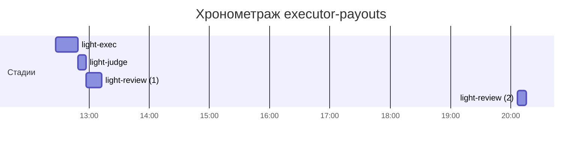

# Хронометраж: executor-payouts

Обновлено: 2026-10-05T20:15:33+05:00

## Стадии

| Стадия | Начало | Конец | Длит. | Ожидание | Чистое | Рестарты | Переделки |
|---|---|---|---|---|---|---|---|
| light-exec | 05.10 12:27 | 05.10 12:49 | 22м 22с | — | 22м 22с | — | — |
| light-judge | 05.10 12:49 | 05.10 12:56 | 7м 35с | — | 7м 35с | — | 5м 17с |
| light-review | 05.10 12:56 | 05.10 20:15 | 24м 09с | — | 24м 09с | — | 3м 30с |
| **Итого (union)** | 05.10 12:27 | 05.10 20:15 | **54м 06с** | **0с** | **54м 06с** |  | **8м 47с** |

Wall-clock (первое→последнее событие журнала): **7ч 48м**; застаймлено (union стадий): 54м 06с; вне стадий: 6ч 54м.

## События (fix-loop / повторные гейты / ошибки)

| Стадия | Тип | Событие | Начало | Длит. | Статус |
|---|---|---|---|---|---|
| light-judge | other | integration | 05.10 12:50 | 1м 15с | ok |
| light-judge | other | e2e-run | 05.10 12:51 | 2м 02с | ok |
| light-judge | other | e2e-run-2 | 05.10 12:54 | 2м | ok |
| light-review | other | rejudge | 05.10 13:07 | 3м 30с | ok |

## Инструменты (тайминги гейтов/чекеров)

| Время | Инструмент | Статус | Итого | Шаги (по убыванию) |
|---|---|---|---|---|
| 05.10 12:49 | review_bundle | PASS | 1с | rule_usage 0.4s · api_conventions 0.1s · contract 0.1s · date_bound 0.1s · live_suite 0.1s · +4 шагов (0.1s) |
| 05.10 12:49 | review_bundle | PASS | 1с | rule_usage 0.4s · api_conventions 0.1s · date_bound 0.1s · live_suite 0.1s · fixture_sync 0.1s · +4 шагов (0.0s) |
| 05.10 12:50 | review_bundle | PASS | 2с | rule_usage 1.0s · date_bound 0.2s · fixture_sync 0.2s · api_conventions 0.1s · contract 0.1s · +4 шагов (0.2s) |
| 05.10 12:56 | review_bundle | PASS | 1с | rule_usage 0.4s · api_conventions 0.1s · date_bound 0.1s · live_suite 0.1s · fixture_sync 0.1s · +4 шагов (0.0s) |
| 05.10 12:57 | e2e_evidence | PASS | 0с | status:passed 0s |
| 05.10 13:11 | e2e_evidence | PASS | 0с | status:passed 0s |
| 05.10 13:11 | review_bundle | PASS | 1с | rule_usage 0.5s · api_conventions 0.1s · date_bound 0.1s · live_suite 0.1s · fixture_sync 0.1s · +4 шагов (0.0s) |
| 05.10 13:12 | review_verdict_check | PASS | 0с | verdict:APPROVED 0s |
| 05.10 14:27 | e2e_evidence | PASS | 0с | status:passed 0s |
| 05.10 20:06 | review_bundle | PASS | 1с | rule_usage 0.5s · api_conventions 0.1s · date_bound 0.1s · live_suite 0.1s · fixture_sync 0.1s · +4 шагов (0.0s) |
| 05.10 20:15 | e2e_evidence | PASS | 0с | status:passed 0s |

## ⚠ BLIND-GAP — интервалы без записей журнала (>5 мин)

Тяжёлый прогон обязан обрамляться `event-start`/`event-end` (§EE anti-polling):
без них нельзя отличить фоновый прогон от sleep-поллинга.

| Стадия | Начало | Конец | Длит. |
|---|---|---|---|
| light-review | 05.10 12:57 | 05.10 13:07 | 10м 19с |
| light-review | 05.10 20:06 | 05.10 20:15 | 8м 37с |

Суммарно вне наблюдения: **18м 56с** (2 интервал(ов)).

## Пайп-передачи (§3.6: бандлы, контракты)

| Время | Стадия | Вид | Артефакт | Размер | Детали |
|---|---|---|---|---|---|
| 05.10 12:49 | 8-code-review | bundle | 8-code-review/input-bundle.md | 4KB | чекеры 8✅/0❌/1⚠; патчи 192KB |
| 05.10 12:49 | 8-code-review | bundle | 8-code-review/input-bundle.md | 4KB | чекеры 8✅/0❌/1⚠; патчи 192KB |
| 05.10 12:50 | 8-code-review | bundle | 8-code-review/input-bundle.md | 3KB | чекеры 9✅/0❌/0⚠; патчи 192KB |
| 05.10 12:56 | 8-code-review | bundle | 8-code-review/input-bundle.md | 4KB | чекеры 9✅/0❌/0⚠; патчи 193KB |
| 05.10 13:11 | 8-code-review | bundle | 8-code-review/input-bundle.md | 5KB | чекеры 9✅/0❌/0⚠; патчи 214KB |
| 05.10 20:06 | 8-code-review | bundle | 8-code-review/input-bundle.md | 5KB | чекеры 9✅/0❌/0⚠; патчи 245KB |

Бандлов: 6, суммарно 27KB — весь документный контекст, переданный между стадиями.
Нарушений пайп-контракта не зафиксировано (context-violations.jsonl отсутствует).

## Ожидание пользователя

Пауз не было.

## Диаграмма

