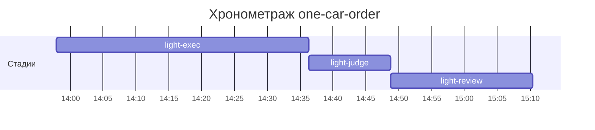

# Хронометраж: one-car-order

Обновлено: 2026-10-15T15:10:21+05:00

## Стадии

| Стадия | Начало | Конец | Длит. | Ожидание | Чистое | Рестарты | Переделки |
|---|---|---|---|---|---|---|---|
| light-exec | 15.10 13:57 | 15.10 14:36 | 38м 24с | — | 38м 24с | — | — |
| light-judge | 15.10 14:36 | 15.10 14:48 | 12м 31с | — | 12м 31с | — | 8м 40с |
| light-review | 15.10 14:48 | 15.10 15:10 | 21м 33с | — | 21м 33с | — | 5м 34с |
| **Итого (union)** | 15.10 13:57 | 15.10 15:10 | **1ч 12м** | **0с** | **1ч 12м** |  | **14м 14с** |

Wall-clock (первое→последнее событие журнала): **1ч 12м**; застаймлено (union стадий): 1ч 12м.

## События (fix-loop / повторные гейты / ошибки)

| Стадия | Тип | Событие | Начало | Длит. | Статус |
|---|---|---|---|---|---|
| light-judge | other | integration | 15.10 14:37 | 1м 38с | ok |
| light-judge | other | e2e-run | 15.10 14:39 | 2м 17с | ok |
| light-judge | other | e2e-run | 15.10 14:42 | 2м 22с | ok |
| light-judge | other | e2e-run | 15.10 14:45 | 2м 23с | ok |
| light-review | other | integration | 15.10 15:04 | 1м 29с | ok |
| light-review | other | e2e-run | 15.10 15:06 | 4м 05с | ok |

## Инструменты (тайминги гейтов/чекеров)

| Время | Инструмент | Статус | Итого | Шаги (по убыванию) |
|---|---|---|---|---|
| 15.10 14:36 | review_bundle | PASS | 2с | rule_usage 0.7s · date_bound 0.6s · api_conventions 0.1s · contract 0.1s · live_suite 0.1s · +4 шагов (0.1s) |
| 15.10 14:36 | review_bundle | PASS | 2с | date_bound 0.7s · rule_usage 0.7s · api_conventions 0.1s · live_suite 0.1s · fixture_sync 0.1s · +4 шагов (0.0s) |
| 15.10 14:48 | e2e_evidence | PASS | 0с | status:passed 0s |
| 15.10 14:48 | review_bundle | PASS | 2с | date_bound 0.7s · rule_usage 0.7s · api_conventions 0.1s · live_suite 0.1s · fixture_sync 0.1s · +4 шагов (0.0s) |
| 15.10 15:03 | review_bundle | PASS | 2с | rule_usage 0.8s · date_bound 0.7s · api_conventions 0.1s · live_suite 0.1s · fixture_sync 0.1s · +4 шагов (0.0s) |
| 15.10 15:10 | e2e_evidence | PASS | 0с | status:passed 0s |

## ⚠ BLIND-GAP — интервалы без записей журнала (>5 мин)

Тяжёлый прогон обязан обрамляться `event-start`/`event-end` (§EE anti-polling):
без них нельзя отличить фоновый прогон от sleep-поллинга.

| Стадия | Начало | Конец | Длит. |
|---|---|---|---|
| light-review | 15.10 14:48 | 15.10 15:03 | 15м 09с |

Суммарно вне наблюдения: **15м 09с** (1 интервал(ов)).

## Пайп-передачи (§3.6: бандлы, контракты)

| Время | Стадия | Вид | Артефакт | Размер | Детали |
|---|---|---|---|---|---|
| 15.10 14:36 | 8-code-review | bundle | 8-code-review/input-bundle.md | 5KB | чекеры 8✅/0❌/1⚠; патчи 348KB |
| 15.10 14:36 | 8-code-review | bundle | 8-code-review/input-bundle.md | 5KB | чекеры 9✅/0❌/0⚠; патчи 348KB |
| 15.10 14:48 | 8-code-review | bundle | 8-code-review/input-bundle.md | 6KB | чекеры 9✅/0❌/0⚠; патчи 349KB |
| 15.10 15:03 | 8-code-review | bundle | 8-code-review/input-bundle.md | 6KB | чекеры 9✅/0❌/0⚠; патчи 364KB |

Бандлов: 4, суммарно 24KB — весь документный контекст, переданный между стадиями.
Нарушений пайп-контракта не зафиксировано (context-violations.jsonl отсутствует).

## Ожидание пользователя

Пауз не было.

## Диаграмма

