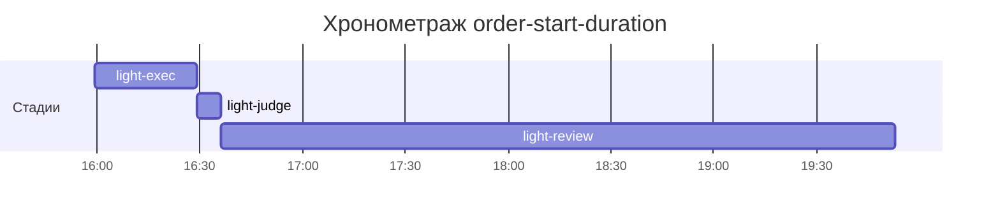

# Хронометраж: order-start-duration

Обновлено: 2026-10-15T19:52:57+05:00

## Стадии

| Стадия | Начало | Конец | Длит. | Ожидание | Чистое | Рестарты | Переделки |
|---|---|---|---|---|---|---|---|
| light-exec | 15.10 15:59 | 15.10 16:29 | 29м 50с | — | 29м 50с | — | — |
| light-judge | 15.10 16:29 | 15.10 16:36 | 7м 08с | — | 7м 08с | — | 6м 14с |
| light-review | 15.10 16:36 | 15.10 19:52 | 3ч 16м | — | 3ч 16м | — | 6м 13с |
| **Итого (union)** | 15.10 15:59 | 15.10 19:52 | **3ч 53м** | **0с** | **3ч 53м** |  | **12м 27с** |

Wall-clock (первое→последнее событие журнала): **3ч 53м**; застаймлено (union стадий): 3ч 53м.

## События (fix-loop / повторные гейты / ошибки)

| Стадия | Тип | Событие | Начало | Длит. | Статус |
|---|---|---|---|---|---|
| light-judge | other | integration | 15.10 16:29 | 1м 35с | ok |
| light-judge | other | e2e-run | 15.10 16:31 | 4м 39с | ok |
| light-review | other | integration | 15.10 19:40 | 1м 34с | ok |
| light-review | other | e2e-run | 15.10 19:42 | 4м 39с | ok |

## Инструменты (тайминги гейтов/чекеров)

| Время | Инструмент | Статус | Итого | Шаги (по убыванию) |
|---|---|---|---|---|
| 15.10 16:29 | review_bundle | PASS | 2с | rule_usage 0.9s · date_bound 0.7s · api_conventions 0.1s · live_suite 0.1s · fixture_sync 0.1s · +4 шагов (0.0s) |
| 15.10 16:36 | e2e_evidence | PASS | 0с | status:passed 0s |
| 15.10 16:36 | review_bundle | FAIL | 2с | rule_usage 1.0s · date_bound 0.6s · api_conventions 0.1s · live_suite 0.1s · fixture_sync 0.1s · +4 шагов (0.0s) |
| 15.10 19:40 | review_bundle | FAIL | 2с | rule_usage 1.0s · date_bound 0.7s · api_conventions 0.1s · live_suite 0.1s · fixture_sync 0.1s · +4 шагов (0.0s) |
| 15.10 19:47 | e2e_evidence | PASS | 0с | status:passed 0s |
| 15.10 19:50 | review_bundle | FAIL | 2с | rule_usage 1.0s · date_bound 0.7s · api_conventions 0.1s · live_suite 0.1s · fixture_sync 0.1s · +4 шагов (0.0s) |

## ⚠ BLIND-GAP — интервалы без записей журнала (>5 мин)

Тяжёлый прогон обязан обрамляться `event-start`/`event-end` (§EE anti-polling):
без них нельзя отличить фоновый прогон от sleep-поллинга.

| Стадия | Начало | Конец | Длит. |
|---|---|---|---|
| light-review | 15.10 16:36 | 15.10 19:40 | 3ч 03м |

Суммарно вне наблюдения: **3ч 03м** (1 интервал(ов)).

## Пайп-передачи (§3.6: бандлы, контракты)

| Время | Стадия | Вид | Артефакт | Размер | Детали |
|---|---|---|---|---|---|
| 15.10 16:29 | 8-code-review | bundle | 8-code-review/input-bundle.md | 4KB | чекеры 9✅/0❌/0⚠; патчи 190KB |
| 15.10 16:36 | 8-code-review | bundle | 8-code-review/input-bundle.md | 5KB | чекеры 8✅/1❌/0⚠; патчи 190KB |
| 15.10 19:40 | 8-code-review | bundle | 8-code-review/input-bundle.md | 5KB | чекеры 8✅/1❌/0⚠; патчи 255KB |
| 15.10 19:50 | 8-code-review | bundle | 8-code-review/input-bundle.md | 6KB | чекеры 8✅/1❌/0⚠; патчи 263KB |

Бандлов: 4, суммарно 21KB — весь документный контекст, переданный между стадиями.
Нарушений пайп-контракта не зафиксировано (context-violations.jsonl отсутствует).

## Ожидание пользователя

Пауз не было.

## Диаграмма

