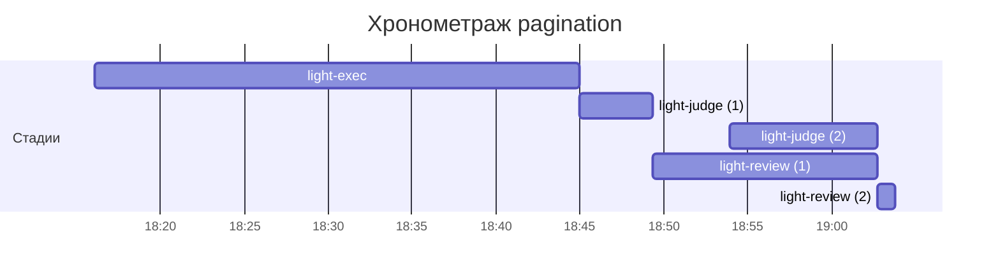

# Хронометраж: pagination

Обновлено: 2026-09-27T19:03:48+05:00

## Стадии

| Стадия | Начало | Конец | Длит. | Ожидание | Чистое | Рестарты | Переделки |
|---|---|---|---|---|---|---|---|
| light-exec | 27.09 18:16 | 27.09 18:44 | 28м 55с | — | 28м 55с | — | — |
| light-judge | 27.09 18:44 | 27.09 19:02 | 13м 13с | — | 13м 13с | — | 8м 17с |
| light-review | 27.09 18:49 | 27.09 19:03 | 14м 28с | — | 14м 28с | 1 | — |
| **Итого (union)** | 27.09 18:16 | 27.09 19:03 | **47м 44с** | **0с** | **47м 44с** |  | **8м 17с** |

Wall-clock (первое→последнее событие журнала): **47м 44с**; застаймлено (union стадий): 47м 44с; сумма интервалов: 56м 36с — перекрытия/рестарты не двоятся.

## События (fix-loop / повторные гейты / ошибки)

| Стадия | Тип | Событие | Начало | Длит. | Статус |
|---|---|---|---|---|---|
| light-judge | other | integration | 27.09 18:45 | 56с | ok |
| light-judge | other | e2e-run | 27.09 18:47 | 1м 38с | ok |
| light-judge | other | e2e-run | 27.09 18:54 | 2м 31с | ok |
| light-judge | other | e2e-full | 27.09 18:58 | 3м 12с | ok |

## Инструменты (тайминги гейтов/чекеров)

| Время | Инструмент | Статус | Итого | Шаги (по убыванию) |
|---|---|---|---|---|
| 27.09 18:45 | review_bundle | FAIL | 1с | go_naming 0.1s · api_conventions 0.1s · contract 0.1s · date_bound 0.1s · live_suite 0.1s · +5 шагов (0.1s) |
| 27.09 18:45 | review_bundle | FAIL | 0с | api_conventions 0.1s · contract 0.1s · date_bound 0.1s · live_suite 0.1s · fixture_sync 0.1s · +5 шагов (0.0s) |
| 27.09 18:45 | review_bundle | FAIL | 0с | api_conventions 0.1s · date_bound 0.1s · live_suite 0.1s · fixture_sync 0.1s · go_naming 0.0s · +5 шагов (0.0s) |
| 27.09 18:49 | e2e_evidence | PASS | 0с | status:passed 0s |
| 27.09 18:54 | review_bundle | FAIL | 0с | api_conventions 0.1s · date_bound 0.1s · live_suite 0.1s · fixture_sync 0.1s · go_naming 0.0s · +5 шагов (0.0s) |
| 27.09 19:02 | e2e_evidence | PASS | 0с | status:passed 0s |
| 27.09 19:02 | review_bundle | FAIL | 0с | go_naming 0.1s · api_conventions 0.1s · date_bound 0.1s · live_suite 0.1s · fixture_sync 0.1s · +5 шагов (0.0s) |

## Пайп-передачи (§3.6: бандлы, контракты)

| Время | Стадия | Вид | Артефакт | Размер | Детали |
|---|---|---|---|---|---|
| 27.09 18:27 | — | passport | 0-setup/passport.md | 3KB | — |
| 27.09 18:45 | 8-code-review | bundle | 8-code-review/input-bundle.md | 13KB | чекеры 8✅/1❌/1⚠; патчи 80KB |
| 27.09 18:45 | 8-code-review | bundle | 8-code-review/input-bundle.md | 12KB | чекеры 8✅/1❌/1⚠; патчи 80KB |
| 27.09 18:45 | 8-code-review | bundle | 8-code-review/input-bundle.md | 12KB | чекеры 9✅/1❌/0⚠; патчи 80KB |
| 27.09 18:54 | 8-code-review | bundle | 8-code-review/input-bundle.md | 13KB | чекеры 9✅/1❌/0⚠; патчи 83KB |
| 27.09 19:02 | 8-code-review | bundle | 8-code-review/input-bundle.md | 13KB | чекеры 9✅/1❌/0⚠; патчи 88KB |

Бандлов: 5, суммарно 66KB — весь документный контекст, переданный между стадиями.
Нарушений пайп-контракта не зафиксировано (context-violations.jsonl отсутствует).

## Ожидание пользователя

Пауз не было.

## Диаграмма

