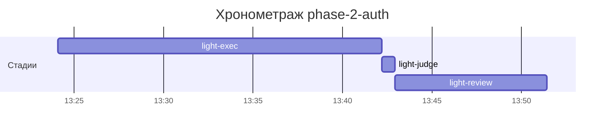

# Хронометраж: phase-2-auth

Обновлено: 2026-09-25T13:51:25+05:00

## Стадии

| Стадия | Начало | Конец | Длит. | Ожидание | Чистое | Рестарты | Переделки |
|---|---|---|---|---|---|---|---|
| light-exec | 25.09 13:24 | 25.09 13:42 | 18м 05с | — | 18м 05с | — | — |
| light-judge | 25.09 13:42 | 25.09 13:42 | 45с | — | 45с | — | — |
| light-review | 25.09 13:42 | 25.09 13:51 | 8м 29с | — | 8м 29с | — | — |
| **Итого (union)** | 25.09 13:24 | 25.09 13:51 | **27м 19с** | **0с** | **27м 19с** |  | **0с** |

Wall-clock (первое→последнее событие журнала): **27м 19с**; застаймлено (union стадий): 27м 19с.

## События (fix-loop / повторные гейты / ошибки)

Событий не было.

## Инструменты (тайминги гейтов/чекеров)

| Время | Инструмент | Статус | Итого | Шаги (по убыванию) |
|---|---|---|---|---|
| 25.09 13:41 | e2e_evidence | PASS | 0с | status:passed 0s |
| 25.09 13:42 | review_bundle | PASS | 0с | date_bound 0.1s · live_suite 0.1s · fixture_sync 0.1s · go_naming 0.0s · api_conventions 0.0s · +4 шагов (0.0s) |
| 25.09 13:50 | e2e_evidence | PASS | 0с | status:passed 0s |
| 25.09 13:50 | review_bundle | PASS | 0с | api_conventions 0.1s · contract 0.1s · date_bound 0.1s · live_suite 0.1s · fixture_sync 0.1s · +4 шагов (0.0s) |

## ⚠ BLIND-GAP — интервалы без записей журнала (>5 мин)

Тяжёлый прогон обязан обрамляться `event-start`/`event-end` (§EE anti-polling):
без них нельзя отличить фоновый прогон от sleep-поллинга.

| Стадия | Начало | Конец | Длит. |
|---|---|---|---|
| light-review | 25.09 13:42 | 25.09 13:50 | 7м 04с |

Суммарно вне наблюдения: **7м 04с** (1 интервал(ов)).

## Пайп-передачи (§3.6: бандлы, контракты)

| Время | Стадия | Вид | Артефакт | Размер | Детали |
|---|---|---|---|---|---|
| 25.09 13:42 | 8-code-review | bundle | 8-code-review/input-bundle.md | 3KB | чекеры 8✅/0❌/1⚠; патчи 174KB |
| 25.09 13:50 | 8-code-review | bundle | 8-code-review/input-bundle.md | 4KB | чекеры 8✅/0❌/1⚠; патчи 181KB |

Бандлов: 2, суммарно 8KB — весь документный контекст, переданный между стадиями.
Нарушений пайп-контракта не зафиксировано (context-violations.jsonl отсутствует).

## Ожидание пользователя

Пауз не было.

## Диаграмма

