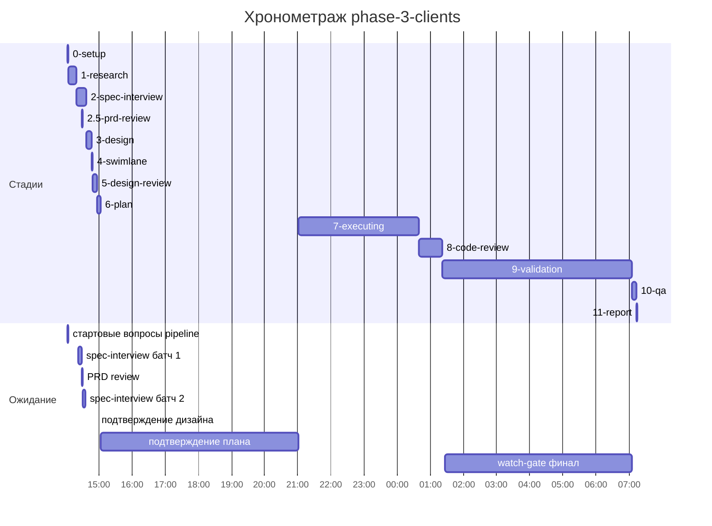

# Хронометраж: phase-3-clients

Обновлено: 2026-09-26T07:15:02+05:00

## Стадии

| Стадия | Начало | Конец | Длит. | Ожидание | Чистое | Рестарты | Переделки |
|---|---|---|---|---|---|---|---|
| 0-setup | 25.09 14:02 | 25.09 14:04 | 1м 37с | 1м 30с | 7с | — | — |
| 1-research | 25.09 14:04 | 25.09 14:19 | 14м 53с | — | 14м 53с | — | 6м 08с |
| 2-spec-interview | 25.09 14:19 | 25.09 14:37 | 17м 35с | 10м 47с | 6м 48с | — | — |
| 2.5-prd-review | 25.09 14:29 | 25.09 14:29 | 23с | 23с | 0с | — | — |
| 3-design | 25.09 14:37 | 25.09 14:46 | 8м 59с | — | 8м 59с | — | — |
| 4-swimlane | 25.09 14:46 | 25.09 14:48 | 2м 06с | — | 2м 06с | — | — |
| 5-design-review | 25.09 14:48 | 25.09 14:56 | 8м 16с | — | 8м 16с | — | 1м 57с |
| 6-plan | 25.09 14:57 | 25.09 15:03 | 6м 26с | — | 6м 26с | — | — |
| 7-executing | 25.09 21:00 | 26.09 00:38 | 3ч 38м | — | 3ч 38м | — | 2м 56с |
| 8-code-review | 26.09 00:38 | 26.09 01:21 | 42м 54с | — | 42м 54с | — | 27м 15с |
| 9-validation | 26.09 01:22 | 26.09 07:04 | 5ч 42м | 5ч 38м | 4м 36с | — | — |
| 10-qa | 26.09 07:04 | 26.09 07:12 | 8м 13с | — | 8м 13с | — | — |
| 11-report | 26.09 07:12 | 26.09 07:15 | 2м 03с | — | 2м 03с | — | — |
| **Итого (union)** | 25.09 14:02 | 26.09 07:15 | **11ч 13м** | **11ч 48м** | **5ч 23м** |  | **38м 16с** |

Wall-clock (первое→последнее событие журнала): **17ч 12м**; застаймлено (union стадий): 11ч 13м; вне стадий: 5ч 58м; ожидание вне стадий: 5ч 57м.

## События (fix-loop / повторные гейты / ошибки)

| Стадия | Тип | Событие | Начало | Длит. | Статус |
|---|---|---|---|---|---|
| 1-research | fix-loop | fix-loop #1: artifact_lint file:line + size | 25.09 14:13 | 6м 08с | ok |
| 5-design-review | fix-loop | fix-loop #1: mobile HIGH EQUIPMENT_TYPE_NAME_TAKEN | 25.09 14:52 | 1м 57с | ok |
| 7-executing | e2e-fail | EQ-004 spec rows 3 vs 2 | 26.09 00:26 | — | — |
| 7-executing | fix-loop | fix-loop phase08 #1: EQ-004 | 26.09 00:26 | 2м 56с | ok |
| 8-code-review | fix-loop | fix-loop #1: review MEDIUM 1-4 + LOW 500/PRG | 26.09 00:44 | 27м 15с | ok |

## Инструменты (тайминги гейтов/чекеров)

| Время | Инструмент | Статус | Итого | Шаги (по убыванию) |
|---|---|---|---|---|
| 26.09 00:38 | e2e_evidence | PASS | 0с | status:passed 0s |
| 26.09 00:38 | review_bundle | PASS | 0с | api_conventions 0.1s · contract 0.1s · date_bound 0.1s · live_suite 0.1s · fixture_sync 0.1s · +4 шагов (0.0s) |
| 26.09 01:11 | review_bundle | PASS | 1с | api_conventions 0.1s · contract 0.1s · date_bound 0.1s · live_suite 0.1s · fixture_sync 0.1s · +4 шагов (0.1s) |
| 26.09 01:20 | review_bundle | PASS | 0с | api_conventions 0.1s · contract 0.1s · date_bound 0.1s · live_suite 0.1s · fixture_sync 0.1s · +4 шагов (0.0s) |
| 26.09 01:23 | e2e_evidence | PASS | 0с | status:passed 0s |

## ⚠ BLIND-GAP — интервалы без записей журнала (>5 мин)

Тяжёлый прогон обязан обрамляться `event-start`/`event-end` (§EE anti-polling):
без них нельзя отличить фоновый прогон от sleep-поллинга.

| Стадия | Начало | Конец | Длит. |
|---|---|---|---|
| 9-validation | 26.09 01:26 | 26.09 07:04 | 5ч 38м |
| 8-code-review | 26.09 00:44 | 26.09 01:11 | 27м 15с |
| 8-code-review | 26.09 01:11 | 26.09 01:20 | 9м 06с |
| 3-design | 25.09 14:37 | 25.09 14:46 | 8м 59с |
| 1-research | 25.09 14:04 | 25.09 14:13 | 8м 35с |
| 10-qa | 26.09 07:04 | 26.09 07:12 | 8м 13с |
| 2-spec-interview | 25.09 14:21 | 25.09 14:28 | 6м 49с |
| 6-plan | 25.09 14:57 | 25.09 15:03 | 6м 26с |
| 1-research | 25.09 14:13 | 25.09 14:19 | 6м 08с |
| 8-code-review | 26.09 00:38 | 26.09 00:44 | 5м 13с |

Суммарно вне наблюдения: **7ч 04м** (10 интервал(ов)).

## Пайп-передачи (§3.6: бандлы, контракты)

| Время | Стадия | Вид | Артефакт | Размер | Детали |
|---|---|---|---|---|---|
| 25.09 14:04 | 1-research | bundle | 1-research/input-bundle.md | 1KB | правил 1, MISSING 1; паспорт 1KB |
| 25.09 14:04 | 1-research | contract-emit | — | — | mode warn |
| 25.09 14:04 | 1-research | contract-emit | — | — | mode warn |
| 25.09 14:19 | 1-research | contract-clear | — | — | — |
| 25.09 14:19 | 2-spec-interview | bundle | 2-spec-interview/input-bundle.md | 16KB | правил 3, MISSING 2; паспорт 1KB |
| 25.09 14:19 | 2-spec-interview | contract-emit | — | — | mode warn |
| 25.09 14:37 | 2-spec-interview | contract-clear | — | — | — |
| 25.09 14:37 | 3-design | bundle | 3-design/input-bundle.md | 36KB | правил 3, MISSING 0; паспорт 2KB |
| 25.09 14:37 | 3-design | contract-emit | — | — | mode warn |
| 25.09 14:46 | 3-design | contract-clear | — | — | — |
| 25.09 14:46 | 4-swimlane | bundle | 4-swimlane/input-bundle.md | 31KB | правил 1, MISSING 0; паспорт 2KB |
| 25.09 14:46 | 4-swimlane | contract-emit | — | — | mode warn |
| 25.09 14:48 | 4-swimlane | contract-clear | — | — | — |
| 25.09 14:48 | 5-design-review | bundle | 5-design-review/input-bundle.md | 3KB | правил 3, MISSING 0; паспорт 2KB |
| 25.09 14:48 | 5-design-review | contract-emit | — | — | mode warn |
| 25.09 14:56 | 5-design-review | contract-clear | — | — | — |
| 25.09 14:57 | 6-plan | bundle | 6-plan/input-bundle.md | 4KB | правил 3, MISSING 1; паспорт 2KB |
| 25.09 14:57 | 6-plan | contract-emit | — | — | mode warn |
| 25.09 15:03 | 6-plan | contract-clear | — | — | — |
| 25.09 21:00 | 7-executing | phase-bundle | 6-plan/phase-bundles/phase-01-input.md | 33KB | фаза 01 (frontend) |
| 25.09 21:14 | 7-executing | phase-bundle | 6-plan/phase-bundles/phase-02-input.md | 49KB | фаза 02 (backend) |
| 25.09 21:23 | 7-executing | phase-bundle | 6-plan/phase-bundles/phase-03-input.md | 51KB | фаза 03 (backend) |
| 25.09 21:38 | 7-executing | phase-bundle | 6-plan/phase-bundles/phase-04-input.md | 34KB | фаза 04 (frontend) |
| 25.09 22:01 | 7-executing | phase-bundle | 6-plan/phase-bundles/phase-05-input.md | 51KB | фаза 05 (backend) |
| 25.09 23:39 | 7-executing | phase-bundle | 6-plan/phase-bundles/phase-06-input.md | 35KB | фаза 06 (frontend) |
| 25.09 23:58 | 7-executing | phase-bundle | 6-plan/phase-bundles/phase-07-input.md | 51KB | фаза 07 (backend) |
| 26.09 00:08 | 7-executing | phase-bundle | 6-plan/phase-bundles/phase-08-input.md | 34KB | фаза 08 (frontend) |
| 26.09 00:29 | 7-executing | phase-bundle | 6-plan/phase-bundles/phase-09-input.md | 34KB | фаза 09 (frontend) |
| 26.09 00:38 | 8-code-review | bundle | 8-code-review/input-bundle.md | 15KB | чекеры 8✅/0❌/1⚠; патчи 261KB |
| 26.09 00:44 | 7-executing | phase-bundle | 6-plan/phase-bundles/phase-07-input.md | 51KB | фаза 07 (backend) |
| 26.09 01:11 | 8-code-review | bundle | 8-code-review/input-bundle.md | 17KB | чекеры 8✅/0❌/1⚠; патчи 284KB |
| 26.09 01:20 | 8-code-review | bundle | 8-code-review/input-bundle.md | 17KB | чекеры 8✅/0❌/1⚠; патчи 288KB |
| 26.09 07:04 | 10-qa | bundle | 10-qa/input-bundle.md | 53KB | правил 10, MISSING 1; паспорт 3KB |
| 26.09 07:04 | 10-qa | contract-emit | — | — | mode warn |
| 26.09 07:12 | 10-qa | contract-clear | — | — | — |
| 26.09 07:12 | 11-report | bundle | 11-report/input-bundle.md | 13KB | правил 9, MISSING 1; паспорт 3KB |

Бандлов: 21, суммарно 636KB — весь документный контекст, переданный между стадиями.
Нарушения пайп-контракта (context-violations.jsonl): `3-design`: 3, `4-swimlane`: 3, `5-design-review`: 1.

## Ожидание пользователя

| Стадия | Причина | Начало | Длит. |
|---|---|---|---|
| 0-setup | стартовые вопросы pipeline | 25.09 14:02 | 1м 30с |
| 2-spec-interview | spec-interview батч 1 | 25.09 14:21 | 6м 49с |
| 2.5-prd-review | PRD review | 25.09 14:29 | 23с |
| 2-spec-interview | spec-interview батч 2 | 25.09 14:31 | 3м 58с |
| — | подтверждение дизайна | 25.09 14:56 | 25с |
| — | подтверждение плана | 25.09 15:03 | 5ч 57м |
| 9-validation | watch-gate финал | 26.09 01:26 | 5ч 38м |

## Диаграмма

## Аномалии журнала

- ⚠ event-end без event-start: `7-executing` / «e2e-full сводный гейт» @ 2026-09-26T00:37:58+05:00
- ⚠ контракт стадии `1-research` не снят (emit без clear — §3.6 протокол)

