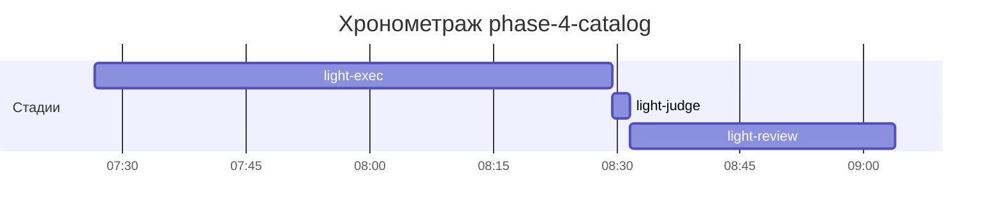

# Хронометраж: phase-4-catalog

Обновлено: 2026-09-26T09:03:48+05:00

## Стадии

| Стадия | Начало | Конец | Длит. | Ожидание | Чистое | Рестарты | Переделки |
|---|---|---|---|---|---|---|---|
| light-exec | 26.09 07:26 | 26.09 08:29 | 1ч 02м | — | 1ч 02м | — | — |
| light-judge | 26.09 08:29 | 26.09 08:31 | 2м 08с | — | 2м 08с | — | — |
| light-review | 26.09 08:31 | 26.09 09:03 | 32м 14с | — | 32м 14с | — | 21м 16с |
| **Итого (union)** | 26.09 07:26 | 26.09 09:03 | **1ч 37м** | **0с** | **1ч 37м** |  | **21м 16с** |

Wall-clock (первое→последнее событие журнала): **1ч 37м**; застаймлено (union стадий): 1ч 37м.

## События (fix-loop / повторные гейты / ошибки)

| Стадия | Тип | Событие | Начало | Длит. | Статус |
|---|---|---|---|---|---|
| light-review | fix-loop | fix-loop #1: HIGH numeric bounds + MEDIUM 1-3 + LOW | 26.09 08:35 | 21м 16с | ok |

## Инструменты (тайминги гейтов/чекеров)

| Время | Инструмент | Статус | Итого | Шаги (по убыванию) |
|---|---|---|---|---|
| 26.09 08:31 | e2e_evidence | PASS | 0с | status:passed 0s |
| 26.09 08:31 | review_bundle | PASS | 1с | api_conventions 0.1s · contract 0.1s · date_bound 0.1s · live_suite 0.1s · fixture_sync 0.1s · +4 шагов (0.1s) |
| 26.09 08:56 | e2e_evidence | PASS | 0с | status:passed 0s |
| 26.09 08:56 | review_bundle | PASS | 0с | api_conventions 0.1s · contract 0.1s · date_bound 0.1s · live_suite 0.1s · fixture_sync 0.1s · +4 шагов (0.0s) |
| 26.09 09:03 | e2e_evidence | PASS | 0с | status:passed 0s |

## ⚠ BLIND-GAP — интервалы без записей журнала (>5 мин)

Тяжёлый прогон обязан обрамляться `event-start`/`event-end` (§EE anti-polling):
без них нельзя отличить фоновый прогон от sleep-поллинга.

| Стадия | Начало | Конец | Длит. |
|---|---|---|---|
| light-review | 26.09 08:35 | 26.09 08:56 | 21м 16с |
| light-review | 26.09 08:56 | 26.09 09:03 | 6м 24с |

Суммарно вне наблюдения: **27м 40с** (2 интервал(ов)).

## Пайп-передачи (§3.6: бандлы, контракты)

| Время | Стадия | Вид | Артефакт | Размер | Детали |
|---|---|---|---|---|---|
| 26.09 08:31 | 8-code-review | bundle | 8-code-review/input-bundle.md | 4KB | чекеры 8✅/0❌/1⚠; патчи 221KB |
| 26.09 08:56 | 8-code-review | bundle | 8-code-review/input-bundle.md | 5KB | чекеры 8✅/0❌/1⚠; патчи 254KB |

Бандлов: 2, суммарно 9KB — весь документный контекст, переданный между стадиями.
Нарушений пайп-контракта не зафиксировано (context-violations.jsonl отсутствует).

## Ожидание пользователя

Пауз не было.

## Диаграмма

