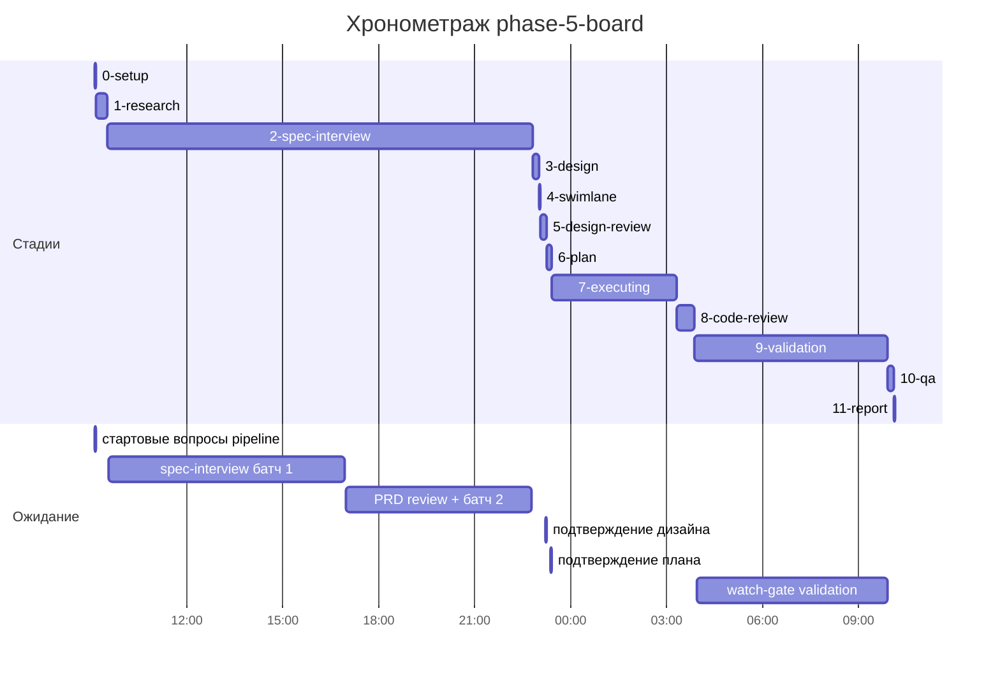

# Хронометраж: phase-5-board

Обновлено: 2026-09-27T10:07:50+05:00

## Стадии

| Стадия | Начало | Конец | Длит. | Ожидание | Чистое | Рестарты | Переделки |
|---|---|---|---|---|---|---|---|
| 0-setup | 26.09 09:06 | 26.09 09:09 | 2м 33с | 2м 26с | 7с | — | — |
| 1-research | 26.09 09:09 | 26.09 09:31 | 22м 15с | — | 22м 15с | — | — |
| 2-spec-interview | 26.09 09:31 | 26.09 22:48 | 13ч 16м | 13ч 12м | 4м 48с | — | — |
| 3-design | 26.09 22:48 | 26.09 23:00 | 12м 04с | — | 12м 04с | — | — |
| 4-swimlane | 26.09 23:00 | 26.09 23:02 | 2м 18с | — | 2м 18с | — | — |
| 5-design-review | 26.09 23:02 | 26.09 23:13 | 10м 54с | 2м | 8м 54с | — | 4м 57с |
| 6-plan | 26.09 23:13 | 26.09 23:22 | 8м 59с | 20с | 8м 39с | — | — |
| 7-executing | 26.09 23:22 | 27.09 03:17 | 3ч 54м | — | 3ч 54м | — | 1ч 41м |
| 8-code-review | 27.09 03:17 | 27.09 03:52 | 34м 41с | — | 34м 41с | — | 27м 38с |
| 9-validation | 27.09 03:52 | 27.09 09:54 | 6ч 02м | 5ч 57м | 4м 37с | — | — |
| 10-qa | 27.09 09:54 | 27.09 10:05 | 11м 07с | — | 11м 07с | — | — |
| 11-report | 27.09 10:05 | 27.09 10:07 | 2м 03с | — | 2м 03с | — | — |
| **Итого (union)** | 26.09 09:06 | 27.09 10:07 | **25ч 00м** | **19ч 14м** | **5ч 46м** |  | **2ч 14м** |

Wall-clock (первое→последнее событие журнала): **25ч 01м**; застаймлено (union стадий): 25ч 00м.

## События (fix-loop / повторные гейты / ошибки)

| Стадия | Тип | Событие | Начало | Длит. | Статус |
|---|---|---|---|---|---|
| 5-design-review | fix-loop | fix-loop #1: swimlane коды/поля + mobile M-01/M-02 | 26.09 23:06 | 4м 57с | ok |
| 7-executing | e2e-fail | board.spec 1/14: создание клиента в фикстуре → 400 | 27.09 01:33 | — | — |
| 7-executing | fix-loop | fix-loop #1 фаза 06: board.spec 13/14 red | 27.09 01:33 | 48м 22с | ok |
| 7-executing | other | сводный гейт: полный E2E #1 + integ + чекеры | 27.09 02:49 | 27м 54с | ok |
| 7-executing | e2e-fail | полный E2E #1: 86/87, AU-005 401 от фоновой догрузки клиентов board.js | 27.09 02:52 | — | — |
| 7-executing | fix-loop | fix-loop #2: AU-005 — фоновая пагинация клиентов в board.js | 27.09 02:52 | 25м 35с | ok |
| 8-code-review | fix-loop | fix-loop #1: HIGH last-non-final via PUT, MEDIUM rebalance/paid-vs-version/final+open subtasks, mobile M-01 | 27.09 03:23 | 27м 38с | ok |

## Инструменты (тайминги гейтов/чекеров)

| Время | Инструмент | Статус | Итого | Шаги (по убыванию) |
|---|---|---|---|---|
| 27.09 03:16 | e2e_evidence | PASS | 0с | status:passed 0s |
| 27.09 03:17 | review_bundle | PASS | 1с | go_naming 0.1s · api_conventions 0.1s · contract 0.1s · date_bound 0.1s · live_suite 0.1s · +4 шагов (0.1s) |
| 27.09 03:18 | review_bundle | PASS | 1с | go_naming 0.1s · api_conventions 0.1s · contract 0.1s · date_bound 0.1s · live_suite 0.1s · +4 шагов (0.1s) |
| 27.09 03:18 | review_bundle | PASS | 1с | go_naming 0.1s · api_conventions 0.1s · contract 0.1s · date_bound 0.1s · live_suite 0.1s · +4 шагов (0.1s) |
| 27.09 03:51 | review_bundle | PASS | 1с | go_naming 0.1s · api_conventions 0.1s · contract 0.1s · date_bound 0.1s · live_suite 0.1s · +4 шагов (0.1s) |
| 27.09 03:54 | e2e_evidence | PASS | 0с | status:passed 0s |

## ⚠ BLIND-GAP — интервалы без записей журнала (>5 мин)

Тяжёлый прогон обязан обрамляться `event-start`/`event-end` (§EE anti-polling):
без них нельзя отличить фоновый прогон от sleep-поллинга.

| Стадия | Начало | Конец | Длит. |
|---|---|---|---|
| 2-spec-interview | 26.09 09:33 | 26.09 16:55 | 7ч 22м |
| 9-validation | 27.09 03:57 | 27.09 09:54 | 5ч 57м |
| 2-spec-interview | 26.09 16:57 | 26.09 22:46 | 5ч 49м |
| 8-code-review | 27.09 03:23 | 27.09 03:51 | 27м 38с |
| 1-research | 26.09 09:09 | 26.09 09:31 | 22м 15с |
| 3-design | 26.09 22:48 | 26.09 23:00 | 12м 04с |
| 10-qa | 27.09 09:54 | 27.09 10:05 | 11м 07с |
| 6-plan | 26.09 23:13 | 26.09 23:22 | 8м 39с |
| 8-code-review | 27.09 03:18 | 27.09 03:23 | 5м 01с |

Суммарно вне наблюдения: **20ч 36м** (9 интервал(ов)).

## Пайп-передачи (§3.6: бандлы, контракты)

| Время | Стадия | Вид | Артефакт | Размер | Детали |
|---|---|---|---|---|---|
| 26.09 09:09 | 1-research | bundle | 1-research/input-bundle.md | 1KB | правил 1, MISSING 1; паспорт 1KB |
| 26.09 09:09 | 1-research | contract-emit | — | — | mode warn |
| 26.09 09:31 | 1-research | contract-clear | — | — | — |
| 26.09 09:31 | 2-spec-interview | bundle | 2-spec-interview/input-bundle.md | 12KB | правил 3, MISSING 2; паспорт 1KB |
| 26.09 09:31 | 2-spec-interview | contract-emit | — | — | mode warn |
| 26.09 22:48 | 2-spec-interview | contract-clear | — | — | — |
| 26.09 22:48 | 3-design | bundle | 3-design/input-bundle.md | 29KB | правил 3, MISSING 0; паспорт 2KB |
| 26.09 22:48 | 3-design | contract-emit | — | — | mode warn |
| 26.09 23:00 | 3-design | contract-clear | — | — | — |
| 26.09 23:00 | 4-swimlane | bundle | 4-swimlane/input-bundle.md | 31KB | правил 1, MISSING 0; паспорт 3KB |
| 26.09 23:00 | 4-swimlane | contract-emit | — | — | mode warn |
| 26.09 23:02 | 4-swimlane | contract-clear | — | — | — |
| 26.09 23:02 | 5-design-review | bundle | 5-design-review/input-bundle.md | 3KB | правил 3, MISSING 0; паспорт 3KB |
| 26.09 23:02 | 5-design-review | contract-emit | — | — | mode warn |
| 26.09 23:13 | 5-design-review | contract-clear | — | — | — |
| 26.09 23:13 | 6-plan | bundle | 6-plan/input-bundle.md | 5KB | правил 3, MISSING 1; паспорт 3KB |
| 26.09 23:13 | 6-plan | contract-emit | — | — | mode warn |
| 26.09 23:22 | 6-plan | contract-clear | — | — | — |
| 26.09 23:22 | 7-executing | phase-bundle | 6-plan/phase-bundles/phase-01-input.md | 61KB | фаза 01 (backend) |
| 26.09 23:22 | 7-executing | contract-emit | — | — | mode warn |
| 26.09 23:39 | 7-executing | phase-bundle | 6-plan/phase-bundles/phase-02-input.md | 60KB | фаза 02 (backend) |
| 26.09 23:58 | 7-executing | phase-bundle | 6-plan/phase-bundles/phase-03-input.md | 62KB | фаза 03 (backend) |
| 27.09 00:34 | 7-executing | phase-bundle | 6-plan/phase-bundles/phase-04-input.md | 60KB | фаза 04 (backend) |
| 27.09 00:53 | 7-executing | phase-bundle | 6-plan/phase-bundles/phase-05-input.md | 57KB | фаза 05 (backend) |
| 27.09 01:13 | 7-executing | phase-bundle | 6-plan/phase-bundles/phase-06-input.md | 37KB | фаза 06 (frontend) |
| 27.09 02:22 | 7-executing | phase-bundle | 6-plan/phase-bundles/phase-07-input.md | 33KB | фаза 07 (frontend) |
| 27.09 02:37 | 7-executing | phase-bundle | 6-plan/phase-bundles/phase-08-input.md | 33KB | фаза 08 (frontend) |
| 27.09 03:17 | 7-executing | contract-clear | — | — | — |
| 27.09 03:17 | 8-code-review | bundle | 8-code-review/input-bundle.md | 19KB | чекеры 9✅/0❌/0⚠; патчи 474KB |
| 27.09 03:18 | 8-code-review | bundle | 8-code-review/input-bundle.md | 20KB | чекеры 9✅/0❌/0⚠; патчи 473KB |
| 27.09 03:18 | 8-code-review | bundle | 8-code-review/input-bundle.md | 19KB | чекеры 9✅/0❌/0⚠; патчи 473KB |
| 27.09 03:51 | 8-code-review | bundle | 8-code-review/input-bundle.md | 19KB | чекеры 9✅/0❌/0⚠; патчи 489KB |
| 27.09 09:54 | 10-qa | bundle | 10-qa/input-bundle.md | 73KB | правил 10, MISSING 1; паспорт 3KB |
| 27.09 09:54 | 10-qa | contract-emit | — | — | mode warn |
| 27.09 10:05 | 10-qa | contract-clear | — | — | — |
| 27.09 10:05 | 11-report | bundle | 11-report/input-bundle.md | 24KB | правил 9, MISSING 0; паспорт 3KB |

Бандлов: 20, суммарно 669KB — весь документный контекст, переданный между стадиями.
Нарушения пайп-контракта (context-violations.jsonl): `4-swimlane`: 1, `5-design-review`: 1, `7-executing`: 5.

## Ожидание пользователя

| Стадия | Причина | Начало | Длит. |
|---|---|---|---|
| 0-setup | стартовые вопросы pipeline | 26.09 09:06 | 2м 26с |
| 2-spec-interview | spec-interview батч 1 | 26.09 09:33 | 7ч 22м |
| 2-spec-interview | PRD review + батч 2 | 26.09 16:57 | 5ч 49м |
| 5-design-review | подтверждение дизайна | 26.09 23:11 | 2м |
| 6-plan | подтверждение плана | 26.09 23:22 | 20с |
| 9-validation | watch-gate validation | 27.09 03:57 | 5ч 57м |

## Диаграмма

