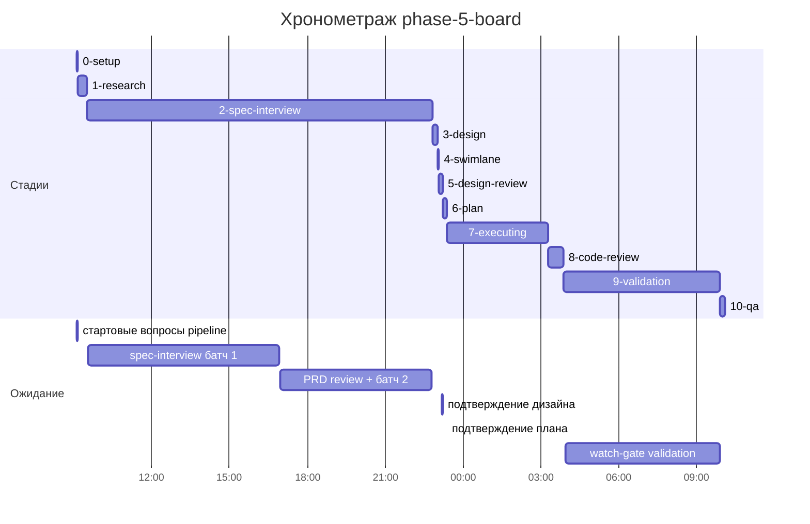

# Input Bundle: phase-5-board / стадия 11-report — generated 2026-09-27 10:05

> Твой ЕДИНСТВЕННЫЙ документный вход (пайп-контракт). Upstream-доки напрямую НЕ читать;
> точечный grep по конкретному ID (DS-NNN/AC-NNN/TS-NNN) — разрешён. Отсутствие нужного
> факта в бандле = сигнал оркестратору (дырка контракта), не повод читать всё.

## Источник: 1-research/output.md [verdict]
---
stage: 1-research
feature: phase-5-board
tier: M
---
# Research: Фаза 5 — Доска заказов

## Источник: 2-spec-interview/output.md [verdict]
---
stage: 2-spec-interview
feature: phase-5-board
tier: M
---
# Spec: Доска заказов и «Остатки» (фаза 5)

## Источник: 3-design/output.md [verdict]
---
stage: 3-design
feature: phase-5-board
tier: M
---
# Design: phase-5-board — доска заказов и «Остатки»

## Источник: 5-design-review/output.md [verdict]
---
stage: 5-design-review
feature: phase-5-board
tier: M
verdict: APPROVED
high: 0
medium: 0
low: 1
---
# Design Review: phase-5-board — APPROVED

## Источник: 8-code-review/output.md [verdict]
---
stage: 8-code-review
feature: phase-5-board
tier: M
verdict: APPROVED
high: 0
medium: 0
low: 2
---
# Code Review: phase-5-board — APPROVED

## Источник: 9-validation/output.md [verdict]
---
stage: 9-validation
feature: phase-5-board
tier: M
---
# Validation: phase-5-board — PASS

## Источник: 10-qa/output.md [verdict]
---
stage: 10-qa
feature: phase-5-board
tier: M
verdict: APPROVED
high: 0
medium: 0
low: 1
---
# QA: phase-5-board — APPROVED

## Источник: 0-setup/timeline.md [full]
# Хронометраж: phase-5-board

Обновлено: 2026-09-27T10:05:47+05:00

## Стадии

| Стадия | Начало | Конец | Длит. | Ожидание | Чистое | Рестарты | Переделки |
|---|---|---|---|---|---|---|---|
| 0-setup | 26.09 09:06 | 26.09 09:09 | 2м 33с | 2м 26с | 7с | — | — |
| 1-research | 26.09 09:09 | 26.09 09:31 | 22м 15с | — | 22м 15с | — | — |
| 2-spec-interview | 26.09 09:31 | 26.09 22:48 | 13ч 16м | 13ч 12м | 4м 48с | — | — |
| 3-design | 26.09 22:48 | 26.09 23:00 | 12м 04с | — | 12м 04с | — | — |
| 4-swimlane | 26.09 23:00 | 26.09 23:02 | 2м 18с | — | 2м 18с | — | — |
| 5-design-review | 26.09 23:02 | 26.09 23:13 | 10м 54с | 2м | 8м 54с | — | 4м 57с |
| 6-plan | 26.09 23:13 | 26.09 23:22 | 8м 59с | 20с | 8м 39с | — | — |
| 7-executing | 26.09 23:22 | 27.09 03:17 | 3ч 54м | — | 3ч 54м | — | 1ч 41м |
| 8-code-review | 27.09 03:17 | 27.09 03:52 | 34м 41с | — | 34м 41с | — | 27м 38с |
| 9-validation | 27.09 03:52 | 27.09 09:54 | 6ч 02м | 5ч 57м | 4м 37с | — | — |
| 10-qa | 27.09 09:54 | 27.09 10:05 | 11м 07с | — | 11м 07с | — | — |
| **Итого (union)** | 26.09 09:06 | 27.09 10:05 | **24ч 58м** | **19ч 14м** | **5ч 44м** |  | **2ч 14м** |

Wall-clock (первое→последнее событие журнала): **24ч 58м**; застаймлено (union стадий): 24ч 58м.

## События (fix-loop / повторные гейты / ошибки)

| Стадия | Тип | Событие | Начало | Длит. | Статус |
|---|---|---|---|---|---|
| 5-design-review | fix-loop | fix-loop #1: swimlane коды/поля + mobile M-01/M-02 | 26.09 23:06 | 4м 57с | ok |
| 7-executing | e2e-fail | board.spec 1/14: создание клиента в фикстуре → 400 | 27.09 01:33 | — | — |
| 7-executing | fix-loop | fix-loop #1 фаза 06: board.spec 13/14 red | 27.09 01:33 | 48м 22с | ok |
| 7-executing | other | сводный гейт: полный E2E #1 + integ + чекеры | 27.09 02:49 | 27м 54с | ok |
| 7-executing | e2e-fail | полный E2E #1: 86/87, AU-005 401 от фоновой догрузки клиентов board.js | 27.09 02:52 | — | — |
| 7-executing | fix-loop | fix-loop #2: AU-005 — фоновая пагинация клиентов в board.js | 27.09 02:52 | 25м 35с | ok |
| 8-code-review | fix-loop | fix-loop #1: HIGH last-non-final via PUT, MEDIUM rebalance/paid-vs-version/final+open subtasks, mobile M-01 | 27.09 03:23 | 27м 38с | ok |

## Инструменты (тайминги гейтов/чекеров)

| Время | Инструмент | Статус | Итого | Шаги (по убыванию) |
|---|---|---|---|---|
| 27.09 03:16 | e2e_evidence | PASS | 0с | status:passed 0s |
| 27.09 03:17 | review_bundle | PASS | 1с | go_naming 0.1s · api_conventions 0.1s · contract 0.1s · date_bound 0.1s · live_suite 0.1s · +4 шагов (0.1s) |
| 27.09 03:18 | review_bundle | PASS | 1с | go_naming 0.1s · api_conventions 0.1s · contract 0.1s · date_bound 0.1s · live_suite 0.1s · +4 шагов (0.1s) |
| 27.09 03:18 | review_bundle | PASS | 1с | go_naming 0.1s · api_conventions 0.1s · contract 0.1s · date_bound 0.1s · live_suite 0.1s · +4 шагов (0.1s) |
| 27.09 03:51 | review_bundle | PASS | 1с | go_naming 0.1s · api_conventions 0.1s · contract 0.1s · date_bound 0.1s · live_suite 0.1s · +4 шагов (0.1s) |
| 27.09 03:54 | e2e_evidence | PASS | 0с | status:passed 0s |

## ⚠ BLIND-GAP — интервалы без записей журнала (>5 мин)

Тяжёлый прогон обязан обрамляться `event-start`/`event-end` (§EE anti-polling):
без них нельзя отличить фоновый прогон от sleep-поллинга.

| Стадия | Начало | Конец | Длит. |
|---|---|---|---|
| 2-spec-interview | 26.09 09:33 | 26.09 16:55 | 7ч 22м |
| 9-validation | 27.09 03:57 | 27.09 09:54 | 5ч 57м |
| 2-spec-interview | 26.09 16:57 | 26.09 22:46 | 5ч 49м |
| 8-code-review | 27.09 03:23 | 27.09 03:51 | 27м 38с |
| 1-research | 26.09 09:09 | 26.09 09:31 | 22м 15с |
| 3-design | 26.09 22:48 | 26.09 23:00 | 12м 04с |
| 10-qa | 27.09 09:54 | 27.09 10:05 | 11м 07с |
| 6-plan | 26.09 23:13 | 26.09 23:22 | 8м 39с |
| 8-code-review | 27.09 03:18 | 27.09 03:23 | 5м 01с |

Суммарно вне наблюдения: **20ч 36м** (9 интервал(ов)).

## Пайп-передачи (§3.6: бандлы, контракты)

| Время | Стадия | Вид | Артефакт | Размер | Детали |
|---|---|---|---|---|---|
| 26.09 09:09 | 1-research | bundle | 1-research/input-bundle.md | 1KB | правил 1, MISSING 1; паспорт 1KB |
| 26.09 09:09 | 1-research | contract-emit | — | — | mode warn |
| 26.09 09:31 | 1-research | contract-clear | — | — | — |
| 26.09 09:31 | 2-spec-interview | bundle | 2-spec-interview/input-bundle.md | 12KB | правил 3, MISSING 2; паспорт 1KB |
| 26.09 09:31 | 2-spec-interview | contract-emit | — | — | mode warn |
| 26.09 22:48 | 2-spec-interview | contract-clear | — | — | — |
| 26.09 22:48 | 3-design | bundle | 3-design/input-bundle.md | 29KB | правил 3, MISSING 0; паспорт 2KB |
| 26.09 22:48 | 3-design | contract-emit | — | — | mode warn |
| 26.09 23:00 | 3-design | contract-clear | — | — | — |
| 26.09 23:00 | 4-swimlane | bundle | 4-swimlane/input-bundle.md | 31KB | правил 1, MISSING 0; паспорт 3KB |
| 26.09 23:00 | 4-swimlane | contract-emit | — | — | mode warn |
| 26.09 23:02 | 4-swimlane | contract-clear | — | — | — |
| 26.09 23:02 | 5-design-review | bundle | 5-design-review/input-bundle.md | 3KB | правил 3, MISSING 0; паспорт 3KB |
| 26.09 23:02 | 5-design-review | contract-emit | — | — | mode warn |
| 26.09 23:13 | 5-design-review | contract-clear | — | — | — |
| 26.09 23:13 | 6-plan | bundle | 6-plan/input-bundle.md | 5KB | правил 3, MISSING 1; паспорт 3KB |
| 26.09 23:13 | 6-plan | contract-emit | — | — | mode warn |
| 26.09 23:22 | 6-plan | contract-clear | — | — | — |
| 26.09 23:22 | 7-executing | phase-bundle | 6-plan/phase-bundles/phase-01-input.md | 61KB | фаза 01 (backend) |
| 26.09 23:22 | 7-executing | contract-emit | — | — | mode warn |
| 26.09 23:39 | 7-executing | phase-bundle | 6-plan/phase-bundles/phase-02-input.md | 60KB | фаза 02 (backend) |
| 26.09 23:58 | 7-executing | phase-bundle | 6-plan/phase-bundles/phase-03-input.md | 62KB | фаза 03 (backend) |
| 27.09 00:34 | 7-executing | phase-bundle | 6-plan/phase-bundles/phase-04-input.md | 60KB | фаза 04 (backend) |
| 27.09 00:53 | 7-executing | phase-bundle | 6-plan/phase-bundles/phase-05-input.md | 57KB | фаза 05 (backend) |
| 27.09 01:13 | 7-executing | phase-bundle | 6-plan/phase-bundles/phase-06-input.md | 37KB | фаза 06 (frontend) |
| 27.09 02:22 | 7-executing | phase-bundle | 6-plan/phase-bundles/phase-07-input.md | 33KB | фаза 07 (frontend) |
| 27.09 02:37 | 7-executing | phase-bundle | 6-plan/phase-bundles/phase-08-input.md | 33KB | фаза 08 (frontend) |
| 27.09 03:17 | 7-executing | contract-clear | — | — | — |
| 27.09 03:17 | 8-code-review | bundle | 8-code-review/input-bundle.md | 19KB | чекеры 9✅/0❌/0⚠; патчи 474KB |
| 27.09 03:18 | 8-code-review | bundle | 8-code-review/input-bundle.md | 20KB | чекеры 9✅/0❌/0⚠; патчи 473KB |
| 27.09 03:18 | 8-code-review | bundle | 8-code-review/input-bundle.md | 19KB | чекеры 9✅/0❌/0⚠; патчи 473KB |
| 27.09 03:51 | 8-code-review | bundle | 8-code-review/input-bundle.md | 19KB | чекеры 9✅/0❌/0⚠; патчи 489KB |
| 27.09 09:54 | 10-qa | bundle | 10-qa/input-bundle.md | 73KB | правил 10, MISSING 1; паспорт 3KB |
| 27.09 09:54 | 10-qa | contract-emit | — | — | mode warn |
| 27.09 10:05 | 10-qa | contract-clear | — | — | — |

Бандлов: 19, суммарно 645KB — весь документный контекст, переданный между стадиями.
Нарушения пайп-контракта (context-violations.jsonl): `4-swimlane`: 1, `5-design-review`: 1, `7-executing`: 5.

## Ожидание пользователя

| Стадия | Причина | Начало | Длит. |
|---|---|---|---|
| 0-setup | стартовые вопросы pipeline | 26.09 09:06 | 2м 26с |
| 2-spec-interview | spec-interview батч 1 | 26.09 09:33 | 7ч 22м |
| 2-spec-interview | PRD review + батч 2 | 26.09 16:57 | 5ч 49м |
| 5-design-review | подтверждение дизайна | 26.09 23:11 | 2м |
| 6-plan | подтверждение плана | 26.09 23:22 | 20с |
| 9-validation | watch-gate validation | 27.09 03:57 | 5ч 57м |

## Диаграмма

## Источник: 6-plan/code-plan-status.md [head]
# Code Plan Status: phase-5-board
**Последнее обновление:** 2026-09-27T09:05:00+00:00

## Code Review fix-loop (итерация 2) — 2026-09-27T09:05:00Z
Регрессия BD-006 (`board.spec.ts:238`, кнопка «Удалить» колонки оставалась enabled для непустой колонки). Корень — НЕ правка `lastKnownTasks` (итерация 1): клиентский гард `openColumnForm` в `web/ssr/_shared/js/board.js` считал «есть заказы в колонке» сканированием `state.tasks` — списка доски, обрезанного `limit=500` И активными фильтрами. На выросшем от многократных E2E-прогонов стенде общий список заказов уже перевалил за 500 строк, а свежесозданная колонка BD-006 (`position` в конце, `ORDER BY c.position, c.id, t.position, t.id`) сортировалась ПОСЛЕ обрезки — её единственный заказ физически существовал, но не попадал в загруженные 500 строк, поэтому `hasTasks` ложно давал `false`. Подтверждено инструментально (временный `console.log` в браузере под тестом): `count(state.tasks) === 500` ровно на пороге лимита, `hasTasks=false` для колонки с реальным заказом в БД.
Фикс: `hasTasks` теперь `col.tasks_count > 0 || state.tasks.some(...)` — `tasks_count` из `GET /api/v1/columns` (`columns_repo.go`, точный `COUNT(*)` без `limit`/фильтров) как основной источник, `state.tasks` — подстраховка на случай локального оптимистичного переноса в этой же сессии до следующего reload (когда `tasks_count` ещё не обновился, а `state.tasks` уже отражает перенос). Итог: гард не может ошибочно разрешить удаление непустой колонки ни при большом стенде, ни при активных фильтрах доски, ни сразу после локального move.
Гонял диагностику через временный `page.on('console')` в `board.spec.ts` — снят перед коммитом, тест-файл не хуже до этого (единственная правка спека — BD-011 от координатора, не тронута).
E2E `tests/board.spec.ts tests/board-guards.spec.ts tests/stock.spec.ts tests/auth.spec.ts` (chromium, headed, workers=1) — 31/31 дважды подряд, без флейков.

## Code Review fix-loop (итерация 1) — 2026-09-27T08:20:00Z
HIGH-1 (`columns_service.go` Update: инвариант «≥1 нефинальная колонка» обходился через PUT is_final=true) — исправлен, гард под тем же `LockAll`, live-тест `TestBoardLiveSuite_Update_LastNonFinal_Rejected`.
MEDIUM-1 (`position.go`: `scale(pos) > 20` недостижим — PG режет scale деления до 16) — гард переписан на `pos <= prev_pos OR pos >= next_pos OR scale(pos) >= 16`; LV-064 поднят до 70 вставок.
MEDIUM-2 (`tasks_service.go` Update: paid-гард проверялся раньше version-конфликта, executor получал ложный 403 вместо 409) — version-конфликт теперь ДО paid-гарда; live-тест `TestBoardLiveSuite_Update_StaleVersion_PaidChanged_VersionConflictWins`.
MEDIUM-3 (эскалация design: PUT is_final=true на непустой колонке с открытыми услугами проходил) — добавлен `SUBTASKS_NOT_DONE` с `details.subtasks`, новый repo-метод `ColumnRepo.OpenSubtasksForColumn`; live-тест `TestBoardLiveSuite_Update_ToFinal_ColumnHasOpenSubtasks`. Побочный эффект: пришлось доснарядить существующий `TestBoardLiveSuite_DeleteColumn_LastNonFinal` — очисткой чужих открытых подзадач перед переключением колонок в финальные (общий стенд без TRUNCATE между тестами).
Mobile M-01 (`/columns`, `/assignees` тихо клэмпили мусорный limit/offset вместо 400) — унифицировано с `tasks_filter.go`/`stock_handler.go`; live-тест `TestBoardLiveSuite_ColumnsAssignees_InvalidLimitOffset400`.
LOW: `stock_repo.go` комментарий про экранирование `q` приведён к правде; `seeddemo.go` guard `count(tasks)=0` перенесён в ту же транзакцию под `pg_advisory_xact_lock`; `board.js` — `state.lastKnownTasks` снимается непосредственно перед своей оптимистичной правкой move и сбрасывается на успехе (не в `dragstart`), чтобы два быстрых move не затирали снапшот друг друга. NavBadges на каждом SSR-рендере — оставлено as-is (MVP), known-issue.
Гейт: `make build` / `go test ./... -race -count=1` / `make lint` — зелёные; `BASE=be769e5 make test-integration-scoped` — расширился до FULL (миграция 0005 в diff, детектор `go_affected_pkgs.py`) — все пакеты зелёные.

| # | Фаза | Файл | Статус | Обновлено | Примечание |
|---|------|------|--------|-----------|------------|
| 1 | Foundation (миграция 0005, numeric, errorspkg, D26/SERVICE_IN_USE) | [phase-01](code-plan-phase-01-foundation.md) | completed | 2026-09-26T23:55:00Z | — |
| 2 | Board: колонки + StockEngine | [phase-02](code-plan-phase-02-board-columns-stock-engine.md) | completed | 2026-09-27T00:40:00Z | withTx-ретрай не покрыт искусственной гонкой в этой фазе — gap для фазы 03 LV-062 |
| 3 | Board: заказы + move + live-сьюта | [phase-03](code-plan-phase-03-board-tasks-move.md) | completed | 2026-09-27T01:10:00Z | TaskService — интерфейс (не concrete struct как ColumnService) ради FuzzMoveBody без БД; см. отчёт |
| 4 | Stock API + бейдж + DI (роутер, удаление home) | [phase-04](code-plan-phase-04-stock-api-badge-di.md) | completed | 2026-09-27T02:05:00Z | SH-001 (e2e/tests/shell.spec.ts) устарел после снятия home/добавления «Остатков» в меню — см. отчёт фазы |
| 5 | make seed-demo | [phase-05](code-plan-phase-05-seed-demo.md) | completed | 2026-09-27T02:45:00Z | — |
| 6 | UI доски + E2E доски | [phase-06](code-plan-phase-06-ui-board.md) | completed | 2026-09-27T05:10:00Z | Fix-loop итерация 2: регрессия SH-020/022 (`js/combobox.js` закрывал открытый комбобокс по scroll-докрутке к частично видимой кнопке на длинных страницах) исправлена в продуктовом JS; `npx playwright test tests/shell.spec.ts tests/board.spec.ts` — 25/25, 2 прогона подряд без флейков. Fix-loop итерация 3 (поздняя находка сводного гейта Executing, BD-021): `board.js` больше не догружает ВСЕХ клиентов постранично (до 25 фоновых GET) — только первая страница (limit=200) + серверный поиск по вводу через новый `sel._cbFetchOptions` в `combobox.js` (debounce 250мс, ensureOption добавляет найденную опцию в select) + `ensureClientOption()` для фильтра, не только формы заказа. Корень самого падения AU-005 — НЕ гонка клика с логаутом (проверено таймингами через временный debug-спек: обычный клик «Выйти» успевал раньше ответов доски), а браузерный HTTP-кэш/bfcache: `GET /` без `Cache-Control` мог отдаться из кэша при `page.goBack()` уже ПОСЛЕ logout, стухшая страница выполняла свой JS и слала фоновые GET на `/api/v1/...` с уже недействительной сессией → 401-шум. Фикс — `Cache-Control: no-store, must-revalidate` на каждом ответе `middleware.Auth.RequireSSR()` (`internal/server/middleware/auth.go`) — «Назад»/bfcache-восстановление доски после logout больше не отдаётся из кэша, всегда идёт через guard заново. `make build/lint/test` — зелёные; JS-часть фикса (`api.js`/`board.js`/`combobox.js`) подтверждена `npx playwright test tests/auth.spec.ts tests/board.spec.ts tests/board-guards.spec.ts tests/stock.spec.ts tests/shell.spec.ts` — 41/42 (только AU-005 всё ещё падал на серверной части фикса, т.к. работал СТАРЫЙ бинарь); Go-часть (`auth.go`) правки в бинарь ещё не попала — **нужен рестарт сервера**, после чего повторный прогон `tests/auth.spec.ts` дважды подряд — обязателен перед закрытием фазы. |
| 7 | UI «Остатки» + E2E | [phase-07](code-plan-phase-07-ui-stock.md) | completed | 2026-09-27T05:45:00Z | Заполнен стаб stock.html + новый stock.js (KPI/таблица/правка admin); попутно почини́л упавший из-за этого regression-тест `TestRenderer_PageInSharedLayout` (ассерт на снятый `stock-placeholder`); `npx playwright test tests/stock.spec.ts tests/board.spec.ts` — 16/16, 2 прогона подряд без флейков |
| 8 | D26 E2E-гарды + полировка 360px/тёмная тема | [phase-08](code-plan-phase-08-guards-polish.md) | completed | 2026-09-27T06:45:00Z | Фикс SSR-гарда `clients/ssr.go` (`remove`/`eqRemove` возвращали голый JSON на 409 вместо PRG-flash — эталон productRemove/serviceRemove); board-guards.spec.ts (BD-017/018/019a/019b) + BD-020 в board.spec.ts — 50/50, 2 прогона подряд; вёрстка 360px/тёмной темы правок не потребовала (адаптив фаз 6-7 уже покрывал); `BASE=be769e5 make test-integration-scoped` — FULL (миграция 0005) — зелёный |

## Легенда статусов
- `pending` — не начата
- `in_progress` — выполняется сейчас (в таблице ровно одна фаза с этим статусом)
- `completed` — завершена, все Definition of Done выполнены
- `blocked` — заблокирована (указать причину в «Примечание»)

## Паспорт (выжимка)
# Passport: phase-5-board (generated — руками не править; stage_bundle.py)
**Tier:** M | **Совместимость:** ? (pipeline-doctrine.md §CM-1; ? → уточни у оркестратора)
**Трек:** обычный (prefs нет — дефолт) — режимы агентов (`spec-track delta/micro/mini/merged`) включает ТОЛЬКО строка `Режим:` в prompt оркестратора; DS/TS-индексы ниже присутствуют на ЛЮБОМ треке при наличии draft-spec.
**Layout:** автодетект (tools/layout_resolve.py)
**UI-scope (pipeline-doctrine.md §US-1, 0-setup/ui-scope-prefs.md):** swagger:no | adaptive:min | themes:both

**Индексы:** AC 20 / DS 0 / TS 0 — полные списки: `0-setup/passport.md` (разрешён контрактом); конкретное решение — точечный grep по `DS-NNN`/`TS-NNN` в draft-spec §9/§11 (разрешён).
