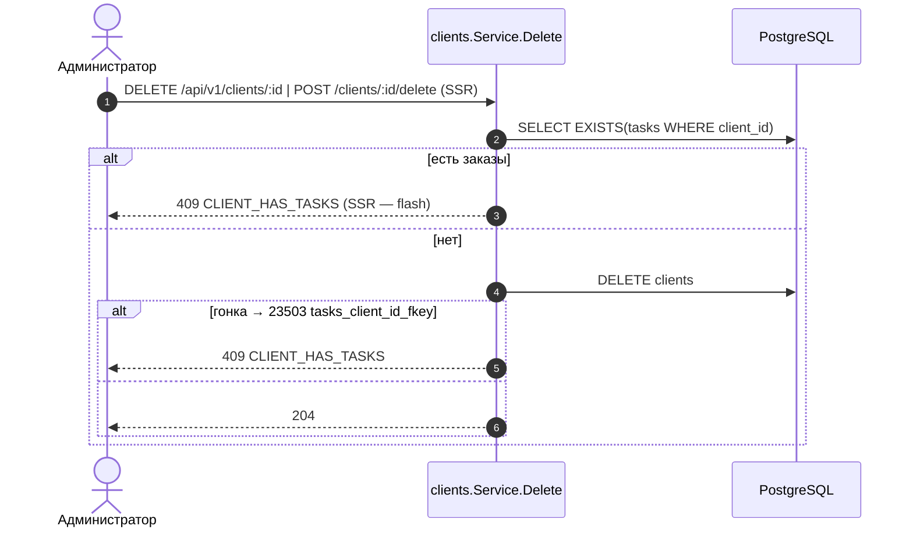
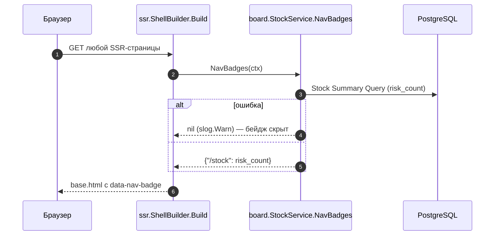

# Design Sequence Diagrams: phase-5-board

> Только новые потоки с побочными эффектами (склад/журнал/блокировки). Линейный CRUD (GET колонок/заказов/остатков, POST колонки без флагов) не рисуется. Фазы: Request → Validation → Business logic → Persistence → Response (+Notify UI).

## Move Task
AC-002, AC-003, AC-004, AC-005; ADR-001, ADR-104, ADR-006.
```mermaid
sequenceDiagram
    autonumber
    actor U as Пользователь
    participant JS as board.js
    participant H as TaskHandler.Move
    participant S as TaskService
    participant R as TaskRepo / StockEngine
    participant DB as PostgreSQL
    U->>JS: drop карточки (DnD) / меню «Переместить в…»
    JS->>JS: оптимистично переставить DOM, вычислить prev_id/next_id
    JS->>H: POST /api/v1/tasks/:id/move {column_id, prev_id, next_id}
    H->>H: ParseInt(id), Bind (strictJSON) → 400/404
    H->>S: Move(actor, id, req)
    S->>DB: BEGIN
    S->>R: LockTargetColumn FOR SHARE
    R->>DB: SELECT columns ... FOR SHARE
    alt колонки нет
        S-->>H: 400 VALIDATION column_id
    end
    S->>R: LockTask FOR UPDATE
    alt target.is_final и открытые услуги
        R->>DB: SELECT subtasks status<>'done'
        S->>DB: ROLLBACK
        S-->>H: 409 SUBTASKS_NOT_DONE details.subtasks[]
        H-->>JS: 409
        JS->>JS: откат карточки + ui-dialog со списком услуг
    else разрешено
        S->>R: NextPosition (prev/next, ребалансировка при scale>20)
        S->>R: UPDATE tasks (column_id, position, version+1)
        S->>R: Reconcile(task, target.consumes_stock, actor.ID)
        R->>DB: дельты demand vs task_stock
        R->>DB: SELECT products ORDER BY id FOR UPDATE
        R->>DB: UPDATE products.stock; upsert/DELETE task_stock; INSERT stock_movements
        R->>DB: SELECT warnings (stock<=min_stock)
        S->>DB: COMMIT (40P01/40001 → retry ×3)
        S-->>H: {task, warnings}
        H-->>JS: 200
        JS->>JS: обновить version карточки; warnings → toast + ссылка /stock
        JS->>H: GET /api/v1/stock/summary (KT.refreshNavBadge)
    end
```

## Update Task Form
AC-009, AC-010, AC-011. Отличия от move: `version`, проверка `is_paid`, позиция — в конец новой колонки.
```mermaid
sequenceDiagram
    autonumber
    participant JS as board.js (форма)
    participant S as TaskService.Update
    participant DB as PostgreSQL
    JS->>S: PUT /api/v1/tasks/:id {title, client_id, column_id, assignee_id, due_date, is_paid, version}
    S->>S: validate → 400 details.fields[]
    S->>DB: BEGIN; columns FOR SHARE; tasks FOR UPDATE
    alt executor и is_paid ≠ текущему
        S-->>JS: 403 PAID_ADMIN_ONLY
    else column_id сменилась в is_final и есть открытые услуги
        S-->>JS: 409 SUBTASKS_NOT_DONE
    else UPDATE ... WHERE version=$v → 0 строк
        S-->>JS: 409 TASK_VERSION_CONFLICT → «Заказ уже изменён, обновите»
    else ok
        S->>DB: Reconcile (если column_id сменилась); COMMIT
        S-->>JS: 200 {task, warnings}
    end
```

## Column Consumes Toggle
AC-007, AC-006; ADR-104.
```mermaid
sequenceDiagram
    autonumber
    actor A as Администратор
    participant S as ColumnService.Update
    participant E as StockEngine
    participant DB as PostgreSQL
    A->>S: PUT /api/v1/columns/:id {name, color, is_final, consumes_stock, position}
    S->>DB: BEGIN; SELECT columns ORDER BY id FOR UPDATE (вся таблица)
    alt после изменения нет нефинальных
        S-->>A: 409 LAST_NON_FINAL_COLUMN
    end
    S->>DB: UPDATE columns; Renumber (если position)
    opt consumes_stock изменился
        S->>DB: SELECT tasks WHERE column_id FOR UPDATE ORDER BY id
        loop каждый заказ колонки
            S->>E: Reconcile(task, new consumes_stock)
        end
        Note over S: span columns.recalc (column_id, tasks_count)
    end
    S->>DB: COMMIT
    S-->>A: 200 {column, warnings (объединение по product_id)}
```

## Delete Task
AC-012.
```mermaid
sequenceDiagram
    autonumber
    actor A as Администратор
    participant S as TaskService.Delete
    participant E as StockEngine
    participant DB as PostgreSQL
    A->>S: DELETE /api/v1/tasks/:id (после ui-dialog confirm)
    Note over S: executor → 403 (RequireAdmin)
    S->>DB: BEGIN; tasks FOR UPDATE
    S->>E: Reconcile(task, consumes=false) → task_return в журнал
    S->>DB: DELETE tasks (CASCADE subtasks/.../task_stock; stock_movements.task_id → NULL)
    S->>DB: COMMIT
    S-->>A: 200 {warnings}
```

## Delete Client Guard
AC-017 (аналогично оборудование — AC-018); ADR-005.


## Nav Badge Render
AC-016; ADR-004.

