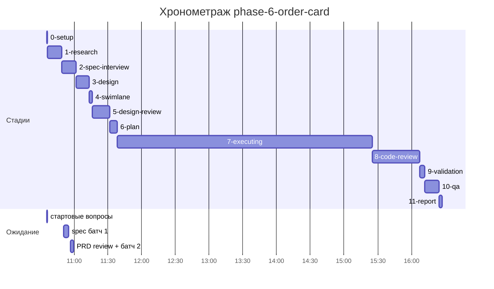

# Хронометраж: phase-6-order-card

Обновлено: 2026-09-27T16:27:22+05:00

## Стадии

| Стадия | Начало | Конец | Длит. | Ожидание | Чистое | Рестарты | Переделки |
|---|---|---|---|---|---|---|---|
| 0-setup | 27.09 10:35 | 27.09 10:36 | 44с | 44с | 0с | — | — |
| 1-research | 27.09 10:36 | 27.09 10:49 | 12м 32с | — | 12м 32с | — | — |
| 2-spec-interview | 27.09 10:49 | 27.09 11:01 | 12м 52с | 7м 30с | 5м 22с | — | — |
| 3-design | 27.09 11:01 | 27.09 11:13 | 11м 48с | — | 11м 48с | — | — |
| 4-swimlane | 27.09 11:13 | 27.09 11:16 | 2м 45с | — | 2м 45с | — | — |
| 5-design-review | 27.09 11:16 | 27.09 11:31 | 15м 25с | — | 15м 25с | — | 6м 32с |
| 6-plan | 27.09 11:31 | 27.09 11:38 | 6м 38с | — | 6м 38с | — | — |
| 7-executing | 27.09 11:38 | 27.09 15:25 | 3ч 46м | — | 3ч 46м | — | 20м 09с |
| 8-code-review | 27.09 15:25 | 27.09 16:07 | 42м 20с | — | 42м 20с | — | 28м 59с |
| 9-validation | 27.09 16:07 | 27.09 16:11 | 4м 20с | — | 4м 20с | — | — |
| 10-qa | 27.09 16:11 | 27.09 16:24 | 13м 02с | — | 13м 02с | — | — |
| 11-report | 27.09 16:24 | 27.09 16:27 | 2м 38с | — | 2м 38с | — | — |
| **Итого (union)** | 27.09 10:35 | 27.09 16:27 | **5ч 51м** | **8м 14с** | **5ч 43м** |  | **55м 40с** |

Wall-clock (первое→последнее событие журнала): **5ч 51м**; застаймлено (union стадий): 5ч 51м.

## События (fix-loop / повторные гейты / ошибки)

| Стадия | Тип | Событие | Начало | Длит. | Статус |
|---|---|---|---|---|---|
| 5-design-review | fix-loop | fix-loop #1: swimlane DTO + mobile H-01 self-race + backfill position | 27.09 11:25 | 6м 32с | ok |
| 7-executing | e2e-fail | полный E2E #1: 104/110, catalog/users — изоляция от объёма dev-БД | 27.09 15:04 | — | — |
| 7-executing | fix-loop | fix-loop: изоляция catalog/users E2E | 27.09 15:04 | 20м 09с | ok |
| 8-code-review | fix-loop | fix-loop #1: спаны, generation/order в task-card.js, шапка, коды 404 | 27.09 15:30 | 28м 59с | ok |

## Инструменты (тайминги гейтов/чекеров)

| Время | Инструмент | Статус | Итого | Шаги (по убыванию) |
|---|---|---|---|---|
| 27.09 15:23 | e2e_evidence | PASS | 0с | status:passed 0s |
| 27.09 15:25 | review_bundle | PASS | 1с | go_naming 0.1s · api_conventions 0.1s · contract 0.1s · date_bound 0.1s · live_suite 0.1s · +4 шагов (0.1s) |
| 27.09 15:59 | review_bundle | PASS | 0с | date_bound 0.1s · live_suite 0.1s · fixture_sync 0.1s · go_naming 0.0s · api_conventions 0.0s · +4 шагов (0.0s) |
| 27.09 16:11 | e2e_evidence | PASS | 0с | status:passed 0s |

## ⚠ BLIND-GAP — интервалы без записей журнала (>5 мин)

Тяжёлый прогон обязан обрамляться `event-start`/`event-end` (§EE anti-polling):
без них нельзя отличить фоновый прогон от sleep-поллинга.

| Стадия | Начало | Конец | Длит. |
|---|---|---|---|
| 8-code-review | 27.09 15:30 | 27.09 15:59 | 28м 59с |
| 10-qa | 27.09 16:11 | 27.09 16:24 | 13м 02с |
| 1-research | 27.09 10:36 | 27.09 10:49 | 12м 32с |
| 3-design | 27.09 11:01 | 27.09 11:13 | 11м 48с |
| 5-design-review | 27.09 11:16 | 27.09 11:25 | 8м 52с |
| 8-code-review | 27.09 15:59 | 27.09 16:07 | 8м 03с |
| 6-plan | 27.09 11:31 | 27.09 11:38 | 6м 38с |
| 5-design-review | 27.09 11:25 | 27.09 11:31 | 6м 32с |
| 8-code-review | 27.09 15:25 | 27.09 15:30 | 5м 16с |

Суммарно вне наблюдения: **1ч 41м** (9 интервал(ов)).

## Пайп-передачи (§3.6: бандлы, контракты)

| Время | Стадия | Вид | Артефакт | Размер | Детали |
|---|---|---|---|---|---|
| 27.09 10:36 | 1-research | bundle | 1-research/input-bundle.md | 1KB | правил 1, MISSING 1; паспорт 1KB |
| 27.09 10:36 | 1-research | contract-emit | — | — | mode warn |
| 27.09 10:49 | 1-research | contract-clear | — | — | — |
| 27.09 10:49 | 2-spec-interview | bundle | 2-spec-interview/input-bundle.md | 9KB | правил 3, MISSING 2; паспорт 1KB |
| 27.09 10:49 | 2-spec-interview | contract-emit | — | — | mode warn |
| 27.09 11:01 | 2-spec-interview | contract-clear | — | — | — |
| 27.09 11:01 | 3-design | bundle | 3-design/input-bundle.md | 31KB | правил 3, MISSING 0; паспорт 2KB |
| 27.09 11:01 | 3-design | contract-emit | — | — | mode warn |
| 27.09 11:13 | 3-design | contract-clear | — | — | — |
| 27.09 11:13 | 4-swimlane | bundle | 4-swimlane/input-bundle.md | 31KB | правил 1, MISSING 0; паспорт 2KB |
| 27.09 11:13 | 4-swimlane | contract-emit | — | — | mode warn |
| 27.09 11:16 | 4-swimlane | contract-clear | — | — | — |
| 27.09 11:16 | 5-design-review | bundle | 5-design-review/input-bundle.md | 3KB | правил 3, MISSING 0; паспорт 2KB |
| 27.09 11:16 | 5-design-review | contract-emit | — | — | mode warn |
| 27.09 11:31 | 5-design-review | contract-clear | — | — | — |
| 27.09 11:31 | 6-plan | bundle | 6-plan/input-bundle.md | 4KB | правил 3, MISSING 1; паспорт 2KB |
| 27.09 11:31 | 6-plan | contract-emit | — | — | mode warn |
| 27.09 11:38 | 6-plan | contract-clear | — | — | — |
| 27.09 11:38 | 7-executing | phase-bundle | 6-plan/phase-bundles/phase-01-input.md | 54KB | фаза 01 (backend) |
| 27.09 11:38 | 7-executing | contract-emit | — | — | mode warn |
| 27.09 11:47 | 7-executing | phase-bundle | 6-plan/phase-bundles/phase-02-input.md | 59KB | фаза 02 (backend) |
| 27.09 12:12 | 7-executing | phase-bundle | 6-plan/phase-bundles/phase-03-input.md | 35KB | фаза 03 (frontend) |
| 27.09 13:02 | 7-executing | phase-bundle | 6-plan/phase-bundles/phase-04-input.md | 55KB | фаза 04 (backend) |
| 27.09 13:18 | 7-executing | phase-bundle | 6-plan/phase-bundles/phase-05-input.md | 30KB | фаза 05 (frontend) |
| 27.09 14:29 | 7-executing | phase-bundle | 6-plan/phase-bundles/phase-06-input.md | 28KB | фаза 06 (frontend) |
| 27.09 15:25 | 7-executing | contract-clear | — | — | — |
| 27.09 15:25 | 8-code-review | bundle | 8-code-review/input-bundle.md | 17KB | чекеры 8✅/0❌/1⚠; патчи 424KB |
| 27.09 15:59 | 8-code-review | bundle | 8-code-review/input-bundle.md | 19KB | чекеры 8✅/0❌/1⚠; патчи 446KB |
| 27.09 16:11 | 10-qa | bundle | 10-qa/input-bundle.md | 65KB | правил 10, MISSING 1; паспорт 3KB |
| 27.09 16:11 | 10-qa | contract-emit | — | — | mode warn |
| 27.09 16:24 | 10-qa | contract-clear | — | — | — |
| 27.09 16:24 | 11-report | bundle | 11-report/input-bundle.md | 36KB | правил 9, MISSING 0; паспорт 3KB |

Бандлов: 16, суммарно 485KB — весь документный контекст, переданный между стадиями.
Нарушения пайп-контракта (context-violations.jsonl): `1-research`: 2, `2-spec-interview`: 3, `4-swimlane`: 2, `5-design-review`: 3, `6-plan`: 2, `7-executing`: 8.

## Ожидание пользователя

| Стадия | Причина | Начало | Длит. |
|---|---|---|---|
| 0-setup | стартовые вопросы | 27.09 10:35 | 44с |
| 2-spec-interview | spec батч 1 | 27.09 10:50 | 4м 18с |
| 2-spec-interview | PRD review + батч 2 | 27.09 10:56 | 3м 12с |

## Диаграмма

