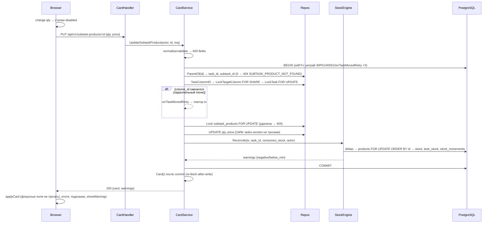
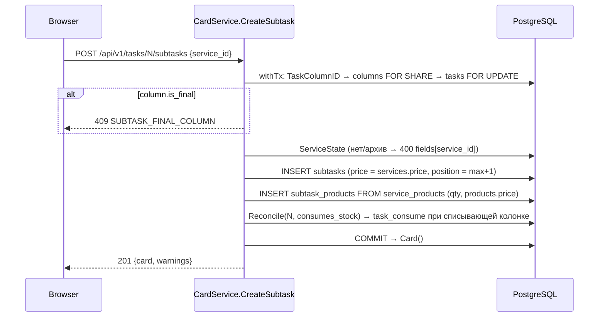
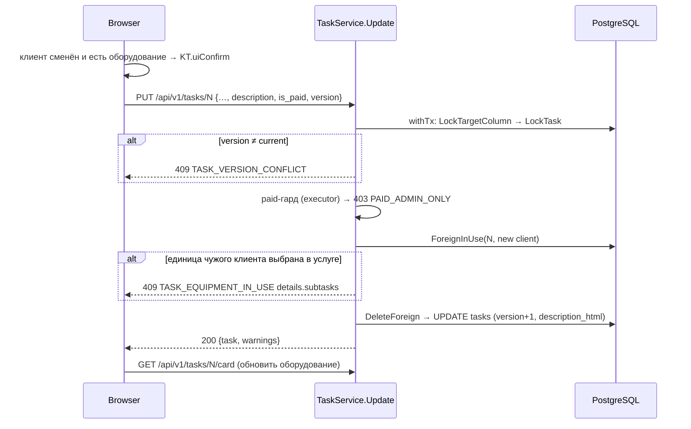
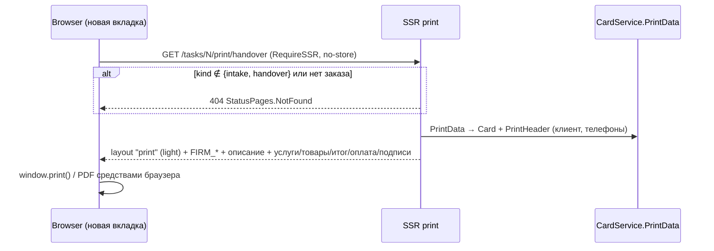

# Sequence Diagrams: phase-6-order-card

> Только новые потоки. Фазы: Request → Validation → Lock → Business → Persistence(+Reconcile) → Response. Линейные CRUD без побочных эффектов (журнал, PUT оборудования) не рисуются — по форме совпадают с §2 без Reconcile. Коды — `design-errors.md`.

## 1. Открытие карточки (deep-link `/?task=N`)
```mermaid
sequenceDiagram
    participant B as Browser (board.js + task-card.js)
    participant S as SSR GET /
    participant H as CardHandler.Card
    participant SV as CardService.Card
    participant DB as PostgreSQL
    B->>S: GET /?task=N (RequireSSR, no-store)
    S-->>B: board.html
    B->>B: parseFilters() игнорирует task; KT.taskCard.open(N)
    B->>H: GET /api/v1/tasks/N/card
    H->>SV: Card(actor, "N")
    SV->>DB: TaskRepo.Get (+description_html, total_amount, last_log)
    alt нет заказа
        SV-->>B: 404 TASK_NOT_FOUND → uiAlert, replaceState без task
    end
    SV->>DB: Column, Equipment(+history json_agg), Subtasks, Products, Logs, Stock (7 запросов, без N+1)
    SV-->>B: 200 OrderCardResponse (can_edit по актору)
    B->>B: render разделов, подсказки AC-009, итоги
```

## 2. Правка товара услуги в списывающей колонке (LWW + Reconcile)


## 3. Добавление услуги (комплект + финальная колонка)


## 4. Сохранение шапки со сменой клиента


## 5. Печать акта

