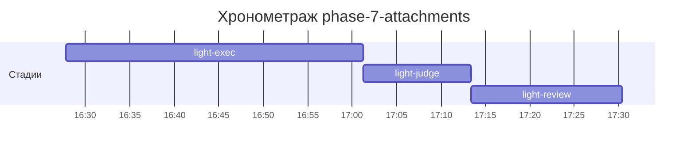

# Хронометраж: phase-7-attachments

Обновлено: 2026-09-27T17:30:23+05:00

## Стадии

| Стадия | Начало | Конец | Длит. | Ожидание | Чистое | Рестарты | Переделки |
|---|---|---|---|---|---|---|---|
| light-exec | 27.09 16:27 | 27.09 17:01 | 33м 25с | — | 33м 25с | — | — |
| light-judge | 27.09 17:01 | 27.09 17:13 | 12м 09с | — | 12м 09с | — | 3м 58с |
| light-review | 27.09 17:13 | 27.09 17:30 | 17м 01с | — | 17м 01с | — | — |
| **Итого (union)** | 27.09 16:27 | 27.09 17:30 | **1ч 02м** | **0с** | **1ч 02м** |  | **3м 58с** |

Wall-clock (первое→последнее событие журнала): **1ч 02м**; застаймлено (union стадий): 1ч 02м.

## События (fix-loop / повторные гейты / ошибки)

| Стадия | Тип | Событие | Начало | Длит. | Статус |
|---|---|---|---|---|---|
| light-judge | other | integration-full | 27.09 17:01 | 50с | ok |
| light-judge | other | e2e-run | 27.09 17:02 | 3м 08с | ok |

## Инструменты (тайминги гейтов/чекеров)

| Время | Инструмент | Статус | Итого | Шаги (по убыванию) |
|---|---|---|---|---|
| 27.09 17:01 | review_bundle | PASS | 0с | contract 0.1s · date_bound 0.1s · fixture_sync 0.1s · go_naming 0.0s · api_conventions 0.0s · +4 шагов (0.0s) |
| 27.09 17:13 | review_bundle | PASS | 0с | api_conventions 0.1s · date_bound 0.1s · live_suite 0.1s · fixture_sync 0.1s · go_naming 0.0s · +4 шагов (0.0s) |
| 27.09 17:13 | e2e_evidence | PASS | 0с | status:passed 0s |
| 27.09 17:29 | review_bundle | PASS | 0с | api_conventions 0.1s · date_bound 0.1s · live_suite 0.1s · fixture_sync 0.1s · go_naming 0.0s · +4 шагов (0.0s) |
| 27.09 17:29 | e2e_evidence | PASS | 0с | status:passed 0s |

## ⚠ BLIND-GAP — интервалы без записей журнала (>5 мин)

Тяжёлый прогон обязан обрамляться `event-start`/`event-end` (§EE anti-polling):
без них нельзя отличить фоновый прогон от sleep-поллинга.

| Стадия | Начало | Конец | Длит. |
|---|---|---|---|
| light-review | 27.09 17:13 | 27.09 17:29 | 15м 39с |
| light-judge | 27.09 17:06 | 27.09 17:13 | 7м 12с |

Суммарно вне наблюдения: **22м 51с** (2 интервал(ов)).

## Пайп-передачи (§3.6: бандлы, контракты)

| Время | Стадия | Вид | Артефакт | Размер | Детали |
|---|---|---|---|---|---|
| 27.09 17:01 | 8-code-review | bundle | 8-code-review/input-bundle.md | 3KB | чекеры 5✅/0❌/4⚠; патчи 114KB |
| 27.09 17:13 | 8-code-review | bundle | 8-code-review/input-bundle.md | 4KB | чекеры 9✅/0❌/0⚠; патчи 116KB |
| 27.09 17:29 | 8-code-review | bundle | 8-code-review/input-bundle.md | 4KB | чекеры 9✅/0❌/0⚠; патчи 124KB |

Бандлов: 3, суммарно 12KB — весь документный контекст, переданный между стадиями.
Нарушений пайп-контракта не зафиксировано (context-violations.jsonl отсутствует).

## Ожидание пользователя

Пауз не было.

## Диаграмма

