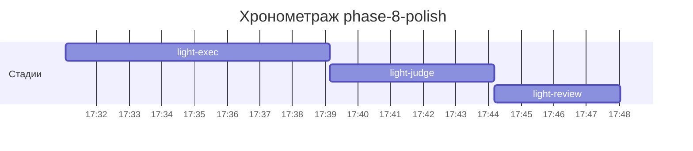

# Хронометраж: phase-8-polish

Обновлено: 2026-09-27T17:48:02+05:00

## Стадии

| Стадия | Начало | Конец | Длит. | Ожидание | Чистое | Рестарты | Переделки |
|---|---|---|---|---|---|---|---|
| light-exec | 27.09 17:31 | 27.09 17:39 | 8м 05с | — | 8м 05с | — | — |
| light-judge | 27.09 17:39 | 27.09 17:44 | 5м 03с | — | 5м 03с | — | — |
| light-review | 27.09 17:44 | 27.09 17:48 | 3м 51с | — | 3м 51с | — | — |
| **Итого (union)** | 27.09 17:31 | 27.09 17:48 | **16м 59с** | **0с** | **16м 59с** |  | **0с** |

Wall-clock (первое→последнее событие журнала): **16м 59с**; застаймлено (union стадий): 16м 59с.

## События (fix-loop / повторные гейты / ошибки)

Событий не было.

## Инструменты (тайминги гейтов/чекеров)

| Время | Инструмент | Статус | Итого | Шаги (по убыванию) |
|---|---|---|---|---|
| 27.09 17:44 | e2e_evidence | PASS | 0с | status:passed 0s |
| 27.09 17:44 | review_bundle | PASS | 0с | api_conventions 0.1s · date_bound 0.1s · live_suite 0.1s · fixture_sync 0.1s · go_naming 0.0s · +4 шагов (0.0s) |

## ⚠ BLIND-GAP — интервалы без записей журнала (>5 мин)

Тяжёлый прогон обязан обрамляться `event-start`/`event-end` (§EE anti-polling):
без них нельзя отличить фоновый прогон от sleep-поллинга.

| Стадия | Начало | Конец | Длит. |
|---|---|---|---|
| light-judge | 27.09 17:39 | 27.09 17:44 | 5м 02с |

Суммарно вне наблюдения: **5м 02с** (1 интервал(ов)).

## Пайп-передачи (§3.6: бандлы, контракты)

| Время | Стадия | Вид | Артефакт | Размер | Детали |
|---|---|---|---|---|---|
| 27.09 17:44 | 8-code-review | bundle | 8-code-review/input-bundle.md | 2KB | чекеры 9✅/0❌/0⚠; патчи 23KB |

Бандлов: 1, суммарно 2KB — весь документный контекст, переданный между стадиями.
Нарушений пайп-контракта не зафиксировано (context-violations.jsonl отсутствует).

## Ожидание пользователя

Пауз не было.

## Диаграмма

