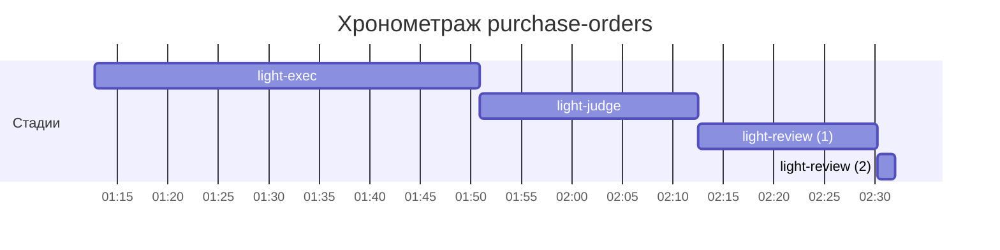

# Хронометраж: purchase-orders

Обновлено: 2026-10-22T02:32:01+05:00

## Стадии

| Стадия | Начало | Конец | Длит. | Ожидание | Чистое | Рестарты | Переделки |
|---|---|---|---|---|---|---|---|
| light-exec | 22.10 01:12 | 22.10 01:50 | 38м 08с | — | 38м 08с | — | — |
| light-judge | 22.10 01:50 | 22.10 02:12 | 21м 37с | — | 21м 37с | — | 17м 47с |
| light-review | 22.10 02:12 | 22.10 02:32 | 19м 28с | — | 19м 28с | 1 | — |
| **Итого (union)** | 22.10 01:12 | 22.10 02:32 | **1ч 19м** | **0с** | **1ч 19м** |  | **17м 47с** |

Wall-clock (первое→последнее событие журнала): **1ч 19м**; застаймлено (union стадий): 1ч 19м.

## События (fix-loop / повторные гейты / ошибки)

| Стадия | Тип | Событие | Начало | Длит. | Статус |
|---|---|---|---|---|---|
| light-judge | other | integration | 22.10 01:52 | 1м 34с | ok |
| light-judge | other | e2e-run | 22.10 02:00 | 2м 15с | ok |
| light-judge | other | e2e-full | 22.10 02:04 | 5м 36с | ok |
| light-judge | other | integration | 22.10 02:10 | 1м 25с | ok |
| light-judge | other | integration | 22.10 02:22 | 1м 23с | ok |
| light-judge | other | e2e-full | 22.10 02:24 | 5м 34с | ok |

## Инструменты (тайминги гейтов/чекеров)

| Время | Инструмент | Статус | Итого | Шаги (по убыванию) |
|---|---|---|---|---|
| 22.10 01:51 | review_bundle | FAIL | 2с | date_bound 0.7s · rule_usage 0.4s · go_naming 0.1s · api_conventions 0.1s · contract 0.1s · +5 шагов (0.2s) |
| 22.10 01:58 | review_bundle | FAIL | 2с | date_bound 0.6s · rule_usage 0.4s · go_naming 0.1s · api_conventions 0.1s · contract 0.1s · +5 шагов (0.2s) |
| 22.10 01:59 | review_bundle | FAIL | 1с | date_bound 0.5s · rule_usage 0.4s · go_naming 0.1s · api_conventions 0.1s · contract 0.1s · +5 шагов (0.2s) |
| 22.10 01:59 | review_bundle | FAIL | 1с | date_bound 0.5s · rule_usage 0.4s · go_naming 0.1s · api_conventions 0.1s · contract 0.1s · +5 шагов (0.2s) |
| 22.10 02:00 | review_bundle | FAIL | 1с | date_bound 0.5s · rule_usage 0.4s · go_naming 0.1s · api_conventions 0.1s · contract 0.1s · +5 шагов (0.2s) |
| 22.10 02:10 | e2e_evidence | PASS | 0с | status:passed 0s |
| 22.10 02:12 | review_bundle | FAIL | 2с | date_bound 0.7s · rule_usage 0.4s · go_naming 0.1s · api_conventions 0.1s · contract 0.1s · +5 шагов (0.2s) |
| 22.10 02:22 | review_bundle | FAIL | 2с | date_bound 0.6s · rule_usage 0.4s · go_naming 0.1s · api_conventions 0.1s · contract 0.1s · +5 шагов (0.2s) |
| 22.10 02:30 | e2e_evidence | PASS | 0с | status:passed 0s |
| 22.10 02:30 | review_bundle | FAIL | 1с | date_bound 0.5s · rule_usage 0.4s · go_naming 0.1s · api_conventions 0.1s · contract 0.1s · +5 шагов (0.2s) |

## ⚠ BLIND-GAP — интервалы без записей журнала (>5 мин)

Тяжёлый прогон обязан обрамляться `event-start`/`event-end` (§EE anti-polling):
без них нельзя отличить фоновый прогон от sleep-поллинга.

| Стадия | Начало | Конец | Длит. |
|---|---|---|---|
| light-review | 22.10 02:12 | 22.10 02:22 | 9м 57с |
| light-judge | 22.10 02:04 | 22.10 02:10 | 5м 36с |
| light-review | 22.10 02:24 | 22.10 02:29 | 5м 34с |

Суммарно вне наблюдения: **21м 07с** (3 интервал(ов)).

## Пайп-передачи (§3.6: бандлы, контракты)

| Время | Стадия | Вид | Артефакт | Размер | Детали |
|---|---|---|---|---|---|
| 22.10 01:12 | — | passport | 0-setup/passport.md | 22KB | — |
| 22.10 01:51 | 8-code-review | bundle | 8-code-review/input-bundle.md | 44KB | чекеры 8✅/2❌/0⚠; патчи 354KB |
| 22.10 01:58 | 8-code-review | bundle | 8-code-review/input-bundle.md | 46KB | чекеры 8✅/2❌/0⚠; патчи 382KB |
| 22.10 01:59 | 8-code-review | bundle | 8-code-review/input-bundle.md | 46KB | чекеры 8✅/2❌/0⚠; патчи 382KB |
| 22.10 01:59 | 8-code-review | bundle | 8-code-review/input-bundle.md | 45KB | чекеры 8✅/2❌/0⚠; патчи 382KB |
| 22.10 02:00 | 8-code-review | bundle | 8-code-review/input-bundle.md | 45KB | чекеры 9✅/1❌/0⚠; патчи 382KB |
| 22.10 02:12 | 8-code-review | bundle | 8-code-review/input-bundle.md | 45KB | чекеры 9✅/1❌/0⚠; патчи 384KB |
| 22.10 02:22 | 8-code-review | bundle | 8-code-review/input-bundle.md | 45KB | чекеры 9✅/1❌/0⚠; патчи 403KB |
| 22.10 02:30 | 8-code-review | bundle | 8-code-review/input-bundle.md | 45KB | чекеры 9✅/1❌/0⚠; патчи 403KB |

Бандлов: 8, суммарно 362KB — весь документный контекст, переданный между стадиями.
Нарушений пайп-контракта не зафиксировано (context-violations.jsonl отсутствует).

## Ожидание пользователя

Пауз не было.

## Диаграмма

## Аномалии журнала

- ⚠ end без start: стадия `light-judge` @ 2026-10-22T02:30:13+05:00

