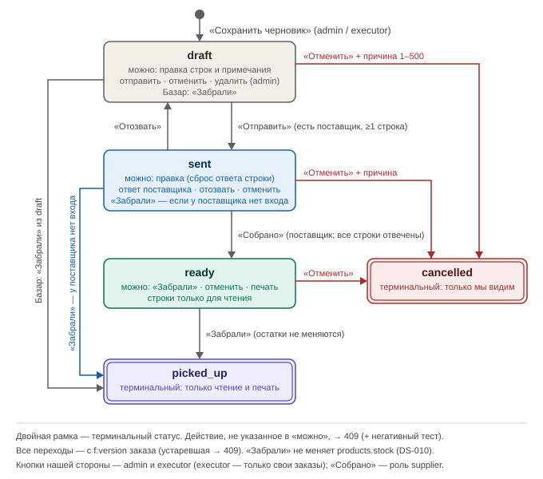
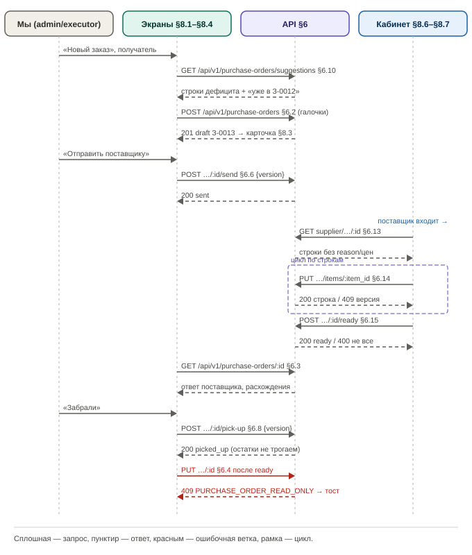

# Draft Spec: Закупки по дефициту

**Дата:** 2026-10-22 | **Статус:** draft | **Tier:** L | **Режим:** new
**Совместимость:** MVP — живых пользователей нет, таблицы и адреса меняем свободно, без переходного периода и отката (DS-030, pipeline-doctrine.md §CM-1)
**UI-scope:** swagger:yes | adaptive:full | themes:both — adaptive:full относится к кабинету поставщика (§8.6–§8.7, с телефона); экраны «Закупки» (§8.1–§8.4) — один overflow-смок ~360px (DS-031, §US-1)
**Источник:** план «Заказ по дефициту» (shortage-order-plan.md, согласован 2026-10-22) + интервью 4 батча (draft-spec-decisions.md)

## §1. Суть задачи
Закупка запчастей по дефициту: сотрудник (admin или executor) формирует список того, чего не хватает под принятые заказы и что ниже минимума, и отправляет его поставщику. Поставщик в своём кабинете отвечает, что соберёт и по какой цене. Мы забираем, список закрывается. Второй вариант — список «Базар (покупаем сами)» с печатью-чеклистом.

Состав:

**Бизнес (что делает пользователь/процесс):**
1. Сотрудник открывает «Новый заказ», выбирает получателя (поставщик или «Базар»), видит строки дефицита с галочками и количеством, правит их, добавляет запчасти вручную, сохраняет черновик (§8.2, DS-002, DS-006).
2. Сотрудник отправляет заказ поставщику. При необходимости правит отправленный заказ или отзывает его в черновик (§8.3, DS-012, DS-034).
3. Поставщик входит под своим логином и видит заказы своего поставщика. По каждой строке ставит «Соберу, шт.», цену и комментарий, затем нажимает «Собрано, можно забирать» (§8.6–§8.7, DS-008).
4. Сотрудник видит ответ: суммы, расхождения подсвечены. После того как забрали, нажимает «Забрали», и заказ закрывается. Остатки на складе этим НЕ меняются (§8.3, DS-010).
5. Печать заказа в PDF (как акт выдачи): нам — с галочками для базара или с ценами после ответа, поставщику — свой экземпляр (§8.4, DS-014).
6. Админ создаёт учётку поставщика на экране «Пользователи»: роль «Поставщик» + привязка к записи справочника `t:suppliers` (§8.5, DS-025, DS-044).

**Логика (правила системы):**
1. Статусы: `s:draft` → `s:sent` → `s:ready` → `s:picked_up`; `s:cancelled` из `s:draft`/`s:sent`/`s:ready`. У «Базара» короткий путь `s:draft` → `s:picked_up`. У поставщика без активного входа возможен переход `s:sent` → `s:picked_up` (§5, DS-011, DS-042).
2. Количество «к заказу» по запчасти = max(0, pending + `f:min_stock` − `f:stock`). Признак строки `s:for_orders`, если pending > `f:stock`, иначе `s:below_min` (§6.10, DS-003).
3. Подсказка «уже в открытом заказе З-0012 — 5 шт.» учитывает только заказы в `s:sent` и `s:ready`. Галочка у такой строки по умолчанию снята, количество предлагается без вычета (DS-004, DS-049).
4. Правка строки в `s:sent` (количество или запчасть, добавление строки) сбрасывает ответ поставщика по ЭТОЙ строке и ставит у неё пометку «Изменено заказчиком». Правка примечания заказа ответы не сбрасывает: у поставщика заказ помечается «Изменён», новое примечание подсвечивается (DS-034, DS-048).
5. После `s:ready` строки только для чтения. Поставщик не может отменить своё «Собрано» (DS-038, DS-039).
6. Executor видит в списке, открывает, печатает и меняет ТОЛЬКО свои заказы (`f:created_by` = он); чужой id → 404, как у поставщика. Admin видит все заказы и делает с ними всё. Удаление, восстановление и окончательное удаление черновика доступны только admin (DS-050, DS-051, DS-060).
7. Подсказка «уже в открытом заказе» на экране «Новый заказ»: у admin учитывает все открытые заказы (`s:sent`/`s:ready`), у executor — только его собственные. Номера чужих заказов исполнителю не показываются (DS-078).
8. Время: храним в UTC (`timestamptz`), показываем в поясе смотрящего (`f:timezone` пользователя, по умолчанию Asia/Almaty). Фильтров по дате нет (DS-033).
9. Конкурентный доступ по операциям:
   - правка черновика или отправленного заказа и все переходы статусов — оптимистичная блокировка по `f:version` заказа, устаревшая версия → 409;
   - ответ поставщика по строке — своя `f:version` строки, второй сохраняющий → 409;
   - «Собрано» и «Отозвать» одновременно — выигрывает первый, второй получает 409 (DS-032).

**Техника (API/данные/интеграции):**
1. Новые таблицы `t:purchase_orders` и `t:purchase_order_items` (строки, `ON DELETE CASCADE`). В `t:users` добавляются роль `s:supplier` и `f:supplier_id` (§4).
2. API закупок для нас (§6.1–§6.11) и API кабинета поставщика (§6.12–§6.16) по CLAUDE.md §API-1. Учётки поставщиков — через расширение API `t:users` (§6.17).
3. Безопасность: правило «по умолчанию запрещено» для роли `s:supplier` в `RequireAPI`/`RequireSSR`. Поставщику открыты только `/supplier/*`, `/api/v1/supplier/*`, выход и смена своего пояса (DS-017, DS-053).
4. Расчёт дефицита переиспользует CTE pending из `internal/features/board/stock_repo.go`. Страница `/stock` не меняется (DS-005, DS-064).
5. Черновик — новый вид «Закупки» в разделе «Удалённые» (`internal/features/softdelete`) (DS-037, DS-072).

**UI (графическая часть):**
1. Сайдбар сотрудника → пункт «Закупки» (обе роли) → список `/purchases` с фильтром по статусу (§8.1).
2. «Новый заказ» `/purchases/new`: выбор получателя → таблица дефицита с галочками и количеством → поиск «Добавить запчасть» → «Сохранить черновик» (§8.2).
3. Карточка `/purchases/:id`: строки, колонки ответа поставщика, кнопки по статусу («Отправить поставщику», «Сохранить», «Отозвать», «Забрали», «Отменить», «Удалить», «Печать») (§8.3).
4. PDF-форма заказа (§8.4).
5. «Пользователи»: в форме роль «Поставщик» + выпадающий список поставщиков (§8.5).
6. Кабинет поставщика, удобный с телефона: свой упрощённый сайдбар, список `/supplier/orders`, карточка `/supplier/orders/:id` с полями по строкам и кнопкой «Собрано, можно забирать» (§8.6–§8.7).

Out-of-scope:
1. «Забрали» → приход на склад фактического количества: решено не делать, приход вводят как сейчас (DS-010, DS-028).
2. Изменения страницы «Остатки» `/stock` (отметка «заказано» и т.п.): решено не трогать (DS-005).
3. Уведомления поставщику и нам (Telegram, ссылка в WhatsApp): позже (DS-028).
4. Кнопка «Дозаказать недостающее» в карточке заказа клиента: позже (DS-028).
5. Основной поставщик у запчасти и история закупочных цен: позже, связи «запчасть ↔ поставщик» нет (DS-028).
6. Отдельный журнал изменений «было → стало»: решено не вести, хватает полей «кто/когда» (DS-052).

## §2. Интеграции и master-data
Внешних интеграций нет: поставщик работает в нашей системе через кабинет (DS-007).

Потоки:
| Система | Направление | Что передаётся | Когда | Формат / канал / валидация | Статус |
|---|---|---|---|---|---|
| Наша система → кабинет поставщика | исходящий (внутри системы) | заказ в `s:sent`/`s:ready`/`s:picked_up`: номер, дата отправки, примечание, строки (название, артикул, единица, количество), имя и телефон мастерской | после «Отправить» (§6.6) | REST API кабинета §6.12–§6.13 под сессией пользователя с ролью `s:supplier`; выборка по `f:supplier_id` из сессии (DS-046, DS-053) | closed |
| Кабинет поставщика → наша система | входящий (внутри системы) | ответ по строке: `f:supplier_qty`, `f:supplier_price`, `f:supplier_note`; «Собрано» | пока заказ в `s:sent` | REST API §6.14–§6.15; валидация §6.14; `f:version` строки (DS-032, DS-047) | closed |

Справочники (master-data):
| Справочник | Источник правды | Синхронизация | Где используется |
|---|---|---|---|
| Поставщики `t:suppliers` | ведёт admin в разделе «Поставщики» (существующий) | фича только читает; архив/удаление поставщика с незакрытыми закупками запрещается (DS-043) | получатель заказа §4.1; привязка учётки §4.3 |
| Запчасти `t:products` | ведёт admin в каталоге (существующий) | фича только читает остатки, минимум и pending; снимок `f:name`/`f:sku`/`f:unit` в строке (DS-021) | строки §4.2; подсказка §6.10 |
| Реквизиты мастерской | env `FIRM_NAME`, `FIRM_PHONE` (`internal/config/config.go`, как в PDF акта выдачи) | при старте приложения | кабинет поставщика §8.7, PDF §8.4 (DS-046) |

## §3. Нефункциональные требования

**Конкурентность (по операциям, DS-032):**
1. **Правка заказа (§6.4) и переходы статусов (§6.6–§6.9):**
   - механизм: `UPDATE … WHERE id = :id AND version = :version AND status IN (…)`, затем `f:version` + 1;
   - конкурент: устаревшая версия → 409 `PURCHASE_ORDER_VERSION_CONFLICT` «Заказ изменился, обновите страницу».
2. **Ответ поставщика по строке (§6.14):**
   - механизм: `f:version` строки + guard по статусу заказа `s:sent` в одной транзакции;
   - конкурент: устаревшая версия строки → 409 `PURCHASE_ITEM_VERSION_CONFLICT`; заказ уже не `s:sent` → 409 `PURCHASE_ORDER_READ_ONLY`.
3. **«Собрано» (§6.15) против «Отозвать»/«Отменить»/правки (§6.7, §6.9, §6.4):**
   - механизм: атомарный guard `WHERE status = 'sent'`;
   - конкурент: выигрывает первый, второй → 409, экран перечитывается.
4. **Правка строки в `s:sent` против одновременного ответа поставщика по той же строке:**
   - механизм: сброс ответа и пометка «Изменено заказчиком» увеличивают `f:version` строки;
   - конкурент: поставщик со старой версией → 409, видит новую строку без ответа (DS-048).
5. **Номер заказа:** выдаёт sequence `purchase_orders_number_seq`, без гонок и без переиспользования (DS-015).

**Аудит (DS-052):**
- у заказа: `f:created_by`/`f:created_at`, `f:sent_by`/`f:sent_at`, `f:ready_by`/`f:ready_at`, `f:picked_up_by`/`f:picked_up_at`, `f:cancelled_by`/`f:cancelled_at`/`f:cancel_reason`, `f:deleted_by`/`f:deleted_at`/`f:delete_reason`;
- у строки: `f:supplier_answered_by`/`f:supplier_answered_at` — кто из учёток поставщика ответил последним;
- отдельного журнала «было → стало» нет; аудит чтения и печати не ведём.

**Время/таймзоны (DS-033):**
- хранение — UTC, все отметки времени `timestamptz`;
- показ в списке, карточке, PDF и кабинете — в поясе смотрящего (`f:timezone`, по умолчанию Asia/Almaty; поставщик может сменить, `PUT /api/v1/users/me/timezone` ему разрешён);
- фильтров и отчётов по диапазонам дат нет;
- источник времени — `now()` БД; порядок — `f:number` (sequence).

**Метрики/таймстемпы:**
- `f:sent_at` → `f:ready_at` → `f:picked_up_at` дают длительность «отправили → собрано → забрали»; отчётов и алертов в MVP нет (inferred, DS-052).

**Offline / деградация / восстановление:**
- SSR, всё состояние на сервере. После перезагрузки страница перечитывает заказ. Несохранённый ввод в полях поставщика теряется: каждая строка сохраняется отдельно по кнопке или blur (§8.7, inferred DS-063).

**Логирование и чувствительные данные:**
- slog с trace_id (as-is каркас); цены поставщика и комментарии в логи не пишем;
- поставщик не видит `f:reason` строки, наши продажные цены (`t:products.price`), отменённые заказы и причины отмены (DS-041, DS-046).

**Формат ошибок:**
- `pkg/errorspkg`: `{ "code", "message", "details" }`; 400 → `details.fields[]` (проектный CLAUDE.md); 403 / 404 / 409 — по смыслу (§6).

**Abuse cases (вход для adversarial E2E TD-4):**
1. Поставщик открывает существующие разделы (`/`, `/stock`, `/clients`, `/catalog/*`, `/suppliers`, `/users`, `/calendar`, `/executor-payouts`, `/deleted`, `/tasks/:id/print/*` и все `/api/v1/*` кроме своих) → SSR: редирект на `/supplier/orders`, API: 403 (DS-017, DS-053). Смягчение — правило «по умолчанию запрещено» в middleware + live-тест на каждый раздел.
2. Поставщик подставляет чужой id заказа или строки → 404 (DS-017).
3. Поставщик передаёт в body `supplier_id`/`order_id` → игнорируется, поставщик берётся из сессии (DS-053).
4. Executor открывает, печатает, правит или отменяет чужой заказ по id → 404 `PURCHASE_ORDER_NOT_FOUND`, как будто заказа нет; в списке чужих нет (DS-051, DS-060). Подсказка §6.10 у executor считает только его заказы — номера чужих не раскрываются (DS-078).
5. Executor пытается удалить черновик или выдать учётке роль `s:supplier` → 403 (DS-050, DS-044).
6. Дубли закупок: два исполнителя независимо заказывают одну запчасть — подсказка §6.10 у каждого видит только свои заказы. Риск принят пользователем (DS-078); admin видит все открытые заказы и может снять дубль отменой.

**Применённые zap-дефолты** (zap-list — стандарты проекта из CLAUDE.md, применяются автоматически, без вопросов; в §9 источник `zap`):
- формат ошибок — `pkg/errorspkg`, 400 `details.fields[]` (DS-065);
- коды not found / forbidden / conflict → 404 / 403 / 409 (DS-065);
- синхронная обработка, без очередей (DS-065);
- миграции не применяются автоматически, только `make migrate-up` (DS-065).

## §4. Данные

> Колонка **Обяз.**: `да` — клиент обязан передать при создании/правке; `нет` — опционально; `авто` — заполняет система (PK, дефолты, таймстемпы, значения из URL/сессии); `условно` — зависит от правила, оно указано в Описании. NULL — DDL-факт, Обяз. — семантика заполнения.

### §4.1. `t:purchase_orders` — заказ поставщику / список на базар
Шапка закупки: один заказ — один получатель (DS-006).

| Поле | Тип | NULL | Default | Обяз. | Описание | DS |
|---|---|---|---|---|---|---|
| id | uuid PK | no | gen_random_uuid() | авто | surrogate key | DS-015 |
| number | bigint | no | nextval('purchase_orders_number_seq') | авто | сквозной номер, показывается как «З-» + номер, дополненный нулями до 4 знаков (`З-0001`, после 9999 — `З-10000`); не переиспользуется | DS-015, DS-056 |
| supplier_id | uuid | yes | null | условно | FK → `t:suppliers(id)` `ON DELETE RESTRICT`; NULL = «Базар, покупаем сами». Задаётся при создании, после создания не меняется; при создании — только активный и не удалённый поставщик | DS-006, DS-068 |
| status | text | no | 'draft' | авто | CHECK: `s:draft` / `s:sent` / `s:ready` / `s:picked_up` / `s:cancelled` (§5) | DS-011 |
| note | text | no | '' | нет | примечание к заказу, 0–1000 символов, видно поставщику | DS-047, DS-046 |
| note_changed_at | timestamptz | yes | null | авто | когда примечание правили в `s:sent`; > `f:sent_at` → у поставщика пометка «Изменён» и подсветка примечания | DS-048 |
| version | bigint | no | 1 | авто | оптимистичная блокировка, +1 на каждую правку и каждый переход | DS-032 |
| created_by | uuid | no | — | авто | FK → `t:users(id)` `ON DELETE RESTRICT`; из сессии; владелец заказа: executor видит и меняет только заказы, где он автор | DS-052, DS-051 |
| created_at | timestamptz | no | now() | авто | когда создан | DS-052 |
| updated_at | timestamptz | no | now() | авто | последняя правка | DS-052 |
| sent_by | uuid | yes | null | авто | FK → `t:users(id)` `ON DELETE RESTRICT`; кто последним нажал «Отправить» | DS-052 |
| sent_at | timestamptz | yes | null | авто | последняя отправка (повторная после «Отозвать» перезаписывает); дата у поставщика | DS-052, DS-046 |
| ready_by | uuid | yes | null | авто | FK → `t:users(id)` `ON DELETE RESTRICT`; учётка поставщика, нажавшая «Собрано» | DS-052 |
| ready_at | timestamptz | yes | null | авто | когда поставщик нажал «Собрано» | DS-052 |
| picked_up_by | uuid | yes | null | авто | FK → `t:users(id)` `ON DELETE RESTRICT`; кто нажал «Забрали» | DS-052 |
| picked_up_at | timestamptz | yes | null | авто | когда закрыт «Забрали» | DS-052 |
| cancelled_by | uuid | yes | null | авто | FK → `t:users(id)` `ON DELETE RESTRICT`; кто отменил | DS-052 |
| cancelled_at | timestamptz | yes | null | авто | когда отменён | DS-052 |
| cancel_reason | text | yes | null | условно | обязательна при отмене, 1–500 символов после trim; видна только нам | DS-036, DS-041 |
| deleted_at | timestamptz | yes | null | авто | мягкое удаление (только черновик, admin) | DS-037 |
| deleted_by | uuid | yes | null | авто | FK → `t:users(id)` `ON DELETE RESTRICT` | DS-037 |
| delete_reason | text | yes | null | условно | 1–500 символов, как у остальных видов раздела «Удалённые» | DS-037, DS-072 |

Ключи и индексы:
- PK: `f:id`
- UNIQUE: `f:number` (`i:purchase_orders_number_uq`)
- Индексы:
  - `i:purchase_orders_status_idx` (`f:status`, `f:created_at` DESC) WHERE `f:deleted_at` IS NULL — список §6.1 с фильтром по статусу;
  - `i:purchase_orders_supplier_idx` (`f:supplier_id`, `f:status`) WHERE `f:deleted_at` IS NULL — кабинет §6.12 и проверка «незакрытые закупки поставщика» (DS-043);
  - `i:purchase_orders_deleted_at_idx` (`f:deleted_at` DESC, `f:id`) WHERE `f:deleted_at` IS NOT NULL — вкладка раздела «Удалённые».
- CHECK:
  - `i:purchase_orders_status_chk` — статус из списка выше;
  - `i:purchase_orders_cancel_chk` — (`f:status` = 'cancelled') ⇔ (`f:cancelled_at`, `f:cancelled_by`, `f:cancel_reason` заданы);
  - `i:purchase_orders_deleted_chk` — тройка `f:deleted_at`/`f:deleted_by`/`f:delete_reason` задана целиком или пуста; удалённым может быть только `s:draft`;
  - `i:purchase_orders_bazaar_chk` — при `f:supplier_id` IS NULL статус не `s:sent`/`s:ready`.

Связи (одна связь = одна строка):
- N→1 `t:suppliers` — `ON DELETE RESTRICT` (у поставщика только мягкое удаление)
- N→1 `t:users` (`f:created_by`, `f:sent_by`, `f:ready_by`, `f:picked_up_by`, `f:cancelled_by`, `f:deleted_by`) — `ON DELETE RESTRICT` (пользователи не удаляются, ADR-007)
- 1→N `t:purchase_order_items` — `ON DELETE CASCADE` (строки живут только с заказом)

Поведение при действиях:
- Создание (§6.2): admin/executor; `status='draft'`, `f:number` из sequence, `f:created_by` из сессии, строки — в той же транзакции.
- Изменение (§6.4): в `s:draft` и `s:sent`, admin — любой заказ, executor — только свой (чужой → 404); `f:version` + 1. В `s:sent` правка `f:note` ставит `f:note_changed_at`, правка строк сбрасывает ответ этих строк (§4.2).
- Удаление (§6.5): только admin, только `s:draft`, мягкое (`f:deleted_at`/`f:deleted_by`/`f:delete_reason`). Восстановление и окончательное удаление — раздел «Удалённые», только admin. Окончательное удаление каскадом удаляет строки.
- Переходы статусов: §5.

Инварианты (правило → чем держится → DS):
- у «Базара» нет `s:sent`/`s:ready` → CHECK `i:purchase_orders_bazaar_chk` + guard §6.6 → DS-011, DS-077
- отправить и забрать можно только непустой заказ → guard `EXISTS items` в транзакции перехода → DS-076
- не больше 200 строк → проверка в сервисе в транзакции правки → DS-047
- `f:number` уникален и не переиспользуется → sequence + UNIQUE → DS-015

### §4.2. `t:purchase_order_items` — строки заказа
Запчасть, сколько просим и ответ поставщика (DS-008, DS-022).

| Поле | Тип | NULL | Default | Обяз. | Описание | DS |
|---|---|---|---|---|---|---|
| id | uuid PK | no | gen_random_uuid() | авто | surrogate key | DS-022 |
| order_id | uuid | no | — | авто | FK → `t:purchase_orders(id)` `ON DELETE CASCADE`; из URL | DS-070 |
| product_id | uuid | no | — | да | FK → `t:products(id)` `ON DELETE RESTRICT`; при добавлении — только активная, не удалённая запчасть | DS-055 |
| position | integer | no | 0 | авто | порядок строк в заказе (порядок массива `items` в запросе) | DS-022 |
| qty | numeric(12,3) | no | — | да | сколько просим: > 0 и ≤ 99999.999, до 3 знаков после запятой | DS-029, DS-047 |
| reason | text | no | 'manual' | авто | CHECK: `s:for_orders` (не хватает под принятые заказы) / `s:below_min` (остаток уйдёт ниже минимума) / `s:manual` (добавлена вручную); из подсказки §6.10, иначе `s:manual`; поставщику не показывается | DS-022, DS-046 |
| name | text | no | — | авто | снимок `t:products.name` при добавлении строки, обновляется при каждой отправке (§6.6) | DS-021, DS-054 |
| sku | text | no | '' | авто | снимок `t:products.sku` при добавлении строки, обновляется при каждой отправке (§6.6) | DS-021, DS-054 |
| unit | text | no | '' | авто | снимок `t:products.unit` при добавлении строки, обновляется при каждой отправке (§6.6) | DS-021, DS-054 |
| supplier_qty | numeric(12,3) | yes | null | условно | «Соберу, шт.»: 0–99999.999 (0 = нет); больше `f:qty` можно, строка подсвечивается как расхождение; NULL = поставщик ещё не ответил | DS-008, DS-047 |
| supplier_price | numeric(12,2) | yes | null | условно | «Цена за ед.»: 0–9999999.99; обязательна для «Собрано», если `f:supplier_qty` > 0 | DS-008, DS-038, DS-047 |
| supplier_note | text | no | '' | нет | комментарий поставщика (замена, срок): 0–500 символов | DS-008, DS-047 |
| supplier_answered_by | uuid | yes | null | авто | FK → `t:users(id)` `ON DELETE RESTRICT`; учётка поставщика, сохранившая ответ последней | DS-052 |
| supplier_answered_at | timestamptz | yes | null | авто | когда ответ сохранён последним | DS-052 |
| customer_changed_at | timestamptz | yes | null | авто | когда мы изменили или добавили строку после первой отправки; задана → у поставщика пометка «Изменено заказчиком», пока он не ответит заново (`f:supplier_answered_at` > `f:customer_changed_at`) | DS-048 |
| version | bigint | no | 1 | авто | оптимистичная блокировка строки (ответ поставщика, сброс нашей правкой) | DS-032 |

Ключи и индексы:
- PK: `f:id`
- UNIQUE: (`f:order_id`, `f:product_id`) — `i:purchase_order_items_order_product_uq`: дубль запчасти запрещён, при добавлении количество складывается (DS-047)
- Индексы:
  - `i:purchase_order_items_order_idx` (`f:order_id`, `f:position`) — строки карточки;
  - `i:purchase_order_items_product_idx` (`f:product_id`) — подсказка «уже в открытом заказе» §6.10 и RESTRICT-проверка удаления запчасти.
- CHECK: `f:qty` > 0; `f:supplier_qty` IS NULL OR ≥ 0; `f:supplier_price` IS NULL OR ≥ 0; `f:reason` из списка; длина `f:supplier_note` ≤ 500.

Связи (одна связь = одна строка):
- N→1 `t:purchase_orders` — `ON DELETE CASCADE`
- N→1 `t:products` — `ON DELETE RESTRICT`
- N→1 `t:users` (`f:supplier_answered_by`) — `ON DELETE RESTRICT`

Поведение при действиях:
- Создание: вместе с заказом (§6.2) или правкой (§6.4); снимок `f:name`/`f:sku`/`f:unit`; если заказ уже отправлялся (`f:sent_at` IS NOT NULL), ставится `f:customer_changed_at = now()`.
- Изменение нами (§6.4, `s:draft`/`s:sent`): смена `f:qty` → сброс `f:supplier_qty`, `f:supplier_price` в NULL и `f:supplier_note` в '' и `f:customer_changed_at = now()`, если заказ уже отправлялся; `f:version` + 1 (DS-034, DS-035, DS-048).
- Изменение поставщиком (§6.14, только `s:sent`): `f:supplier_qty`, `f:supplier_price`, `f:supplier_note`, `f:supplier_answered_by`, `f:supplier_answered_at`; `f:version` + 1.
- Удаление нами (§6.4, `s:draft`/`s:sent`): hard delete строки; у поставщика строка просто исчезает (DS-034).
- При «Отозвать» ответы сохраняются; при повторной отправке сохраняются у неизменённых строк (DS-035).

Инварианты (правило → чем держится → DS):
- одна запчасть — одна строка в заказе → UNIQUE `i:purchase_order_items_order_product_uq` → DS-047
- поставщик пишет только в `s:sent` → guard по статусу заказа в транзакции §6.14 → DS-020
- «Собрано» только если все `f:supplier_qty` заданы и у строк с `f:supplier_qty` > 0 задана `f:supplier_price` → проверка в транзакции §6.15 → DS-038
- сумма строки = `f:supplier_qty` × `f:supplier_price` (округление до 0.01); сумма заказа = Σ сумм строк с ценой; вычисляется, не хранится → DS-009, DS-071

### §4.3. `t:users` — пользователи (существующая таблица, фича расширяет)
Добавляются роль `s:supplier` и привязка учётки к поставщику (DS-007).

| Поле | Тип | NULL | Default | Обяз. | Описание | DS |
|---|---|---|---|---|---|---|
| id | uuid PK | no | gen_random_uuid() | авто | as-is | DS-007 |
| login | text | no | — | да | as-is; уникален по lower(login) | DS-007 |
| password_hash | text | no | — | авто | as-is; из пароля формы | DS-007 |
| name | text | no | '' | нет | as-is; для поставщика — имя продавца | DS-007 |
| is_active | boolean | no | true | нет | as-is; false → сессия обрывается на следующем запросе (`internal/server/middleware/auth.go` resolve) | DS-045 |
| version | bigint | no | 1 | авто | as-is, оптимистичная блокировка формы пользователя | DS-007 |
| created_at | timestamptz | no | now() | авто | as-is | DS-007 |
| updated_at | timestamptz | no | now() | авто | as-is | DS-007 |
| role | text | no | 'executor' | да | CHECK расширяется: `s:admin` / `s:executor` / `s:supplier` (новое значение). Выдаёт роль только admin | DS-007, DS-044 |
| phone | text | no | '' | нет | as-is | DS-007 |
| timezone | text | no | 'Asia/Almaty' | нет | as-is, 1–64 символа; у поставщика по умолчанию тоже Asia/Almaty, может сменить сам | DS-033 |
| **supplier_id (to-be DS-007)** | uuid | yes | null | условно | FK → `t:suppliers(id)` `ON DELETE RESTRICT`; обязателен при `f:role` = `s:supplier`, иначе NULL; выбирается активный, не удалённый поставщик; несколько учёток на одного поставщика допустимы | DS-007, DS-044 |

Ключи и индексы:
- PK: `f:id`
- UNIQUE: `i:users_login_lower_uq` (as-is)
- Индексы: `i:users_supplier_id_idx` (`f:supplier_id`) WHERE `f:supplier_id` IS NOT NULL — проверка «у поставщика есть активный вход» (§6.8, DS-059)
- CHECK: `i:users_supplier_chk` — (`f:role` = 'supplier') ⇔ (`f:supplier_id` IS NOT NULL) (DS-007)

Связи (одна связь = одна строка):
- N→1 `t:suppliers` (`f:supplier_id`) — `ON DELETE RESTRICT`

Поведение при действиях:
- Создание и изменение: только admin на экране «Пользователи» (§6.17). Смена роли на или с `s:supplier` допустима при соблюдении CHECK (inferred, DS-069).
- Удаление: нет (as-is ADR-007, только блокировка `f:is_active`).

## §5. Статусная модель


Детали переходов (guard = атомарное условие; любой запрет = 409 + негативный тест):
| Из | В | Триггер | Кто | Guard / конкурентный исход | Side effects |
|---|---|---|---|---|---|
| — | draft | «Сохранить черновик» §6.2 | admin, executor | — | `f:number`, `f:created_by`, `f:created_at` |
| draft | sent | «Отправить поставщику» §6.6 | admin; executor — только свой (чужой → 404) | `WHERE status='draft' AND version=:v AND supplier_id IS NOT NULL AND deleted_at IS NULL` + ≥1 строка; Базар → 409 `PURCHASE_ORDER_NO_SUPPLIER`; пусто → 409 `PURCHASE_ORDER_EMPTY` | `f:sent_by`, `f:sent_at`; снимок `f:name`/`f:sku`/`f:unit` обновлён; заказ появляется в кабинете |
| sent | draft | «Отозвать» §6.7 | admin; executor — только свой (чужой → 404) | `WHERE status='sent' AND version=:v`; одновременное «Собрано» → проигравший получает 409 | ответы сохраняются (DS-035); заказ пропадает из кабинета |
| sent | ready | «Собрано, можно забирать» §6.15 | supplier своего поставщика | `WHERE status='sent'`; все строки отвечены (иначе 409 `PURCHASE_ORDER_ITEMS_INCOMPLETE` с перечнем строк); одновременный «Отозвать»/«Отменить» → проигравший 409 | `f:ready_by`, `f:ready_at`; строки только для чтения обеим сторонам |
| ready | picked_up | «Забрали» §6.8 | admin; executor — только свой (чужой → 404) | `WHERE status='ready' AND version=:v` | `f:picked_up_by`, `f:picked_up_at`; остатки НЕ меняются (DS-010) |
| draft | picked_up | «Забрали» §6.8 (Базар) | admin; executor — только свой (чужой → 404) | `WHERE status='draft' AND supplier_id IS NULL AND version=:v` + ≥1 строка | `f:picked_up_by`, `f:picked_up_at` |
| sent | picked_up | «Забрали» §6.8 (у поставщика нет входа) | admin; executor — только свой (чужой → 404) | `WHERE status='sent' AND version=:v AND NOT EXISTS (users WHERE supplier_id = заказа AND role='supplier' AND is_active)`; вход есть → 409 `PURCHASE_ORDER_NOT_READY` | `f:picked_up_by`, `f:picked_up_at` (DS-042, DS-059) |
| draft, sent, ready | cancelled | «Отменить» + причина §6.9 | admin; executor — только свой (чужой → 404) | `WHERE status IN ('draft','sent','ready') AND version=:v` | `f:cancelled_by`, `f:cancelled_at`, `f:cancel_reason`; заказ скрыт из кабинета (DS-036) |
| picked_up, cancelled | — | любое действие кроме чтения и печати | — | → 409 `PURCHASE_ORDER_INVALID_STATUS` | — |

(DS-011, DS-012, DS-036, DS-038, DS-042, DS-058, DS-075)

## §6. API

> Режим B «API + фронтенд». Стенд `http://localhost:8080`. Авторизация — cookie-сессия `sid` (HttpOnly), получается через вход `/login`; в примерах подставь `<SID>` (сотрудник) или `<SUPPLIER_SID>` (поставщик). Каждый curl копируется в терминал или в Postman (Import → Raw text).
> Конвенции: CLAUDE.md §API-1 — URL kebab-case, JSON snake_case, списки `{items, total, limit, offset}`. Ошибки — `pkg/errorspkg`: `{ "code", "message", "details" }`, 400 → `details.fields[]`.
> Числа `numeric` передаются строками (`"5.000"`, `"1250.00"`), как в существующем API остатков (`pkg/numeric`) (inferred, DS-047).

### §6.1. `e:GET /api/v1/purchase-orders`
- Назначение: список закупок (экран §8.1)
- Authz: admin — все заказы; executor — только свои (сервер добавляет фильтр `f:created_by` = текущий пользователь, из сессии, параметром не управляется); supplier → 403 (DS-060)
- Идемпотентность/повтор: чтение
- Side effects: нет

Request:

| Параметр | Где | Тип | Обязателен | Валидация |
|---|---|---|---|---|
| status | query | text | нет | один из `s:draft`/`s:sent`/`s:ready`/`s:picked_up`/`s:cancelled`; иное → 400 |
| limit | query | int | нет | 1–100, по умолчанию 50; иное → 400 |
| offset | query | int | нет | ≥ 0, по умолчанию 0 |

Response 200:

| Поле | Тип | Описание |
|---|---|---|
| items[].id | uuid | id заказа |
| items[].number | int | номер |
| items[].number_display | string | «З-0012» |
| items[].supplier_id | uuid\|null | null = Базар |
| items[].recipient_name | string | название поставщика или «Базар (сами)» |
| items[].status | string | slug статуса §5 |
| items[].items_count | int | строк |
| items[].total_amount | string\|null | сумма по ответу поставщика; null — цен нет |
| items[].created_by_name | string | автор |
| items[].created_at | string | ISO-8601 UTC |
| items[].sent_at | string\|null | ISO-8601 UTC |
| items[].picked_up_at | string\|null | ISO-8601 UTC |
| total | int | всего под фильтром |
| limit | int | эхо |
| offset | int | эхо |

Сортировка: `f:created_at` DESC, `f:id` (DS-057). Удалённые не входят.

Ошибки:

| Код | Условие | Сообщение пользователю |
|---|---|---|
| 400 VALIDATION | `status` вне списка | «Неизвестный статус» |
| 400 VALIDATION | `limit` вне 1–100 или `offset` < 0 | «Некорректная пагинация» |
| 401 UNAUTHORIZED | нет сессии | — (редирект на вход) |
| 403 FORBIDDEN | роль supplier | «Нет доступа» |

Пример успеха:
```bash
curl 'http://localhost:8080/api/v1/purchase-orders?status=sent&limit=50&offset=0' -H 'Cookie: sid=<SID>'
```
```json
{
  "items": [
    { "id": "0b6f3c1e-8a7d-4a43-9b8e-2f4c5d6e7a10", "number": 12, "number_display": "З-0012",
      "supplier_id": "5a1d2c3b-4e5f-4a6b-8c7d-9e0f1a2b3c4d", "recipient_name": "АвтоДеталь Плюс",
      "status": "sent", "items_count": 7, "total_amount": null, "created_by_name": "Иванов",
      "created_at": "2026-10-22T05:12:00Z", "sent_at": "2026-10-22T05:20:41Z", "picked_up_at": null }
  ],
  "total": 1, "limit": 50, "offset": 0
}
```
Пример ошибки:
```bash
curl 'http://localhost:8080/api/v1/purchase-orders?status=closed' -H 'Cookie: sid=<SID>'
```
```json
{ "code": "VALIDATION", "message": "validation failed",
  "details": { "fields": [ { "name": "status", "message": "Неизвестный статус" } ] } }
```
DS: DS-027, DS-057, DS-060.

### §6.2. `e:POST /api/v1/purchase-orders`
- Назначение: создать черновик (экран §8.2 «Сохранить черновик»)
- Authz: admin, executor
- Идемпотентность/повтор: повторная отправка создаст второй черновик; кнопка блокируется до ответа (UI), лишний черновик удаляет admin (inferred, DS-062)
- Side effects: INSERT `t:purchase_orders` + `t:purchase_order_items` в одной транзакции

Request:

| Параметр | Где | Тип | Обязателен | Валидация |
|---|---|---|---|---|
| supplier_id | body | uuid\|null | да (ключ) | null = Базар; иначе существующий, активный и не удалённый поставщик, иначе 400 «Поставщик недоступен» |
| note | body | string | нет | 0–1000 символов |
| items | body | array | да | 1–200 элементов; пусто → 400 «Добавьте хотя бы одну строку» |
| items[].product_id | body | uuid | да | активная, не удалённая запчасть, иначе 400; повтор product_id в массиве → количества складываются |
| items[].qty | body | string (numeric) | да | > 0 и ≤ 99999.999, до 3 знаков |
| items[].reason | body | string | нет | `s:for_orders`/`s:below_min`/`s:manual`, по умолчанию `s:manual` |

Response 201: объект заказа, как в §6.3.

Ошибки:

| Код | Условие | Сообщение пользователю |
|---|---|---|
| 400 VALIDATION | `items` пуст | «Добавьте хотя бы одну строку» |
| 400 VALIDATION | строк > 200 | «Не больше 200 строк в заказе» |
| 400 VALIDATION | `qty` ≤ 0, > 99999.999 или больше 3 знаков | «Количество от 0.001 до 99 999.999» |
| 400 VALIDATION | запчасть не найдена, в архиве или удалена | «Запчасть недоступна» |
| 400 VALIDATION | поставщик не найден, в архиве или удалён | «Поставщик недоступен» |
| 400 VALIDATION | `note` > 1000 | «Примечание — не больше 1000 символов» |
| 400 VALIDATION | `reason` вне списка | «Неизвестный источник строки» |
| 403 FORBIDDEN | роль supplier | «Нет доступа» |

Пример успеха:
```bash
curl -X POST 'http://localhost:8080/api/v1/purchase-orders' -H 'Cookie: sid=<SID>' -H 'Content-Type: application/json' \
  -d '{"supplier_id":"5a1d2c3b-4e5f-4a6b-8c7d-9e0f1a2b3c4d","note":"Забрать до 17:00",
       "items":[{"product_id":"9c8b7a6d-5e4f-4a3b-8c2d-1e0f9a8b7c6d","qty":"4","reason":"for_orders"}]}'
```
```json
{ "id": "0b6f3c1e-8a7d-4a43-9b8e-2f4c5d6e7a10", "number": 13, "number_display": "З-0013",
  "status": "draft", "version": 1, "supplier_id": "5a1d2c3b-4e5f-4a6b-8c7d-9e0f1a2b3c4d",
  "recipient_name": "АвтоДеталь Плюс", "note": "Забрать до 17:00", "items": [
    { "id": "1f2e3d4c-5b6a-4987-8a6b-5c4d3e2f1a0b", "product_id": "9c8b7a6d-5e4f-4a3b-8c2d-1e0f9a8b7c6d",
      "name": "Фильтр масляный W 712/75", "sku": "W71275", "unit": "шт", "qty": "4.000",
      "reason": "for_orders", "supplier_qty": null, "supplier_price": null, "supplier_note": "",
      "line_amount": null, "customer_changed": false, "version": 1 } ],
  "total_amount": null }
```
Пример ошибки:
```bash
curl -X POST 'http://localhost:8080/api/v1/purchase-orders' -H 'Cookie: sid=<SID>' -H 'Content-Type: application/json' \
  -d '{"supplier_id":null,"items":[]}'
```
```json
{ "code": "VALIDATION", "message": "validation failed",
  "details": { "fields": [ { "name": "items", "message": "Добавьте хотя бы одну строку" } ] } }
```
DS: DS-002, DS-006, DS-047, DS-055.

### §6.3. `e:GET /api/v1/purchase-orders/:id`
- Назначение: карточка заказа (§8.3)
- Authz: admin — любой заказ; executor — только свой, чужой → 404 `PURCHASE_ORDER_NOT_FOUND` (DS-060); supplier → 403
- Идемпотентность/повтор: чтение
- Side effects: нет

Request:

| Параметр | Где | Тип | Обязателен | Валидация |
|---|---|---|---|---|
| id | path | uuid | да | не uuid → 404 |

Response 200:

| Поле | Тип | Описание |
|---|---|---|
| id | uuid | id |
| number | int | номер |
| number_display | string | «З-0013» |
| status | string | §5 |
| version | int | для правок и переходов |
| supplier_id | uuid\|null | null = Базар |
| recipient_name | string | поставщик или «Базар (сами)» |
| recipient_phone | string | телефон поставщика (`t:suppliers.phone`), '' у Базара |
| supplier_has_login | bool | есть активный вход поставщика (влияет на «Забрали» из `s:sent`) |
| note | string | примечание |
| can_edit | bool | заказ можно править: статус `s:draft`/`s:sent` (чужие заказы executor'у не отдаются вовсе) |
| created_by_name | string | автор |
| created_at | string | UTC |
| sent_at | string\|null | UTC |
| ready_at | string\|null | UTC |
| picked_up_at | string\|null | UTC |
| cancelled_at | string\|null | UTC |
| cancel_reason | string\|null | причина отмены |
| items[].id | uuid | строка |
| items[].product_id | uuid | запчасть |
| items[].name | string | снимок |
| items[].sku | string | снимок |
| items[].unit | string | снимок |
| items[].qty | string | сколько просим |
| items[].reason | string | `s:for_orders`/`s:below_min`/`s:manual` |
| items[].supplier_qty | string\|null | ответ |
| items[].supplier_price | string\|null | ответ |
| items[].supplier_note | string | ответ |
| items[].line_amount | string\|null | `f:supplier_qty` × `f:supplier_price` |
| items[].has_discrepancy | bool | ответ задан и `f:supplier_qty` ≠ `f:qty` |
| items[].customer_changed | bool | пометка «Изменено заказчиком» действует |
| items[].version | int | версия строки |
| total_amount | string\|null | сумма по строкам с ценой |

Ошибки:

| Код | Условие | Сообщение пользователю |
|---|---|---|
| 404 PURCHASE_ORDER_NOT_FOUND | нет такого или удалён | «Заказ не найден» |
| 404 PURCHASE_ORDER_NOT_FOUND | executor, заказ создан другим | «Заказ не найден» |
| 403 FORBIDDEN | роль supplier | «Нет доступа» |

Пример успеха:
```bash
curl 'http://localhost:8080/api/v1/purchase-orders/0b6f3c1e-8a7d-4a43-9b8e-2f4c5d6e7a10' -H 'Cookie: sid=<SID>'
```
```json
{ "id": "0b6f3c1e-8a7d-4a43-9b8e-2f4c5d6e7a10", "number": 13, "number_display": "З-0013", "status": "ready",
  "version": 4, "supplier_id": "5a1d2c3b-4e5f-4a6b-8c7d-9e0f1a2b3c4d", "recipient_name": "АвтоДеталь Плюс",
  "recipient_phone": "+7 701 555 12 34", "supplier_has_login": true, "note": "Забрать до 17:00", "can_edit": false,
  "created_by_name": "Иванов", "created_at": "2026-10-22T05:12:00Z", "sent_at": "2026-10-22T05:20:41Z",
  "ready_at": "2026-10-22T08:02:10Z", "picked_up_at": null, "cancelled_at": null, "cancel_reason": null,
  "items": [ { "id": "1f2e3d4c-5b6a-4987-8a6b-5c4d3e2f1a0b", "product_id": "9c8b7a6d-5e4f-4a3b-8c2d-1e0f9a8b7c6d",
    "name": "Фильтр масляный W 712/75", "sku": "W71275", "unit": "шт", "qty": "4.000", "reason": "for_orders",
    "supplier_qty": "3.000", "supplier_price": "2450.00", "supplier_note": "4-й будет в пятницу",
    "line_amount": "7350.00", "has_discrepancy": true, "customer_changed": false, "version": 3 } ],
  "total_amount": "7350.00" }
```
Пример ошибки:
```bash
curl 'http://localhost:8080/api/v1/purchase-orders/00000000-0000-0000-0000-000000000000' -H 'Cookie: sid=<SID>'
```
```json
{ "code": "PURCHASE_ORDER_NOT_FOUND", "message": "Заказ не найден" }
```
DS: DS-009, DS-023, DS-071.

### §6.4. `e:PUT /api/v1/purchase-orders/:id`
- Назначение: правка черновика или отправленного заказа: примечание и состав строк (§8.3 «Сохранить»)
- Authz: admin — любой заказ; executor — только `f:created_by` = он, чужой → 404 `PURCHASE_ORDER_NOT_FOUND` (DS-060)
- Идемпотентность/повтор: `f:version` — повтор со старой версией → 409
- Side effects (одна транзакция):
  - UPDATE шапки;
  - строки сверяются с массивом `items`: новые — INSERT, отсутствующие — DELETE, изменённые — UPDATE;
  - в `s:sent` изменённые и новые строки сбрасывают ответ и получают `f:customer_changed_at`;
  - изменение `f:note` в `s:sent` ставит `f:note_changed_at` (DS-034, DS-048).

Request:

| Параметр | Где | Тип | Обязателен | Валидация |
|---|---|---|---|---|
| id | path | uuid | да | не найден → 404 |
| version | body | int | да | ≥ 1; ≠ текущей → 409 |
| note | body | string | да | 0–1000 символов |
| items | body | array | да | 1–200 элементов |
| items[].id | body | uuid\|null | нет | id существующей строки этого заказа; null — новая строка; чужой id → 400 |
| items[].product_id | body | uuid | да | у новой строки — активная, не удалённая запчасть; у существующей не меняется (замена = удалить строку и добавить новую); повтор product_id → количества складываются |
| items[].qty | body | string (numeric) | да | > 0 и ≤ 99999.999, до 3 знаков |
| items[].reason | body | string | нет | `s:for_orders`/`s:below_min`/`s:manual`; у новой строки по умолчанию `s:manual` |

Response 200: объект заказа (§6.3).

Ошибки:

| Код | Условие | Сообщение пользователю |
|---|---|---|
| 400 VALIDATION | поля как в §6.2, плюс чужой `items[].id` | по полю |
| 404 PURCHASE_ORDER_NOT_FOUND | executor, заказ создан другим | «Заказ не найден» |
| 404 PURCHASE_ORDER_NOT_FOUND | нет или удалён | «Заказ не найден» |
| 409 PURCHASE_ORDER_VERSION_CONFLICT | устаревшая `version` | «Заказ изменился, обновите страницу» |
| 409 PURCHASE_ORDER_READ_ONLY | статус `s:ready` | «Поставщик уже собрал заказ — правка недоступна» |
| 409 PURCHASE_ORDER_READ_ONLY | статус `s:picked_up` | «Заказ закрыт — правка недоступна» |
| 409 PURCHASE_ORDER_READ_ONLY | статус `s:cancelled` | «Заказ отменён — правка недоступна» |

Пример успеха:
```bash
curl -X PUT 'http://localhost:8080/api/v1/purchase-orders/0b6f3c1e-8a7d-4a43-9b8e-2f4c5d6e7a10' -H 'Cookie: sid=<SID>' \
  -H 'Content-Type: application/json' \
  -d '{"version":2,"note":"Забрать до 18:00","items":[{"id":"1f2e3d4c-5b6a-4987-8a6b-5c4d3e2f1a0b","product_id":"9c8b7a6d-5e4f-4a3b-8c2d-1e0f9a8b7c6d","qty":"6"}]}'
```
```json
{ "id": "0b6f3c1e-8a7d-4a43-9b8e-2f4c5d6e7a10", "number_display": "З-0013", "status": "sent", "version": 3,
  "note": "Забрать до 18:00", "items": [ { "id": "1f2e3d4c-5b6a-4987-8a6b-5c4d3e2f1a0b", "qty": "6.000",
  "supplier_qty": null, "supplier_price": null, "supplier_note": "", "customer_changed": true, "version": 4 } ] }
```
Пример ошибки:
```bash
curl -X PUT 'http://localhost:8080/api/v1/purchase-orders/0b6f3c1e-8a7d-4a43-9b8e-2f4c5d6e7a10' -H 'Cookie: sid=<SID>' \
  -H 'Content-Type: application/json' -d '{"version":1,"note":"","items":[{"id":null,"product_id":"9c8b7a6d-5e4f-4a3b-8c2d-1e0f9a8b7c6d","qty":"1"}]}'
```
```json
{ "code": "PURCHASE_ORDER_VERSION_CONFLICT", "message": "Заказ изменился, обновите страницу" }
```
DS: DS-032, DS-034, DS-035, DS-039, DS-048, DS-051.

### §6.5. `e:DELETE /api/v1/purchase-orders/:id`
- Назначение: мягко удалить черновик (§8.3 «Удалить»)
- Authz: только admin (executor → 403)
- Идемпотентность/повтор: повтор по удалённому → 404
- Side effects: UPDATE `f:deleted_at`, `f:deleted_by`, `f:delete_reason`; запись появляется в разделе «Удалённые» на вкладке «Закупки». Восстановление и окончательное удаление — существующие эндпоинты раздела «Удалённые» с kind `purchase-orders`, только admin (DS-072).

Request:

| Параметр | Где | Тип | Обязателен | Валидация |
|---|---|---|---|---|
| id | path | uuid | да | — |
| version | body | int | да | ≠ текущей → 409 |
| reason | body | string | да | 1–500 символов после trim |

Response 204 — без тела.

Ошибки:

| Код | Условие | Сообщение пользователю |
|---|---|---|
| 400 VALIDATION | `reason` пуст или > 500 | «Причина — от 1 до 500 символов» |
| 403 FORBIDDEN | не admin | «Удалять может только администратор» |
| 404 PURCHASE_ORDER_NOT_FOUND | нет или уже удалён | «Заказ не найден» |
| 409 PURCHASE_ORDER_INVALID_STATUS | статус не `s:draft` | «Удалить можно только черновик» |
| 409 PURCHASE_ORDER_VERSION_CONFLICT | устаревшая версия | «Заказ изменился, обновите страницу» |

Пример успеха:
```bash
curl -X DELETE 'http://localhost:8080/api/v1/purchase-orders/0b6f3c1e-8a7d-4a43-9b8e-2f4c5d6e7a10' -H 'Cookie: sid=<SID>' \
  -H 'Content-Type: application/json' -d '{"version":1,"reason":"Создан по ошибке"}'
```
```json
{}
```
Пример ошибки:
```bash
curl -X DELETE 'http://localhost:8080/api/v1/purchase-orders/0b6f3c1e-8a7d-4a43-9b8e-2f4c5d6e7a10' -H 'Cookie: sid=<SID>' \
  -H 'Content-Type: application/json' -d '{"version":3,"reason":"Дубль"}'
```
```json
{ "code": "PURCHASE_ORDER_INVALID_STATUS", "message": "Удалить можно только черновик" }
```
DS: DS-037, DS-050, DS-072.

### §6.6. `e:POST /api/v1/purchase-orders/:id/send`
- Назначение: отправить поставщику (`s:draft` → `s:sent`), в том числе повторно после «Отозвать»
- Authz: admin; executor — только свой, чужой → 404 (DS-060)
- Идемпотентность/повтор: guard по `f:version` и статусу; повтор → 409
- Side effects: `f:status`, `f:sent_by`, `f:sent_at`, обновление снимка `f:name`/`f:sku`/`f:unit` строк; ответы у неизменённых строк сохраняются (DS-035)

Request:

| Параметр | Где | Тип | Обязателен | Валидация |
|---|---|---|---|---|
| id | path | uuid | да | — |
| version | body | int | да | ≠ текущей → 409 |

Response 200: объект заказа (§6.3).

Ошибки:

| Код | Условие | Сообщение пользователю |
|---|---|---|
| 404 PURCHASE_ORDER_NOT_FOUND | executor, заказ создан другим | «Заказ не найден» |
| 404 PURCHASE_ORDER_NOT_FOUND | нет или удалён | «Заказ не найден» |
| 409 PURCHASE_ORDER_NO_SUPPLIER | заказ «Базар» | «Список на базар не отправляется — отметьте «Забрали»» |
| 409 PURCHASE_ORDER_EMPTY | нет строк | «Добавьте хотя бы одну строку» |
| 409 PURCHASE_ORDER_INVALID_STATUS | статус `s:sent` | «Заказ уже отправлен» |
| 409 PURCHASE_ORDER_INVALID_STATUS | статус `s:ready`/`s:picked_up`/`s:cancelled` | «Отправить можно только черновик» |
| 409 PURCHASE_ORDER_VERSION_CONFLICT | устаревшая версия | «Заказ изменился, обновите страницу» |

Пример успеха:
```bash
curl -X POST 'http://localhost:8080/api/v1/purchase-orders/0b6f3c1e-8a7d-4a43-9b8e-2f4c5d6e7a10/send' -H 'Cookie: sid=<SID>' \
  -H 'Content-Type: application/json' -d '{"version":1}'
```
```json
{ "id": "0b6f3c1e-8a7d-4a43-9b8e-2f4c5d6e7a10", "number_display": "З-0013", "status": "sent", "version": 2,
  "sent_at": "2026-10-22T05:20:41Z" }
```
Пример ошибки:
```bash
curl -X POST 'http://localhost:8080/api/v1/purchase-orders/7e6d5c4b-3a29-4180-9f8e-7d6c5b4a3928/send' -H 'Cookie: sid=<SID>' \
  -H 'Content-Type: application/json' -d '{"version":1}'
```
```json
{ "code": "PURCHASE_ORDER_NO_SUPPLIER", "message": "Список на базар не отправляется — отметьте «Забрали»" }
```
DS: DS-011, DS-054, DS-076, DS-077.

### §6.7. `e:POST /api/v1/purchase-orders/:id/recall`
- Назначение: отозвать (`s:sent` → `s:draft`)
- Authz: admin; executor — только свой
- Идемпотентность/повтор: guard по версии и статусу
- Side effects: `f:status='draft'`; ответы поставщика сохраняются; заказ пропадает из кабинета (DS-035)

Request:

| Параметр | Где | Тип | Обязателен | Валидация |
|---|---|---|---|---|
| id | path | uuid | да | — |
| version | body | int | да | ≠ текущей → 409 |

Response 200: объект заказа (§6.3).

Ошибки:

| Код | Условие | Сообщение пользователю |
|---|---|---|
| 404 PURCHASE_ORDER_NOT_FOUND | executor, заказ создан другим | «Заказ не найден» |
| 404 PURCHASE_ORDER_NOT_FOUND | нет | «Заказ не найден» |
| 409 PURCHASE_ORDER_INVALID_STATUS | статус `s:ready` (поставщик успел нажать «Собрано») | «Поставщик уже собрал заказ — отозвать нельзя» |
| 409 PURCHASE_ORDER_INVALID_STATUS | статус `s:draft`/`s:picked_up`/`s:cancelled` | «Отозвать можно только отправленный заказ» |
| 409 PURCHASE_ORDER_VERSION_CONFLICT | устаревшая версия | «Заказ изменился, обновите страницу» |

Пример успеха:
```bash
curl -X POST 'http://localhost:8080/api/v1/purchase-orders/0b6f3c1e-8a7d-4a43-9b8e-2f4c5d6e7a10/recall' -H 'Cookie: sid=<SID>' \
  -H 'Content-Type: application/json' -d '{"version":2}'
```
```json
{ "id": "0b6f3c1e-8a7d-4a43-9b8e-2f4c5d6e7a10", "status": "draft", "version": 3 }
```
Пример ошибки:
```bash
curl -X POST 'http://localhost:8080/api/v1/purchase-orders/0b6f3c1e-8a7d-4a43-9b8e-2f4c5d6e7a10/recall' -H 'Cookie: sid=<SID>' \
  -H 'Content-Type: application/json' -d '{"version":3}'
```
```json
{ "code": "PURCHASE_ORDER_INVALID_STATUS", "message": "Поставщик уже собрал заказ — отозвать нельзя" }
```
DS: DS-012, DS-032, DS-035.

### §6.8. `e:POST /api/v1/purchase-orders/:id/pick-up`
- Назначение: «Забрали» — закрыть заказ (`s:ready` → `s:picked_up`; Базар `s:draft` → `s:picked_up`; поставщик без активного входа `s:sent` → `s:picked_up`)
- Authz: admin; executor — только свой
- Идемпотентность/повтор: guard по версии и статусу
- Side effects: `f:picked_up_by`, `f:picked_up_at`; остатки `t:products.stock` НЕ меняются (DS-010)

Request:

| Параметр | Где | Тип | Обязателен | Валидация |
|---|---|---|---|---|
| id | path | uuid | да | — |
| version | body | int | да | ≠ текущей → 409 |

Response 200: объект заказа (§6.3).

Ошибки:

| Код | Условие | Сообщение пользователю |
|---|---|---|
| 404 PURCHASE_ORDER_NOT_FOUND | executor, заказ создан другим | «Заказ не найден» |
| 404 PURCHASE_ORDER_NOT_FOUND | нет | «Заказ не найден» |
| 409 PURCHASE_ORDER_NOT_READY | `s:sent`, у поставщика есть активный вход | «Дождитесь отметки поставщика «Собрано»» |
| 409 PURCHASE_ORDER_NOT_READY | `s:draft` у заказа поставщику | «Сначала отправьте заказ поставщику» |
| 409 PURCHASE_ORDER_EMPTY | Базар без строк | «Добавьте хотя бы одну строку» |
| 409 PURCHASE_ORDER_INVALID_STATUS | `s:picked_up` | «Заказ уже закрыт» |
| 409 PURCHASE_ORDER_INVALID_STATUS | `s:cancelled` | «Заказ отменён» |
| 409 PURCHASE_ORDER_VERSION_CONFLICT | устаревшая версия | «Заказ изменился, обновите страницу» |

Пример успеха:
```bash
curl -X POST 'http://localhost:8080/api/v1/purchase-orders/0b6f3c1e-8a7d-4a43-9b8e-2f4c5d6e7a10/pick-up' -H 'Cookie: sid=<SID>' \
  -H 'Content-Type: application/json' -d '{"version":4}'
```
```json
{ "id": "0b6f3c1e-8a7d-4a43-9b8e-2f4c5d6e7a10", "status": "picked_up", "version": 5,
  "picked_up_at": "2026-10-22T10:44:03Z" }
```
Пример ошибки:
```bash
curl -X POST 'http://localhost:8080/api/v1/purchase-orders/0b6f3c1e-8a7d-4a43-9b8e-2f4c5d6e7a10/pick-up' -H 'Cookie: sid=<SID>' \
  -H 'Content-Type: application/json' -d '{"version":2}'
```
```json
{ "code": "PURCHASE_ORDER_NOT_READY", "message": "Дождитесь отметки поставщика «Собрано»" }
```
DS: DS-010, DS-038, DS-042, DS-058, DS-059.

### §6.9. `e:POST /api/v1/purchase-orders/:id/cancel`
- Назначение: отменить с причиной (`s:draft`/`s:sent`/`s:ready` → `s:cancelled`)
- Authz: admin; executor — только свой
- Идемпотентность/повтор: guard по версии и статусу
- Side effects: `f:cancelled_by`, `f:cancelled_at`, `f:cancel_reason`; заказ скрывается из кабинета поставщика; причину видим только мы (DS-036, DS-041)

Request:

| Параметр | Где | Тип | Обязателен | Валидация |
|---|---|---|---|---|
| id | path | uuid | да | — |
| version | body | int | да | ≠ текущей → 409 |
| reason | body | string | да | 1–500 символов после trim |

Response 200: объект заказа (§6.3).

Ошибки:

| Код | Условие | Сообщение пользователю |
|---|---|---|
| 400 VALIDATION | `reason` пуст или > 500 | «Причина — от 1 до 500 символов» |
| 404 PURCHASE_ORDER_NOT_FOUND | executor, заказ создан другим | «Заказ не найден» |
| 404 PURCHASE_ORDER_NOT_FOUND | нет | «Заказ не найден» |
| 409 PURCHASE_ORDER_INVALID_STATUS | `s:picked_up` | «Заказ уже закрыт — отмена недоступна» |
| 409 PURCHASE_ORDER_INVALID_STATUS | `s:cancelled` | «Заказ уже отменён» |
| 409 PURCHASE_ORDER_VERSION_CONFLICT | устаревшая версия | «Заказ изменился, обновите страницу» |

Пример успеха:
```bash
curl -X POST 'http://localhost:8080/api/v1/purchase-orders/0b6f3c1e-8a7d-4a43-9b8e-2f4c5d6e7a10/cancel' -H 'Cookie: sid=<SID>' \
  -H 'Content-Type: application/json' -d '{"version":2,"reason":"Нашли у другого поставщика дешевле"}'
```
```json
{ "id": "0b6f3c1e-8a7d-4a43-9b8e-2f4c5d6e7a10", "status": "cancelled", "version": 3,
  "cancel_reason": "Нашли у другого поставщика дешевле" }
```
Пример ошибки:
```bash
curl -X POST 'http://localhost:8080/api/v1/purchase-orders/0b6f3c1e-8a7d-4a43-9b8e-2f4c5d6e7a10/cancel' -H 'Cookie: sid=<SID>' \
  -H 'Content-Type: application/json' -d '{"version":2,"reason":"  "}'
```
```json
{ "code": "VALIDATION", "message": "validation failed",
  "details": { "fields": [ { "name": "reason", "message": "Причина — от 1 до 500 символов" } ] } }
```
DS: DS-036, DS-041, DS-050.

### §6.10. `e:GET /api/v1/purchase-orders/suggestions`
- Назначение: строки дефицита для экрана «Новый заказ» (§8.2)
- Authz: admin, executor; supplier → 403
- Идемпотентность/повтор: чтение
- Side effects: нет
- Расчёт:
  - по активным, не удалённым запчастям: `to_order` = max(0, pending + `f:min_stock` − `f:stock`), где pending — CTE из `internal/features/board/stock_repo.go` (запчасти в заказах клиентов, ещё не взятых в работу);
  - в ответ попадают строки с `to_order` > 0;
  - `reason` = `s:for_orders`, если pending > `f:stock`, иначе `s:below_min`;
  - `in_open_orders` — заказы в `s:sent`/`s:ready` (не удалённые) с этой запчастью: у admin — все, у executor — только с `f:created_by` = он (фильтр из сессии) (DS-078);
  - `checked` = false, если `in_open_orders` не пуст, иначе true (DS-003, DS-004, DS-049, DS-064).

Request:

| Параметр | Где | Тип | Обязателен | Валидация |
|---|---|---|---|---|
| reason | query | string | нет | `s:for_orders`/`s:below_min`; иное → 400 |
| limit | query | int | нет | 1–500, по умолчанию 500 |
| offset | query | int | нет | ≥ 0 |

Response 200:

| Поле | Тип | Описание |
|---|---|---|
| items[].product_id | uuid | запчасть |
| items[].name | string | название |
| items[].sku | string | артикул |
| items[].unit | string | единица |
| items[].stock | string | остаток |
| items[].min_stock | string | минимум |
| items[].pending | string | нужно под принятые заказы |
| items[].to_order | string | предлагаемое количество |
| items[].reason | string | `s:for_orders`/`s:below_min` |
| items[].tasks[] | array | `{ id, title }` заказов клиентов, где нужна запчасть (только для `s:for_orders`) |
| items[].in_open_orders[] | array | `{ id, number_display, qty }` — «уже в открытом заказе»; набор заказов зависит от роли (admin — все, executor — свои), поэтому каждый заказ доступен текущему пользователю и показывается ссылкой |
| items[].checked | bool | галочка по умолчанию |
| total | int | всего |
| limit | int | эхо |
| offset | int | эхо |

Сортировка: `s:for_orders` первыми, затем по названию.

Ошибки:

| Код | Условие | Сообщение пользователю |
|---|---|---|
| 400 VALIDATION | `reason` вне списка | «Неизвестный тип строки» |
| 403 FORBIDDEN | supplier | «Нет доступа» |

Пример успеха:
```bash
curl 'http://localhost:8080/api/v1/purchase-orders/suggestions' -H 'Cookie: sid=<SID>'
```
```json
{ "items": [
  { "product_id": "9c8b7a6d-5e4f-4a3b-8c2d-1e0f9a8b7c6d", "name": "Фильтр масляный W 712/75", "sku": "W71275",
    "unit": "шт", "stock": "1.000", "min_stock": "2.000", "pending": "3.000", "to_order": "4.000",
    "reason": "for_orders", "tasks": [ { "id": 214, "title": "Camry 70 — ТО-60" } ],
    "in_open_orders": [ { "id": "c3b2a190-8f7e-4d6c-9b5a-4f3e2d1c0b9a", "number_display": "З-0012", "qty": "5.000" } ],
    "checked": false } ],
  "total": 1, "limit": 500, "offset": 0 }
```
Пример ошибки:
```bash
curl 'http://localhost:8080/api/v1/purchase-orders/suggestions?reason=all' -H 'Cookie: sid=<SID>'
```
```json
{ "code": "VALIDATION", "message": "validation failed",
  "details": { "fields": [ { "name": "reason", "message": "Неизвестный тип строки" } ] } }
```
DS: DS-002, DS-003, DS-004, DS-049, DS-064, DS-078.

### §6.11. `e:GET /purchases/:id/print`
- Назначение: PDF заказа для нас (§8.4), тем же способом, что акт выдачи (`internal/features/board/print_pdf.go`)
- Authz: admin — любой заказ; executor — только свой, чужой → 404-страница (DS-060); RequireSSR + запрет supplier; любой статус, включая `s:cancelled`
- Идемпотентность/повтор: чтение
- Side effects: нет; `Content-Type: application/pdf`, `Content-Disposition: attachment; filename="З-0013.pdf"`
- Содержимое:
  - шапка: номер, дата (в поясе смотрящего), получатель, телефон, реквизиты мастерской (`FIRM_NAME`/`FIRM_PHONE`);
  - таблица: №, Запчасть, Артикул, Кол-во, Ед.; у «Базара» — колонка ☐, после ответа поставщика — «Соберёт», «Цена», «Сумма» и итог;
  - подпись.

Request:

| Параметр | Где | Тип | Обязателен | Валидация |
|---|---|---|---|---|
| id | path | uuid | да | нет/удалён → 404-страница |

Response 200: PDF-файл.

Ошибки:

| Код | Условие | Сообщение пользователю |
|---|---|---|
| 302 | без сессии | редирект на `/login` |
| 302 | роль supplier | редирект на `/supplier/orders` |
| 404 | заказа нет или executor открывает чужой | страница «Не найдено» |

Пример успеха:
```bash
curl -o З-0013.pdf 'http://localhost:8080/purchases/0b6f3c1e-8a7d-4a43-9b8e-2f4c5d6e7a10/print' -H 'Cookie: sid=<SID>'
```
```text
HTTP 200, Content-Type: application/pdf — бинарный файл З-0013.pdf (тело не JSON)
```
Пример ошибки:
```bash
curl -i 'http://localhost:8080/purchases/00000000-0000-0000-0000-000000000000/print' -H 'Cookie: sid=<SID>'
```
```text
HTTP 404, Content-Type: text/html — SSR-страница «Не найдено» (тело не JSON)
```
DS: DS-014, DS-066.

### §6.12. `e:GET /api/v1/supplier/purchase-orders`
- Назначение: список заказов в кабинете поставщика (§8.6)
- Authz: только роль supplier; поставщик — `f:supplier_id` из сессии; статусы `s:sent`, `s:ready`, `s:picked_up`; `s:draft` и `s:cancelled` не видны (DS-019, DS-035, DS-036)
- Идемпотентность/повтор: чтение
- Side effects: нет

Request:

| Параметр | Где | Тип | Обязателен | Валидация |
|---|---|---|---|---|
| status | query | string | нет | `s:sent`/`s:ready`/`s:picked_up`; иное → 400 |
| limit | query | int | нет | 1–100, по умолчанию 50 |
| offset | query | int | нет | ≥ 0 |

Response 200:

| Поле | Тип | Описание |
|---|---|---|
| items[].id | uuid | заказ |
| items[].number_display | string | «З-0013» |
| items[].status | string | `s:sent`/`s:ready`/`s:picked_up` |
| items[].sent_at | string | UTC |
| items[].items_count | int | строк |
| items[].answered_count | int | строк с ответом |
| items[].total_amount | string\|null | сумма по ответам |
| items[].is_changed | bool | «Изменён» — правка примечания или строк после отправки, на которую поставщик ещё не ответил |
| total | int | всего |
| limit | int | эхо |
| offset | int | эхо |

Сортировка: `s:sent` первыми, затем `f:sent_at` DESC (inferred, DS-067).

Ошибки:

| Код | Условие | Сообщение пользователю |
|---|---|---|
| 400 VALIDATION | `status` вне списка | «Неизвестный статус» |
| 403 FORBIDDEN | роль не supplier | «Раздел только для поставщиков» |

Пример успеха:
```bash
curl 'http://localhost:8080/api/v1/supplier/purchase-orders?status=sent' -H 'Cookie: sid=<SUPPLIER_SID>'
```
```json
{ "items": [ { "id": "0b6f3c1e-8a7d-4a43-9b8e-2f4c5d6e7a10", "number_display": "З-0013", "status": "sent",
  "sent_at": "2026-10-22T05:20:41Z", "items_count": 7, "answered_count": 2, "total_amount": "7350.00",
  "is_changed": true } ], "total": 1, "limit": 50, "offset": 0 }
```
Пример ошибки:
```bash
curl 'http://localhost:8080/api/v1/supplier/purchase-orders' -H 'Cookie: sid=<SID>'
```
```json
{ "code": "FORBIDDEN", "message": "Раздел только для поставщиков" }
```
DS: DS-019, DS-024, DS-048, DS-067.

### §6.13. `e:GET /api/v1/supplier/purchase-orders/:id`
- Назначение: карточка заказа в кабинете (§8.7)
- Authz: supplier; заказ чужого поставщика, `s:draft`, `s:cancelled` или удалённый → 404 (DS-017)
- Идемпотентность/повтор: чтение
- Side effects: нет

Request:

| Параметр | Где | Тип | Обязателен | Валидация |
|---|---|---|---|---|
| id | path | uuid | да | — |

Response 200:

| Поле | Тип | Описание |
|---|---|---|
| id | uuid | заказ |
| number_display | string | номер |
| status | string | статус |
| sent_at | string | дата отправки |
| note | string | примечание |
| note_changed | bool | примечание правили после отправки — подсветить |
| firm_name | string | `FIRM_NAME` |
| firm_phone | string | `FIRM_PHONE` |
| can_answer | bool | статус `s:sent` |
| items[].id | uuid | строка |
| items[].name | string | снимок |
| items[].sku | string | снимок |
| items[].unit | string | снимок |
| items[].qty | string | сколько просим |
| items[].supplier_qty | string\|null | ответ |
| items[].supplier_price | string\|null | ответ |
| items[].supplier_note | string | ответ |
| items[].line_amount | string\|null | сумма строки |
| items[].customer_changed | bool | «Изменено заказчиком» |
| items[].version | int | версия строки |
| total_amount | string\|null | итог |

Поля `f:reason`, `f:product_id`, наши цены и автор заказа не отдаются (DS-046).

Ошибки:

| Код | Условие | Сообщение пользователю |
|---|---|---|
| 403 FORBIDDEN | роль не supplier | «Раздел только для поставщиков» |
| 404 PURCHASE_ORDER_NOT_FOUND | чужой, черновик, отменён, удалён или нет | «Заказ не найден» |

Пример успеха:
```bash
curl 'http://localhost:8080/api/v1/supplier/purchase-orders/0b6f3c1e-8a7d-4a43-9b8e-2f4c5d6e7a10' -H 'Cookie: sid=<SUPPLIER_SID>'
```
```json
{ "id": "0b6f3c1e-8a7d-4a43-9b8e-2f4c5d6e7a10", "number_display": "З-0013", "status": "sent",
  "sent_at": "2026-10-22T05:20:41Z", "note": "Забрать до 18:00", "note_changed": true,
  "firm_name": "Автосервис «Мотор»", "firm_phone": "+7 727 300 00 00", "can_answer": true,
  "items": [ { "id": "1f2e3d4c-5b6a-4987-8a6b-5c4d3e2f1a0b", "name": "Фильтр масляный W 712/75", "sku": "W71275",
    "unit": "шт", "qty": "6.000", "supplier_qty": null, "supplier_price": null, "supplier_note": "",
    "line_amount": null, "customer_changed": true, "version": 4 } ],
  "total_amount": null }
```
Пример ошибки:
```bash
curl 'http://localhost:8080/api/v1/supplier/purchase-orders/c3b2a190-8f7e-4d6c-9b5a-4f3e2d1c0b9a' -H 'Cookie: sid=<SUPPLIER_SID>'
```
```json
{ "code": "PURCHASE_ORDER_NOT_FOUND", "message": "Заказ не найден" }
```
DS: DS-017, DS-046, DS-048.

### §6.14. `e:PUT /api/v1/supplier/purchase-orders/:id/items/:item_id`
- Назначение: ответ поставщика по строке (§8.7)
- Authz: supplier своего поставщика; чужой заказ или строка → 404
- Идемпотентность/повтор: `version` строки; повтор с той же версией после успеха → 409 (UI перечитывает строку)
- Side effects: UPDATE строки (`f:supplier_qty`, `f:supplier_price`, `f:supplier_note`, `f:supplier_answered_by`, `f:supplier_answered_at`, `f:version` + 1) с guard «заказ в `s:sent`» в одной транзакции

Request:

| Параметр | Где | Тип | Обязателен | Валидация |
|---|---|---|---|---|
| id | path | uuid | да | заказ своего поставщика в `s:sent` |
| item_id | path | uuid | да | строка этого заказа |
| version | body | int | да | ≠ текущей версии строки → 409 |
| supplier_qty | body | string (numeric)\|null | да (ключ) | 0–99999.999, до 3 знаков; null — ответа нет |
| supplier_price | body | string (numeric)\|null | нет | 0–9999999.99, до 2 знаков; для «Собрано» обязательна при `supplier_qty` > 0 |
| supplier_note | body | string | нет | 0–500 символов |

Response 200: строка в формате `items[]` §6.13 + `total_amount` заказа.

Ошибки:

| Код | Условие | Сообщение пользователю |
|---|---|---|
| 400 VALIDATION | `supplier_qty` < 0, > 99999.999 или больше 3 знаков | «Количество от 0 до 99 999.999» |
| 400 VALIDATION | `supplier_price` < 0, > 9999999.99 или больше 2 знаков | «Цена от 0 до 9 999 999.99» |
| 400 VALIDATION | `supplier_note` > 500 | «Комментарий — не больше 500 символов» |
| 403 FORBIDDEN | не supplier | «Раздел только для поставщиков» |
| 404 PURCHASE_ORDER_NOT_FOUND | заказ или строка чужие или не найдены | «Заказ не найден» |
| 409 PURCHASE_ORDER_READ_ONLY | заказ `s:ready` | «Заказ уже отмечен «Собрано»» |
| 409 PURCHASE_ORDER_READ_ONLY | заказ `s:picked_up` | «Заказ уже забрали» |
| 409 PURCHASE_ORDER_READ_ONLY | заказ отозван или отменён (нет в кабинете) | «Заказ отозван заказчиком» |
| 409 PURCHASE_ITEM_VERSION_CONFLICT | устаревшая версия строки | «Строку изменили, обновите страницу» |

Пример успеха:
```bash
curl -X PUT 'http://localhost:8080/api/v1/supplier/purchase-orders/0b6f3c1e-8a7d-4a43-9b8e-2f4c5d6e7a10/items/1f2e3d4c-5b6a-4987-8a6b-5c4d3e2f1a0b' \
  -H 'Cookie: sid=<SUPPLIER_SID>' -H 'Content-Type: application/json' \
  -d '{"version":4,"supplier_qty":"3","supplier_price":"2450","supplier_note":"4-й будет в пятницу"}'
```
```json
{ "id": "1f2e3d4c-5b6a-4987-8a6b-5c4d3e2f1a0b", "qty": "6.000", "supplier_qty": "3.000", "supplier_price": "2450.00",
  "supplier_note": "4-й будет в пятницу", "line_amount": "7350.00", "customer_changed": false, "version": 5,
  "total_amount": "7350.00" }
```
Пример ошибки:
```bash
curl -X PUT 'http://localhost:8080/api/v1/supplier/purchase-orders/0b6f3c1e-8a7d-4a43-9b8e-2f4c5d6e7a10/items/1f2e3d4c-5b6a-4987-8a6b-5c4d3e2f1a0b' \
  -H 'Cookie: sid=<SUPPLIER_SID>' -H 'Content-Type: application/json' -d '{"version":4,"supplier_qty":"-1"}'
```
```json
{ "code": "VALIDATION", "message": "validation failed",
  "details": { "fields": [ { "name": "supplier_qty", "message": "Количество от 0 до 99 999.999" } ] } }
```
DS: DS-008, DS-020, DS-032, DS-047, DS-052, DS-063.

### §6.15. `e:POST /api/v1/supplier/purchase-orders/:id/ready`
- Назначение: «Собрано, можно забирать» (`s:sent` → `s:ready`)
- Authz: supplier своего поставщика
- Идемпотентность/повтор: guard `WHERE status='sent'`; повтор → 409
- Side effects: `f:status='ready'`, `f:ready_by`, `f:ready_at`, `f:version` заказа + 1

Request:

| Параметр | Где | Тип | Обязателен | Валидация |
|---|---|---|---|---|
| id | path | uuid | да | — |

Response 200: карточка §6.13.

Ошибки:

| Код | Условие | Сообщение пользователю |
|---|---|---|
| 403 FORBIDDEN | не supplier | «Раздел только для поставщиков» |
| 404 PURCHASE_ORDER_NOT_FOUND | чужой, отозван, отменён или нет | «Заказ не найден» |
| 409 PURCHASE_ORDER_ITEMS_INCOMPLETE | есть строки без «Соберу, шт.» | «Заполните «Соберу» во всех строках» (+ `details.item_ids`) |
| 409 PURCHASE_ORDER_ITEMS_INCOMPLETE | есть строки с количеством > 0 без цены | «Укажите цену у строк, которые соберёте» (+ `details.item_ids`) |
| 409 PURCHASE_ORDER_INVALID_STATUS | уже `s:ready` | «Заказ уже отмечен «Собрано»» |
| 409 PURCHASE_ORDER_INVALID_STATUS | `s:picked_up` | «Заказ уже забрали» |

Пример успеха:
```bash
curl -X POST 'http://localhost:8080/api/v1/supplier/purchase-orders/0b6f3c1e-8a7d-4a43-9b8e-2f4c5d6e7a10/ready' -H 'Cookie: sid=<SUPPLIER_SID>'
```
```json
{ "id": "0b6f3c1e-8a7d-4a43-9b8e-2f4c5d6e7a10", "number_display": "З-0013", "status": "ready", "can_answer": false,
  "total_amount": "7350.00" }
```
Пример ошибки:
```bash
curl -X POST 'http://localhost:8080/api/v1/supplier/purchase-orders/0b6f3c1e-8a7d-4a43-9b8e-2f4c5d6e7a10/ready' -H 'Cookie: sid=<SUPPLIER_SID>'
```
```json
{ "code": "PURCHASE_ORDER_ITEMS_INCOMPLETE", "message": "Заполните «Соберу» во всех строках",
  "details": { "item_ids": [ "2a3b4c5d-6e7f-4801-9a2b-3c4d5e6f7a8b" ] } }
```
DS: DS-008, DS-038.

### §6.16. `e:GET /supplier/orders/:id/print`
- Назначение: PDF заказа для поставщика (§8.7 «Печать»): шапка (номер, дата отправки, реквизиты мастерской), таблица №/Запчасть/Артикул/Кол-во/Ед./Соберу/Цена/Сумма, итог; без `f:reason` и наших цен
- Authz: supplier своего поставщика; видимые статусы (`s:sent`/`s:ready`/`s:picked_up`)
- Идемпотентность/повтор: чтение
- Side effects: нет

Request:

| Параметр | Где | Тип | Обязателен | Валидация |
|---|---|---|---|---|
| id | path | uuid | да | чужой или не виден → 404-страница |

Response 200: PDF-файл.

Ошибки:

| Код | Условие | Сообщение пользователю |
|---|---|---|
| 302 | без сессии | `/login` |
| 403 | роль не supplier | страница «Нет доступа» |
| 404 | чужой, черновик, отменён | страница «Не найдено» |

Пример успеха:
```bash
curl -o З-0013.pdf 'http://localhost:8080/supplier/orders/0b6f3c1e-8a7d-4a43-9b8e-2f4c5d6e7a10/print' -H 'Cookie: sid=<SUPPLIER_SID>'
```
```text
HTTP 200, Content-Type: application/pdf — бинарный файл З-0013.pdf (тело не JSON)
```
Пример ошибки:
```bash
curl -i 'http://localhost:8080/supplier/orders/c3b2a190-8f7e-4d6c-9b5a-4f3e2d1c0b9a/print' -H 'Cookie: sid=<SUPPLIER_SID>'
```
```text
HTTP 404, Content-Type: text/html — SSR-страница «Не найдено» (тело не JSON)
```
DS: DS-014, DS-066.

### §6.17. `e:POST /api/v1/users` и `e:PUT /api/v1/users/:id` (изменение существующих)
- Назначение: создать или изменить учётку поставщика (§8.5)
- Authz: только admin (as-is)
- Идемпотентность/повтор: as-is (`f:version` пользователя)
- Side effects: as-is + поле `f:supplier_id`

Request (новые и изменённые поля; остальные поля формы — as-is):

| Параметр | Где | Тип | Обязателен | Валидация |
|---|---|---|---|---|
| role | body | string | да | `s:admin`/`s:executor`/`s:supplier`; иное → 400 |
| supplier_id | body | uuid\|null | условно | при `role` = `s:supplier` обязателен: существующий, активный, не удалённый поставщик; при другой роли должен быть null, иначе 400 |

Response 200/201: объект пользователя as-is + `supplier_id`, `supplier_name`.

Ошибки:

| Код | Условие | Сообщение пользователю |
|---|---|---|
| 400 VALIDATION | `role`=`s:supplier` без `supplier_id` | «Выберите поставщика» |
| 400 VALIDATION | поставщик в архиве, удалён или не найден | «Поставщик недоступен» |
| 400 VALIDATION | `supplier_id` у роли admin/executor | «Поставщик указывается только для роли «Поставщик»» |
| 403 FORBIDDEN | не admin | «Нет доступа» (as-is) |

Пример успеха:
```bash
curl -X POST 'http://localhost:8080/api/v1/users' -H 'Cookie: sid=<SID>' -H 'Content-Type: application/json' \
  -d '{"login":"avtodetal","name":"Продавец Ерлан","password":"secret123","role":"supplier","supplier_id":"5a1d2c3b-4e5f-4a6b-8c7d-9e0f1a2b3c4d","is_active":true,"timezone":"Asia/Almaty","phone":""}'
```
```json
{ "id": "6b5a4c3d-2e1f-4a0b-9c8d-7e6f5a4b3c2d", "login": "avtodetal", "name": "Продавец Ерлан", "role": "supplier",
  "supplier_id": "5a1d2c3b-4e5f-4a6b-8c7d-9e0f1a2b3c4d", "supplier_name": "АвтоДеталь Плюс", "is_active": true, "version": 1 }
```
Пример ошибки:
```bash
curl -X POST 'http://localhost:8080/api/v1/users' -H 'Cookie: sid=<SID>' -H 'Content-Type: application/json' \
  -d '{"login":"avtodetal2","name":"","password":"secret123","role":"supplier","supplier_id":null,"is_active":true}'
```
```json
{ "code": "VALIDATION", "message": "validation failed",
  "details": { "fields": [ { "name": "supplier_id", "message": "Выберите поставщика" } ] } }
```
DS: DS-007, DS-025, DS-044, DS-069.

### §6.18. Изменение существующих эндпоинтов поставщиков (`t:suppliers`)
- Назначение: запрет архива и удаления поставщика с незакрытыми закупками
- Authz: as-is (admin)
- Идемпотентность/повтор: as-is
- Side effects: архивирование (`e:PUT /api/v1/suppliers/:id` с `is_active=false`) и мягкое удаление поставщика (существующий эндпоинт soft-delete) при незакрытых закупках (`s:draft`/`s:sent`/`s:ready`, не удалённых) отклоняются (DS-043)

Ошибки:

| Код | Условие | Сообщение пользователю |
|---|---|---|
| 409 SUPPLIER_HAS_OPEN_PURCHASES | архив поставщика с незакрытыми закупками | «У поставщика есть незакрытые закупки: З-0012, З-0015» |
| 409 SUPPLIER_HAS_OPEN_PURCHASES | удаление поставщика с незакрытыми закупками | «У поставщика есть незакрытые закупки: З-0012, З-0015» |

Пример ошибки:
```bash
curl -X PUT 'http://localhost:8080/api/v1/suppliers/5a1d2c3b-4e5f-4a6b-8c7d-9e0f1a2b3c4d' -H 'Cookie: sid=<SID>' \
  -H 'Content-Type: application/json' -d '{"name":"АвтоДеталь Плюс","is_active":false}'
```
```json
{ "code": "SUPPLIER_HAS_OPEN_PURCHASES", "message": "У поставщика есть незакрытые закупки: З-0012, З-0015",
  "details": { "numbers": [ "З-0012", "З-0015" ] } }
```
DS: DS-043.

## §7. UX/UI + API (сквозной флоу)


Полнота покрытия (endpoint → экраны §8):

| Endpoint | Экраны |
|---|---|
| §6.1 `e:GET /api/v1/purchase-orders` | §8.1 |
| §6.2 `e:POST /api/v1/purchase-orders` | §8.2 |
| §6.3 `e:GET /api/v1/purchase-orders/:id` | §8.3 |
| §6.4 `e:PUT /api/v1/purchase-orders/:id` | §8.3 |
| §6.5 `e:DELETE /api/v1/purchase-orders/:id` | §8.3 (admin); восстановление — раздел «Удалённые» |
| §6.6–§6.9 send / recall / pick-up / cancel | §8.3 |
| §6.10 `e:GET /api/v1/purchase-orders/suggestions` | §8.2 |
| §6.11 `e:GET /purchases/:id/print` | §8.3 → §8.4 |
| §6.12 `e:GET /api/v1/supplier/purchase-orders` | §8.6 |
| §6.13–§6.15 (карточка, ответ по строке, «Собрано») | §8.7 |
| §6.16 `e:GET /supplier/orders/:id/print` | §8.7 |
| §6.17 users | §8.5 |
| §6.18 suppliers | существующий экран «Поставщики» (ошибка при архиве/удалении) |
| `e:GET /api/v1/products` (as-is, `?q=`) | §8.2, §8.3 — поиск «Добавить запчасть» |

Пробелов нет: у каждого UI-действия §8 есть endpoint, у каждого endpoint есть экран.

## §8. UI-иерархия
Дерево:
- Сайдбар сотрудника (admin, executor) → «Закупки» → список §8.1 → «Новый заказ» §8.2 / строка → карточка §8.3 → «Печать» §8.4
- Сайдбар admin → «Пользователи» (as-is) → форма пользователя §8.5
- Сайдбар поставщика (упрощённый: «Заказы», «Выход») → список §8.6 → карточка §8.7

UI-конвенции (DS-073, as-is проекта): ошибка поля — красный текст под полем + подсветка рамки; глобальная ошибка (409, сеть) — тост в правом верхнем углу, 5 секунд; подтверждение действий («Отменить», «Удалить», «Забрали», «Собрано») — модальное окно по центру, закрывается кнопкой или Esc.

### §8.1. Экран «Закупки» (список)

**Как попадаем:**
- **Путь:** сайдбар → «Закупки» (пункт после «Остатки»)
- **URL:** `/purchases?status=`
- **Роли:** admin (все заказы), executor (только свои, DS-060) · **Устройство:** десктоп (на ~360px — только проверка на выход за край, DS-031)
- **При открытии:** `GET §6.1` → `/api/v1/purchase-orders?status=&limit=50&offset=0`
- **200:** таблица · **Пусто:** «Закупок пока нет» + кнопка «Новый заказ» · **4xx:** тост «Не удалось загрузить список»

**Что на странице (сверху вниз):**
1. Заголовок «Закупки» и справа основная кнопка «Новый заказ».
2. Панель фильтров:
   | Фильтр | Контрол | Источник значений | API-параметр §6.1 | Пример |
   |---|---|---|---|---|
   | Статус | дропдаун «Все / Черновик / Отправлен / Собран / Забрали / Отменён» | enum §5 | `status` | `sent` |
   Один фильтр; «Все» = сброс.
3. Таблица, колонки:
   1. Номер (`number_display`)
   2. Получатель (`recipient_name`)
   3. Статус — бейдж
   4. Строк (`items_count`)
   5. Сумма (`total_amount`, пусто если null)
   6. Создан (`created_at`, автор `created_by_name`)
   7. Отправлен (`sent_at`)
   8. Забрали (`picked_up_at`)
4. Пагинация внизу (по 50).

**Интерактив:**
1. **Фильтр по статусу**
   - **Элемент:** дропдаун в панели фильтров
   - **UI:** перезагрузка списка, `offset` = 0
   - **Вызов:** `GET §6.1` → `/api/v1/purchase-orders?status=sent&limit=50&offset=0`
   - **200:** `{ items, total }` → строки таблицы, счётчик «Всего: N» под таблицей
   - **4xx (400 статус):** тост «Неизвестный статус», фильтр сбрасывается
2. **Открыть заказ (строка таблицы)**
   - **Элемент:** строка таблицы
   - **UI:** переход
   - **Вызов:** — (переход на `/purchases/:id`)
   - **200:** карточка §8.3
   - **4xx (404):** страница «Не найдено»
3. **Новый заказ (кнопка)**
   - **Элемент:** основная кнопка справа вверху
   - **UI:** переход
   - **Вызов:** — (переход на `/purchases/new`)
   - **200:** экран §8.2
   - **4xx:** —

**Состояния:** перезагрузка страницы — список с сервера заново; конкурентные изменения видны после перезагрузки.

### §8.2. Экран «Новый заказ»

**Как попадаем:**
- **Путь:** §8.1 → «Новый заказ»
- **URL:** `/purchases/new`
- **Роли:** admin, executor · **Устройство:** десктоп
- **При открытии:** список поставщиков (активные, не удалённые) из SSR; `GET §6.10` → `/api/v1/purchase-orders/suggestions`
- **200:** таблица дефицита · **Пусто:** «Дефицита нет — добавьте запчасти вручную» · **4xx:** тост «Не удалось рассчитать дефицит»

**Что на странице (сверху вниз):**
1. Заголовок «Новый заказ».
2. Получатель (`supplier_id`) — дропдаун: «Базар (покупаем сами)» + поставщики по алфавиту; обязателен.
3. Примечание (`note`) — textarea, до 1000 символов.
4. Над таблицей — переключатели «Под заказы» / «Ниже минимума» (отметить или снять все галочки типа).
5. Таблица дефицита, колонки:
   1. Галочка (`checked`)
   2. Запчасть (`name`, `sku`) и под названием серым — подсказка «уже в открытом заказе З-0012 — 5 шт.» (`in_open_orders[]`), номер — ссылка на карточку заказа; executor видит здесь только свои заказы (DS-078)
   3. Остаток (`stock`)
   4. Минимум (`min_stock`)
   5. Под заказы (`pending`) — со ссылками на заказы клиентов (`tasks[]`)
   6. Тип — бейдж «Не хватает под заказы» / «Ниже минимума» / «Вручную» (`reason`)
   7. К заказу (`qty`) — числовой инпут, по умолчанию `to_order`
6. Поиск «Добавить запчасть» — текстовый инпут с выпадающим списком под таблицей.
7. Внизу справа — основная кнопка «Сохранить черновик», слева — второстепенная «Отмена» (назад в §8.1).

**Интерактив:**
1. **Поиск запчасти (текстовый инпут)**
   - **Элемент:** текстовый инпут под таблицей
   - **UI:** debounce 300 мс, от 2 символов
   - **Вызов:** `GET (as-is)` → `/api/v1/products?q=фильтр&limit=20&offset=0`
   - **200:** `{ items: [{ id, name, sku, unit }] }` → выпадающий список под инпутом; выбор добавляет строку `reason=manual`, `qty=1`, галочка отмечена; если запчасть уже в таблице — фокус на её «К заказу»
   - **4xx (сеть/500):** тост «Поиск недоступен»
2. **Сохранить черновик (кнопка)**
   - **Элемент:** основная кнопка внизу справа
   - **UI:** кнопка блокируется до ответа
   - **Вызов:** `POST §6.2` → `/api/v1/purchase-orders`, body: `{ supplier_id, note, items: [отмеченные строки {product_id, qty, reason}] }`
   - **200:** `{ id, number_display }` → переход на карточку `/purchases/:id`, тост «Черновик З-0013 создан» вверху справа
   - **4xx (400 items пуст):** под таблицей «Отметьте хотя бы одну строку»
   - **4xx (400 qty):** под полем «К заказу» строки «Количество от 0.001 до 99 999.999»
   - **4xx (400 строк > 200):** под таблицей «Не больше 200 строк в заказе»
   - **4xx (400 поставщик недоступен):** под дропдауном получателя «Поставщик недоступен»
   - **4xx (400 запчасть недоступна):** строка подсвечивается, под ней «Запчасть недоступна»
   - **4xx (400 note):** под примечанием «Не больше 1000 символов»

**Состояния:** перезагрузка — галочки и количества сбрасываются к расчёту (черновик ещё не создан); потеря связи при сохранении — тост, данные остаются на экране, повтор кнопкой.

### §8.3. Экран «Карточка заказа»

**Как попадаем:**
- **Путь:** §8.1 → строка; §8.2 → «Сохранить черновик»
- **URL:** `/purchases/:id`
- **Роли:** admin — любой заказ; executor — только свой, чужой → страница «Не найдено» (DS-060) · **Устройство:** десктоп
- **При открытии:** `GET §6.3` → `/api/v1/purchase-orders/:id`
- **200:** карточка · **Пусто:** — · **4xx (404):** страница «Не найдено»

**Что на странице (сверху вниз):**
1. Шапка: номер «З-0013», бейдж статуса, получатель и телефон, автор и даты (создан / отправлен / собран / забрали / отменён — в поясе смотрящего); у отменённого — причина отмены.
2. Примечание (`note`) — textarea (в `s:draft`/`s:sent` для владельца или admin), иначе текст.
3. Таблица строк, колонки:
   1. №
   2. Запчасть (`name`, `sku`, `unit`)
   3. Тип (`reason`) — бейдж
   4. Просим (`qty`) — числовой инпут в `s:draft`/`s:sent`
   5. Соберёт (`supplier_qty`)
   6. Цена (`supplier_price`)
   7. Сумма (`line_amount`)
   8. Комментарий (`supplier_note`)
   9. Кнопка «×» удалить строку (в `s:draft`/`s:sent`)
   Строки с `has_discrepancy` подсвечены жёлтым; колонки 5–8 показываются, когда хоть одна строка отвечена.
4. Итог `total_amount` под таблицей справа.
5. Поиск «Добавить запчасть» (в `s:draft`/`s:sent`), как в §8.2.
6. Панель кнопок внизу:
   1. слева — второстепенная «Печать»;
   2. справа, по статусу:
      - `s:draft`: «Сохранить», основная «Отправить поставщику» (не у Базара), «Забрали» (только Базар), «Отменить», «Удалить» (admin);
      - `s:sent`: «Сохранить», «Отозвать», «Забрали» (только если `supplier_has_login` = false), «Отменить»;
      - `s:ready`: основная «Забрали», «Отменить»;
      - `s:picked_up`/`s:cancelled`: только «Печать».

**Интерактив:**
1. **Сохранить (кнопка)**
   - **Элемент:** второстепенная кнопка внизу справа
   - **UI:** блокировка кнопки до ответа
   - **Вызов:** `PUT §6.4` → `/api/v1/purchase-orders/:id`, body: `{ version, note, items }`
   - **200:** `{ order }` → таблица перерисована; у изменённых строк в `s:sent` ответ поставщика очищен; тост «Сохранено» вверху справа
   - **4xx (409 версия):** тост «Заказ изменился, обновите страницу» + кнопка «Обновить»
   - **4xx (409 `s:ready`):** тост «Поставщик уже собрал заказ — правка недоступна», страница перечитывается
   - **4xx (409 `s:picked_up`):** тост «Заказ закрыт — правка недоступна», страница перечитывается
   - **4xx (409 `s:cancelled`):** тост «Заказ отменён — правка недоступна», страница перечитывается
   - **4xx (404):** страница «Не найдено» (заказ удалён)
   - **4xx (400 поля):** под полем строки или примечания
2. **Отправить поставщику (кнопка)**
   - **Элемент:** основная кнопка внизу справа (`s:draft`, не Базар)
   - **UI:** блокировка; при несохранённых правках — сначала «Сохранить»
   - **Вызов:** `POST §6.6` → `/api/v1/purchase-orders/:id/send`, body: `{ version }`
   - **200:** `{ status: "sent" }` → бейдж «Отправлен» в шапке, тост «Отправлено поставщику»
   - **4xx (409 пусто):** тост «Добавьте хотя бы одну строку»
   - **4xx (409 версия):** тост «Заказ изменился, обновите страницу»
   - **4xx (409 статус):** тост «Заказ уже отправлен»
   - **4xx (404):** страница «Не найдено» (заказ удалён)
3. **Отозвать (кнопка)**
   - **Элемент:** второстепенная кнопка (`s:sent`)
   - **UI:** блокировка
   - **Вызов:** `POST §6.7` → `/api/v1/purchase-orders/:id/recall`, body: `{ version }`
   - **200:** `{ status: "draft" }` → бейдж «Черновик», ответы поставщика остаются в колонках
   - **4xx (409 `s:ready`):** тост «Поставщик уже собрал заказ — отозвать нельзя», страница перечитывается
   - **4xx (409 версия):** тост «Заказ изменился, обновите страницу»
4. **Забрали (кнопка)**
   - **Элемент:** основная кнопка (`s:ready`), второстепенная (Базар `s:draft`, поставщик без входа `s:sent`)
   - **UI:** модальное окно «Отметить, что забрали? Остатки не изменятся — приход введите как обычно» → «Да»
   - **Вызов:** `POST §6.8` → `/api/v1/purchase-orders/:id/pick-up`, body: `{ version }`
   - **200:** `{ status: "picked_up" }` → бейдж «Забрали» в шапке, кнопки правки скрыты
   - **4xx (409 не готов):** тост «Дождитесь отметки поставщика «Собрано»»
   - **4xx (409 пусто):** тост «Добавьте хотя бы одну строку»
   - **4xx (409 `s:picked_up`):** тост «Заказ уже закрыт»
   - **4xx (409 `s:cancelled`):** тост «Заказ отменён»
   - **4xx (409 версия):** тост «Заказ изменился, обновите страницу»
5. **Отменить (кнопка)**
   - **Элемент:** второстепенная кнопка → модальное окно с textarea «Причина» (обязательна, до 500)
   - **UI:** «Отменить заказ» неактивна, пока причина пуста
   - **Вызов:** `POST §6.9` → `/api/v1/purchase-orders/:id/cancel`, body: `{ version, reason }`
   - **200:** `{ status: "cancelled", cancel_reason }` → бейдж «Отменён», причина в шапке
   - **4xx (400 причина):** под textarea «Причина — от 1 до 500 символов»
   - **4xx (409 `s:picked_up`):** тост «Заказ уже закрыт — отмена недоступна»
   - **4xx (409 `s:cancelled`):** тост «Заказ уже отменён»
   - **4xx (404):** страница «Не найдено» (заказ удалён)
6. **Удалить (кнопка, admin, `s:draft`)**
   - **Элемент:** второстепенная кнопка (красный текст) → модальное окно с причиной
   - **UI:** блокировка
   - **Вызов:** `DELETE §6.5` → `/api/v1/purchase-orders/:id`, body: `{ version, reason }`
   - **200:** 204 → переход в §8.1, тост «Черновик удалён — восстановить можно в «Удалённых»»
   - **4xx (409 статус):** тост «Удалить можно только черновик»
   - **4xx (400 причина):** под textarea «Причина — от 1 до 500 символов»
7. **Удалить строку (кнопка «×» в строке)**
   - **Элемент:** кнопка в строке таблицы
   - **UI:** строка убирается локально, применяется по «Сохранить»
   - **Вызов:** `PUT §6.4` → `/api/v1/purchase-orders/:id`, body: `{ version, note, items без строки }` (при «Сохранить»)
   - **200:** строка исчезла
   - **4xx (409/400):** как у «Сохранить»
8. **Печать (кнопка)**
   - **Элемент:** второстепенная кнопка внизу слева
   - **UI:** скачивание файла
   - **Вызов:** `GET §6.11` → `/purchases/:id/print`
   - **200:** PDF «З-0013.pdf»
   - **4xx (404):** тост «Заказ не найден»

**Состояния:** перезагрузка — всё с сервера, несохранённые правки теряются (предупреждение браузера «Покинуть страницу?» при несохранённых правках, inferred DS-062); поставщик нажал «Собрано», пока экран открыт — узнаём при следующем действии (409) или после перезагрузки.

### §8.4. Печатная форма заказа (PDF)

**Как попадаем:**
- **Путь:** §8.3 → «Печать»
- **URL:** `/purchases/:id/print`
- **Роли:** admin, executor · **Устройство:** A4
- **При открытии:** `GET §6.11` → `/purchases/:id/print`
- **200:** PDF · **Пусто:** — · **4xx:** 404-страница

**Что на странице (сверху вниз):**
1. Реквизиты мастерской (`FIRM_NAME`, `FIRM_PHONE`).
2. Заголовок «Заказ З-0013 от 22.10.2026».
3. Получатель и телефон («Базар (покупаем сами)» без телефона).
4. Таблица:
   1. №
   2. Запчасть
   3. Артикул
   4. Кол-во
   5. Ед.
   6. Базар: ☐ (галочка); поставщик после ответа: «Соберёт», «Цена», «Сумма»
5. Итог (если есть цены).
6. Примечание.
7. Подпись «Принял ____».

**Интерактив:**
1. **Скачать (открытие URL)**
   - **Элемент:** кнопка «Печать» §8.3
   - **UI:** —
   - **Вызов:** `GET §6.11` → `/purchases/:id/print`
   - **200:** PDF-файл
   - **4xx (404):** страница «Не найдено»

**Состояния:** формируется на сервере, состояния клиента нет.

### §8.5. Форма пользователя (изменение экрана «Пользователи»)

**Как попадаем:**
- **Путь:** сайдбар admin → «Пользователи» → «Новый» / строка
- **URL:** `/users/new`, `/users/:id`
- **Роли:** admin · **Устройство:** десктоп
- **При открытии:** SSR формы (as-is) + список активных, не удалённых поставщиков
- **200:** форма · **Пусто:** — · **4xx:** as-is

**Что на странице (сверху вниз):**
1. Логин (`login`) — as-is
2. Имя (`name`) — as-is
3. Телефон (`phone`) — as-is
4. Пароль (`password`) — as-is
5. Роль (`role`) — дропдаун «Администратор / Исполнитель / Поставщик» (новое значение)
6. Поставщик (`supplier_id`) — дропдаун, виден и обязателен только при роли «Поставщик» (новое поле)
7. Часовой пояс (`timezone`) — as-is
8. Активен (`is_active`) — as-is
9. Внизу справа — основная кнопка «Сохранить»

**Интерактив:**
1. **Выбор роли «Поставщик» (дропдаун)**
   - **Элемент:** дропдаун «Роль»
   - **UI:** под ним появляется дропдаун «Поставщик»
   - **Вызов:** —
   - **200:** —
   - **4xx:** —
2. **Сохранить (кнопка)**
   - **Элемент:** основная кнопка внизу справа
   - **UI:** блокировка
   - **Вызов:** `POST §6.17` → `/api/v1/users` (SSR-форма `POST /users`), body: `{ …, role: "supplier", supplier_id }`
   - **200:** переход к списку пользователей, в строке роль «Поставщик (АвтоДеталь Плюс)»
   - **4xx (400 нет поставщика):** под дропдауном «Выберите поставщика»
   - **4xx (400 поставщик недоступен):** под дропдауном «Поставщик недоступен»
   - **4xx (400 поставщик у другой роли):** под дропдауном «Поставщик указывается только для роли «Поставщик»»
   - **4xx (409 версия):** as-is

**Состояния:** as-is.

### §8.6. Кабинет поставщика: список заказов

**Как попадаем:**
- **Путь:** вход под учёткой поставщика → редирект; сайдбар поставщика → «Заказы»
- **URL:** `/supplier/orders?status=`
- **Роли:** supplier · **Устройство:** телефон в первую очередь (полный адаптив, DS-031), десктоп
- **При открытии:** `GET §6.12` → `/api/v1/supplier/purchase-orders?limit=50&offset=0`
- **200:** карточки заказов · **Пусто:** «Новых заказов нет» · **4xx:** тост «Не удалось загрузить»

**Что на странице (сверху вниз):**
1. Шапка: имя мастерской и телефон (кнопка «Позвонить» `tel:`), меню «Заказы / Выход».
2. Панель фильтров:
   | Фильтр | Контрол | Источник значений | API-параметр §6.12 | Пример |
   |---|---|---|---|---|
   | Статус | табы «Все / Новые / Собраны / Забрали» | enum §5 (`s:sent`/`s:ready`/`s:picked_up`) | `status` | `sent` |
   «Все» = сброс.
3. Список карточек (на телефоне карточки, на десктопе таблица): номер, бейдж статуса, «Изменён» (если `is_changed`), дата отправки, «отвечено N из M», сумма.

**Интерактив:**
1. **Таб статуса**
   - **Элемент:** табы над списком
   - **UI:** перезагрузка списка
   - **Вызов:** `GET §6.12` → `/api/v1/supplier/purchase-orders?status=ready&limit=50&offset=0`
   - **200:** `{ items }` → карточки
   - **4xx (400):** тост «Неизвестный статус»
2. **Открыть заказ (карточка)**
   - **Элемент:** карточка списка
   - **UI:** переход
   - **Вызов:** — (переход на `/supplier/orders/:id`)
   - **200:** §8.7
   - **4xx (404):** «Заказ не найден» (например, отозван)

**Состояния:** отозванный или отменённый заказ исчезает из списка при следующей загрузке.

### §8.7. Кабинет поставщика: карточка заказа

**Как попадаем:**
- **Путь:** §8.6 → карточка
- **URL:** `/supplier/orders/:id`
- **Роли:** supplier своего поставщика · **Устройство:** телефон (крупные поля, числовая клавиатура `inputmode="decimal"`), десктоп
- **При открытии:** `GET §6.13` → `/api/v1/supplier/purchase-orders/:id`
- **200:** строки · **Пусто:** — · **4xx (404):** «Заказ не найден» + ссылка «К списку»

**Что на странице (сверху вниз):**
1. Шапка: «З-0013», бейдж статуса, дата отправки, имя и телефон мастерской.
2. Примечание заказчика (`note`); при `note_changed` — жёлтая подсветка и метка «Изменено».
3. Строки (на телефоне — карточка на строку). Для каждой:
   1. Запчасть (`name`), артикул (`sku`), «Просят: 6 шт» (`qty`, `unit`)
   2. Метка «Изменено заказчиком» (`customer_changed`)
   3. Соберу, шт. (`supplier_qty`) — числовой инпут
   4. Цена за ед. (`supplier_price`) — числовой инпут
   5. Комментарий (`supplier_note`) — текстовый инпут, до 500
   6. Сумма строки (`line_amount`) — текст; при «Соберу» ≠ «Просят» — подсветка расхождения
   7. Индикатор «Сохранено ✓»
4. Итог (`total_amount`) — закреплён внизу экрана на телефоне.
5. Основная кнопка «Собрано, можно забирать» на всю ширину внизу (только `s:sent`); второстепенная «Печать».

**Интерактив:**
1. **Сохранить ответ по строке (инпуты строки)**
   - **Элемент:** три поля строки (числовые инпуты и текстовый); сохранение по blur изменённого поля
   - **UI:** поля строки блокируются до ответа, индикатор «Сохраняю…»
   - **Вызов:** `PUT §6.14` → `/api/v1/supplier/purchase-orders/:id/items/:item_id`, body: `{ version, supplier_qty, supplier_price, supplier_note }`
   - **200:** `{ line_amount, version, total_amount }` → сумма строки под полями, итог внизу, «Сохранено ✓» справа в строке, метка «Изменено заказчиком» снимается
   - **4xx (400 количество):** под полем «Соберу» «Количество от 0 до 99 999.999»
   - **4xx (400 цена):** под полем «Цена» «Цена от 0 до 9 999 999.99»
   - **4xx (400 комментарий):** под полем «Комментарий — не больше 500 символов»
   - **4xx (409 версия строки):** тост «Строку изменили, обновите страницу», строка перечитывается
   - **4xx (409 `s:ready`):** тост «Заказ уже отмечен «Собрано»», поля только для чтения
   - **4xx (409 `s:picked_up`):** тост «Заказ уже забрали», поля только для чтения
   - **4xx (409 отозван/отменён):** тост «Заказ отозван заказчиком», переход к списку
2. **Собрано, можно забирать (кнопка)**
   - **Элемент:** основная кнопка внизу на всю ширину
   - **UI:** модальное окно «Отметить «Собрано»? После этого изменить ответ нельзя» → «Да»; блокировка
   - **Вызов:** `POST §6.15` → `/api/v1/supplier/purchase-orders/:id/ready`
   - **200:** `{ status: "ready" }` → бейдж «Собран» в шапке, поля только для чтения, кнопка скрыта
   - **4xx (409 не все строки):** строки из `details.item_ids` подсвечены красным, под полем «Соберу» — «Заполните»; тост «Заполните «Соберу» во всех строках»
   - **4xx (409 без цены):** под полем «Цена» у строк из `details.item_ids` — «Укажите цену»
   - **4xx (409 статус):** тост «Заказ уже отмечен «Собрано»»
   - **4xx (404):** тост «Заказ отозван заказчиком», переход к списку
3. **Печать (кнопка)**
   - **Элемент:** второстепенная кнопка внизу
   - **UI:** скачивание
   - **Вызов:** `GET §6.16` → `/supplier/orders/:id/print`
   - **200:** PDF
   - **4xx (404):** тост «Заказ не найден»

**Состояния:** перезагрузка — сохранённые строки приходят с сервера, несохранённый ввод в поле теряется (сохранение построчное); потеря связи — у строки «Не сохранено — повторить»; заказ отозвали, пока экран открыт — 409/404 при следующем действии.

## §9. Решения (DS-index)
| DS | Формулировка | Источник | Статус |
|---|---|---|---|
| DS-001 | Проект `kanban-tree-autoservice`, один склад: остаток и минимум в `t:products` (`f:stock`, `f:min_stock`) | план, согласован 2026-10-22 | closed |
| DS-002 | Строки заказа из двух источников с галочками (`s:for_orders`, `s:below_min`) + ручные, всё правится | план, согласован 2026-10-22 | closed |
| DS-003 | К заказу = max(0, pending + `f:min_stock` − `f:stock`); `s:for_orders`, если pending > `f:stock`, иначе `s:below_min` | план, согласован 2026-10-22 | closed |
| DS-004 | Подсказка «уже в открытом заказе З-0012 — 5 шт.» на экране формирования, галочка снята | план, согласован 2026-10-22 | closed |
| DS-005 | Страницу «Остатки» `/stock` не трогаем | план, согласован 2026-10-22 | closed |
| DS-006 | Один заказ — один получатель: поставщик или «Базар» (`f:supplier_id` NULL) | план, согласован 2026-10-22 | closed |
| DS-007 | Кабинет поставщика: роль `s:supplier` + `f:supplier_id` в `t:users`, CHECK роль supplier ⇔ supplier_id задан | план, согласован 2026-10-22 | closed |
| DS-008 | Поставщик по строке: «Соберу» (0 = нет), цена за ед., комментарий; на заказ — «Собрано» | план, согласован 2026-10-22 | closed |
| DS-009 | Сумму считает система: `f:supplier_qty` × `f:supplier_price` | план, согласован 2026-10-22 | closed |
| DS-010 | «Забрали» только закрывает заказ, остатки не меняет | план, согласован 2026-10-22 | closed |
| DS-011 | Статусы draft → sent → ready → picked_up; cancelled из draft/sent/ready; Базар draft → picked_up | план, согласован 2026-10-22 | closed |
| DS-012 | «Отозвать» sent → draft, пока не «Собрано» | план, согласован 2026-10-22 | closed |
| DS-013 | Закупки создают и отправляют admin и executor; раздел виден обеим ролям | план, согласован 2026-10-22 | closed |
| DS-014 | Печать — PDF, тем же способом, что акт выдачи (`internal/features/board/print_pdf.go`) | план, согласован 2026-10-22 | closed |
| DS-015 | Номер сквозной, вид «З-0001» | план, согласован 2026-10-22 | closed |
| DS-016 | Один этап MVP; порядок: таблицы+API → роль supplier и кабинет → наши экраны → PDF; демо после наших экранов | план, согласован 2026-10-22 | closed |
| DS-017 | Роль supplier явно запрещена на всех существующих страницах и API; свой guard; чужой id → 404; live-тесты на каждый раздел | план, согласован 2026-10-22 | closed |
| DS-018 | После входа поставщика — редирект на `/supplier/orders`, свой упрощённый сайдбар | план, согласован 2026-10-22 | closed |
| DS-019 | Поставщик видит заказы своего поставщика в sent/ready/picked_up | план, согласован 2026-10-22 | closed |
| DS-020 | Поставщик правит строки только в `s:sent`; после ready и recall — только чтение | план, согласован 2026-10-22 | closed |
| DS-021 | Снимок name/sku/unit в строке | план, согласован 2026-10-22 | closed |
| DS-022 | `f:reason` строки: `s:for_orders`/`s:below_min`/`s:manual` | план, согласован 2026-10-22 | closed |
| DS-023 | Наши экраны: `/purchases`, `/purchases/new`, `/purchases/:id`, печать | план, согласован 2026-10-22 | closed |
| DS-024 | Кабинет: `/supplier/orders`, `/supplier/orders/:id`, удобный с телефона | план, согласован 2026-10-22 | closed |
| DS-025 | «Пользователи»: роль «Поставщик» + привязка к записи справочника | план, согласован 2026-10-22 | closed |
| DS-026 | Перечень API закупок и кабинета (§6), CLAUDE.md §API-1 | план, согласован 2026-10-22 | closed |
| DS-027 | Список: номер, получатель, статус, строк, сумма, даты; фильтр по статусу | план, согласован 2026-10-22 | closed |
| DS-028 | Потом: «Дозаказать недостающее», уведомления, приход по «Забрали», основной поставщик и история цен | план, согласован 2026-10-22 | closed |
| DS-029 | `f:qty` numeric(12,3), `f:supplier_price` numeric(12,2) | план, согласован 2026-10-22 | closed |
| DS-030 | Совместимость MVP: живых пользователей нет, без переходного периода и отката | батч 1 | closed |
| DS-031 | UI-scope: swagger:yes; adaptive:full для кабинета, экраны «Закупки» — overflow-смок; themes:both | батч 1 | closed |
| DS-032 | Конкурентность: `f:version` заказа + 409; своя `f:version` у строки поставщика; «Собрано» против «Отозвать» — выигрывает первый | батч 1 | closed |
| DS-033 | Время: UTC (`timestamptz`), показ в поясе смотрящего (по умолчанию Asia/Almaty, у поставщика тоже); фильтра по дате нет | батч 1 | closed |
| DS-034 | Править строки можно и в `s:sent`; поставщик видит изменения сразу, ответ по изменённым строкам сбрасывается | батч 2 | closed |
| DS-035 | При «Отозвать» и повторной отправке ответы сохраняются, у изменённых и добавленных строк сбрасываются; отозванный заказ скрыт из кабинета | батч 2 | closed |
| DS-036 | Отмена — обязательная причина 1–500 символов; отменённый заказ скрыт из кабинета | батч 2 | closed |
| DS-037 | Удалять можно только черновик, мягко, в «Удалённые» с восстановлением | батч 2 | closed |
| DS-038 | «Собрано» — только когда у всех строк задано «Соберу» (0 тоже ответ), цена обязательна при количестве > 0; отменить «Собрано» поставщик не может; «Забрали» — после «Собрано» | батч 2 | closed |
| DS-039 | После `s:ready` строки только для чтения | батч 3 | closed |
| DS-040 | «Изменённая строка» = любая правка, включая примечание | батч 3 | superseded by DS-048 |
| DS-041 | Причину отмены видим только мы | батч 3 | closed |
| DS-042 | Отправить поставщику без входа можно; если у поставщика нет активного входа, «Забрали» разрешено прямо из `s:sent` | батч 3 | closed |
| DS-043 | Архив и удаление поставщика с незакрытыми закупками (draft/sent/ready) запрещены, ошибка перечисляет номера | батч 3 | closed |
| DS-044 | Несколько входов на поставщика; создаёт только admin на «Пользователи» | батч 3 | closed |
| DS-045 | Блокировка входа поставщика сразу обрывает сессию (as-is `internal/server/middleware/auth.go` resolve) | батч 3 | closed |
| DS-046 | Поставщик видит номер, дату отправки, примечание, имя и телефон мастерской (`FIRM_NAME`/`FIRM_PHONE`); `f:reason` и наши цены не видит | батч 3 | closed |
| DS-047 | Валидации: qty > 0…99999.999 (3 знака); supplier_qty 0…99999.999, больше просимого можно; цена 0…9999999.99; комментарий ≤ 500; примечание ≤ 1000; дубль запчасти — сложение; ≤ 200 строк | батч 3 | closed |
| DS-048 | Правка строки сбрасывает ответ только этой строки + метка «Изменено заказчиком»; правка примечания ответы не сбрасывает, заказ у поставщика «Изменён», примечание подсвечено (заменяет DS-040) | батч 4 | closed |
| DS-049 | «Открытые» для подсказки — только `s:sent` и `s:ready`; количество без вычета, галочка снята | батч 4 | closed |
| DS-050 | Отменить могут admin и executor; удаление черновика, восстановление и окончательное удаление — только admin | батч 4 | closed |
| DS-051 | Executor правит, отправляет, отзывает, отменяет и закрывает только свои заказы (`f:created_by`) | батч 4 | closed |
| DS-052 | Аудит: у заказа кто/когда создал, отправил, собрал, забрал, отменил, удалил; у строки — кто из поставщика ответил последним; журнала нет | батч 4 | closed |
| DS-053 | Безопасность: роль supplier запрещена по умолчанию в `RequireAPI`/`RequireSSR` (API 403, SSR редирект на `/supplier/orders`); разрешены `/supplier/*`, `/api/v1/supplier/*`, выход, `PUT /api/v1/users/me/timezone`; поставщик берётся из сессии, не из body | inferred | closed |
| DS-054 | Снимок name/sku/unit берётся при добавлении строки и обновляется при каждой отправке | inferred | closed |
| DS-055 | Добавить в заказ можно только активную, не удалённую запчасть; ставшая архивной после добавления остаётся в заказе | inferred | closed |
| DS-056 | `f:number` — bigint из sequence; показ «З-» + номер, дополненный нулями до 4 знаков | inferred | closed |
| DS-057 | Список: сортировка `f:created_at` DESC; пагинация limit 1–100 (по умолчанию 50) / offset | inferred | closed |
| DS-058 | Базар: только «Забрали» из `s:draft` или «Отменить»; полей поставщика нет; в PDF колонка ☐ | inferred | closed |
| DS-059 | «Нет активного входа» проверяется в момент «Забрали»: нет пользователя с этим `f:supplier_id`, `f:role` = supplier и `f:is_active` | inferred | closed |
| DS-060 | Admin видит все заказы и делает с ними всё; executor видит в списке, открывает, печатает и меняет ТОЛЬКО свои (`f:created_by`), чужой id → 404 | батч 5 (update) | closed |
| DS-062 | Защита от двойного создания — блокировка кнопки; лишний черновик удаляет admin; предупреждение о несохранённых правках | inferred | closed |
| DS-063 | Ответ поставщика сохраняется построчно (blur поля) | inferred | closed |
| DS-064 | Подсказка переиспользует CTE pending из `internal/features/board/stock_repo.go`; в ответе только строки с `to_order` > 0 | inferred | closed |
| DS-065 | zap: ошибки `pkg/errorspkg`; 404/403/409; синхронно; миграции через `make migrate-up` | zap | closed |
| DS-066 | PDF для поставщика — отдельный маршрут без `f:reason` и наших данных; наш PDF доступен в любом статусе | inferred | closed |
| DS-067 | Кабинет: `s:sent` первыми, затем `f:sent_at` DESC | inferred | closed |
| DS-068 | `f:supplier_id` заказа задаётся при создании и не меняется | inferred | closed |
| DS-069 | Роль пользователя можно сменить на supplier и обратно при соблюдении CHECK | inferred | closed |
| DS-070 | Строки → заказ `ON DELETE CASCADE` (окончательное удаление черновика удаляет строки) | inferred | closed |
| DS-071 | Суммы вычисляются, не хранятся; итог — по строкам с ценой | inferred | closed |
| DS-072 | Новый вид `purchase-orders` («Закупки») в разделе «Удалённые» (`internal/features/softdelete/kinds.go`), причина удаления 1–500 | inferred | closed |
| DS-073 | Пункт «Закупки» в сайдбаре сотрудника после «Остатки»; UI-конвенции фидбека — как в проекте | inferred | closed |
| DS-075 | `s:picked_up` и `s:cancelled` терминальные: только чтение и печать | inferred | closed |
| DS-076 | Отправить и забрать можно только непустой заказ | inferred | closed |
| DS-077 | Заказ «Базар» нельзя отправить (409) | inferred | closed |
| DS-078 | Подсказка «уже в открытом заказе» учитывает открытые заказы (`s:sent`/`s:ready`): admin — все, executor — только свои (`f:created_by`); номера чужих заказов исполнителю не показываются. Принятый риск — возможны дубли закупок одной запчасти у разных исполнителей | батч 6 (update, пользователь) | closed |

Номера DS-061 и DS-074 не использованы (пропуск нумерации, не удаление).

## §10. Открытые вопросы (status: open)
Открытых вопросов нет.

## §11. Тестовые сценарии (черновик — вход для design-e2e-strategy, TD-6.8)

### Unit / Integration (Go)
- **TS-001.** `validateCreate`/`validateUpdate` заказа: `items` пуст → 400; 201 строка → 400; `qty` 0, −1, 100000, 1.0001 → 400, 0.001 и 99999.999 → ok; `note` 1001 символ → 400; `reason` вне enum → 400; неактивная или удалённая запчасть → 400; повтор product_id → количества сложены — DS-047, DS-055
- **TS-002.** `validateSupplierItem`: `supplier_qty` −0.001 / 100000 / 4 знака → 400, 0 и больше `qty` → ok; `supplier_price` −1 / 10000000 / 3 знака → 400; `supplier_note` 501 → 400 — DS-047
  - негатив: заказ в `s:ready` → 409 `PURCHASE_ORDER_READ_ONLY`
- **TS-003.** Матрица переходов §5 (repo-integration): каждый разрешённый переход → ok; каждый запрещённый (send из sent/ready/picked_up/cancelled, recall из ready, pick-up поставщику из draft, pick-up из sent при активном входе, cancel из picked_up/cancelled, delete не-draft) → 409 с нужным кодом — DS-011, DS-012, DS-042, DS-075
  - негатив: send у Базара → 409 `PURCHASE_ORDER_NO_SUPPLIER`; send или pick-up пустого → 409 `PURCHASE_ORDER_EMPTY`
- **TS-004.** Конкурентность: два PUT §6.4 с одной `version` → один 200, второй 409; одновременные «Собрано» и «Отозвать» → ровно один успех; два PUT строки §6.14 с одной версией → второй 409 — DS-032
  - негатив: устаревшая версия на каждом переходе §6.6–§6.9 → 409 `PURCHASE_ORDER_VERSION_CONFLICT`
- **TS-005.** Сброс ответа: в `s:sent` смена `qty` строки → `f:supplier_qty`/`f:supplier_price`/`f:supplier_note` очищены, `f:customer_changed_at` задан, `f:version` строки + 1; смена `note` → ответы целы, `f:note_changed_at` задан; recall + send без правок → ответы целы — DS-034, DS-035, DS-048
  - негатив: правка в `s:ready` → 409, ответы не тронуты
- **TS-006.** «Собрано»: строка без `f:supplier_qty` → 409 `PURCHASE_ORDER_ITEMS_INCOMPLETE` с `details.item_ids`; строка qty > 0 без цены → 409; все строки с ответом (включая 0 без цены) → ready — DS-038
- **TS-007.** Подсказка §6.10 на сидах: stock 1, min 2, pending 3 → to_order 4, `s:for_orders`; stock 3, min 5, pending 1 → 3, `s:below_min`; запчасть в заказе `s:sent` → `in_open_orders` заполнен, `checked=false`; в `s:draft` → не учитывается; to_order 0 → строки нет; запрос от executor — заказ другого автора в `in_open_orders` не попадает, `checked=true`; запрос от admin — попадает — DS-003, DS-004, DS-049, DS-078
- **TS-008.** Миграция: CHECK `i:users_supplier_chk` (role supplier без supplier_id → ошибка БД; executor с supplier_id → ошибка); CHECK `i:purchase_orders_bazaar_chk`; sequence номера; up/down на чистой БД — DS-007, DS-015
- **TS-009.** Live (§TD-8, `pkg/testutil.LiveSuite`): сессия supplier на КАЖДОМ существующем разделе — SSR `/`, `/stock`, `/clients`, `/equipment/:id`, `/catalog`, `/catalog/products`, `/catalog/services`, `/catalog/categories`, `/suppliers`, `/users`, `/calendar`, `/executor-payouts`, `/deleted`, `/tasks/:id/print/:kind`, `/tasks/:id/print/:kind/pdf`, `/purchases`, `/purchases/:id/print` → 302 на `/supplier/orders`; API `/api/v1/tasks`, `/api/v1/columns`, `/api/v1/subtasks`, `/api/v1/subtask-products`, `/api/v1/subtask-logs`, `/api/v1/attachments`, `/api/v1/assignees`, `/api/v1/stock`, `/api/v1/clients`, `/api/v1/equipment/:id`, `/api/v1/products`, `/api/v1/services`, `/api/v1/catalog-categories`, `/api/v1/suppliers`, `/api/v1/users`, `/api/v1/calendar`, `/api/v1/purchase-orders` → 403; разрешено: `PUT /api/v1/users/me/timezone`, выход — DS-017, DS-053
  - негатив: supplier А открывает заказ поставщика Б по id (§6.13, §6.14, §6.15, §6.16) → 404
- **TS-010.** Live: executor-А получает список §6.1 → только свои заказы (`total` не считает чужие); GET §6.3, PUT §6.4, POST §6.6–§6.9 и PDF §6.11 по заказу executor-Б → 404; executor DELETE своего черновика → 403; admin видит и меняет заказы обоих — 200 — DS-050, DS-051, DS-060
  - негатив: подмена `created_by` в body игнорируется — автор берётся из сессии
- **TS-011.** Live: архив и мягкое удаление поставщика с заказом в draft/sent/ready → 409 `SUPPLIER_HAS_OPEN_PURCHASES` со списком номеров; с заказами только picked_up/cancelled → ok — DS-043
- **TS-012.** Live: users — создание учётки supplier без `supplier_id` → 400; с архивным поставщиком → 400; executor с `supplier_id` → 400; блокировка учётки → следующий запрос 401 / редирект на вход — DS-044, DS-045
- **TS-013.** «Забрали» не меняет `t:products.stock` и не пишет `t:stock_movements` — DS-010

### E2E (Playwright)
- **TS-014.** Полный круг закупки у поставщика — экраны §8.2, §8.3, §8.6, §8.7 — DS-011, DS-008
  - шаги: admin → «Новый заказ» → поставщик → снять одну галочку → «Сохранить черновик» → «Отправить поставщику» → вход supplier → открыть заказ → заполнить строки (одну с «Соберу» меньше просимого) → «Собрано» → вход admin → строка с расхождением подсвечена, сумма верна → «Забрали»; проверка: бейдж «Забрали», остаток запчасти не изменился; негатив: «Собрано» с пустой строкой → строка подсвечена, статус `s:sent`
- **TS-015.** Базар — экраны §8.2, §8.3, §8.4 — DS-058
  - шаги: получатель «Базар» → сохранить → кнопки «Отправить» нет → «Печать» скачивает PDF с колонкой ☐ → «Забрали»; проверка: статус «Забрали»; негатив: POST send через API → 409
- **TS-016.** Правка отправленного заказа — экраны §8.3, §8.7 — DS-034, DS-048
  - шаги: поставщик ответил по двум строкам → мы меняем количество одной и примечание → поставщик видит «Изменён», подсвеченное примечание, у одной строки метка «Изменено заказчиком» и пустой ответ, вторая с ответом; проверка: после ответа метка снимается; негатив: мы правим после «Собрано» → тост «Поставщик уже собрал заказ — правка недоступна»
- **TS-017.** Отозвать и отправить снова — экраны §8.3, §8.6 — DS-035
  - шаги: отправить → поставщик ответил → «Отозвать» → у поставщика заказа нет в списке → «Отправить» → ответы на месте; негатив: «Отозвать» после «Собрано» → тост «Поставщик уже собрал заказ — отозвать нельзя»
- **TS-018.** Отмена с причиной — экраны §8.3, §8.6 — DS-036, DS-041
  - шаги: «Отменить» → пустая причина (кнопка неактивна) → ввести причину → бейдж «Отменён» и причина в шапке; проверка: у поставщика заказа нет; негатив: прямой URL `/supplier/orders/:id` → «Заказ не найден»
- **TS-019.** Подсказка «уже в открытом заказе» — экран §8.2 — DS-004, DS-049
  - шаги: запчасть в отправленном заказе З-0012 → «Новый заказ» → у строки подсказка «уже в открытом заказе З-0012 — N шт.», галочка снята; проверка: количество без вычета; негатив: запчасть только в черновике → подсказки нет, галочка стоит
- **TS-020.** Поставщик заперт в кабинете — экраны §8.6, §8.7 — DS-017, DS-018
  - шаги: вход supplier → редирект на `/supplier/orders`, сайдбар только «Заказы / Выход» → ввести в адресной строке `/`, `/stock`, `/clients`, `/purchases` → каждый раз возврат в `/supplier/orders`; негатив: чужой заказ по URL → «Заказ не найден»
- **TS-021.** Кабинет на телефоне — экран §8.7, вьюпорты 360×640 / 768 / 1280, светлая и тёмная темы — DS-031
  - шаги: открыть карточку → поля доступны без горизонтального скролла, итог закреплён внизу, числовая клавиатура; проверка: `scrollWidth <= clientWidth`, скриншот-база; негатив: длинное название запчасти не ломает вёрстку
- **TS-022.** Экраны «Закупки» на узком экране — §8.1–§8.3, один вьюпорт ~360px — DS-031
  - шаги: открыть список, новый заказ, карточку; проверка: нет горизонтального выхода страницы за край (таблица может скроллиться внутри своего контейнера); негатив: длинное имя поставщика не выталкивает кнопки за край
- **TS-023.** Учётка поставщика — экран §8.5 — DS-025, DS-044
  - шаги: admin → новый пользователь → роль «Поставщик» → появился дропдаун поставщика → сохранить без выбора → «Выберите поставщика» → выбрать → сохранить; проверка: вход этой учёткой ведёт в кабинет; негатив: executor открывает `/users` → 403-страница
- **TS-024.** Executor видит только свои заказы — экраны §8.1, §8.3, §8.2 — DS-051, DS-060, DS-078
  - шаги: executor открывает «Закупки» → в списке только его заказы → вставляет в адресную строку URL заказа admin → страница «Не найдено»; в «Новом заказе» у запчасти, которая есть только в отправленном заказе admin, подсказки «уже в открытом заказе» нет и галочка стоит; у запчасти из своего отправленного заказа — подсказка со ссылкой и галочка снята; проверка: admin на том же экране видит подсказку по обоим заказам; негатив: прямой POST cancel чужого → 404
- **TS-025.** Архив поставщика с открытым заказом — существующий экран «Поставщики» — DS-043
  - шаги: снять «Активен» у поставщика с отправленным заказом → ошибка «У поставщика есть незакрытые закупки: З-…»; негатив: после «Забрали» — архив проходит
- **TS-026.** Удаление и восстановление черновика — экраны §8.3 и «Удалённые» — DS-037, DS-072
  - шаги: admin → «Удалить» с причиной → черновик на вкладке «Закупки» раздела «Удалённые» → «Восстановить» → снова в списке; негатив: у отправленного заказа кнопки «Удалить» нет, API → 409

### Фикстуры и сиды (АКЦЕНТ — хронический пропуск)
- **TS-F1.** Сид e2e (`e2e/fixtures` + Go-сид live-тестов): поставщик «АвтоДеталь Плюс» с активной учёткой supplier, поставщик «Без кабинета» без учётки, второй поставщик со своей учёткой (для проверок «чужой → 404»), запчасти в состояниях `s:for_orders` / `s:below_min` / без дефицита, заказ клиента в колонке без `consumes_stock` (даёт pending) — DS-003, DS-042
- **TS-F2.** Заказы-закупки в каждом статусе (draft / sent с частичным ответом / ready / picked_up / cancelled / удалённый draft / Базар draft) у двух авторов: admin и executor — DS-011, DS-051
- **TS-F3.** Существующие хелперы входа e2e: добавить роль supplier; payload'ы хелперов типизировать wire-типами из src (§TD-6.2; ретро api-conventions-sweep: сырые ключи невидимы гейтам) — DS-007
- **TS-F4.** Существующие live-тесты, создающие пользователей (`internal/features/users/*_live_test.go`), и проверки роли (`internal/features/users/validate_test.go`): обновить под роль из трёх значений и поле `supplier_id` в той же фазе, что миграция — DS-007

## §Impact — точки касания существующего кода
Источник: `impact_scan.py --repo . --terms purchase_orders,purchase_order_items,purchase-orders,RoleAdmin,RoleExecutor,RequireSSR,RequireAPI,KindSuppliers,users_role,supplier_id,FIRM_PHONE,stock_repo,consumes_stock` (каталог фичи ещё не существует — SAMPLE-DIR-MISSING) + ручная интерпретация. Совпадения в `.claude/worktrees/*` отброшены (временные копии).

| # | Класс | Что задеваем (file:line / объект) | Дельта фичи | Решение | DS |
|---|---|---|---|---|---|
| 1 | SHARED-DEP | `internal/server/middleware/auth.go:95` `RequireAPI`, `:120` `RequireSSR`, `:26–27` роли | константа `RoleSupplier`; запрет supplier по умолчанию (API 403, SSR 302 → `/supplier/orders`) + allow-list; новый guard `RequireSupplier` | меняем общий guard, а не каждый routes.go: новые разделы закрыты автоматически | DS-017, DS-053 |
| 2 | ENUMERATION | `internal/features/users/validate.go:14–15, :87`, `internal/features/users/service.go:78`, `internal/features/users/ssr.go:86`, `internal/features/users/repo.go` (загрузка Principal) | роль `s:supplier`, поле `f:supplier_id`, `supplier_id` в Principal | расширяем | DS-007, DS-044 |
| 3 | FK | `migrations/0002_users_roles.up.sql` CHECK `role IN ('admin','executor')` | новая миграция `0019_purchase_orders`: CHECK роли из трёх значений, `f:supplier_id`, `i:users_supplier_chk`, таблицы §4.1–§4.2, sequence | MVP: без переходного периода | DS-007, DS-030 |
| 4 | FRONTEND | `internal/ssr/shell.go:20–21, :89` (меню по ролям), `web/ssr/_layout/templates/layouts/base.html:28` | пункт «Закупки» у admin и executor; отдельный упрощённый сайдбар supplier | расширяем shell | DS-018, DS-073 |
| 5 | SHARED-DEP | `internal/features/auth` (вход, редирект после логина) | после входа supplier → `/supplier/orders`; `?redirect=` на запрещённый раздел игнорируется | правка хендлера входа | DS-018 |
| 6 | ENUMERATION | `internal/features/softdelete/kinds.go:13–27` реестр `Kinds` + источники | новый вид `purchase-orders` («Закупки») + source (только draft) | расширяем реестр | DS-037, DS-072 |
| 7 | SHARED-DEP | `internal/features/suppliers/service.go` (архив через `is_active`), `internal/features/suppliers/soft_delete.go` (мягкое удаление) | guard «незакрытые закупки» → 409 `SUPPLIER_HAS_OPEN_PURCHASES` | правка сервиса поставщиков | DS-043 |
| 8 | SHARED-DEP | `internal/features/board/stock_repo.go:24` `stockPendingCTETemplate` | переиспользуем расчёт pending в §6.10 (только чтение) | вынести или экспортировать CTE без изменения поведения `/stock` | DS-005, DS-064 |
| 9 | SHARED-DEP | `internal/features/board/print_pdf.go`, `internal/features/board/fonts` | генерация PDF заказа тем же способом | переиспользуем шрифты и хелперы; при необходимости выносим общий PDF-хелпер | DS-014 |
| 10 | CONFIG | `internal/config/config.go:74` `FIRM_NAME`/`FIRM_PHONE` | читаем в кабинете и PDF | без изменений | DS-046 |
| 11 | ENUMERATION | `internal/features/*/routes.go` (board, clients, calendar, catalog, suppliers, users, softdelete, executorpayouts) | покрываются guard'ом из п. 1; `PUT /api/v1/users/me/timezone` остаётся доступен supplier | правка не нужна, только live-тесты TS-009 | DS-053 |

**Вне каталога фичи:** есть — internal/server/middleware/auth.go, internal/ssr/shell.go, web/ssr/_layout/templates/layouts/base.html, internal/features/users, internal/features/auth, internal/features/softdelete, internal/features/suppliers, internal/features/board/stock_repo.go, internal/features/board/print_pdf.go, migrations
