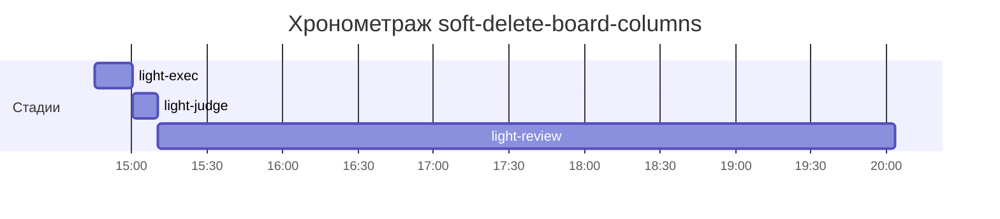

# Хронометраж: soft-delete-board-columns

Обновлено: 2026-10-08T20:03:24+05:00

## Стадии

| Стадия | Начало | Конец | Длит. | Ожидание | Чистое | Рестарты | Переделки |
|---|---|---|---|---|---|---|---|
| light-exec | 08.10 14:45 | 08.10 15:00 | 15м 03с | — | 15м 03с | — | — |
| light-judge | 08.10 15:00 | 08.10 15:10 | 9м 51с | — | 9м 51с | — | 9м 40с |
| light-review | 08.10 15:10 | 08.10 20:03 | 4ч 53м | — | 4ч 53м | — | — |
| **Итого (union)** | 08.10 14:45 | 08.10 20:03 | **5ч 18м** | **0с** | **5ч 18м** |  | **9м 40с** |

Wall-clock (первое→последнее событие журнала): **5ч 18м**; застаймлено (union стадий): 5ч 18м.

## События (fix-loop / повторные гейты / ошибки)

| Стадия | Тип | Событие | Начало | Длит. | Статус |
|---|---|---|---|---|---|
| light-judge | other | gates | 08.10 15:00 | 9м 40с | ok |

## Инструменты (тайминги гейтов/чекеров)

| Время | Инструмент | Статус | Итого | Шаги (по убыванию) |
|---|---|---|---|---|
| 08.10 15:00 | review_bundle | FAIL | 0с | api_conventions 0.1s · contract 0.1s · date_bound 0.1s · live_suite 0.1s · fixture_sync 0.1s · +5 шагов (0.0s) |
| 08.10 15:10 | e2e_evidence | PASS | 0с | status:passed 0s |

## ⚠ BLIND-GAP — интервалы без записей журнала (>5 мин)

Тяжёлый прогон обязан обрамляться `event-start`/`event-end` (§EE anti-polling):
без них нельзя отличить фоновый прогон от sleep-поллинга.

| Стадия | Начало | Конец | Длит. |
|---|---|---|---|
| light-review | 08.10 15:10 | 08.10 20:03 | 4ч 53м |
| light-judge | 08.10 15:00 | 08.10 15:10 | 9м 40с |

Суммарно вне наблюдения: **5ч 02м** (2 интервал(ов)).

## Пайп-передачи (§3.6: бандлы, контракты)

| Время | Стадия | Вид | Артефакт | Размер | Детали |
|---|---|---|---|---|---|
| 08.10 14:45 | — | passport | 0-setup/passport.md | 9KB | — |
| 08.10 15:00 | 8-code-review | bundle | 8-code-review/input-bundle.md | 21KB | чекеры 8✅/1❌/1⚠; патчи 132KB |

Бандлов: 1, суммарно 21KB — весь документный контекст, переданный между стадиями.
Нарушений пайп-контракта не зафиксировано (context-violations.jsonl отсутствует).

## Ожидание пользователя

Пауз не было.

## Диаграмма

