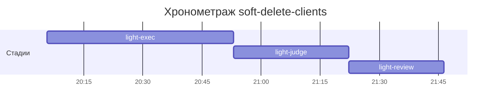

# Хронометраж: soft-delete-clients

Обновлено: 2026-10-08T21:46:26+05:00

## Стадии

| Стадия | Начало | Конец | Длит. | Ожидание | Чистое | Рестарты | Переделки |
|---|---|---|---|---|---|---|---|
| light-exec | 08.10 20:05 | 08.10 20:52 | 47м 20с | — | 47м 20с | — | — |
| light-judge | 08.10 20:52 | 08.10 21:22 | 29м 21с | — | 29м 21с | — | 23м 13с |
| light-review | 08.10 21:22 | 08.10 21:46 | 24м 07с | — | 24м 07с | — | 8м 04с |
| **Итого (union)** | 08.10 20:05 | 08.10 21:46 | **1ч 40м** | **0с** | **1ч 40м** |  | **31м 17с** |

Wall-clock (первое→последнее событие журнала): **1ч 40м**; застаймлено (union стадий): 1ч 40м.

## События (fix-loop / повторные гейты / ошибки)

| Стадия | Тип | Событие | Начало | Длит. | Статус |
|---|---|---|---|---|---|
| light-judge | other | gates | 08.10 20:52 | 12м 12с | ok |
| light-judge | other | rejudge | 08.10 21:10 | 11м 01с | ok |
| light-review | other | rejudge | 08.10 21:35 | 8м 04с | ok |

## Инструменты (тайминги гейтов/чекеров)

| Время | Инструмент | Статус | Итого | Шаги (по убыванию) |
|---|---|---|---|---|
| 08.10 20:52 | review_bundle | FAIL | 1с | api_conventions 0.1s · contract 0.1s · date_bound 0.1s · live_suite 0.1s · fixture_sync 0.1s · +5 шагов (0.1s) |
| 08.10 21:22 | e2e_evidence | PASS | 0с | status:passed 0s |
| 08.10 21:22 | review_bundle | FAIL | 0с | api_conventions 0.1s · contract 0.1s · date_bound 0.1s · live_suite 0.1s · fixture_sync 0.1s · +5 шагов (0.0s) |
| 08.10 21:35 | review_bundle | FAIL | 0с | api_conventions 0.1s · contract 0.1s · date_bound 0.1s · live_suite 0.1s · fixture_sync 0.1s · +5 шагов (0.0s) |
| 08.10 21:45 | e2e_evidence | PASS | 0с | status:passed 0s |

## ⚠ BLIND-GAP — интервалы без записей журнала (>5 мин)

Тяжёлый прогон обязан обрамляться `event-start`/`event-end` (§EE anti-polling):
без них нельзя отличить фоновый прогон от sleep-поллинга.

| Стадия | Начало | Конец | Длит. |
|---|---|---|---|
| light-review | 08.10 21:22 | 08.10 21:35 | 13м 32с |
| light-judge | 08.10 20:52 | 08.10 21:05 | 12м 12с |
| light-judge | 08.10 21:10 | 08.10 21:21 | 11м 01с |
| light-review | 08.10 21:35 | 08.10 21:43 | 8м 04с |

Суммарно вне наблюдения: **44м 49с** (4 интервал(ов)).

## Пайп-передачи (§3.6: бандлы, контракты)

| Время | Стадия | Вид | Артефакт | Размер | Детали |
|---|---|---|---|---|---|
| 08.10 20:05 | — | passport | 0-setup/passport.md | 15KB | — |
| 08.10 20:52 | 8-code-review | bundle | 8-code-review/input-bundle.md | 33KB | чекеры 8✅/1❌/1⚠; патчи 310KB |
| 08.10 21:22 | 8-code-review | bundle | 8-code-review/input-bundle.md | 33KB | чекеры 8✅/1❌/1⚠; патчи 319KB |
| 08.10 21:35 | 8-code-review | bundle | 8-code-review/input-bundle.md | 33KB | чекеры 8✅/1❌/1⚠; патчи 347KB |

Бандлов: 3, суммарно 101KB — весь документный контекст, переданный между стадиями.
Нарушений пайп-контракта не зафиксировано (context-violations.jsonl отсутствует).

## Ожидание пользователя

Пауз не было.

## Диаграмма

