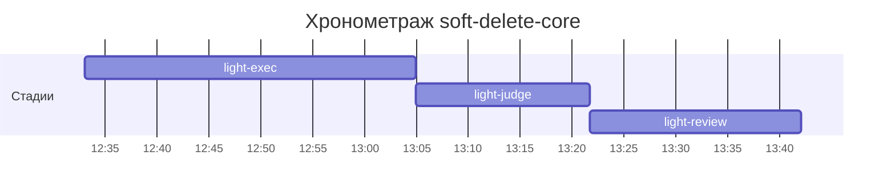

# Хронометраж: soft-delete-core

Обновлено: 2026-10-08T13:42:07+05:00

## Стадии

| Стадия | Начало | Конец | Длит. | Ожидание | Чистое | Рестарты | Переделки |
|---|---|---|---|---|---|---|---|
| light-exec | 08.10 12:32 | 08.10 13:04 | 31м 56с | — | 31м 56с | — | — |
| light-judge | 08.10 13:04 | 08.10 13:21 | 16м 47с | — | 16м 47с | — | 13м 45с |
| light-review | 08.10 13:21 | 08.10 13:42 | 20м 25с | — | 20м 25с | — | 8м 27с |
| **Итого (union)** | 08.10 12:32 | 08.10 13:42 | **1ч 09м** | **0с** | **1ч 09м** |  | **22м 12с** |

Wall-clock (первое→последнее событие журнала): **1ч 09м**; застаймлено (union стадий): 1ч 09м.

## События (fix-loop / повторные гейты / ошибки)

| Стадия | Тип | Событие | Начало | Длит. | Статус |
|---|---|---|---|---|---|
| light-judge | other | integration | 08.10 13:05 | 1м 53с | ok |
| light-judge | other | e2e-run | 08.10 13:07 | 6м 10с | ok |
| light-judge | other | e2e-run-2 | 08.10 13:15 | 5м 42с | ok |
| light-review | other | rejudge | 08.10 13:31 | 8м 27с | ok |

## Инструменты (тайминги гейтов/чекеров)

| Время | Инструмент | Статус | Итого | Шаги (по убыванию) |
|---|---|---|---|---|
| 08.10 13:05 | review_bundle | FAIL | 1с | go_naming 0.1s · api_conventions 0.1s · contract 0.1s · date_bound 0.1s · fuzz_verdict 0.1s · +5 шагов (0.4s) |
| 08.10 13:21 | e2e_evidence | PASS | 0с | status:passed 0s |
| 08.10 13:21 | review_bundle | FAIL | 0с | api_conventions 0.1s · contract 0.1s · date_bound 0.1s · live_suite 0.1s · fixture_sync 0.1s · +5 шагов (0.0s) |
| 08.10 13:40 | e2e_evidence | PASS | 0с | status:passed 0s |
| 08.10 13:40 | review_bundle | FAIL | 0с | api_conventions 0.1s · contract 0.1s · date_bound 0.1s · live_suite 0.1s · fixture_sync 0.1s · +5 шагов (0.0s) |

## ⚠ BLIND-GAP — интервалы без записей журнала (>5 мин)

Тяжёлый прогон обязан обрамляться `event-start`/`event-end` (§EE anti-polling):
без них нельзя отличить фоновый прогон от sleep-поллинга.

| Стадия | Начало | Конец | Длит. |
|---|---|---|---|
| light-review | 08.10 13:21 | 08.10 13:31 | 10м 03с |
| light-review | 08.10 13:31 | 08.10 13:40 | 8м 27с |
| light-judge | 08.10 13:07 | 08.10 13:13 | 6м 10с |
| light-judge | 08.10 13:15 | 08.10 13:21 | 5м 42с |

Суммарно вне наблюдения: **30м 22с** (4 интервал(ов)).

## Пайп-передачи (§3.6: бандлы, контракты)

| Время | Стадия | Вид | Артефакт | Размер | Детали |
|---|---|---|---|---|---|
| 08.10 12:32 | — | passport | 0-setup/passport.md | 17KB | — |
| 08.10 13:05 | 8-code-review | bundle | 8-code-review/input-bundle.md | 38KB | чекеры 8✅/1❌/1⚠; патчи 272KB |
| 08.10 13:21 | 8-code-review | bundle | 8-code-review/input-bundle.md | 38KB | чекеры 8✅/1❌/1⚠; патчи 273KB |
| 08.10 13:40 | 8-code-review | bundle | 8-code-review/input-bundle.md | 39KB | чекеры 8✅/1❌/1⚠; патчи 298KB |

Бандлов: 3, суммарно 116KB — весь документный контекст, переданный между стадиями.
Нарушений пайп-контракта не зафиксировано (context-violations.jsonl отсутствует).

## Ожидание пользователя

Пауз не было.

## Диаграмма

