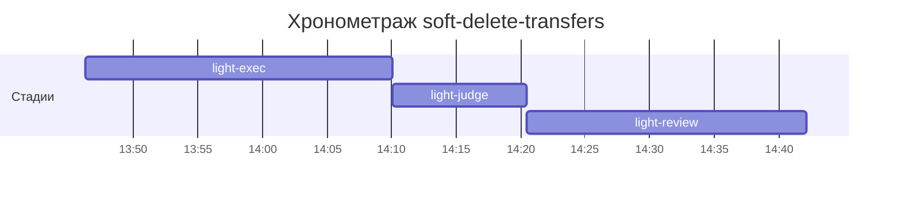

# Хронометраж: soft-delete-transfers

Обновлено: 2026-10-08T14:42:09+05:00

## Стадии

| Стадия | Начало | Конец | Длит. | Ожидание | Чистое | Рестарты | Переделки |
|---|---|---|---|---|---|---|---|
| light-exec | 08.10 13:46 | 08.10 14:10 | 23м 50с | — | 23м 50с | — | — |
| light-judge | 08.10 14:10 | 08.10 14:20 | 10м 21с | — | 10м 21с | — | 8м 48с |
| light-review | 08.10 14:20 | 08.10 14:42 | 21м 42с | — | 21м 42с | — | 8м 02с |
| **Итого (union)** | 08.10 13:46 | 08.10 14:42 | **55м 53с** | **0с** | **55м 53с** |  | **16м 50с** |

Wall-clock (первое→последнее событие журнала): **55м 53с**; застаймлено (union стадий): 55м 53с.

## События (fix-loop / повторные гейты / ошибки)

| Стадия | Тип | Событие | Начало | Длит. | Статус |
|---|---|---|---|---|---|
| light-judge | other | gates | 08.10 14:10 | 8м 48с | ok |
| light-review | other | rejudge | 08.10 14:29 | 8м 02с | ok |

## Инструменты (тайминги гейтов/чекеров)

| Время | Инструмент | Статус | Итого | Шаги (по убыванию) |
|---|---|---|---|---|
| 08.10 14:10 | review_bundle | FAIL | 0с | api_conventions 0.1s · contract 0.1s · date_bound 0.1s · live_suite 0.1s · fixture_sync 0.1s · +5 шагов (0.0s) |
| 08.10 14:20 | e2e_evidence | PASS | 0с | status:passed 0s |
| 08.10 14:29 | review_bundle | FAIL | 0с | api_conventions 0.1s · contract 0.1s · date_bound 0.1s · live_suite 0.1s · fixture_sync 0.1s · +5 шагов (0.0s) |
| 08.10 14:40 | e2e_evidence | PASS | 0с | status:passed 0s |

## ⚠ BLIND-GAP — интервалы без записей журнала (>5 мин)

Тяжёлый прогон обязан обрамляться `event-start`/`event-end` (§EE anti-polling):
без них нельзя отличить фоновый прогон от sleep-поллинга.

| Стадия | Начало | Конец | Длит. |
|---|---|---|---|
| light-judge | 08.10 14:10 | 08.10 14:18 | 8м 48с |
| light-review | 08.10 14:20 | 08.10 14:29 | 8м 45с |
| light-review | 08.10 14:29 | 08.10 14:37 | 8м 01с |

Суммарно вне наблюдения: **25м 34с** (3 интервал(ов)).

## Пайп-передачи (§3.6: бандлы, контракты)

| Время | Стадия | Вид | Артефакт | Размер | Детали |
|---|---|---|---|---|---|
| 08.10 13:46 | — | passport | 0-setup/passport.md | 13KB | — |
| 08.10 14:10 | 8-code-review | bundle | 8-code-review/input-bundle.md | 31KB | чекеры 7✅/2❌/1⚠; патчи 228KB |
| 08.10 14:29 | 8-code-review | bundle | 8-code-review/input-bundle.md | 31KB | чекеры 8✅/1❌/1⚠; патчи 241KB |

Бандлов: 2, суммарно 62KB — весь документный контекст, переданный между стадиями.
Нарушений пайп-контракта не зафиксировано (context-violations.jsonl отсутствует).

## Ожидание пользователя

Пауз не было.

## Диаграмма

