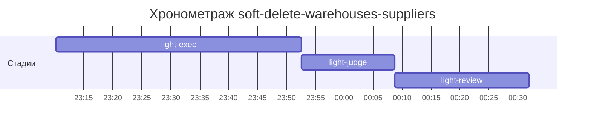

# Хронометраж: soft-delete-warehouses-suppliers

Обновлено: 2026-10-09T00:31:57+05:00

## Стадии

| Стадия | Начало | Конец | Длит. | Ожидание | Чистое | Рестарты | Переделки |
|---|---|---|---|---|---|---|---|
| light-exec | 08.10 23:10 | 08.10 23:52 | 42м 30с | — | 42м 30с | — | — |
| light-judge | 08.10 23:52 | 09.10 00:08 | 16м 05с | — | 16м 05с | — | 14м 03с |
| light-review | 09.10 00:08 | 09.10 00:31 | 23м 12с | — | 23м 12с | — | 8м 22с |
| **Итого (union)** | 08.10 23:10 | 09.10 00:31 | **1ч 21м** | **0с** | **1ч 21м** |  | **22м 25с** |

Wall-clock (первое→последнее событие журнала): **1ч 21м**; застаймлено (union стадий): 1ч 21м.

## События (fix-loop / повторные гейты / ошибки)

| Стадия | Тип | Событие | Начало | Длит. | Статус |
|---|---|---|---|---|---|
| light-judge | other | gates | 08.10 23:52 | 7м 26с | ok |
| light-judge | other | e2e-run-2 | 09.10 00:01 | 6м 37с | ok |
| light-review | other | rejudge | 09.10 00:21 | 8м 22с | ok |

## Инструменты (тайминги гейтов/чекеров)

| Время | Инструмент | Статус | Итого | Шаги (по убыванию) |
|---|---|---|---|---|
| 08.10 23:52 | review_bundle | FAIL | 0с | api_conventions 0.1s · contract 0.1s · date_bound 0.1s · live_suite 0.1s · fixture_sync 0.1s · +5 шагов (0.0s) |
| 09.10 00:08 | e2e_evidence | PASS | 0с | status:passed 0s |
| 09.10 00:21 | review_bundle | FAIL | 0с | api_conventions 0.1s · contract 0.1s · date_bound 0.1s · live_suite 0.1s · fixture_sync 0.1s · +5 шагов (0.0s) |
| 09.10 00:30 | e2e_evidence | PASS | 0с | status:passed 0s |

## ⚠ BLIND-GAP — интервалы без записей журнала (>5 мин)

Тяжёлый прогон обязан обрамляться `event-start`/`event-end` (§EE anti-polling):
без них нельзя отличить фоновый прогон от sleep-поллинга.

| Стадия | Начало | Конец | Длит. |
|---|---|---|---|
| light-review | 09.10 00:08 | 09.10 00:21 | 12м 50с |
| light-review | 09.10 00:21 | 09.10 00:29 | 8м 21с |
| light-judge | 08.10 23:52 | 09.10 00:00 | 7м 26с |
| light-judge | 09.10 00:01 | 09.10 00:08 | 6м 37с |

Суммарно вне наблюдения: **35м 14с** (4 интервал(ов)).

## Пайп-передачи (§3.6: бандлы, контракты)

| Время | Стадия | Вид | Артефакт | Размер | Детали |
|---|---|---|---|---|---|
| 08.10 23:10 | — | passport | 0-setup/passport.md | 21KB | — |
| 08.10 23:52 | 8-code-review | bundle | 8-code-review/input-bundle.md | 39KB | чекеры 8✅/1❌/1⚠; патчи 364KB |
| 09.10 00:21 | 8-code-review | bundle | 8-code-review/input-bundle.md | 40KB | чекеры 8✅/1❌/1⚠; патчи 392KB |

Бандлов: 2, суммарно 80KB — весь документный контекст, переданный между стадиями.
Нарушений пайп-контракта не зафиксировано (context-violations.jsonl отсутствует).

## Ожидание пользователя

Пауз не было.

## Диаграмма

