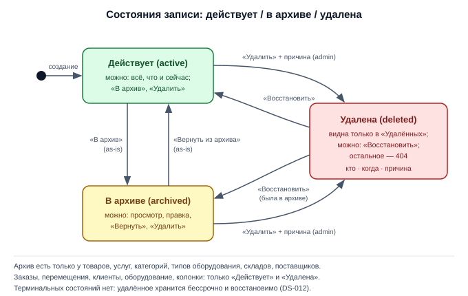
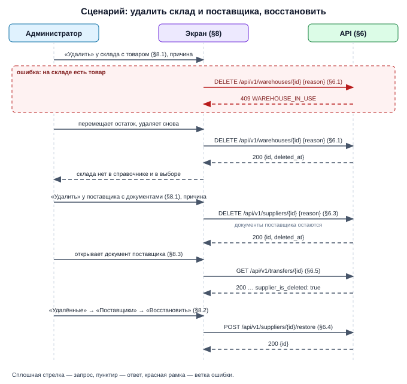

# Draft Spec: Мягкое удаление — склады и поставщики

**Tier:** S · **Совместимость:** MVP · **Режим:** new

**Дата:** 2026-10-08 | **Статус:** draft → final (после подтверждения пользователя) | **Tier:** S
**Совместимость:** MVP (DS-022) — рабочей версии с живыми пользователями нет: таблицы и адреса меняем свободно, без переходного периода и отката; данные на базе сохраняются — все существующие склады и поставщики после миграции считаются действующими, признак архива не меняется
**UI-scope:** swagger:no | adaptive:min | themes:both (DS-023)
**Источник:** мастер-спека `docs/features/soft-delete/draft-spec.md` (§4.10, §4.11, §6.19–§6.22, §6.26, §8.5) + её журнал `docs/features/soft-delete/draft-spec-decisions.md` + as-is факты кода (`internal/features/warehouses`, `internal/features/suppliers`, `internal/features/transfers/dto.go`, `migrations/0008_warehouses.up.sql`, `migrations/0012_suppliers.up.sql`)
**Часть 6 из 6 мастер-спеки `soft-delete`; зависит от: 1 (`soft-delete-core`).** Номера DS и TS — мастер-идентификаторы, не перенумерованы. Номера разделов — свои: §6.1–§6.4 = мастер §6.19–§6.22, §6.5 = строки мастера §6.26 про склады и поставщиков; §8.1 = часть мастера §8.5.

> После мержа этой части: у складов и поставщиков впервые появляется действие «Удалить» (до этого был только архив) — с причиной и с восстановлением из вкладок «Склады» и «Поставщики» раздела «Удалённые». Склад удаляется только пустой: без товара, без оборудования, без незавершённых перемещений. Поставщик удаляется при любых документах. Название удалённого склада или поставщика свободно.

## §1. Суть задачи
Склады и поставщики получают восстановимое удаление рядом с архивом. Для администратора.

**Бизнес (что делает пользователь/процесс):**
1. Администратор удаляет пустой склад с причиной; склад с товаром, оборудованием или незавершёнными перемещениями удалить нельзя — система называет, что мешает (§8.1) — DS-021, DS-020.
2. Администратор удаляет поставщика с причиной — документы поставщика остаются и показывают бейдж «удалён» (§8.1, §8.3) — DS-014.
3. Администратор по-прежнему отправляет склад и поставщика в архив — отдельное действие (§8.1) — DS-009.
4. Администратор восстанавливает склад или поставщика из «Удалённых» — активным либо архивным, каким был (§8.2) — DS-009.

**Логика (правила системы):**
1. Склад не удаляется, пока на нём есть товар с ненулевым остатком, числится оборудование либо есть действующий документ в «Заявка» или «В пути» с этим складом — DS-021. Удалённых единиц на складе быть не должно (удалить можно только оборудование, находящееся у клиента, DS-041); проверка всё равно считает все единицы склада без условия по удалению — как страховка.
1а. Остаток, появившийся на удалённом складе позже (возврат товара из заказа по строке этого склада), виден в отчёте «Остатки» с пометкой «удалён» и может быть списан корректировкой — DS-042.
2. Последний активный склад не удаляется — системе нужен склад по умолчанию — DS-021.
3. Поставщик удаляется при любых документах; в документах остаётся с бейджем «удалён» — DS-014.
4. Название удалённого склада и поставщика свободно; восстановление при занятом названии — отказ — DS-017.
5. Удалённые склад и поставщик не выбираются в новых документах, заказах, остатках; для обычных адресов не существуют — DS-014, DS-026.
6. Архив и удаление независимы; при восстановлении признак архива прежний — DS-009.
7. Время: `f:deleted_at` — UTC (`timestamptz`), показ и фильтр — по поясу пользователя, «ДД.ММ.ГГГГ ЧЧ:ММ» — DS-025 (краткий дубль §3).
8. Конкурентный доступ: удаляем склад → одна транзакция под блокировкой активных складов (та же, что у архивирования) с проверками и записью; удаляем поставщика → один UPDATE с условием «ещё не удалён»; восстанавливаем → условие «удалён», название держит частичный индекс — DS-024 (краткий дубль §3).

**Техника (API/данные/интеграции):**
1. Данные: по три новые колонки в `t:warehouses` и `t:suppliers`; два уникальных индекса названий становятся частичными; функция базы `default_warehouse_id()` перестаёт выбирать удалённые склады (§4).
2. API: четыре новых адреса — удаление и восстановление склада и поставщика (§6.1–§6.4); новые поля-признаки в ответах документов и карточки заказа, условие «не удалён» в списках и выборе, виды раздела «Удалённые» и служебной уборки, новая серверная форма удаления склада (§6.5).
3. Пакеты: `internal/features/warehouses`, `internal/features/suppliers`, `internal/features/transfers`, `internal/features/board`, `internal/features/catalog`, `internal/features/softdelete`.
4. Внешних систем нет.

**UI (графическая часть):**
1. «Склады»: новая кнопка «Удалить» в строке склада рядом с «В архив» (§8.1).
2. «Поставщики»: новая кнопка «Удалить» в форме поставщика (§8.1).
3. «Удалённые»: новые вкладки «Склады» и «Поставщики» (§8.2).
4. «Перемещения», карточка заказа: бейджи «удалён» у склада и поставщика; выбор без удалённых (§8.3).

Out-of-scope:
1. Автоматический перенос остатков и оборудования с удаляемого склада — не делаем: сначала переместить вручную (решение пользователя, DS-021).
2. Пометка удалённого товара в отчёте «Остатки» — часть 5 (DS-042).
3. Окончательное удаление — не делаем (решение пользователя, DS-012).

## §2. Интеграции и master-data
Потоки: не применимо — внешних систем нет.

Справочники (master-data):

| Справочник | Источник правды | Синхронизация | Где используется |
|---|---|---|---|
| `t:users` | эта же база (пакет `users`) | нет | `f:deleted_by` в `t:warehouses` и `t:suppliers`; колонка «Кто удалил» — DS-030 |

## §3. Нефункциональные требования

**Конкурентность (по операциям):**
1. **Удаление склада:**
   - одна транзакция: действующие активные склады блокируются `FOR UPDATE` по возрастанию `f:id` (as-is порядок архивирования склада), удаляемый склад — тоже, если он архивный; под блокировкой — четыре проверки (остаток товара, оборудование, незавершённые документы, последний активный) и UPDATE с условием `deleted_at IS NULL`; 0 строк → 404 — DS-021, DS-024
   - два администратора одновременно удаляют (или один удаляет, другой архивирует) два последних активных склада: ровно один запрос успешен, второй — 409 `WAREHOUSE_LAST_ACTIVE` (as-is гарантия архивирования сохраняется)
   - приход товара, перемещение оборудования на склад, создание документа со складом одновременно с удалением: эти операции проверяют `deleted_at IS NULL` склада под своей блокировкой — удаление выиграло → 400 `warehouse_id: not_found`; операция выиграла → удаление видит остаток, оборудование или документ и отказывает
2. **Удаление поставщика:**
   - один UPDATE с условием `deleted_at IS NULL`; 0 строк → 404 `SUPPLIER_NOT_FOUND`; создание документа с этим поставщиком, прошедшее раньше, остаётся — документ показывает бейдж (DS-014)
3. **Восстановление склада и поставщика:**
   - один UPDATE с условием `deleted_at IS NOT NULL`; не удалён → 409 `NOT_DELETED`; нарушение частичного уникального индекса названия → 409 `NAME_TAKEN` — DS-017, DS-024
4. **Создание и переименование одновременно с восстановлением записи с тем же названием:**
   - исход определяет частичный уникальный индекс: ровно один запрос успешен; второй — 400 `name: duplicate` у создания (as-is) либо 409 `NAME_TAKEN` у восстановления — DS-017
5. **Увеличение количества в строке товара заказа одновременно с удалением её склада:**
   - правка количества читает склад строки под блокировкой и ждёт транзакцию удаления склада: удаление выиграло → 409 `WAREHOUSE_DELETED`; увеличение выиграло → списанный товар создаёт остаток либо долг, удаление склада видит ненулевой остаток и отказывает (409 `WAREHOUSE_IN_USE`) — DS-050
6. **Правка действующей записи:**
   - версии у склада и поставщика нет — last-write-wins (as-is); правка удалённой → 404 — DS-026

**Аудит:**
- на записи хранится последнее удаление: `f:deleted_by`, `f:deleted_at`, `f:delete_reason`; при восстановлении очищаются — DS-030
- факт удаления и восстановления — в журнал приложения (`slog`, info); причина в журнал не пишется

**Время/таймзоны:**
- хранение: `f:deleted_at` — `timestamptz`, UTC, `now()` — DS-025
- фильтр периода и показ в разделе «Удалённые» — по поясу пользователя, «ДД.ММ.ГГГГ ЧЧ:ММ» (механика части 1)

**Метрики/таймстемпы:**
- новый таймстемп — `f:deleted_at`; счётчики вкладок — `f:counts.warehouses`, `f:counts.suppliers` (часть 1)

**Offline / деградация / восстановление:**
- одиночные запросы и отправки форм; при потере связи — тост либо ошибка страницы, повтор безопасен (см. «Идемпотентность» в §6)

**Объёмы и производительность:**
- складов единицы, поставщиков десятки-сотни; проверки удаления склада идут по индексам `i:product_stock_warehouse_id_idx`, `i:equipment_warehouse_id_idx`, `i:transfers_from_warehouse_id_idx`, `i:transfers_to_warehouse_id_idx`

**Логирование и чувствительные данные:**
- причина удаления и контакты поставщика в журнал не пишутся; раздел «Удалённые» — только администратору — DS-003

**Формат ошибок:**
- `pkg/errorspkg`: `{code, message, details}`; 400 → `details.fields[]`; отказ в доступе — 403 «Нет доступа»

**Abuse cases (инсайдерские риски — вход для adversarial E2E TD-4):**
1. Исполнитель вызывает удаление или восстановление склада либо поставщика → 403 «Нет доступа» (группы `/api/v1/warehouses` и `/api/v1/suppliers` закрыты для исполнителя целиком, as-is) — DS-003.
2. Идентификатор удалённого склада или поставщика подставляется в новый документ, строку товара заказа, корректировку остатка в обход выпадающего списка → 400 `not_found` по полю — DS-014.
3. Склад удаляется параллельно с приходом на него товара → исход детерминирован блокировками: либо 409, либо приход получает 400 — DS-021.
4. Попытка оставить систему без склада по умолчанию удалением всех активных складов → 409 `WAREHOUSE_LAST_ACTIVE` — DS-021.
5. Причина из пробелов или длиннее 500 символов → 400 — DS-020.

**Применённые zap-дефолты** (zap-list — стандарты проекта из CLAUDE.md, применяются автоматически, без вопросов; в §9 — источник `zap`):
- коды ответов: 404 / 403 / 409 (zap)
- обработка синхронная (zap)
- миграции вручную (`make migrate-up`) (zap)

## §4. Данные
Легенда колонки «Обяз.»: `да` — клиент обязан передать при создании/правке; `нет` — опционально; `авто` — заполняет система (PK, дефолты, таймстемпы, значения из URL/сессии); `условно` — зависит от правила, оно указано в Описании. NULL — DDL-факт, Обяз. — семантика заполнения.

### §4.1. `t:warehouses` (существующая таблица — фича добавляет колонки миграцией ALTER, созданием не владеет)
Склад. Создана в `migrations/0008_warehouses.up.sql`, позднейшие миграции её не меняли. Строки без пометки «новое» — существующие поля без изменений.

| Поле | Тип | NULL | Default | Обяз. | Описание | DS |
|---|---|---|---|---|---|---|
| `f:id` | uuid | нет | `gen_random_uuid()` | авто | PK (as-is) | DS-021 |
| `f:name` | text | нет | — | да | название, не пусто после обрезки пробелов, не длиннее 100 символов; уникально без учёта регистра — теперь только среди действующих (as-is поле) | DS-017 |
| `f:position` | int | нет | — | авто | порядок в списках, не меньше 1 (as-is); по нему выбирается склад по умолчанию; удалением и восстановлением не меняется | DS-021 |
| `f:is_active` | boolean | нет | true | нет | false — в архиве (as-is); удалением и восстановлением не меняется | DS-009 |
| `f:created_at` | timestamptz | нет | `now()` | авто | момент создания (as-is) | DS-025 |
| `f:updated_at` | timestamptz | нет | `now()` | авто | момент изменения (as-is); обновляется при удалении и восстановлении | DS-024 |
| **`f:deleted_at`** (новое) | timestamptz | да | — | авто | момент удаления, UTC, `now()`; NULL — склад действует | DS-021, DS-025 |
| **`f:deleted_by`** (новое) | uuid | да | — | авто | FK → `t:users(id)` `ON DELETE RESTRICT`; кто удалил — из сессии | DS-003, DS-030 |
| **`f:delete_reason`** (новое) | text | да | — | условно | причина удаления: обязательна в запросе удаления, 1–500 символов после обрезки крайних пробелов | DS-020 |

Ключи и индексы:
- PK: `f:id` (as-is)
- UNIQUE: `i:warehouses_name_lower_uq` (`lower(btrim(name))`) пересоздаётся частичным — `WHERE deleted_at IS NULL` — DS-017
- Индексы (новое): `i:warehouses_deleted_at_idx` (`deleted_at DESC`, `id`) `WHERE deleted_at IS NOT NULL` — вкладка «Склады» раздела «Удалённые»
- CHECK (as-is): название, `position >= 1`
- CHECK (новое) `i:warehouses_deleted_chk`: три поля удаления либо все NULL, либо все заполнены; `char_length(btrim(delete_reason))` от 1 до 500 — DS-030
- Функция базы `default_warehouse_id()` (as-is: первый активный склад по `position`, `id`) получает условие `deleted_at IS NULL` ; выбор склада по умолчанию в коде (`DefaultWarehouse`) берёт только существующий активный склад и повторяет выбор, если склад исчез между чтением и использованием (уточнение реализации) — DS-021

Связи (одна связь = одна строка):
- 1→N `t:product_stock.warehouse_id` — RESTRICT (as-is) — строки остатков удалённого склада остаются (нулевые на момент удаления)
- 1→N `t:equipment.warehouse_id` — RESTRICT (as-is) — на момент удаления единиц на складе нет
- 1→N `t:transfers.from_warehouse_id`, `t:transfers.to_warehouse_id` — RESTRICT (as-is) — завершённые, отменённые и удалённые документы остаются, склад показывается с бейджем (DS-014)
- 1→N `t:subtask_products.warehouse_id`, `t:task_stock.warehouse_id`, `t:stock_movements.warehouse_id` — RESTRICT (as-is) — строки остаются (DS-014)
- N→1 `t:users` (`f:deleted_by`) — RESTRICT (новое)

Поведение при действиях (одно действие = одна строка):
- Создание и переименование: название сверяется только с действующими складами; занято → 400 `VALIDATION` (`name: duplicate`, as-is) — DS-017
- Архив и возврат из архива: как сейчас (as-is проверки `WAREHOUSE_LAST_ACTIVE`, `WAREHOUSE_IN_USE`), с одной правкой: проверка незавершённых документов считает только действующие — мягко удалённая заявка архивированию не мешает (DS-044); для удалённого склада → 404 `WAREHOUSE_NOT_FOUND` — DS-009, DS-026
- Удаление: только admin, причина обязательна; одна транзакция под блокировкой активных складов: (1) в `t:product_stock` есть строка склада с `stock <> 0` → 409 `WAREHOUSE_IN_USE`; (2) в `t:equipment` есть единица с этим `f:warehouse_id` → 409 `WAREHOUSE_IN_USE` (запрос без условия по `deleted_at` единицы: удалённых единиц на складе по DS-041 не бывает, условие не ставится намеренно — страховка); (3) есть действующий документ `t:transfers` в `s:requested` или `s:in_transit` с этим складом → 409 `WAREHOUSE_IN_USE`; мягко удалённые заявки не считаются (DS-044); (4) склад активен и других действующих активных нет → 409 `WAREHOUSE_LAST_ACTIVE`; затем запись трёх полей — DS-021, DS-020
- Восстановление: только admin; среди действующих складов есть такое название → 409 `NAME_TAKEN`; `f:is_active` и `f:position` прежние — DS-017, DS-009
- Выбор удалённого склада в документе, в строке товара заказа, в остатках товара → 400 `VALIDATION` (`warehouse_id: not_found`) — DS-014
- Остаток на удалённом складе: возврат товара из заказа по строке этого склада меняет остаток как обычно (отмена проведения документа с удалённым складом отклоняется, DS-046); ненулевой остаток виден в отчёте «Остатки» в колонке склада с пометкой «удалён»; ручная корректировка остатка на удалённом складе из отчёта «Остатки» разрешена только на списание — к нулю, без увеличения и смены знака (DS-048); архивный и удалённый склад с ненулевым остатком показываются в отчёте колонкой с пометкой (DS-049) — DS-042
- Строка товара заказа на удалённом складе: увеличение количества → 409 `WAREHOUSE_DELETED`; то же количество, уменьшение, удаление строки и смена склада на действующий — разрешены; перенос заказа по колонкам и восстановление заказа не блокируются, долг на удалённом складе допустим — DS-050
- Физическое удаление: только служебная уборка автотестов (§6.5) — DS-027

Инварианты (правило → чем держится → DS):
- удалённая заявка не возвращается на удалённый склад: восстановление заявки, склад или поставщик которой в удалённых, → 409 `TRANSFER_HAS_DELETED_REFS` → проверка в восстановлении документа (часть 2 §6.2), добавляется этой частью → DS-045
- на момент удаления на складе нет товара и оборудования → проверки в транзакции удаления под блокировкой → DS-021
- остаток, появившийся на удалённом складе после удаления, не теряется из вида → отчёт «Остатки» включает удалённые склады с ненулевым остатком → DS-042
- в системе есть действующий активный склад → проверка «последний активный» под блокировкой активных складов при удалении и архивировании → DS-021
- склад по умолчанию — действующий → условие `deleted_at IS NULL` в `default_warehouse_id()` → DS-021
- название уникально среди действующих → частичный уникальный индекс → DS-017

### §4.2. `t:suppliers` (существующая таблица — фича добавляет колонки миграцией ALTER, созданием не владеет)
Поставщик. Создана в `migrations/0012_suppliers.up.sql`, позднейшие миграции её не меняли.

| Поле | Тип | NULL | Default | Обяз. | Описание | DS |
|---|---|---|---|---|---|---|
| `f:id` | uuid | нет | `gen_random_uuid()` | авто | PK (as-is) | DS-014 |
| `f:name` | text | нет | — | да | название, не пусто после обрезки пробелов, не длиннее 200 символов; уникально без учёта регистра — теперь только среди действующих (as-is поле) | DS-017 |
| `f:contact_name` | text | нет | `''` | нет | контактное лицо, до 200 символов (as-is) | DS-014 |
| `f:phone` | text | нет | `''` | нет | телефон — строка, до 50 символов (as-is) | DS-014 |
| `f:address` | text | нет | `''` | нет | адрес, до 500 символов (as-is) | DS-014 |
| `f:note` | text | нет | `''` | нет | примечание, до 1000 символов (as-is) | DS-014 |
| `f:is_active` | boolean | нет | true | нет | false — в архиве (as-is); удалением и восстановлением не меняется | DS-009 |
| `f:created_at` | timestamptz | нет | `now()` | авто | момент создания (as-is) | DS-025 |
| `f:updated_at` | timestamptz | нет | `now()` | авто | момент изменения (as-is); обновляется при удалении и восстановлении | DS-024 |
| **`f:deleted_at`** (новое) | timestamptz | да | — | авто | момент удаления, UTC, `now()`; NULL — поставщик действует | DS-014, DS-025 |
| **`f:deleted_by`** (новое) | uuid | да | — | авто | FK → `t:users(id)` `ON DELETE RESTRICT`; кто удалил — из сессии | DS-003, DS-030 |
| **`f:delete_reason`** (новое) | text | да | — | условно | причина удаления: обязательна в запросе удаления, 1–500 символов после обрезки крайних пробелов | DS-020 |

Ключи и индексы:
- PK: `f:id` (as-is)
- UNIQUE: `i:suppliers_name_lower_uq` (`lower(btrim(name))`) пересоздаётся частичным — `WHERE deleted_at IS NULL` — DS-017
- Индексы (новое): `i:suppliers_deleted_at_idx` (`deleted_at DESC`, `id`) `WHERE deleted_at IS NOT NULL` — вкладка «Поставщики» раздела «Удалённые»
- CHECK (as-is): длины полей
- CHECK (новое) `i:suppliers_deleted_chk`: три поля удаления вместе; длина причины 1–500 — DS-030

Связи (одна связь = одна строка):
- 1→N `t:transfers.supplier_id` — RESTRICT (as-is) — документы остаются, поставщик показывается с бейджем (DS-014)
- N→1 `t:users` (`f:deleted_by`) — RESTRICT (новое)

Поведение при действиях (одно действие = одна строка):
- Создание и переименование: название сверяется только с действующими поставщиками; занято → 400 `VALIDATION` (`name: duplicate`, as-is) — DS-017
- Архив и возврат из архива (`PUT` с `f:is_active`): как сейчас; для удалённого → 404 `SUPPLIER_NOT_FOUND` — DS-009, DS-026
- Удаление: только admin, причина обязательна; документы поставщика в любом статусе не мешают — DS-014
- Восстановление: только admin; среди действующих поставщиков есть такое название → 409 `NAME_TAKEN`; `f:is_active` прежний — DS-017, DS-009
- Выбор удалённого поставщика в новом документе → 400 `VALIDATION` (`supplier_id: not_found`) — DS-014
- Физическое удаление: только служебная уборка автотестов (§6.5) — DS-027

Инварианты (правило → чем держится → DS):
- название уникально среди действующих → частичный уникальный индекс → DS-017
- удалённый поставщик не виден в списках и выборе → условие `suppliers.deleted_at IS NULL` в запросах списка, чтения и проверки существования; в соединении из документов условие НЕ ставится → DS-014

### §4.3. `t:product_stock` (общая таблица, чужая — фича использует, не владеет)
Остаток товара по складам. Часть 6 таблицу не меняет: читает строки склада при его удалении. DDL: `migrations/0008_warehouses.up.sql`.

| Поле | Тип | NULL | Default | Обяз. | Описание | DS |
|---|---|---|---|---|---|---|
| `f:product_id` | uuid | нет | — | авто | FK → `t:products(id)` `ON DELETE CASCADE`; часть PK; товар может быть мягко удалён — его остаток на складе всё равно считается | DS-021 |
| `f:warehouse_id` | uuid | нет | — | да | FK → `t:warehouses(id)` `ON DELETE RESTRICT`; часть PK | DS-021 |
| `f:stock` | numeric(12,3) | нет | 0 | нет | остаток товара на складе; может быть отрицательным; не равен нулю → склад не удаляется | DS-021 |
| `f:min_stock` | numeric(12,3) | нет | 0 | нет | минимальный остаток, не меньше 0 | DS-021 |
| `f:box` | text | нет | `''` | нет | коробка хранения | DS-021 |
| `f:place` | text | нет | `''` | нет | место хранения | DS-021 |

Ключи и индексы:
- PK: (`product_id`, `warehouse_id`)
- UNIQUE: нет
- Индексы (as-is): `i:product_stock_warehouse_id_idx` (`warehouse_id`) — проверка остатка при удалении склада

Используется в модулях (used by):

| Модуль | Ключ-дискриминатор (если есть) | Роль (writer/reader) | Что делает | Путь |
|---|---|---|---|---|
| `catalog` | — | writer | остатки в форме товара, ручная правка | `internal/features/catalog/products_stock.go` |
| `board` | — | writer | списание и возврат по заказам, отчёт «Остатки», корректировка | `internal/features/board/stock_engine.go`, `stock_repo.go` |
| `transfers` | — | writer | приход и расход при проведении документов | `internal/features/transfers/repo.go` |
| `warehouses` | — | reader | в части 6 — проверка нулевого остатка при удалении склада | `internal/features/warehouses/repo.go` |

### §4.4. `t:equipment` (общая таблица, чужая — фича использует, не владеет)
Единица оборудования клиента. Часть 6 таблицу не меняет: читает `f:warehouse_id` при удалении склада. DDL: `migrations/0003_clients_equipment.up.sql`, `migrations/0014_transfers_core.up.sql`; поля удаления — миграция части 4 (если часть 4 ещё не смержена, этих полей нет и условие по ним не нужно: проверка считает все единицы).

| Поле | Тип | NULL | Default | Обяз. | Описание | DS |
|---|---|---|---|---|---|---|
| `f:id` | uuid | нет | `gen_random_uuid()` | авто | PK | DS-021 |
| `f:client_id` | uuid | нет | — | авто | FK → `t:clients(id)` `ON DELETE CASCADE` | DS-021 |
| `f:type_id` | uuid | нет | — | да | FK → `t:equipment_types(id)` `ON DELETE RESTRICT` | DS-021 |
| `f:brand` | text | нет | `''` | нет | марка | DS-021 |
| `f:model` | text | нет | — | да | модель, непустая | DS-021 |
| `f:sku` | text | нет | `''` | нет | артикул — строка | DS-021 |
| `f:serial` | text | нет | `''` | нет | серийный номер — строка | DS-021 |
| `f:specs` | jsonb | нет | `'[]'` | нет | характеристики, массив | DS-021 |
| `f:note` | text | нет | `''` | нет | примечание | DS-021 |
| `f:created_at` | timestamptz | нет | `now()` | авто | момент создания | DS-025 |
| `f:updated_at` | timestamptz | нет | `now()` | авто | момент изменения | DS-025 |
| `f:location_status` | text | нет | `'at_client'` | авто | местоположение: `s:at_client`, `s:at_warehouse`, `s:in_transit` (полный набор — CHECK `i:equipment_location_status_check`) | DS-021 |
| `f:warehouse_id` | uuid | да | — | авто | FK → `t:warehouses(id)` `ON DELETE RESTRICT`; склад единицы при `s:at_warehouse`; любая единица с этим значением запрещает удаление склада | DS-021 |
| `f:active_transfer_id` | bigint | да | — | авто | FK → `t:transfers(id)` `ON DELETE SET NULL`; незавершённый документ единицы | DS-021 |
| `f:deleted_at` | timestamptz | да | — | авто | момент удаления единицы (часть 4); удалённая единица всегда у клиента (DS-041), поэтому на складе её не бывает; проверка удаления склада это поле не читает — считает все единицы склада | DS-021, DS-041 |
| `f:deleted_by` | uuid | да | — | авто | FK → `t:users(id)` `ON DELETE RESTRICT` (часть 4) | DS-030 |
| `f:delete_reason` | text | да | — | условно | причина удаления единицы (часть 4) | DS-020 |
| `f:deleted_with_client` | boolean | нет | false | авто | единица удалена вместе с клиентом (часть 4) | DS-021 |

Ключи и индексы:
- PK: `f:id`
- UNIQUE: нет
- Индексы (as-is): `i:equipment_warehouse_id_idx` (`warehouse_id`) — проверка оборудования при удалении склада

Используется в модулях (used by):

| Модуль | Ключ-дискриминатор (если есть) | Роль (writer/reader) | Что делает | Путь |
|---|---|---|---|---|
| `clients` | — | writer | создание, правка, удаление единиц, история | `internal/features/clients` |
| `transfers` | `f:location_status` | writer | занятие единиц и смена местоположения проведением документа | `internal/features/transfers/repo.go` |
| `board` | — | reader | оборудование заказа, фильтр доски по складу | `internal/features/board` |
| `warehouses` | `f:location_status` = `s:at_warehouse` | reader | запрет архивирования (as-is) и удаления (часть 6) склада с оборудованием | `internal/features/warehouses/repo.go:377` |

## §5. Статусная модель


У склада и поставщика три состояния — действует, в архиве, удалён; диаграмма общая с мастером.

Состояния: `s:active` — действует (`deleted_at IS NULL`, `is_active`); `s:archived` — в архиве (`deleted_at IS NULL`, `NOT is_active`); `s:deleted` — удалён (`deleted_at IS NOT NULL` при любом `f:is_active`). Терминальных состояний нет — DS-012.

| Из | В | Триггер | Кто | Guard / конкурентный исход | Side effects |
|---|---|---|---|---|---|
| склад `s:active` | склад `s:deleted` | «Удалить» + причина | admin | под блокировкой активных складов: нет остатка, оборудования, незавершённых документов (иначе 409 `WAREHOUSE_IN_USE`), не последний активный (иначе 409 `WAREHOUSE_LAST_ACTIVE`), `deleted_at IS NULL` (иначе 404) | склад по умолчанию — следующий активный по позиции |
| склад `s:archived` | склад `s:deleted` | «Удалить» + причина | admin | то же без проверки «последний активный» | — |
| поставщик `s:active` или `s:archived` | поставщик `s:deleted` | «Удалить» + причина | admin | `deleted_at IS NULL` в том же UPDATE; второй запрос → 404 | — |
| `s:deleted` | `s:active` | «Восстановить» (запись была активной) | admin | `deleted_at IS NOT NULL`; название свободно, иначе 409 `NAME_TAKEN`; второй запрос → 409 `NOT_DELETED` | — |
| `s:deleted` | `s:archived` | «Восстановить» (запись была в архиве) | admin | то же | — |
| `s:active` | `s:archived` | «В архив» (as-is, без изменений) | admin | as-is | — |
| `s:archived` | `s:active` | «Вернуть из архива» (as-is, без изменений) | admin | as-is | — |

Что можно в `s:deleted`: только «Восстановить» и просмотр в разделе «Удалённые»; правка, архив, выбор в новых записях → 404 либо 400 `not_found` — DS-026, DS-014.

## §6. API
> Режим B «API + фронтенд». Базовый URL стенда: `http://localhost:8080`. Авторизация — сессионная cookie `sid` (плейсхолдер `<SID>`). Копируй curl в терминал или в Postman: Import → Raw text. Тело ошибки — формат `pkg/errorspkg`: `{code, message, details}`; при 400 — `details.fields[]` с `name` и `message`. Все ключи — snake_case, URL — kebab-case (CLAUDE.md §API-1). Текст отказа в доступе единый — «Нет доступа».

### §6.1. `e:DELETE /api/v1/warehouses/:id`
- Назначение: мягко удалить запись «склад» — она уходит в раздел «Удалённые» (новый адрес, до задачи удаления не было). Часть 6 `soft-delete-warehouses-suppliers`.
- Authz: только admin; executor → 403 «Нет доступа»; роль проверяется первой, до поиска записи — DS-003.
- Идемпотентность/повтор: повтор удаления уже удалённой записи → 404 (удалённая запись для обычных адресов не существует, DS-026); двойное применение невозможно — UPDATE с условием `deleted_at IS NULL` (DS-024).
- Side effects: одна транзакция под блокировкой строки склада — три поля удаления `t:warehouses`.
- as-is: адреса `DELETE /api/v1/warehouses/:id` нет — пакет `warehouses` умеет только архивировать (`PUT` с `is_active`, SSR `POST /warehouses/:id/archive`); действующая проверка архивирования `WAREHOUSE_IN_USE` смотрит оборудование и незавершённые документы, остаток товара не проверяет — для удаления проверка остатка добавляется.

Request:

| Параметр | Где | Тип | Обязателен | Валидация |
|---|---|---|---|---|
| `f:id` | path | uuid | да | существующая действующая запись; иное → 404 |
| `f:reason` | body | string | да | 1–500 символов после обрезки крайних пробелов; пусто → 400 `required`; длиннее → 400 `too_long`; недопустимые символы (NUL) → 400 `invalid_text` |

Response 200:

| Поле | Тип | Описание |
|---|---|---|
| `f:id` | uuid | идентификатор удалённой записи |
| `f:deleted_at` | string (RFC 3339, UTC) | момент удаления |

Ошибки:

| Код | Условие | Сообщение пользователю |
|---|---|---|
| 400 `VALIDATION` | `reason: required` | «Укажите причину удаления» |
| 400 `VALIDATION` | `reason: too_long` | «Причина — не длиннее 500 символов» |
| 400 `VALIDATION` | `reason: invalid_text` | «Недопустимые символы в причине» |
| 403 `FORBIDDEN` | executor | «Нет доступа» |
| 404 `WAREHOUSE_NOT_FOUND` | записи нет либо она уже удалена | «Склад не найден» |
| 409 `WAREHOUSE_IN_USE` | на складе есть товар с ненулевым остатком — считаются и товары, находящиеся в удалённых | «На складе есть товар — сначала переместите или спишите остаток» |
| 409 `WAREHOUSE_IN_USE` | на складе числится оборудование (проверка считает все единицы склада без условия по удалению — страховка: удалённых единиц на складе по DS-041 не бывает) | «На складе есть оборудование — сначала переместите его» |
| 409 `WAREHOUSE_IN_USE` | есть действующий (не удалённый) документ в `s:requested` или `s:in_transit` с этим складом | «На складе есть незавершённые перемещения» |
| 409 `WAREHOUSE_LAST_ACTIVE` | склад активен и других действующих активных складов нет (архивный склад удаляется без этой проверки) | «Нельзя удалить последний активный склад» |

Успех:
```bash
curl -s -b 'sid=<SID>' -X DELETE 'http://localhost:8080/api/v1/warehouses/1a2b3c4d-5e6f-4a7b-8c9d-0e1f2a3b4c5d' \
  -H 'Content-Type: application/json' -d '{"reason":"Создан по ошибке"}'
```
```json
{ "id": "1a2b3c4d-5e6f-4a7b-8c9d-0e1f2a3b4c5d", "deleted_at": "2026-10-08T09:15:42Z" }
```
Ошибка (WAREHOUSE_IN_USE → 409):
```bash
curl -s -b 'sid=<SID>' -X DELETE 'http://localhost:8080/api/v1/warehouses/1a2b3c4d-5e6f-4a7b-8c9d-0e1f2a3b4c5d' \
  -H 'Content-Type: application/json' -d '{"reason":"Создан по ошибке"}'
```
```json
{
  "code": "WAREHOUSE_IN_USE",
  "message": "На складе есть товар — сначала переместите или спишите остаток"
}
```
DS: DS-021, DS-017, DS-020, DS-003, DS-024, DS-026, DS-028.

### §6.2. `e:POST /api/v1/warehouses/:id/restore`
- Назначение: восстановить удалённую запись «склад» из раздела «Удалённые» (новый адрес). Часть 6 `soft-delete-warehouses-suppliers`.
- Authz: только admin; executor → 403 «Нет доступа»; роль проверяется первой — DS-003.
- Идемпотентность/повтор: повтор восстановления действующей записи → 409 `NOT_DELETED`; двойное применение невозможно — UPDATE с условием `deleted_at IS NOT NULL` (DS-024).
- Side effects: один UPDATE — очистка трёх полей удаления; уникальность названия проверяет частичный индекс.

Request:

| Параметр | Где | Тип | Обязателен | Валидация |
|---|---|---|---|---|
| `f:id` | path | uuid | да | существующая запись (удалённая); иное → 404 |

Тела запроса нет. Признак архива (`f:is_active`) и `f:position` восстановленного склада остаются прежними (DS-009). Не путать с SSR `POST /warehouses/:id/restore` — это возврат из архива.

Response 200:

| Поле | Тип | Описание |
|---|---|---|
| `f:id` | uuid | идентификатор восстановленной записи |

Ошибки:

| Код | Условие | Сообщение пользователю |
|---|---|---|
| 403 `FORBIDDEN` | executor | «Нет доступа» |
| 404 `WAREHOUSE_NOT_FOUND` | записи нет | «Склад не найден» |
| 409 `NOT_DELETED` | запись не удалена (уже восстановлена) | «Запись уже восстановлена» |
| 409 `NAME_TAKEN` | среди действующих складов есть такое название | «Название занято — переименуйте действующую запись» |

Успех:
```bash
curl -s -b 'sid=<SID>' -X POST 'http://localhost:8080/api/v1/warehouses/1a2b3c4d-5e6f-4a7b-8c9d-0e1f2a3b4c5d/restore'
```
```json
{ "id": "1a2b3c4d-5e6f-4a7b-8c9d-0e1f2a3b4c5d" }
```
Ошибка (NAME_TAKEN → 409):
```bash
curl -s -b 'sid=<SID>' -X POST 'http://localhost:8080/api/v1/warehouses/1a2b3c4d-5e6f-4a7b-8c9d-0e1f2a3b4c5d/restore'
```
```json
{
  "code": "NAME_TAKEN",
  "message": "Название занято — переименуйте действующую запись"
}
```
DS: DS-021, DS-017, DS-020, DS-003, DS-024.

### §6.3. `e:DELETE /api/v1/suppliers/:id`
- Назначение: мягко удалить запись «поставщик» — она уходит в раздел «Удалённые» (новый адрес, до задачи удаления не было). Часть 6 `soft-delete-warehouses-suppliers`.
- Authz: только admin; executor → 403 «Нет доступа»; роль проверяется первой, до поиска записи — DS-003.
- Идемпотентность/повтор: повтор удаления уже удалённой записи → 404 (удалённая запись для обычных адресов не существует, DS-026); двойное применение невозможно — UPDATE с условием `deleted_at IS NULL` (DS-024).
- Side effects: один UPDATE — три поля удаления `t:suppliers`.
- as-is: адреса `DELETE /api/v1/suppliers/:id` нет — пакет `suppliers` умеет только архивировать (`PUT` с `is_active`).

Request:

| Параметр | Где | Тип | Обязателен | Валидация |
|---|---|---|---|---|
| `f:id` | path | uuid | да | существующая действующая запись; иное → 404 |
| `f:reason` | body | string | да | 1–500 символов после обрезки крайних пробелов; пусто → 400 `required`; длиннее → 400 `too_long`; недопустимые символы (NUL) → 400 `invalid_text` |

Response 200:

| Поле | Тип | Описание |
|---|---|---|
| `f:id` | uuid | идентификатор удалённой записи |
| `f:deleted_at` | string (RFC 3339, UTC) | момент удаления |

Ошибки:

| Код | Условие | Сообщение пользователю |
|---|---|---|
| 400 `VALIDATION` | `reason: required` | «Укажите причину удаления» |
| 400 `VALIDATION` | `reason: too_long` | «Причина — не длиннее 500 символов» |
| 400 `VALIDATION` | `reason: invalid_text` | «Недопустимые символы в причине» |
| 403 `FORBIDDEN` | executor | «Нет доступа» |
| 404 `SUPPLIER_NOT_FOUND` | записи нет либо она уже удалена | «Поставщик не найден» |

Успех:
```bash
curl -s -b 'sid=<SID>' -X DELETE 'http://localhost:8080/api/v1/suppliers/2b3c4d5e-6f7a-4b8c-9d0e-1f2a3b4c5d6e' \
  -H 'Content-Type: application/json' -d '{"reason":"Создан по ошибке"}'
```
```json
{ "id": "2b3c4d5e-6f7a-4b8c-9d0e-1f2a3b4c5d6e", "deleted_at": "2026-10-08T09:15:42Z" }
```
Ошибка (VALIDATION → 400):
```bash
curl -s -b 'sid=<SID>' -X DELETE 'http://localhost:8080/api/v1/suppliers/2b3c4d5e-6f7a-4b8c-9d0e-1f2a3b4c5d6e' \
  -H 'Content-Type: application/json' -d '{"reason":"  "}'
```
```json
{
  "code": "VALIDATION",
  "message": "validation failed",
  "details": { "fields": [ { "name": "reason", "message": "required" } ] }
}
```
DS: DS-014, DS-017, DS-020, DS-003, DS-024, DS-026, DS-028.

### §6.4. `e:POST /api/v1/suppliers/:id/restore`
- Назначение: восстановить удалённую запись «поставщик» из раздела «Удалённые» (новый адрес). Часть 6 `soft-delete-warehouses-suppliers`.
- Authz: только admin; executor → 403 «Нет доступа»; роль проверяется первой — DS-003.
- Идемпотентность/повтор: повтор восстановления действующей записи → 409 `NOT_DELETED`; двойное применение невозможно — UPDATE с условием `deleted_at IS NOT NULL` (DS-024).
- Side effects: один UPDATE — очистка трёх полей удаления; уникальность названия проверяет частичный индекс.

Request:

| Параметр | Где | Тип | Обязателен | Валидация |
|---|---|---|---|---|
| `f:id` | path | uuid | да | существующая запись (удалённая); иное → 404 |

Тела запроса нет. Признак архива (`f:is_active`) восстановленного поставщика остаётся прежним (DS-009).

Response 200:

| Поле | Тип | Описание |
|---|---|---|
| `f:id` | uuid | идентификатор восстановленной записи |

Ошибки:

| Код | Условие | Сообщение пользователю |
|---|---|---|
| 403 `FORBIDDEN` | executor | «Нет доступа» |
| 404 `SUPPLIER_NOT_FOUND` | записи нет | «Поставщик не найден» |
| 409 `NOT_DELETED` | запись не удалена (уже восстановлена) | «Запись уже восстановлена» |
| 409 `NAME_TAKEN` | среди действующих поставщиков есть такое название | «Название занято — переименуйте действующую запись» |

Успех:
```bash
curl -s -b 'sid=<SID>' -X POST 'http://localhost:8080/api/v1/suppliers/2b3c4d5e-6f7a-4b8c-9d0e-1f2a3b4c5d6e/restore'
```
```json
{ "id": "2b3c4d5e-6f7a-4b8c-9d0e-1f2a3b4c5d6e" }
```
Ошибка (NAME_TAKEN → 409):
```bash
curl -s -b 'sid=<SID>' -X POST 'http://localhost:8080/api/v1/suppliers/2b3c4d5e-6f7a-4b8c-9d0e-1f2a3b4c5d6e/restore'
```
```json
{
  "code": "NAME_TAKEN",
  "message": "Название занято — переименуйте действующую запись"
}
```
DS: DS-014, DS-017, DS-020, DS-003, DS-024.

### §6.5. Прочие изменения существующих endpoints (дельта)
Существующие DTO плоские, признак удаления добавляется плоским полем рядом с именем. Точные имена новых полей (существующие поля не переименовываются):

| DTO (файл) | Новое поле | Рядом с существующими |
|---|---|---|
| `TransferResponse`, `TransferSummary` (`internal/features/transfers/dto.go`) | `f:from_warehouse_is_deleted` (boolean; false, если склада отправления нет) | `f:from_warehouse_id`, `f:from_warehouse_name` |
| `TransferResponse`, `TransferSummary` (`internal/features/transfers/dto.go`) | `f:to_warehouse_is_deleted` (boolean; false, если склада назначения нет) | `f:to_warehouse_id`, `f:to_warehouse_name` |
| `TransferResponse`, `TransferSummary` (`internal/features/transfers/dto.go`) | `f:supplier_is_deleted` (boolean; false, если поставщика нет) | `f:supplier_id`, `f:supplier_name` |
| `CardWarehouse` — склады для строк товара в карточке заказа (`internal/features/board/card_dto.go`) | `f:is_deleted` (boolean) | `f:id`, `f:name`, `f:is_active` |
| `StockWarehouse` — склад в шапке отчёта «Остатки» (`internal/features/board/stock_dto.go`) | `f:is_deleted` (boolean), `f:is_archived` (boolean) | `f:id`, `f:name` |
| `StockRow` — строка отчёта «Остатки» (`internal/features/board/stock_dto.go`) | `f:is_archived` (boolean) — рядом с `f:is_deleted` части 5 | `f:product_id`, `f:name` |

| Endpoint | Что меняется | Ответ | DS |
|---|---|---|---|
| `e:GET /api/v1/warehouses`, `e:GET /api/v1/suppliers` | удалённые записи не возвращаются ни при каком значении фильтра архива | — | DS-009, DS-014 |
| `e:PUT /api/v1/warehouses/:id`, `e:PUT /api/v1/suppliers/:id` | удалённая запись — 404; название сверяется только с действующими | 404 `WAREHOUSE_NOT_FOUND`, `SUPPLIER_NOT_FOUND`; 400 `VALIDATION` (`name: duplicate`, as-is) | DS-026, DS-017 |
| `e:POST /api/v1/warehouses`, `e:POST /api/v1/suppliers` | название сверяется только с действующими — название удалённой записи свободно | 400 `VALIDATION` (`name: duplicate`, as-is) | DS-017 |
| SSR `POST /warehouses/:id/delete` (новая серверная форма, по образцу форм удаления каталога) | принимает обязательное поле формы `f:reason`; удаляет склад по правилам §6.1; после успеха — переход к списку складов | ошибка формы под полем «Причина»; отказы 409 — текстом над списком (как as-is ошибки архивирования) | DS-032, DS-021 |
| SSR `POST /warehouses/:id/archive`, `e:PUT /api/v1/warehouses/:id` с `f:is_active` = false (архивирование) | проверка `WAREHOUSE_IN_USE` (`Repo.InUse`) получает условие `transfers.deleted_at IS NULL`: мешают только действующие документы в `s:requested`, `s:in_transit`; as-is после части 2 мягко удалённая заявка мешает архивировать склад, хотя администратору не видна | 409 `WAREHOUSE_IN_USE` — только при действующих документах | DS-044 |
| SSR `POST /warehouses/:id/archive`, `POST /warehouses/:id/restore` | в остальном без изменений для действующих — это архив и возврат из архива; для удалённого склада — страница 404 | страница 404 | DS-009, DS-026 |
| `e:POST /api/v1/transfers/:id/restore` (часть 2 §6.2) | восстановление заявки, склад или поставщик которой в удалённых; отменённый документ не проверяется | 409 `TRANSFER_HAS_DELETED_REFS` «В перемещении есть удалённые записи — сначала восстановите их» (`details.kind` = `warehouse` либо `supplier`, `details.id`) | DS-045 |
| SSR `GET /warehouses/:id` | удалённый склад — страница 404 | страница 404 | DS-026 |
| `e:GET /api/v1/transfers`, `e:GET /api/v1/transfers/:id` | новые поля `f:from_warehouse_is_deleted`, `f:to_warehouse_is_deleted`, `f:supplier_is_deleted` | — | DS-014 |
| `e:POST /api/v1/transfers`, `e:PUT /api/v1/transfers/:id` | удалённый склад или поставщик в новом документе и при смене в заявке (as-is для архивных — `archived`; для удалённых — как несуществующие); удалённый поставщик, уже стоящий в заявке, при пересохранении заявки без смены поставщика допускается, смена на другого удалённого — `not_found` (уточнение реализации) | 400 `VALIDATION` (`from_warehouse_id: not_found`, `to_warehouse_id: not_found`, `supplier_id: not_found`) | DS-014 |
| `e:POST /api/v1/transfers/:id/send` (отправка заявки) | отклоняется, если склад отправления или назначения заявки в удалённых — страховка: по правилам такой заявки не бывает (склад с действующей заявкой не удаляется, заявка с удалённым складом не восстанавливается); удалённый поставщик отправке НЕ мешает — он не держит ни остатка, ни местоположения, а отправка — доведение начатого документа | 409 `TRANSFER_HAS_DELETED_REFS` «В перемещении есть удалённые записи — сначала восстановите их» (`details.kind` = `warehouse`, `details.id`) | DS-047 |
| `e:POST /api/v1/transfers/:id/receive`, `e:POST /api/v1/transfers/:id/cancel` | без изменений: действующего документа «В пути» с удалённым складом не бывает (склад с такими документами не удаляется) | — | DS-021 |
| `e:POST /api/v1/transfers/:id/unreceive` (отмена проведения) | отклоняется, если склад отправления или назначения документа в удалённых: откат изменил бы остаток на удалённом складе и вернул документ в «В пути», а с такими документами склад удалённым быть не может; удалённый поставщик отмене проведения НЕ мешает — он не держит ни остатка, ни местоположения | 409 `TRANSFER_HAS_DELETED_REFS` «В перемещении есть удалённые записи — сначала восстановите их» (`details.kind` = `warehouse`, `details.id`) | DS-046 |
| `e:GET /api/v1/tasks/:id/card` | в массиве `f:warehouses` удалённый склад присутствует, только если на него ссылаются строки заказа, с `f:is_deleted` = true; в выбор склада для новой строки не попадает | — | DS-014 |
| `e:POST /api/v1/subtasks/:id/products`, `e:PUT /api/v1/subtask-products/:id` | удалённый склад в новой строке и при смене склада строки | 400 `VALIDATION` (`warehouse_id: not_found`) | DS-014 |
| `e:PUT /api/v1/subtask-products/:id` (количество в строке, склад которой удалён) | увеличение количества отклоняется; то же количество, уменьшение, удаление строки (`e:DELETE /api/v1/subtask-products/:id`) и смена склада на действующий — разрешены; `e:POST /api/v1/tasks/:id/move` (перенос по колонкам) и `e:POST /api/v1/tasks/:id/restore` (восстановление заказа) не блокируются — возникший долг на удалённом складе виден в «Остатках» с пометкой и списывается к нулю | 409 `WAREHOUSE_DELETED` «Склад строки удалён — выберите другой склад» | DS-050 |
| `e:GET /api/v1/tasks` | фильтр доски `f:warehouse_id` с удалённым складом (подтверждено реализацией) | 400 `VALIDATION` (`warehouse_id: not_found`) | DS-014 |
| `e:GET /api/v1/stock` | в массив `f:warehouses` и ячейки `f:by_warehouse` попадают: активные склады (как сейчас) и — новое — архивные и удалённые склады с ненулевым остатком хотя бы одного товара отчёта, с полями `f:is_archived` либо `f:is_deleted` = true; архивные и удалённые склады без остатка не попадают; as-is архивные склады в отчёте не показываются вовсе, из-за чего удалённый товар с остатком только на архивном складе виден строкой с нулями; фильтр по удалённому складу без остатка — 400 | 400 `VALIDATION` (`warehouse_id: not_found`) | DS-042, DS-049 |
| `e:GET /api/v1/stock` (уточнения реализации) | у удалённого склада `f:is_archived` всегда false — пометка одна, «удалён»; архивный склад попадает в отчёт только из-за ненулевого остатка товара отчёта; у пар «товар × склад» на архивных и удалённых складах минимум (`f:min_stock`) и потребность (`f:pending`) — нулевые, состояние `ok`, в счётчики `summary` они не входят | — | DS-049 |
| `e:GET /api/v1/stock` (архивный товар) | архивный, не удалённый товар с ненулевым остатком на удалённом складе показывается строкой с новым полем `f:is_archived` = true (`StockRow`), состояние `ok`, в счётчики не входит; окно корректировки для него предлагает только удалённые склады с его остатком, списание — по DS-048; случай «архивный товар × архивный склад» в отчёт не добавляется — остаток виден и правится в блоке «Склады» формы товара | — | DS-051 |
| список складов окна корректировки остатка (данные отчёта «Остатки») | для удалённого товара окно предлагает только склады с ненулевым остатком этого товара (активные, архивные, удалённые); для действующего товара — как сейчас | — | DS-049 |
| `e:GET /api/v1/stock/summary` | остатки на удалённых складах в счётчики не входят | — | DS-042 |
| ручная корректировка остатка из отчёта «Остатки» (as-is адрес корректировки пакета `board`, тело `StockAdjustRequest` с `f:warehouse_id`) | на удалённом складе — только списание: допустима только по паре товар × склад с ненулевым остатком (иначе 400, строка остатка не создаётся); новое значение — между нулём и текущим включительно, отрицательный остаток (долг) так же списывается к нулю; увеличение или смена знака — отказ; на архивном складе корректировка действующего товара — как сейчас (as-is правила пакета `board`) | 400 `VALIDATION` (`warehouse_id: not_found`); 409 `WAREHOUSE_DELETED_WRITE_OFF_ONLY` «Склад удалён — остаток на нём можно только списать» | DS-042, DS-048 |
| `e:GET /api/v1/products`, `e:GET /api/v1/products/:id`, `e:POST /api/v1/products`, `e:PUT /api/v1/products/:id` | блок `f:stocks` товара — без удалённых складов; удалённый склад в запросе остатков | 400 `VALIDATION` (`stocks[i].warehouse_id: not_found`) | DS-014 |
| `e:GET /api/v1/deleted` (часть 1 §6.3) | виды `s:warehouses`, `s:suppliers` начинают отдавать строки: `f:title` — название; `f:subtitle` — у поставщика контактное лицо, у склада пустая строка; `f:is_archived` = true у записи, удалённой из архива | — | DS-011, DS-009 |
| `e:GET /api/v1/deleted/summary` (часть 1 §6.4) | `f:counts.warehouses`, `f:counts.suppliers` | — | DS-011 |
| `e:DELETE /api/v1/test/purge/:kind/:id` (часть 1 §6.5) | новые виды `s:warehouses`, `s:suppliers`: физическое удаление действующей или удалённой записи, на которую не ссылаются другие строки; уборка склада сама убирает его нулевые строки `t:product_stock` и отказывает для последнего активного склада (уточнение реализации) | 409 `CONFLICT` «Запись используется»; 409 `WAREHOUSE_LAST_ACTIVE` | DS-027 |

Пример новых полей в документе удалённого поставщика:
```bash
curl -s -b 'sid=<SID>' 'http://localhost:8080/api/v1/transfers/21'
```
```json
{
  "id": 21,
  "direction": "supplier_to_warehouse",
  "from_warehouse_id": null,
  "from_warehouse_name": null,
  "from_warehouse_is_deleted": false,
  "to_warehouse_id": "1a2b3c4d-5e6f-4a7b-8c9d-0e1f2a3b4c5d",
  "to_warehouse_name": "Алматы",
  "to_warehouse_is_deleted": false,
  "supplier_id": "2b3c4d5e-6f7a-4b8c-9d0e-1f2a3b4c5d6e",
  "supplier_name": "ТОО «Запчасть»",
  "supplier_is_deleted": true,
  "status": "received"
}
```
(ответ сокращён — остальные поля `TransferResponse` без изменений)

Ошибка (VALIDATION → 400, документ с удалённым поставщиком):
```bash
curl -s -b 'sid=<SID>' -X POST 'http://localhost:8080/api/v1/transfers' \
  -H 'Content-Type: application/json' \
  -d '{"direction":"supplier_to_warehouse","to_warehouse_id":"1a2b3c4d-5e6f-4a7b-8c9d-0e1f2a3b4c5d","supplier_id":"2b3c4d5e-6f7a-4b8c-9d0e-1f2a3b4c5d6e","items":[{"kind":"product","product_id":"c8f0a1d2-3b4c-4d5e-8f60-718293a4b5c6","qty_sent":5}]}'
```
```json
{
  "code": "VALIDATION",
  "message": "validation failed",
  "details": { "fields": [ { "name": "supplier_id", "message": "not_found" } ] }
}
```
DS: DS-009, DS-014, DS-017, DS-021, DS-026, DS-027, DS-032, DS-042, DS-044, DS-045, DS-046, DS-047, DS-048, DS-049, DS-050, DS-051.

## §7. UX/UI + API (сквозной флоу)


Полнота покрытия: каждый адрес §6 встречается на экране §8, каждое действие экрана имеет адрес.

| Endpoint | Экраны |
|---|---|
| §6.1 `e:DELETE /api/v1/warehouses/:id` (и SSR-форма §6.5), §6.3 `e:DELETE /api/v1/suppliers/:id` | §8.1 (через общее окно «Удаление» части 1) |
| §6.2 `e:POST /api/v1/warehouses/:id/restore`, §6.4 `e:POST /api/v1/suppliers/:id/restore` | §8.2 |
| §6.5 адреса складов и поставщиков (списки, создание, правка, архив) | §8.1 |
| §6.5 адреса документов, карточки заказа, остатков, товаров (новые поля, отказы выбора) | §8.3 |
| §6.5 `e:GET /api/v1/deleted`, `e:GET /api/v1/deleted/summary` | §8.2 |
| §6.5 `e:DELETE /api/v1/test/purge/:kind/:id` | экранов нет — только автотесты (DS-027) |

## §8. UI-иерархия
- Справочники → **Склады** (`/warehouses`) → строка склада → «Удалить» рядом с «В архив»; Справочники → **Поставщики** (`/suppliers`) → форма поставщика → «Удалить» — §8.1
- Администрирование → **Удалённые** (`/deleted`) → вкладки «Склады», «Поставщики» → «Восстановить» — §8.2
- **Перемещения**, **Карточка заказа**, **Остатки**, форма товара → бейджи «удалён»; выбор без удалённых — §8.3

UI-конвенции (DS-033): как в части 1 — ошибка поля под полем (`is-invalid`), тост в правом верхнем углу на 5 секунд, причина — общее окно «Удаление» (`KT.uiDialog`), на время запроса кнопка заблокирована. Бейджи «удалён», «в архиве» — серые бейджи Bootstrap (`badge text-bg-secondary`) справа от названия. Даты — в поясе пользователя, «ДД.ММ.ГГГГ ЧЧ:ММ». Адаптив — минимальный (DS-023).

### §8.1. Экран/форма «Склады и поставщики — удаление»

**Как попадаем:**
- **Путь:** меню «Справочники → Склады»; меню «Справочники → Поставщики»
- **URL:** `/warehouses` (серверная страница, as-is), `/suppliers` (страница со списком и формой на API, as-is)
- **Роли:** admin · **Устройство:** десктоп, телефон
- **При открытии:** склады — as-is серверная отрисовка; поставщики — as-is `GET /api/v1/suppliers` (§6.5: удалённых записей нет)
- **200:** списки без удалённых; архивные — как сейчас · **Пусто:** as-is · **4xx:** as-is

**Что на странице (сверху вниз) — только изменения:**
1. «Склады», строка склада: новая кнопка «Удалить» (второстепенная, красный текст) справа от «В архив» / «Вернуть из архива» — открывает общее окно «Удаление» (часть 1 §8.2) с пояснением «Удалить можно только пустой склад: без товара, оборудования и незавершённых перемещений. Чтобы только скрыть склад из выбора, используйте «В архив»».
2. «Поставщики», форма поставщика: новая кнопка «Удалить» (второстепенная, красный текст) внизу формы слева, рядом с переключателем архива, — открывает общее окно «Удаление» с пояснением «Документы поставщика останутся с пометкой «удалён». Поставщика можно восстановить в разделе «Удалённые»».

**Интерактив:**
1. **Удалить склад**
   - **Элемент:** кнопка (второстепенная, красный текст) в строке склада справа; только admin
   - **UI:** общее окно «Удаление»; причина из окна подставляется в скрытое поле `reason` формы удаления; кнопка окна заблокирована на время отправки
   - **Вызов:** SSR `POST /warehouses/{id}/delete` с полем формы `reason` (§6.5); то же действие через API — `DELETE §6.1` → `/api/v1/warehouses/{id}`, body: `{ reason }`
   - **200:** список складов без этой строки; тост «Удалено. Восстановить можно в разделе «Удалённые»»
   - **4xx (409 WAREHOUSE_IN_USE, товар):** красный блок над списком «На складе есть товар — сначала переместите или спишите остаток»
   - **4xx (409 WAREHOUSE_IN_USE, оборудование):** красный блок над списком «На складе есть оборудование — сначала переместите его»
   - **4xx (409 WAREHOUSE_IN_USE, перемещения):** красный блок над списком «На складе есть незавершённые перемещения»
   - **4xx (409 WAREHOUSE_LAST_ACTIVE):** красный блок над списком «Нельзя удалить последний активный склад»
   - **4xx (400 reason required):** окно «Удаление» показано снова, под полем — «Укажите причину удаления»
   - **4xx (400 reason too_long):** под полем — «Причина — не длиннее 500 символов»
   - **4xx (400 reason invalid_text):** под полем — «Недопустимые символы в причине»
   - **4xx (404 WAREHOUSE_NOT_FOUND):** страница 404
   - **4xx (403):** страница отказа «Нет доступа»
2. **Удалить поставщика**
   - **Элемент:** кнопка (второстепенная, красный текст) внизу формы поставщика слева; только admin
   - **UI:** общее окно «Удаление»; на время запроса кнопка окна заблокирована
   - **Вызов:** `DELETE §6.3` → `/api/v1/suppliers/{id}`, body: `{ reason }`
   - **200:** `{ id, deleted_at }` → окно и форма закрываются, поставщик исчезает из списка; тост «Удалено. Восстановить можно в разделе «Удалённые»»
   - **4xx (400 reason required):** под полем «Причина» — «Укажите причину удаления», окно остаётся
   - **4xx (400 reason too_long):** под полем — «Причина — не длиннее 500 символов»
   - **4xx (400 reason invalid_text):** под полем — «Недопустимые символы в причине»
   - **4xx (404 SUPPLIER_NOT_FOUND):** окно закрывается, тост «Поставщик не найден», поставщик исчезает из списка
   - **4xx (403):** тост «Нет доступа»
3. **Создать склад или поставщика с названием удалённой записи**
   - **Элемент:** as-is форма создания
   - **UI:** as-is
   - **Вызов:** as-is SSR `POST /warehouses`; `POST /api/v1/suppliers`
   - **200:** запись создаётся — название удалённой записи свободно
   - **4xx (400 name duplicate):** под полем «Название» — as-is сообщение о занятом названии

**Состояния:** запись удалил другой администратор, пока экран открыт, — действие вернёт 404; список обновляется при следующей загрузке.

### §8.2. Экран/форма «Удалённые», вкладки «Склады» и «Поставщики»

**Как попадаем:**
- **Путь:** меню «Администрирование → Удалённые» → вкладки «Склады», «Поставщики» (добавляются этой частью; экран, фильтры, пагинация — часть 1 §8.1)
- **URL:** `/deleted?kind=warehouses`, `/deleted?kind=suppliers`
- **Роли:** admin · **Устройство:** десктоп, телефон
- **При открытии:** `GET /api/v1/deleted/summary`, `GET /api/v1/deleted?kind=warehouses&limit=50&offset=0` (§6.5)
- **200:** таблица удалённых записей вкладки · **Пусто:** «Удалённых записей нет» · **4xx:** тост с текстом ошибки

**Что на странице (сверху вниз) — только изменения:**
1. Вкладки «Склады» (`s:warehouses`) и «Поставщики» (`s:suppliers`) со счётчиками — перед вкладкой «Колонки» (подтверждено реализацией).
2. Таблица каждой из двух вкладок, колонки слева направо:
   - «Что удалено» — название; у поставщика под ним мелким шрифтом контактное лицо; бейдж «в архиве» при `f:is_archived`
   - «Причина» (`f:delete_reason`)
   - «Кто удалил» (`f:deleted_by.name`)
   - «Когда» (`f:deleted_at`, «ДД.ММ.ГГГГ ЧЧ:ММ»)
   - кнопка «Восстановить» (второстепенная, в строке справа)

**Интерактив:**
1. **Восстановить склад или поставщика**
   - **Элемент:** кнопка (второстепенная) в строке таблицы справа
   - **UI:** подтверждение `KT.uiDialog` «Восстановить «{название}»?»; для записи с бейджем «в архиве» — дополнительная строка «Запись вернётся в архив»; на время запроса кнопка заблокирована
   - **Вызов:** `POST §6.2` → `/api/v1/warehouses/{id}/restore`; `POST §6.4` → `/api/v1/suppliers/{id}/restore`
   - **200:** `{ id }` → строка исчезает, счётчик вкладки уменьшается; тост «Восстановлено»
   - **4xx (409 NAME_TAKEN):** тост «Название занято — переименуйте действующую запись», строка остаётся
   - **4xx (409 NOT_DELETED):** тост «Запись уже восстановлена», строка исчезает
   - **4xx (404 WAREHOUSE_NOT_FOUND / SUPPLIER_NOT_FOUND):** тост «Склад не найден» / «Поставщик не найден», строка исчезает
   - **4xx (403):** тост «Нет доступа»

**Состояния:** как в части 1 §8.1 — потеря связи, перезагрузка из адресной строки, параллельное восстановление другим администратором.

### §8.3. Экран/форма «Перемещения, карточка заказа, Остатки — бейджи «удалён»»

**Как попадаем:**
- **Путь:** меню «Работа → Перемещения»; доска → карточка заказа; «Остатки»; «Каталог → Товары» → форма товара
- **URL:** `/transfers?id={номер}`, `/?task={номер}`, `/stock`, `/catalog/products/:id` (as-is)
- **Роли:** admin, executor (по as-is доступу каждого экрана) · **Устройство:** десктоп, телефон
- **При открытии:** as-is `GET /api/v1/transfers`, `GET /api/v1/transfers/:id`, `GET /api/v1/tasks/:id/card`, `GET /api/v1/stock` (§6.5)
- **200:** as-is экраны с новыми бейджами · **Пусто:** as-is · **4xx:** as-is

**Что на странице (сверху вниз) — только изменения:**
1. «Перемещения», список и документ: бейдж «удалён» у склада отправления (`f:from_warehouse_is_deleted`), склада назначения (`f:to_warehouse_is_deleted`), поставщика (`f:supplier_is_deleted`).
2. «Перемещения», форма документа и фильтры списка: в выборе склада и поставщика удалённых нет.
3. Карточка заказа, строка товара услуги: бейдж «удалён» у склада строки (признак — `f:is_deleted` склада в массиве `f:warehouses` карточки); в выборе склада для новой строки удалённых нет.
4. «Остатки»: удалённый склад с ненулевым остатком — колонкой с бейджем «удалён» в заголовке (`f:is_deleted`), архивный склад с ненулевым остатком — колонкой с бейджем «в архиве» (`f:is_archived`); корректировка в ячейках удалённого склада — только списание; архивных и удалённых складов без остатка в колонках и в фильтре склада нет.
4а. «Остатки», окно корректировки остатка удалённого товара: в выборе склада — только склады с ненулевым остатком этого товара.
4б. «Остатки»: архивный товар с ненулевым остатком на удалённом складе — строкой с бейджем «в архиве» справа от названия (`f:is_archived`); окно корректировки для него предлагает только удалённые склады с его остатком.
4в. Карточка заказа, строка товара на удалённом складе: поле количества принимает то же или меньшее значение; при попытке увеличить — отказ (см. интерактив).
5. Форма товара, блок «Склады»: строк удалённых складов нет.
6. Доска, фильтр по складу: удалённых складов в списке нет.

**Интерактив:**
1. **Создать документ со складом или поставщиком, удалённым, пока форма открыта**
   - **Элемент:** кнопка «Сохранить» формы документа (as-is)
   - **UI:** as-is
   - **Вызов:** as-is `POST /api/v1/transfers` либо `PUT /api/v1/transfers/{id}` (§6.5)
   - **200:** —
   - **4xx (400 from_warehouse_id / to_warehouse_id not_found):** красный текст под полем склада — «Склад не найден»
   - **4xx (400 supplier_id not_found):** красный текст под полем «Поставщик» — «Поставщик не найден»
2. **Добавить в услугу заказа товар со склада, удалённого, пока карточка открыта**
   - **Элемент:** кнопка добавления товара в услуге, выбор склада строки (as-is)
   - **UI:** as-is
   - **Вызов:** as-is `POST /api/v1/subtasks/{id}/products`, `PUT /api/v1/subtask-products/{id}` (§6.5)
   - **200:** —
   - **4xx (400 warehouse_id not_found):** ошибка в шапке карточки «Склад не найден»
3. **Списать остаток на удалённом складе (отчёт «Остатки»)**
   - **Элемент:** кнопка корректировки остатка в ячейке «товар × склад» отчёта «Остатки» (as-is расположение и вид)
   - **UI:** as-is окно корректировки
   - **Вызов:** as-is адрес корректировки остатка пакета `board`, тело `{ stock, warehouse_id }` (§6.5)
   - **200:** остаток обновлён; когда на удалённом складе не остаётся ненулевых остатков, его колонка исчезает из отчёта
   - **4xx (409 WAREHOUSE_DELETED_WRITE_OFF_ONLY):** красный текст под полем остатка «Склад удалён — остаток на нём можно только списать» (введено значение больше текущего либо с другим знаком)
   - **4xx (400 warehouse_id not_found):** тост «Склад не найден» (остаток на удалённом складе уже нулевой)
   - **4xx (400):** as-is ошибки корректировки под полем
4. **Увеличить количество в строке товара заказа, склад которой удалён**
   - **Элемент:** поле количества в строке товара услуги карточки заказа (as-is расположение и вид)
   - **UI:** as-is — значение отправляется при изменении поля
   - **Вызов:** as-is `PUT /api/v1/subtask-products/{id}`, body с новым количеством (§6.5)
   - **200:** то же или меньшее количество, смена склада на действующий — строка сохранена, остаток пересчитан как обычно
   - **4xx (409 WAREHOUSE_DELETED):** ошибка в шапке карточки «Склад строки удалён — выберите другой склад», поле возвращает прежнее значение
5. **Просмотр завершённого документа с удалённым складом или поставщиком**
   - **Элемент:** строка списка документов (as-is)
   - **UI:** as-is
   - **Вызов:** as-is `GET /api/v1/transfers/{id}`
   - **200:** документ открывается как обычно, с бейджами «удалён»
   - **4xx:** as-is ошибки

**Состояния:** склад или поставщика восстановили — бейдж исчезает при следующей загрузке экрана (автообновления нет, as-is).

## §9. Решения (DS-index)
Строки — дословно из мастера, номера не меняются; включены только решения, действующие в части 6.

| DS | Формулировка | Источник | Статус |
|---|---|---|---|
| DS-003 | Удаляет и восстанавливает только администратор; раздел «Удалённые» и его API — только администратор; остальным — 403 «Нет доступа» | батч 1 (В-2) | closed |
| DS-009 | Архив и удаление — два независимых состояния: «В архив» остаётся как есть; удалённая запись возвращается с прежним признаком архива | батч 2 (В-5) | closed |
| DS-011 | Один раздел «Удалённые» с вкладками по видам записей; в строке — что удалено, причина, кто, когда и кнопка «Восстановить»; фильтры — поиск, период, кто удалил | батч 2 (В-8), батч 4 (В-15); фильтры — inferred | closed |
| DS-012 | Удалённое хранится бессрочно; окончательного удаления и автоматической очистки нет | батч 3 (В-9) | closed |
| DS-014 | Удалить можно всегда, ссылки не мешают: в действующих заказах и документах удалённая запись остаётся видна с пометкой «удалён», в новых выбрать её нельзя. Сняты отказы `CLIENT_HAS_TASKS`, `EQUIPMENT_HAS_TRANSFERS`, `EQUIPMENT_USED_IN_TASKS` и отказы «используется» каталога. Заменяет transfers DS-026 в части удаления единицы из справочника | батч 3 (В-10) | closed |
| DS-017 | Название удалённой записи свободно: уникальность — только среди действующих (категории, типы оборудования, склады, поставщики); восстановление при занятом названии — 409 `NAME_TAKEN` «Название занято — переименуйте действующую запись» | батч 3 (В-12) | closed |
| DS-020 | Причина удаления обязательна для любого вида записи: 1–500 символов после обрезки пробелов; без неё удалить нельзя | батч 4 (В-15); границы длины — inferred | closed |
| DS-021 | Не удаляются: товар с ненулевым остатком на любом складе (409 `PRODUCT_HAS_STOCK`); склад с товаром, оборудованием или незавершёнными перемещениями (409 `WAREHOUSE_IN_USE`); последний активный склад (409 `WAREHOUSE_LAST_ACTIVE`) | батч 4 (В-16); последний активный склад — inferred из кода (`internal/features/warehouses`) | closed |
| DS-022 | Совместимость — MVP: рабочей версии нет, меняем свободно, без переходного периода; данные на базе сохраняются, существующие записи — действующие | батч 5 (В-17) | closed |
| DS-023 | UI-scope: Swagger не ведём; адаптив минимальный; темы в автотестах — обе | батч 5 (В-18, В-19, В-20) | closed |
| DS-024 | Конкурентность: удаление и восстановление — атомарный UPDATE с условием по `f:deleted_at`; повтор удаления — 404, повтор восстановления — 409 `NOT_DELETED`; заказ — под блокировкой строки; документ — по `f:version` | inferred | closed |
| DS-025 | Время удаления хранится в UTC, показывается и фильтруется по часовому поясу пользователя, формат «ДД.ММ.ГГГГ ЧЧ:ММ» | черновик (правила проекта), `docs/features/user-timezone` | closed |
| DS-026 | Удалённая запись для всех обычных адресов не существует: чтение по идентификатору и любая мутация — 404 своего вида; доступны только восстановление и раздел «Удалённые» | inferred из В-7 | closed |
| DS-027 | Уборка тестовых данных автотестами — служебный адрес физического удаления, включается переменной окружения `TEST_PURGE_ENABLED=true`, по умолчанию выключен | inferred, согласовано оркестратором (батч 4) | closed |
| DS-028 | Единый API: удаление — `DELETE /api/v1/{ресурс}/:id` с JSON-телом `{reason}` (у документа — и `version`, перенесён из query); восстановление — `POST /api/v1/{ресурс}/:id/restore`; список — `GET /api/v1/deleted` в конверте `{items, total, limit, offset}` | inferred, CLAUDE.md §API-1 | closed |
| DS-030 | Аудит: на записи хранится последнее удаление — кто, когда, почему; при восстановлении отметка стирается; история повторных удалений не ведётся; факты удаления и восстановления — в журнал приложения | inferred из В-15, zap | closed |
| DS-031 | Задача Tier L реализуется шестью частями S/M по порядку: `soft-delete-core`, `soft-delete-transfers`, `soft-delete-board-columns`, `soft-delete-clients`, `soft-delete-catalog`, `soft-delete-warehouses-suppliers`; спека части разворачивает полные таблицы полей своих таблиц | оркестратор (бриф), inferred | closed |
| DS-033 | UI-конвенции: ошибка поля — под полем; тосты — правый верхний угол, 5 секунд; причина и подтверждения — `KT.uiDialog`; пометка «удалён» — серый бейдж; предупреждения восстановления — жёлтый блок над таблицей | inferred, transfers DS-052 | closed |
| DS-041 | Клиента и отдельную единицу оборудования нельзя удалить, пока оборудование на нашем складе или в пути: сначала вернуть его клиенту (409 `CLIENT_EQUIPMENT_AT_WAREHOUSE`, `EQUIPMENT_AT_WAREHOUSE`). Исключение из DS-014, по аналогии со складом с остатком (DS-021). Клиента нельзя удалить и пока его единица стоит в незавершённом документе (409 `CLIENT_EQUIPMENT_IN_TRANSFER`) — иначе документ привёз бы удалённую единицу на склад. Уточняет DS-015 | батч 6 (В-22); запрет при незавершённом документе, коды и тексты ошибок — inferred | closed |
| DS-042 | Остаток, появившийся у удалённого товара или на удалённом складе позже (возврат из заказа, приём документа), виден в отчёте «Остатки» с пометкой «удалён»; при нулевом остатке удалённые товар и склад в отчёте не показываются. Ручная корректировка такого остатка разрешена — чтобы его списать | батч 6 (В-23); разрешение корректировки — inferred | closed |
| DS-044 | Проверка архивирования и удаления склада считает мешающими только действующие документы в «Заявка» и «В пути»; мягко удалённые заявки не мешают — администратору они не видны. Уточняет DS-021 | оркестратор по ревью части 2, inferred | closed |
| DS-045 | Заявка перемещения не восстанавливается, пока что-то из её состава в удалённых — единица оборудования, товар, склад или поставщик: 409 `TRANSFER_HAS_DELETED_REFS` «В перемещении есть удалённые записи — сначала восстановите их», `details.kind` и `details.id`. Отменённые документы не проверяются. Строки удалённой заявки не удерживают единицу, товар, склад и поставщика от удаления (следствие DS-014, DS-018, DS-044), поэтому без этой проверки восстановленная заявка привезла бы товар или оборудование на удалённый склад либо заняла удалённую единицу (нарушение DS-041). Проверка каждого вида вводится его частью: единица — часть 4, товар — часть 5, склад и поставщик — часть 6 | inferred (следствие DS-041, DS-044; по аналогии с DS-043) | closed |
| DS-046 | Дополняет DS-045. Отмена проведения документа перемещения отклоняется, если его единица оборудования, товар или склад в удалённых: 409 `TRANSFER_HAS_DELETED_REFS`, `details.kind` и `details.id`. Откат вернул бы документ в «В пути»: удалённая единица оказалась бы в пути (нарушение DS-041), а остаток удалённого товара или на удалённом складе изменился бы. Достижимый случай для единицы — документ «склад → клиент» получен, затем единицу или клиента удалили. Удалённый поставщик отмене проведения не мешает: он не держит ни остатка, ни местоположения. Проверка вводится по частям: единица — часть 4, товар — часть 5, склад — часть 6 | оркестратор по ревью части 4 (единица; пользователь уведомлён); товар, склад и исключение для поставщика — inferred | closed |
| DS-047 | Дополняет DS-046. Отправка заявки перемещения отклоняется, если её товар в удалённых: 409 `TRANSFER_HAS_DELETED_REFS`, `details.kind` = `product`, `details.id` — для всех направлений. Отмена документа «В пути» с удалённым товаром НЕ запрещается: товар возвращается на склад-источник и виден в «Остатках» с пометкой (DS-042). Отправка заявки с удалённым складом отправления или назначения отклоняется тем же кодом (`details.kind` = `warehouse`) — как страховка: склад с действующей заявкой не удаляется (DS-021), а заявка с удалённым складом не восстанавливается (DS-045). Удалённый поставщик отправке не мешает: он не держит ни остатка, ни местоположения, а отправка — доведение начатого документа (DS-007). Проверка товара — часть 5, склада — часть 6 | оркестратор по ревью части 5 (товар; пользователь уведомлён и не возразил); склад и исключение для поставщика — inferred | closed |
| DS-048 | Уточняет DS-042. Остаток удалённого товара и остаток на удалённом складе можно только списывать. Корректировка допустима только по паре товар × склад с ненулевым остатком (иначе 404 `PRODUCT_NOT_FOUND` для удалённого товара, строка остатка не создаётся); новое значение — между нулём и текущим включительно (отрицательный остаток — долг — так же списывается к нулю); увеличение или смена знака → 409 `PRODUCT_DELETED_WRITE_OFF_ONLY` «Товар удалён — его остаток можно только списать» либо 409 `WAREHOUSE_DELETED_WRITE_OFF_ONLY` «Склад удалён — остаток на нём можно только списать». Корректировка остатка удалённого товара не требует, чтобы склад был активным. Товар — часть 5, склад — часть 6 | оркестратор по ревью части 5 (товар; реализовано); правило и код для склада — inferred | closed |
| DS-049 | Отчёт «Остатки» показывает и архивные, и удалённые склады, на которых есть ненулевой остаток, — колонкой с пометкой «в архиве» либо «удалён»; без остатка такие склады в отчёте не показываются. Иначе удалённый товар с остатком только на архивном складе виден строкой с нулями и его нечем списать. Окно корректировки для удалённого товара предлагает только склады с ненулевым остатком этого товара. Часть 6 | оркестратор по ревью части 5, inferred | closed |
| DS-050 | Дополняет DS-048. Увеличение количества в строке товара заказа, склад которой удалён, отклоняется: 409 `WAREHOUSE_DELETED` «Склад строки удалён — выберите другой склад». То же количество, уменьшение, удаление строки и смена склада на действующий разрешены. Перенос заказа по колонкам и восстановление заказа не блокируются: долг (отрицательный остаток) на удалённом складе допустим, виден в «Остатках» с пометкой и списывается к нулю | оркестратор по ревью части 6 (пользователь в автономном режиме) | closed |
| DS-051 | Дополняет DS-049. Архивный (не удалённый) товар с ненулевым остатком на удалённом складе виден в отчёте «Остатки»: поле `is_archived` в строке товара, бейдж «в архиве», в счётчики не входит, состояние `ok`; окно корректировки архивного товара предлагает только удалённые склады с его остатком; списание — по DS-048. Случай «архивный товар × архивный склад» в отчёт не добавляется: остаток виден и правится в блоке «Склады» формы товара | оркестратор по ревью части 6 (пользователь в автономном режиме) | closed |

## §10. Открытые вопросы (status: open)
Открытых вопросов нет

## §11. Тестовые сценарии (черновик — вход для design-e2e-strategy, TD-6.8)
Оси UI-scope (DS-023): Swagger-сценариев нет; адаптив и темы раздела «Удалённые» и окна удаления покрыты TS-046, TS-047 части 1 (новые вкладки и бейджи проверяются в них же). Номера TS — мастер-идентификаторы; включены только сценарии части 6. В TS-012 и TS-033 в этой части проверяются таблицы `t:warehouses`, `t:suppliers` и адреса §6.1–§6.4. В TS-031 ветка «с оборудованием» проверяется для действующей единицы: удалённых единиц на складе не бывает (DS-041), отдельного сценария на них нет — запрос проверки просто не фильтрует по удалению. В TS-059 в этой части проверяются виды `warehouse` и `supplier`; в TS-060 — вид `warehouse` и ветка «удалённый поставщик отмене проведения не мешает». TS-064 и TS-065 добавлены по ревью реализации части 5; TS-066 и TS-067 — по ревью реализации части 6 и уже реализованы тестами.

### Unit / Integration (Go)
- **TS-012.** Миграция: после применения все существующие строки 11 таблиц имеют `deleted_at IS NULL`; CHECK «три поля вместе» отклоняет частичное заполнение (части 1–6, каждая — свои таблицы) — DS-022, DS-030
  - негатив: UPDATE только `deleted_at` без `deleted_by` → ошибка CHECK
- **TS-031.** Удаление склада: пустой → 200; с товаром → 409; с оборудованием → 409; с документом в `requested` или `in_transit` → 409 — три разных сообщения `WAREHOUSE_IN_USE`; последний активный → 409 `WAREHOUSE_LAST_ACTIVE` (часть 6) — DS-021
  - негатив: склад с завершёнными документами удаляется
- **TS-032.** Поставщик: удаление при наличии документов → 200, в документе `f:supplier_is_deleted` = true; название свободно; восстановление при занятом названии → 409 `NAME_TAKEN` (часть 6) — DS-014, DS-017
  - негатив: выбор удалённого поставщика в новом документе → 400 `supplier_id: not_found`
- **TS-033.** Права на всех 22 адресах удаления и восстановления: executor → 403 «Нет доступа» до поиска записи, включая несуществующий идентификатор (части 1–6) — DS-003
  - негатив: без сессии → 401
- **TS-055.** Остаток на удалённом складе: склад удалён пустым, затем возврат товара из заказа по строке этого склада → в `GET /api/v1/stock` склад в `f:warehouses` с `f:is_deleted` = true; корректировка до нуля → 200, склад исчезает из отчёта (часть 6) — DS-042
  - негатив: удалённый склад без остатка в отчёте не показывается; выбрать его в новом документе нельзя — 400 `not_found`
- **TS-057.** Удалённая заявка не удерживает склад: склад, на который ссылается только мягко удалённая заявка, архивируется (`PUT /api/v1/warehouses/:id` с `is_active` = false → 200) и удаляется (`DELETE /api/v1/warehouses/:id` → 200) (часть 6) — DS-044
  - негатив: действующая заявка с этим складом → 409 `WAREHOUSE_IN_USE` в обоих случаях
- **TS-059.** Восстановление заявки с удалённым товаром, складом или поставщиком → 409 `TRANSFER_HAS_DELETED_REFS` с соответствующим `details.kind` (`product`, `warehouse`, `supplier`); после восстановления записи заявка восстанавливается (товар — часть 5; склад и поставщик — часть 6) — DS-045
  - негатив: отменённый документ с удалёнными товаром, складом, поставщиком восстанавливается — 200
- **TS-060.** Отмена проведения документа с удалённым товаром или складом: `POST /api/v1/transfers/:id/unreceive` → 409 `TRANSFER_HAS_DELETED_REFS` с `details.kind` = `product` либо `warehouse`, документ остаётся «Получено», остатки не изменились; после восстановления записи отмена проведения проходит; документ удалённого поставщика при действующих товаре и складе откатывается — 200 (товар — часть 5; склад и поставщик — часть 6) — DS-046
  - негатив: приём документа «В пути» с удалённым товаром по-прежнему проходит — остаток виден с пометкой (DS-042)
- **TS-064.** Отправка заявки и удалённые склад, поставщик: заявка, склад которой помечен удалённым в обход правил (прямой записью в базу), → `send` 409 `TRANSFER_HAS_DELETED_REFS` с `details.kind` = `warehouse`; заявка «поставщик → склад», поставщик которой удалён после создания, отправляется — 200 (часть 6) — DS-047
  - негатив: удаление склада при действующей заявке по-прежнему → 409 `WAREHOUSE_IN_USE`
- **TS-065.** Остаток на архивном и удалённом складе: в `GET /api/v1/stock` склад с ненулевым остатком присутствует в `f:warehouses` с `f:is_archived` либо `f:is_deleted` = true, без остатка — отсутствует; удалённый товар с остатком только на архивном складе показан с этим остатком, а не нулями; корректировка на удалённом складе — только списание: увеличение → 409 `WAREHOUSE_DELETED_WRITE_OFF_ONLY`; список складов окна корректировки удалённого товара содержит только склады с его ненулевым остатком (часть 6) — DS-048, DS-049
  - негатив: активный склад без остатка по-прежнему показывается колонкой
- **TS-066.** Строка товара заказа на удалённом складе: `PUT /api/v1/subtask-products/:id` с увеличением количества → 409 `WAREHOUSE_DELETED`; то же количество, уменьшение, удаление строки и смена склада на действующий → 200; перенос заказа в списывающую колонку и восстановление заказа проходят, возникший долг на удалённом складе виден в `GET /api/v1/stock` с пометкой и списывается к нулю; гонка «увеличение ↔ удаление склада» даёт детерминированный исход; реализовано тестами `TestQtyIncreaseRefusedOnDeletedWarehouse`, `TestRace_QtyIncreaseWaitsForWarehouseDelete`, `TestDebtOnDeletedWarehouseVisibleAndWrittenOff` (часть 6) — DS-050
  - негатив: на действующем складе увеличение количества работает как раньше
- **TS-067.** Архивный товар на удалённом складе: архивный товар с ненулевым остатком на удалённом складе присутствует в `GET /api/v1/stock` с `f:is_archived` = true, состоянием `ok`, в счётчики `summary` не входит; окно корректировки предлагает только удалённые склады с его остатком; списание — к нулю; архивный товар с остатком на архивном складе в отчёте отсутствует, но виден в блоке «Склады» формы товара; реализовано тестами `TestArchivedProductStockOnDeletedWarehouse`, `TestArchivedProductOnArchivedWarehouse_VisibleInProductStocks` (часть 6) — DS-051
  - негатив: архивный товар без остатка на удалённых складах в отчёте не показывается (as-is)

### E2E (Playwright)
- **TS-045.** Склад и поставщик — экраны §8.1, §8.2 — DS-021, DS-014 (часть 6)
  - шаги: удалить пустой склад и поставщика с документами → восстановить; проверка: кнопка «Удалить» есть рядом с «В архив», записи во вкладках «Склады», «Поставщики»; негатив: склад с товаром — «На складе есть товар…»

### Фикстуры и сиды (АКЦЕНТ — хронический пропуск)
- **TS-F3.** `e2e/fixtures/auth.ts`: новые помощники `softDelete(kind, id, reason)`, `restore(kind, id)`, `listDeleted(kind, filters)`; payload'ы типизировать wire-типами (§TD-6.2; сырые ключи невидимы гейтам) — DS-028
- **TS-F6.** Go live-тесты удаления (`internal/features/board/board_http_live_test.go`, `internal/features/transfers/transfers_partners_http_live_test.go`, `internal/features/clients`, `internal/features/catalog`): запросы DELETE получают тело с причиной; проверки «строки нет в базе» заменяются на «строка помечена удалённой» — DS-020, DS-028
- **TS-F11.** Склады и поставщики в автотестах: `e2e/tests/warehouses.spec.ts`, `suppliers.spec.ts`, `e2e/pages/SuppliersPage.ts` — новые шаги «Удалить» с причиной и «Восстановить»; созданные тестами склады и поставщики убираются `purge(kind, id)` (сейчас они только архивируются и копятся); обновить в части 6 — DS-027

## §Impact — точки касания существующего кода
Источник: `python3 ~/.claude/tools/impact_scan.py` (sample `internal/features/warehouses`, `internal/features/suppliers`; термы `warehouses`, `suppliers`, `warehouse_id`, `supplier_id`, `default_warehouse_id`, `WAREHOUSE_IN_USE`, `WAREHOUSE_LAST_ACTIVE`) + чтение проверок архивирования склада и запросов к складам и поставщикам вне пакетов-владельцев (fff) + решения мастера.

| # | Класс | Что задеваем (file:line / объект) | Дельта фичи | Решение | DS |
|---|---|---|---|---|---|
| 1 | SHARED-DEP | `internal/features/warehouses/routes.go:13`–`:27`, `handler.go`, `service.go` (транзакция архивирования с блокировкой активных складов), `repo.go:136` (`Repo.InUse` — проверка оборудования и документов) | новые `Delete`, `Restore`, маршруты `DELETE /:id`, `POST /:id/restore`, SSR `POST /:id/delete`; проверка остатка товара; общий код проверок с архивированием; в `InUse` — условие `transfers.deleted_at IS NULL` (действует и на архивирование) | добавить, править | DS-021, DS-044 |
| 2 | SHARED-DEP | `internal/features/warehouses/repo.go` (список, чтение, создание, правка), `ssr.go` (список и ошибки над списком) | условие `deleted_at IS NULL`; кнопка «Удалить»; три текста `WAREHOUSE_IN_USE` | править | DS-014, DS-017 |
| 3 | ENUMERATION | коды ошибок `internal/features/warehouses`: `WAREHOUSE_IN_USE` (as-is текст «На складе есть оборудование или незавершённые перемещения»), `WAREHOUSE_LAST_ACTIVE` (as-is текст «Нельзя отправить в архив последний активный склад») | для удаления — отдельные тексты по причине отказа и «Нельзя удалить последний активный склад»; тексты архивирования не меняются; новый код `NAME_TAKEN` | править; тексты удаления сверены с реализацией дословно (`internal/features/warehouses/soft_delete.go:44`–`:51`): «На складе есть товар — сначала переместите или спишите остаток», «На складе есть оборудование — сначала переместите его», «На складе есть незавершённые перемещения» (все три — `WAREHOUSE_IN_USE`), «Нельзя удалить последний активный склад» (`WAREHOUSE_LAST_ACTIVE`) | DS-021, DS-017 |
| 4 | SHARED-DEP | `internal/features/suppliers/routes.go:13`–`:16`, `handler.go`, `service.go`, `repo.go` | новые `Delete`, `Restore` и маршруты; условие `deleted_at IS NULL` в списке, чтении, проверке названия | добавить, править | DS-014, DS-017 |
| 5 | FK | `migrations/0008_warehouses.up.sql:15` (`warehouses_name_lower_uq`), `:22` (функция `default_warehouse_id()`), `migrations/0012_suppliers.up.sql:16` (`suppliers_name_lower_uq`) | новая миграция: по три поля, CHECK, FK `deleted_by`, частичные индексы; два уникальных индекса пересоздаются частичными; функция `default_warehouse_id()` пересоздаётся с условием `deleted_at IS NULL` | добавить | DS-017, DS-021, DS-022 |
| 6 | SHARED-DEP | `internal/features/transfers/dto.go` (`TransferResponse`, `TransferSummary`), `repo.go:185` (соединения со складами и поставщиком), проверка ссылок документа (`activeFlags`, сообщения `archived` / `not_found`), восстановление документа, список складов экрана | новые поля `from_warehouse_is_deleted`, `to_warehouse_is_deleted`, `supplier_is_deleted`; удалённые склад и поставщик → `not_found`; восстановление заявки с удалённым складом или поставщиком, отправка заявки и отмена проведения документа с удалённым складом → `TRANSFER_HAS_DELETED_REFS`; выбор без удалённых | править | DS-014, DS-045, DS-046, DS-047 |
| 7 | SHARED-DEP | `internal/features/board/card_dto.go` (`CardWarehouse`), `card_repo.go:287` (склады карточки), проверка склада строки товара, фильтр доски по складу, `stock_repo.go` (колонки складов отчёта, корректировка), `stock_dto.go` (`StockWarehouse`) | новые поля `is_deleted` (`CardWarehouse`, `StockWarehouse`); удалённый склад в новых строках → `not_found`; отчёт «Остатки» показывает архивный и удалённый склад с ненулевым остатком с пометкой (`is_archived`, `is_deleted`); корректировка на удалённом складе — только списание (`WAREHOUSE_DELETED_WRITE_OFF_ONLY`); окно корректировки удалённого товара — только склады с его остатком; фильтры — без складов без остатка ; увеличение количества в строке на удалённом складе → `WAREHOUSE_DELETED` (`internal/features/board/errors.go:35`); архивный товар на удалённом складе в отчёте (`StockRow.is_archived`) | править | DS-014, DS-021, DS-042, DS-048, DS-049, DS-050, DS-051 |
| 8 | SHARED-DEP | `internal/features/catalog/products_stock.go` (`checkStockWarehouses`, `StocksBatch`, `ActiveWarehouses`) | блок «Склады» товара без удалённых складов; удалённый склад в запросе → `not_found` | править | DS-014 |
| 9 | SHARED-DEP | `internal/features/softdelete` (часть 1) | виды `warehouses`, `suppliers` в списке, счётчиках и служебной уборке; `is_archived` | править | DS-011, DS-027 |
| 10 | FRONTEND | `web/ssr/warehouses`, `web/ssr/suppliers`, `web/ssr/transfers`, `web/ssr/board`, `web/ssr/catalog`, `web/ssr/softdelete` (часть 1) | кнопки «Удалить»; бейджи; две вкладки | править | DS-020, DS-014 |
| 11 | ENUMERATION | `e2e/pages/SuppliersPage.ts`, `e2e/tests/warehouses.spec.ts`, `suppliers.spec.ts`, `transfers-partners.spec.ts`, `stock.spec.ts` | новые шаги удаления и восстановления; уборка служебным адресом | править | DS-027 |
| 12 | SHARED-DEP | Go live-тесты `internal/features/warehouses`, `internal/features/suppliers` (проверка «архивный поставщик тоже занимает название» остаётся верной; добавляется «удалённый — не занимает») | новые сценарии | добавить | DS-017 |
| 13 | SHARED-DEP | `internal/seeddemo/seeddemo.go` | вставки со складом по умолчанию продолжают работать (функция выбирает действующий склад) | проверить | DS-021 |
| 14 | CONFIG | env-ключи | не задеваются | — | — |
| 15 | MONITORING | дашборды, nginx | не задеваются | — | — |

**Вне каталога фичи:** есть — internal/features/warehouses, internal/features/suppliers, internal/features/transfers, internal/features/board, internal/features/catalog, internal/features/softdelete, internal/seeddemo, migrations, web/ssr/warehouses, web/ssr/suppliers, web/ssr/transfers, web/ssr/board, web/ssr/catalog, web/ssr/softdelete, e2e
