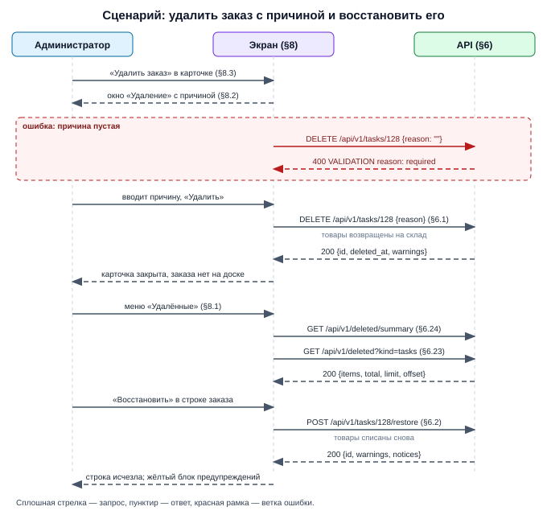

# Draft Spec: Мягкое удаление с восстановлением и раздел «Удалённые»

**Tier:** L · **Совместимость:** MVP · **Режим:** new

**Дата:** 2026-10-08 | **Статус:** draft → final (после подтверждения пользователя) | **Tier:** L
**Совместимость:** MVP (DS-022) — рабочей версии с живыми пользователями нет: таблицы и адреса меняем свободно, без переходного периода и отката; данные на базе сохраняются — все существующие записи после миграции считаются действующими
**UI-scope:** swagger:no | adaptive:min | themes:both (DS-023)
**Источник:** черновик пользователя (2026-10-07) + интервью (draft-spec-decisions.md, батчи 0–5) + as-is факты кода (`internal/features/board/tasks_service.go`, `migrations/0003`–`0017`, мастер-спека `docs/features/transfers/draft-spec.md` DS-021, DS-022, DS-025, DS-026, DS-050, `docs/plan.md` D75, D78, D84)
**Реализуется частями:** soft-delete-core, soft-delete-transfers, soft-delete-board-columns, soft-delete-clients, soft-delete-catalog, soft-delete-warehouses-suppliers (по порядку; каждая — `docs/features/{имя}/draft-spec.md`, номера DS и TS общие с этой мастер-спекой) — DS-031

| № | Часть (каталог) | Tier | Что входит | Разделы мастера | Зависит от |
|---|---|---|---|---|---|
| 1 | `soft-delete-core` | M (верхняя граница) | общий механизм (кто, когда, обязательная причина); заказы: удаление с возвратом товаров и восстановление с повторным списанием; условие «не удалён» во всех читателях заказов; вложения; раздел «Удалённые» с вкладкой «Заказы»; служебная уборка автотестов | §4.1, §6.1, §6.2, §6.23, §6.24, §6.25, §8.1, §8.2, §8.3 | — |
| 2 | `soft-delete-transfers` | M | документ перемещения: удаление в «Заявка» и «Отменён», восстановление; снятие отказа `TASK_HAS_TRANSFERS`; пометка «заказ удалён»; запрет новых документов по удалённому заказу; вкладка «Перемещения» | §4.2, §6.3, §6.4, §8.4 | 1 |
| 3 | `soft-delete-board-columns` | S | колонки доски: удаление и восстановление; подмена удалённой колонки при восстановлении заказа; вкладка «Колонки» | §4.3, §6.5, §6.6 | 1 |
| 4 | `soft-delete-clients` | M | клиенты и оборудование (оборудование уходит и возвращается вместе с клиентом); снятие отказов по ссылкам; пометки «удалён» в заказах и документах; вкладки «Клиенты», «Оборудование» | §4.4, §4.5, §6.7–§6.10, §8.5 | 1, 2 |
| 5 | `soft-delete-catalog` | M | товары, услуги, категории, типы оборудования: удаление рядом с архивом; название уникально среди действующих; запрет удаления товара с остатком; вкладки «Товары», «Услуги», «Категории», «Типы оборудования» | §4.6–§4.9, §6.11–§6.18, §8.5 | 1 |
| 6 | `soft-delete-warehouses-suppliers` | S | склады (удаляется только пустой) и поставщики — действие «Удалить» появляется впервые; вкладки «Склады», «Поставщики» | §4.10, §4.11, §6.19–§6.22, §8.5 | 1 |

> Мастер в `/pipeline-light` не идёт (Tier L); идут части по порядку 1 → 2 → 3 → 4 → 5 → 6. Части 3, 5, 6 после первой друг от друга не зависят. До мержа части удаление её видов записей работает по-старому (безвозвратно, с прежними отказами).

## §1. Суть задачи
Любое удаление в системе становится восстановимым: запись уходит в раздел «Удалённые», откуда администратор возвращает её одной кнопкой. Для администратора; исполнитель удалённого не видит.

**Бизнес (что делает пользователь/процесс):**
1. Администратор удаляет запись любого из 11 видов — заказ, документ перемещения, колонку доски, клиента, единицу оборудования, товар, услугу, категорию, тип оборудования, склад, поставщика — и обязательно указывает причину (§8.2) — DS-001, DS-020.
2. Администратор открывает раздел «Удалённые» (§8.1), выбирает вкладку вида записей, видит что удалено, кем, когда и почему, нажимает «Восстановить» — DS-011.
3. При восстановлении заказа система сообщает, что изменилось: не хватает товара на складе, колонка заменена, клиент или оборудование в удалённых — DS-005, DS-016.
4. В справочниках «В архив» остаётся отдельным действием: архивная запись видна в справочнике, удалённая — только в «Удалённых» — DS-009.

**Логика (правила системы):**
1. Удалённая запись физически остаётся в базе с отметкой «кто, когда, почему»; хранится бессрочно, окончательного удаления нет — DS-012, DS-030.
2. Удалённая запись не видна нигде, кроме раздела «Удалённые», и не выбирается в новых записях; там, где на неё уже ссылаются действующие заказы и документы, она показывается с пометкой «удалён» — DS-010, DS-014.
3. Удалить можно всегда, ссылки удалению не мешают; исключения — то, что влияет на учёт: проведённый документ перемещения, товар с остатком, склад с товаром, оборудованием или незавершёнными перемещениями, клиент и единица оборудования, пока оборудование на нашем складе, в пути или в незавершённом документе, непустая колонка доски — DS-014, DS-018, DS-019, DS-021, DS-041.
4. Заказ: при удалении товары возвращаются на склад, при восстановлении списываются снова; документы перемещения заказа остаются действующими, остатки и местоположение оборудования по ним не меняются — DS-004, DS-005, DS-006, DS-008.
5. Клиент уходит в удалённые и возвращается вместе со своим оборудованием — DS-015.
6. Название удалённой записи свободно; восстановление при занятом названии — отказ — DS-017.
6а. Остаток, появившийся у удалённого товара или на удалённом складе позже, виден в отчёте «Остатки» с пометкой «удалён» — DS-042.
6б. Удалённый документ перемещения не мешает сменить клиента заказа; после смены клиента такой документ не восстанавливается — DS-040.
7. Время: `f:deleted_at` хранится в UTC (`timestamptz`); показывается и фильтруется по часовому поясу пользователя, формат «ДД.ММ.ГГГГ ЧЧ:ММ» — DS-025 (краткий дубль §3).
8. Конкурентный доступ: удаляем запись → атомарный UPDATE с условием «ещё не удалена», повтор → 404; восстанавливаем → атомарный UPDATE с условием «удалена», повтор → 409; заказ — под блокировкой строки заказа; документ перемещения — дополнительно по `f:version` — DS-024 (краткий дубль §3).

**Техника (API/данные/интеграции):**
1. Данные: три новые колонки (`f:deleted_at`, `f:deleted_by`, `f:delete_reason`) на 11 существующих таблицах, у `t:equipment` — ещё `f:deleted_with_client`; новых таблиц нет; уникальные индексы названий четырёх справочников становятся частичными (§4).
2. API: 11 адресов удаления (9 существующих меняют поведение, 2 новых) и 11 новых адресов восстановления (§6.1–§6.22); `e:GET /api/v1/deleted` и `e:GET /api/v1/deleted/summary` для раздела «Удалённые» (§6.23, §6.24); служебная уборка автотестов (§6.25); условие «не удалён» во всех существующих адресах чтения и выбора (§6.26).
3. Новый пакет `internal/features/softdelete` — только чтение раздела «Удалённые» и страница `/deleted`; само удаление и восстановление остаются в пакетах-владельцах (`board`, `transfers`, `clients`, `catalog`, `equipmenttypes`, `warehouses`, `suppliers`).
4. Внешних систем нет.

**UI (графическая часть):**
1. Новый пункт меню «Администрирование → Удалённые» (`/deleted`, только admin) — страница с 11 вкладками, фильтрами и кнопкой «Восстановить» в каждой строке (§8.1).
2. Общее окно «Удаление» с обязательным полем «Причина» — заменяет нынешние подтверждения удаления на всех экранах (§8.2).
3. Доска и карточка заказа: удаление с причиной; пометки «удалён» у клиента, оборудования, услуги, товара (§8.3).
4. «Перемещения»: пометка «заказ удалён» в списке и в документе; удаление документа с причиной (§8.4).
5. Справочники (клиенты, оборудование, каталог, типы оборудования, склады, поставщики): кнопка «Удалить» рядом с «В архив»; у складов и поставщиков — впервые (§8.5).

Out-of-scope:
1. Сотрудники — не удаляются, как и сейчас: только «неактивен» (решение пользователя, DS-002).
2. Части заказа (услуга, товар в услуге, запись о работе, вложение, оборудование в заказе) — удаляются как сейчас, безвозвратно: это правка заказа; восстановим только заказ целиком (решение пользователя, DS-002).
3. Окончательное удаление («удалить навсегда») и автоматическая очистка по сроку — не делаем, хранение бессрочное (решение пользователя, DS-012).
4. История повторных удалений одной записи — не ведётся: хранится только последнее удаление, при восстановлении отметка стирается (DS-030).
5. Статус заказа «ждёт поставку» — отдельная задача (`docs/plan.md` D78).

## §2. Интеграции и master-data
Потоки: не применимо — внешних систем нет.

Справочники (master-data):

| Справочник | Источник правды | Синхронизация | Где используется |
|---|---|---|---|
| `t:users` | эта же база (пакет `users`) | нет | `f:deleted_by` на всех 11 таблицах; фильтр «Кто удалил» раздела «Удалённые» (§6.23) — DS-030 |

## §3. Нефункциональные требования

**Конкурентность (по операциям):**
1. **Удаление записи (все 11 видов):**
   - один UPDATE с условием `deleted_at IS NULL`; затронуто 0 строк → запись уже удалена либо не существует → 404 — DS-024
   - два администратора удаляют одну запись одновременно: первый получает 200, второй — 404; причина второго не записывается
2. **Восстановление записи (все 11 видов):**
   - один UPDATE с условием `deleted_at IS NOT NULL`; затронуто 0 строк при существующей записи → 409 `NOT_DELETED` — DS-024
3. **Удаление и восстановление заказа:**
   - под блокировкой строки заказа (`LockTask`, `FOR UPDATE`) — та же блокировка, что у действующего удаления и правки заказа; возврат и списание товара — в той же транзакции, порядок блокировок «заказ → `t:product_stock`» не меняется (`docs/plan.md` D75) — DS-004, DS-005
   - правка заказа, пришедшая после удаления, → 404 `TASK_NOT_FOUND` — DS-026
4. **Удаление и восстановление документа перемещения:**
   - оптимистичная блокировка по `f:version` (as-is): устаревшая версия → 409 `TRANSFER_VERSION_CONFLICT`; восстановление заявки занимает единицы под блокировкой строк `t:equipment` (`FOR NO KEY UPDATE`, as-is порядок «документ → `t:equipment`») — DS-018
5. **Создание документа по заказу одновременно с удалением заказа:**
   - создание документа держит на заказе `FOR KEY SHARE` и проверяет `deleted_at IS NULL` под ней: удаление выиграло → 409 `TASK_DELETED`; создание выиграло → документ остаётся у удалённого заказа (допустимо, DS-006) — DS-007
6. **Удаление склада и товара с остатком:**
   - проверка остатка и запись отметки — в одной транзакции под блокировкой строк `t:product_stock` (товар) либо строки `t:warehouses` (склад); приход, пришедший позже, получает 400 `not_found` по удалённой записи — DS-021
7. **Удаление колонки доски:**
   - под блокировкой списка колонок (as-is транзакция удаления колонки): перенос заказа в колонку и её удаление не расходятся — перенос в удалённую колонку → 404 `COLUMN_NOT_FOUND` — DS-019
8. **Версионирование справочников:** отдельной колонки `version` у клиентов, оборудования, каталога, складов, поставщиков нет и не вводится — правка действующей записи остаётся last-write-wins (as-is); правка удалённой → 404 — DS-026

**Аудит:**
- на записи хранится последнее удаление: кто (`f:deleted_by`), когда (`f:deleted_at`), почему (`f:delete_reason`); читается в разделе «Удалённые» — DS-030
- при восстановлении три поля очищаются; факт удаления и восстановления пишется в журнал приложения (`slog`, уровень info: вид записи, идентификатор, пользователь, действие) — DS-030
- чтение раздела «Удалённые» не журналируется

**Время/таймзоны:**
- хранение: `f:deleted_at` — `timestamptz`, UTC, время сервера базы (`now()`) — DS-025
- интерпретация периода фильтра «Удалено с / по» — по часовому поясу пользователя (`pkg/timezone`): «за 08.10.2026» = с 00:00 до 24:00 этого дня в поясе пользователя — DS-025
- показ — «ДД.ММ.ГГГГ ЧЧ:ММ» в поясе пользователя (`KT.time`)
- порядок в списке — по `f:deleted_at` по убыванию, при равенстве — по `f:id`

**Метрики/таймстемпы:**
- единственный новый таймстемп — `f:deleted_at`; отчётов по длительностям и оповещений нет
- счётчики по вкладкам раздела «Удалённые» — `e:GET /api/v1/deleted/summary` (§6.24)

**Offline / деградация / восстановление:**
- удаление и восстановление — одиночные запросы; при потере связи кнопка разблокируется, показывается тост ошибки, повтор безопасен (см. «Идемпотентность» в §6)
- перезагрузка страницы «Удалённые» восстанавливает вкладку и фильтры из адресной строки

**Объёмы и производительность:**
- удалённое копится бессрочно (DS-012): список — только с серверной пагинацией (`limit` по умолчанию 50, максимум 200), частичный индекс по `f:deleted_at` на каждой таблице
- условие `deleted_at IS NULL` добавляется во все запросы чтения 11 таблиц; существующие индексы остаются рабочими (доля удалённых мала)

**Логирование и чувствительные данные:**
- причина удаления в журнал приложения не пишется (свободный текст); пишутся вид, идентификатор, пользователь
- раздел «Удалённые» и его API доступны только администратору — DS-003

**Формат ошибок:**
- `pkg/errorspkg`: `{code, message, details}`; 400 → `details.fields[]` с `name` и `message`; отказ в доступе — 403 с текстом «Нет доступа»

**Abuse cases (инсайдерские риски — вход для adversarial E2E TD-4):**
1. Исполнитель вызывает адрес удаления, восстановления или списка удалённого напрямую → 403 «Нет доступа» до любого чтения записи — DS-003.
2. Исполнитель открывает карточку, печатную форму или вложение удалённого заказа по прямой ссылке → 404, как для несуществующего — DS-010, DS-013.
3. Удалённая запись подставляется по идентификатору в новый заказ или документ в обход выпадающего списка → 400 `not_found` — DS-014.
4. Причина удаления из пробелов или длиннее 500 символов → 400; мегабайтная строка отсекается лимитом — DS-020.
5. Служебная уборка автотестов вызвана на стенде, где она не включена → 404, адрес не зарегистрирован — DS-027.

**Применённые zap-дефолты** (zap-list — стандарты проекта из CLAUDE.md, применяются автоматически, без вопросов; в §9 — источник `zap`):
- коды ответов: 404 — не найдено, 403 — нет доступа, 409 — конфликт состояния (zap)
- обработка синхронная, очередей нет (zap)
- отдельной таблицы аудита нет — отметка на записи и журнал приложения (zap; причина удаления — явное требование пользователя, DS-020)
- миграции применяются вручную (`make migrate-up`), без авто-применения (zap)

## §4. Данные
Легенда колонки «Обяз.»: `да` — клиент обязан передать при создании/правке; `нет` — опционально; `авто` — заполняет система (PK, дефолты, таймстемпы, значения из URL/сессии); `условно` — зависит от правила, оно указано в Описании. NULL — DDL-факт, Обяз. — семантика заполнения.

> Мастер-спека описывает ДЕЛЬТУ: новые колонки, индексы и правила на 11 существующих таблицах. Существующие колонки не меняются; их полный перечень — в файлах миграций, указанных под каждой таблицей, и разворачивается таблицей полей в спеке соответствующей части (DS-031). Новых таблиц задача не создаёт. Три колонки удаления одинаковы по смыслу на всех таблицах, но перечислены в каждой явно.

### §4.1. `t:tasks` (существующая таблица — фича добавляет колонки)
Заказ. Мягкое удаление заказа целиком со всеми частями; части заказа (`t:subtasks`, `t:subtask_products`, `t:subtask_logs`, `t:task_attachments`, `t:task_equipment`, `t:task_stock`) своих признаков удаления не получают — они скрываются вместе с заказом (DS-002). Реализуется в части 1 `soft-delete-core`. Существующие колонки: `migrations/0005_board.up.sql`.

| Поле | Тип | NULL | Default | Обяз. | Описание | DS |
|---|---|---|---|---|---|---|
| `f:deleted_at` | timestamptz | да | — | авто | Момент удаления, хранится в UTC, ставит сервер (`now()`); NULL — запись действует | DS-001, DS-025 |
| `f:deleted_by` | uuid | да | — | авто | FK → `t:users(id)` `ON DELETE RESTRICT`; кто удалил — из сессии, клиент не передаёт; NULL у действующей записи | DS-003, DS-030 |
| `f:delete_reason` | text | да | — | условно | Причина удаления: обязательна в запросе удаления, 1–500 символов после обрезки крайних пробелов; NULL у действующей записи | DS-020 |

Ключи и индексы:
- PK: без изменений (`f:id`)
- UNIQUE: без изменений
- Индексы: `i:tasks_deleted_at_idx` (`deleted_at DESC`, `id`) `WHERE deleted_at IS NOT NULL` — список вкладки раздела «Удалённые» с сортировкой по времени удаления (§6.23)
- CHECK `i:tasks_deleted_chk`: `f:deleted_at`, `f:deleted_by`, `f:delete_reason` либо все NULL, либо все заполнены — DS-030

Связи (одна связь = одна строка):
- 1→N `t:subtasks` — CASCADE (as-is) — строки остаются, пока заказ в удалённых
- 1→N `t:task_stock` — CASCADE (as-is) — после удаления заказа пусто: товары возвращены на склад (DS-004)
- 1→N `t:task_equipment` — CASCADE (as-is) — строки остаются
- 1→N `t:task_attachments` — CASCADE (as-is) — строки и файлы остаются (DS-013)
- 1→N `t:transfers` — RESTRICT (as-is) — документы удалённого заказа остаются действующими (DS-006)
- 1→N `t:stock_movements` — SET NULL (as-is) — при мягком удалении ссылка сохраняется

Поведение при действиях (одно действие = одна строка):
- Удаление: только admin, причина обязательна; одна транзакция под блокировкой заказа (`FOR UPDATE`): возврат всех товаров заказа на склад (`StockEngine.Reconcile(false)`, движения `task_return`), затем запись `f:deleted_at`, `f:deleted_by`, `f:delete_reason` — DS-004, DS-020
- Восстановление: только admin; одна транзакция под блокировкой заказа: очистка трёх полей удаления; колонка заказа удалена → `f:column_id` = первая нефинальная действующая колонка по `f:position`, заказ встаёт в её конец; затем `StockEngine.Reconcile(consumes_stock колонки)` — товары списываются снова; нехватка → предупреждения, не отказ — DS-005, DS-016
- Изменение удалённого заказа: любая мутация заказа и его частей → 404 `TASK_NOT_FOUND` — DS-026
- Физическое удаление: только служебная уборка автотестов (DS-027)

Инварианты (правило → чем держится → DS):
- удалённый заказ не держит товар: `t:task_stock` заказа пуст, пока `f:deleted_at` IS NOT NULL → `Reconcile(false)` в транзакции удаления → DS-004
- удалённый заказ не виден читателям (доска, поиск, карточка, печать, «Остатки», «Выплаты», история оборудования, итоги) → условие `tasks.deleted_at IS NULL` в каждом запросе чтения → DS-010

### §4.2. `t:transfers` (существующая таблица — фича добавляет колонки)
Документ «Перемещение». Мягко удаляется только в статусах `s:requested` и `s:cancelled` (действующее правило, transfers DS-025). Реализуется в части 2 `soft-delete-transfers`. Существующие колонки: `migrations/0009_stock_transfers.up.sql, migrations/0014_transfers_core.up.sql, migrations/0015_transfers_partners.up.sql, migrations/0016_transfers_sales.up.sql, migrations/0017_transfers_revert.up.sql`.

| Поле | Тип | NULL | Default | Обяз. | Описание | DS |
|---|---|---|---|---|---|---|
| `f:deleted_at` | timestamptz | да | — | авто | Момент удаления, хранится в UTC, ставит сервер (`now()`); NULL — запись действует | DS-001, DS-025 |
| `f:deleted_by` | uuid | да | — | авто | FK → `t:users(id)` `ON DELETE RESTRICT`; кто удалил — из сессии, клиент не передаёт; NULL у действующей записи | DS-003, DS-030 |
| `f:delete_reason` | text | да | — | условно | Причина удаления: обязательна в запросе удаления, 1–500 символов после обрезки крайних пробелов; NULL у действующей записи | DS-020 |

Ключи и индексы:
- PK: без изменений (`f:id`)
- UNIQUE: без изменений
- Индексы: `i:transfers_deleted_at_idx` (`deleted_at DESC`, `id`) `WHERE deleted_at IS NOT NULL` — список вкладки раздела «Удалённые» с сортировкой по времени удаления (§6.23)
- CHECK `i:transfers_deleted_chk`: `f:deleted_at`, `f:deleted_by`, `f:delete_reason` либо все NULL, либо все заполнены — DS-030

Связи (одна связь = одна строка):
- 1→N `t:transfer_items` — CASCADE (as-is) — строки остаются, пока документ в удалённых
- N→1 `t:tasks` — RESTRICT (as-is) — ссылка на удалённый заказ допустима (DS-006)
- 1→N `t:stock_movements` — SET NULL (as-is) — при мягком удалении ссылка сохраняется
- 1→N `t:equipment.active_transfer_id` — SET NULL (as-is) — при удалении заявки единицы освобождаются явно (DS-018)

Поведение при действиях (одно действие = одна строка):
- Удаление: только admin, причина обязательна, `f:version` обязателен; статус `s:requested` или `s:cancelled`; у заявки единицы оборудования освобождаются (`t:equipment.active_transfer_id` = NULL); остатки и местоположение не меняются — DS-018
- Восстановление: только admin; у заявки (`s:requested`) единицы снова занимаются документом; единица уже стоит в другом незавершённом документе → 409 `EQUIPMENT_IN_TRANSFER`, ничего не восстановлено; остатки и местоположение не меняются — DS-018
- Изменение удалённого документа (правка, отправка, приём, отмена, откат) → 404 `TRANSFER_NOT_FOUND` — DS-026
- Создание документа по удалённому заказу → 409 `TASK_DELETED` — DS-007
- Удалённый документ не мешает смене клиента заказа; после смены клиента восстановить такой документ нельзя → 409 `TRANSFER_CLIENT_MISMATCH` — DS-040
- Восстановление заявки с заказом, единица которой убрана из оборудования заказа, → 409 `TRANSFER_EQUIPMENT_NOT_IN_TASK` — DS-043
- Удалённая заявка не удерживает склад от архивирования и удаления, а единицу — от удаления из справочника; восстановление заявки, в составе которой есть удалённые записи, → 409 `TRANSFER_HAS_DELETED_REFS` — DS-044, DS-045
- Отмена проведения документа, единица, товар или склад которого в удалённых, → 409 `TRANSFER_HAS_DELETED_REFS`; удалённый поставщик отмене проведения не мешает — DS-046
- Отправка заявки, товар или склад которой в удалённых, → 409 `TRANSFER_HAS_DELETED_REFS`; отмена документа «В пути» с удалённым товаром не запрещается; удалённый поставщик отправке не мешает — DS-047

Инварианты (правило → чем держится → DS):
- удалённый документ не влияет на учёт: удаляются только `s:requested` и `s:cancelled` → проверка статуса в том же UPDATE → DS-018
- единица оборудования — не более чем в одном незавершённом действующем документе → проверка занятости при восстановлении заявки под блокировкой строк `t:equipment` → DS-018

### §4.3. `t:columns` (существующая таблица — фича добавляет колонки)
Колонка доски. Мягко удаляется только колонка без действующих заказов. Реализуется в части 3 `soft-delete-board-columns`. Существующие колонки: `migrations/0005_board.up.sql`.

| Поле | Тип | NULL | Default | Обяз. | Описание | DS |
|---|---|---|---|---|---|---|
| `f:deleted_at` | timestamptz | да | — | авто | Момент удаления, хранится в UTC, ставит сервер (`now()`); NULL — запись действует | DS-001, DS-025 |
| `f:deleted_by` | uuid | да | — | авто | FK → `t:users(id)` `ON DELETE RESTRICT`; кто удалил — из сессии, клиент не передаёт; NULL у действующей записи | DS-003, DS-030 |
| `f:delete_reason` | text | да | — | условно | Причина удаления: обязательна в запросе удаления, 1–500 символов после обрезки крайних пробелов; NULL у действующей записи | DS-020 |

Ключи и индексы:
- PK: без изменений (`f:id`)
- UNIQUE: без изменений
- Индексы: `i:columns_deleted_at_idx` (`deleted_at DESC`, `id`) `WHERE deleted_at IS NOT NULL` — список вкладки раздела «Удалённые» с сортировкой по времени удаления (§6.23)
- CHECK `i:columns_deleted_chk`: `f:deleted_at`, `f:deleted_by`, `f:delete_reason` либо все NULL, либо все заполнены — DS-030

Связи (одна связь = одна строка):
- 1→N `t:tasks` — RESTRICT (as-is) — удалённые заказы могут продолжать ссылаться на удалённую колонку (DS-016)

Поведение при действиях (одно действие = одна строка):
- Удаление: только admin, причина обязательна; в колонке есть действующие заказы → 409 `COLUMN_NOT_EMPTY`; последняя действующая нефинальная колонка → 409 `LAST_NON_FINAL_COLUMN`; удалённые заказы колонку не удерживают — DS-019
- Восстановление: только admin; колонка встаёт в конец доски (`f:position` = максимум среди действующих + 1) — DS-019
- Изменение и перенос заказов в удалённую колонку → 404 `COLUMN_NOT_FOUND` — DS-026

Инварианты (правило → чем держится → DS):
- на доске всегда есть действующая нефинальная колонка → проверка в транзакции удаления среди колонок с `deleted_at IS NULL` → DS-019
- действующий заказ не стоит в удалённой колонке → запрет удаления непустой колонки + подмена колонки при восстановлении заказа → DS-016, DS-019

### §4.4. `t:clients` (существующая таблица — фича добавляет колонки)
Клиент. Удаляется вместе со своим оборудованием; заказы и документы клиента остаются действующими и показывают пометку «удалён». Реализуется в части 4 `soft-delete-clients`. Существующие колонки: `migrations/0003_clients_equipment.up.sql`.

| Поле | Тип | NULL | Default | Обяз. | Описание | DS |
|---|---|---|---|---|---|---|
| `f:deleted_at` | timestamptz | да | — | авто | Момент удаления, хранится в UTC, ставит сервер (`now()`); NULL — запись действует | DS-001, DS-025 |
| `f:deleted_by` | uuid | да | — | авто | FK → `t:users(id)` `ON DELETE RESTRICT`; кто удалил — из сессии, клиент не передаёт; NULL у действующей записи | DS-003, DS-030 |
| `f:delete_reason` | text | да | — | условно | Причина удаления: обязательна в запросе удаления, 1–500 символов после обрезки крайних пробелов; NULL у действующей записи | DS-020 |

Ключи и индексы:
- PK: без изменений (`f:id`)
- UNIQUE: без изменений
- Индексы: `i:clients_deleted_at_idx` (`deleted_at DESC`, `id`) `WHERE deleted_at IS NOT NULL` — список вкладки раздела «Удалённые» с сортировкой по времени удаления (§6.23)
- CHECK `i:clients_deleted_chk`: `f:deleted_at`, `f:deleted_by`, `f:delete_reason` либо все NULL, либо все заполнены — DS-030

Связи (одна связь = одна строка):
- 1→N `t:client_phones` — CASCADE (as-is) — телефоны остаются, пока клиент в удалённых
- 1→N `t:equipment` — CASCADE (as-is) — единицы помечаются удалёнными вместе с клиентом (DS-015)
- 1→N `t:tasks` — RESTRICT (as-is) — заказы удалённого клиента остаются на доске (DS-014)
- 1→N `t:transfers.client_id` — RESTRICT (as-is) — документы остаются (DS-014)

Поведение при действиях (одно действие = одна строка):
- Удаление: только admin, причина обязательна; хотя бы одна действующая единица клиента на нашем складе или в пути → 409 `CLIENT_EQUIPMENT_AT_WAREHOUSE`; хотя бы одна стоит в незавершённом документе → 409 `CLIENT_EQUIPMENT_IN_TRANSFER` (DS-041); иначе одна транзакция: клиент помечается удалённым, все его действующие единицы `t:equipment` получают те же `f:deleted_at`, `f:deleted_by`, `f:delete_reason` и `f:deleted_with_client` = true; отказы `x:CLIENT_HAS_TASKS` и `x:EQUIPMENT_HAS_TRANSFERS` сняты — DS-014, DS-015
- Восстановление: только admin; одна транзакция: клиент и все его единицы с `f:deleted_with_client` = true восстанавливаются; единицы, удалённые раньше отдельно, остаются удалёнными — DS-015
- Выбор удалённого клиента в новом заказе или при смене клиента заказа → 400 `VALIDATION` (`client_id: not_found`) — DS-014

Инварианты (правило → чем держится → DS):
- единица действующего клиента не помечена `f:deleted_with_client` → флаг ставится и снимается только транзакциями удаления и восстановления клиента → DS-015

### §4.5. `t:equipment` (существующая таблица — фича добавляет колонки)
Единица оборудования клиента. Удаляется отдельно либо вместе с клиентом. Реализуется в части 4 `soft-delete-clients`. Существующие колонки: `migrations/0003_clients_equipment.up.sql, migrations/0014_transfers_core.up.sql`.

| Поле | Тип | NULL | Default | Обяз. | Описание | DS |
|---|---|---|---|---|---|---|
| `f:deleted_at` | timestamptz | да | — | авто | Момент удаления, хранится в UTC, ставит сервер (`now()`); NULL — запись действует | DS-001, DS-025 |
| `f:deleted_by` | uuid | да | — | авто | FK → `t:users(id)` `ON DELETE RESTRICT`; кто удалил — из сессии, клиент не передаёт; NULL у действующей записи | DS-003, DS-030 |
| `f:delete_reason` | text | да | — | условно | Причина удаления: обязательна в запросе удаления, 1–500 символов после обрезки крайних пробелов; NULL у действующей записи | DS-020 |
| `f:deleted_with_client` | boolean | нет | false | авто | true — единица удалена вместе с клиентом и восстанавливается вместе с ним; false — удалена отдельно либо действует | DS-015 |

Ключи и индексы:
- PK: без изменений (`f:id`)
- UNIQUE: без изменений
- Индексы: `i:equipment_deleted_at_idx` (`deleted_at DESC`, `id`) `WHERE deleted_at IS NOT NULL` — список вкладки раздела «Удалённые» с сортировкой по времени удаления (§6.23)
- CHECK `i:equipment_deleted_chk`: `f:deleted_at`, `f:deleted_by`, `f:delete_reason` либо все NULL, либо все заполнены — DS-030

Связи (одна связь = одна строка):
- N→1 `t:clients` — CASCADE (as-is)
- N→1 `t:equipment_types` — RESTRICT (as-is) — тип может быть удалён мягко, единица показывает его с пометкой (DS-014)
- 1→N `t:task_equipment` — RESTRICT (as-is) — строки заказов остаются (DS-014)
- 1→N `t:subtasks.equipment_id` — RESTRICT (as-is) — услуги заказов остаются (DS-014)
- 1→N `t:transfer_items` — RESTRICT (as-is) — строки документов остаются (DS-014)

Поведение при действиях (одно действие = одна строка):
- Удаление: только admin, причина обязательна; единица стоит в незавершённом документе (`f:active_transfer_id` IS NOT NULL) → 409 `EQUIPMENT_IN_TRANSFER`; единица на нашем складе или в пути (`f:location_status` не `s:at_client`) → 409 `EQUIPMENT_AT_WAREHOUSE` (DS-041); отказы `x:EQUIPMENT_HAS_TRANSFERS` и `x:EQUIPMENT_USED_IN_TASKS` сняты — DS-014
- Удаление вместе с клиентом: возможно, только когда все действующие единицы клиента у клиента и не стоят в незавершённых документах — DS-041, DS-015
- Восстановление отдельной единицы: только admin; клиент единицы удалён → 409 `CLIENT_DELETED` «Сначала восстановите клиента» — DS-015
- Добавление удалённой единицы в заказ, в услугу заказа или в строку документа → 400 `VALIDATION` (`equipment_id: not_found`) — DS-014
- Местоположение (`f:location`, `f:warehouse_id`) при удалении и восстановлении не меняется — DS-008

Инварианты (правило → чем держится → DS):
- `f:deleted_with_client` = true только у удалённой единицы → CHECK `i:equipment_deleted_with_client_chk` (`NOT deleted_with_client OR deleted_at IS NOT NULL`) → DS-015
- удалённая единица находится у клиента и не стоит в незавершённом документе → проверки в транзакции удаления единицы и клиента под блокировкой строк `t:equipment`; занятие единицы документом проверяет `deleted_at IS NULL` → DS-041

### §4.6. `t:products` (существующая таблица — фича добавляет колонки)
Товар каталога. Удаление существует рядом с архивом (`f:is_active`); товар с ненулевым остатком не удаляется. Реализуется в части 5 `soft-delete-catalog`. Существующие колонки: `migrations/0004_catalog.up.sql`.

| Поле | Тип | NULL | Default | Обяз. | Описание | DS |
|---|---|---|---|---|---|---|
| `f:deleted_at` | timestamptz | да | — | авто | Момент удаления, хранится в UTC, ставит сервер (`now()`); NULL — запись действует | DS-001, DS-025 |
| `f:deleted_by` | uuid | да | — | авто | FK → `t:users(id)` `ON DELETE RESTRICT`; кто удалил — из сессии, клиент не передаёт; NULL у действующей записи | DS-003, DS-030 |
| `f:delete_reason` | text | да | — | условно | Причина удаления: обязательна в запросе удаления, 1–500 символов после обрезки крайних пробелов; NULL у действующей записи | DS-020 |

Ключи и индексы:
- PK: без изменений (`f:id`)
- UNIQUE: без изменений
- Индексы: `i:products_deleted_at_idx` (`deleted_at DESC`, `id`) `WHERE deleted_at IS NOT NULL` — список вкладки раздела «Удалённые» с сортировкой по времени удаления (§6.23)
- CHECK `i:products_deleted_chk`: `f:deleted_at`, `f:deleted_by`, `f:delete_reason` либо все NULL, либо все заполнены — DS-030

Связи (одна связь = одна строка):
- N→1 `t:catalog_categories` — RESTRICT (as-is)
- 1→N `t:product_stock` — CASCADE (as-is) — строки остатков остаются (все нулевые на момент удаления, DS-021)
- 1→N `t:subtask_products`, `t:task_stock`, `t:service_products`, `t:transfer_items`, `t:stock_movements` — RESTRICT (as-is) — строки остаются, товар показывается с пометкой «удалён» (DS-014)

Поведение при действиях (одно действие = одна строка):
- Удаление: только admin, причина обязательна; на любом складе остаток товара не равен нулю → 409 `PRODUCT_HAS_STOCK` — DS-021
- Восстановление: только admin; `f:is_active` остаётся прежним — DS-009
- Добавление удалённого товара в услугу заказа, в состав услуги каталога, в строку документа, ручное движение остатка → 400 `VALIDATION` (`product_id: not_found`) — DS-014

Инварианты (правило → чем держится → DS):
- на момент удаления у товара нет остатка на складах → проверка `t:product_stock` в транзакции удаления под блокировкой строк остатка → DS-021
- остаток, появившийся у удалённого товара позже (возврат из заказа, приём документа), не теряется → отчёт «Остатки» показывает такой товар с пометкой «удалён» → DS-042

### §4.7. `t:services` (существующая таблица — фича добавляет колонки)
Услуга каталога. Удаление существует рядом с архивом (`f:is_active`). Реализуется в части 5 `soft-delete-catalog`. Существующие колонки: `migrations/0004_catalog.up.sql`.

| Поле | Тип | NULL | Default | Обяз. | Описание | DS |
|---|---|---|---|---|---|---|
| `f:deleted_at` | timestamptz | да | — | авто | Момент удаления, хранится в UTC, ставит сервер (`now()`); NULL — запись действует | DS-001, DS-025 |
| `f:deleted_by` | uuid | да | — | авто | FK → `t:users(id)` `ON DELETE RESTRICT`; кто удалил — из сессии, клиент не передаёт; NULL у действующей записи | DS-003, DS-030 |
| `f:delete_reason` | text | да | — | условно | Причина удаления: обязательна в запросе удаления, 1–500 символов после обрезки крайних пробелов; NULL у действующей записи | DS-020 |

Ключи и индексы:
- PK: без изменений (`f:id`)
- UNIQUE: без изменений
- Индексы: `i:services_deleted_at_idx` (`deleted_at DESC`, `id`) `WHERE deleted_at IS NOT NULL` — список вкладки раздела «Удалённые» с сортировкой по времени удаления (§6.23)
- CHECK `i:services_deleted_chk`: `f:deleted_at`, `f:deleted_by`, `f:delete_reason` либо все NULL, либо все заполнены — DS-030

Связи (одна связь = одна строка):
- N→1 `t:catalog_categories` — RESTRICT (as-is)
- 1→N `t:service_products` — CASCADE (as-is) — состав остаётся
- 1→N `t:subtasks.service_id` — RESTRICT (as-is) — услуги заказов остаются, название показывается с пометкой «удалён» (DS-014)

Поведение при действиях (одно действие = одна строка):
- Удаление: только admin, причина обязательна; ссылки из заказов удалению не мешают — DS-014
- Восстановление: только admin; `f:is_active` остаётся прежним — DS-009
- Добавление удалённой услуги в заказ → 400 `VALIDATION` (`service_id: not_found`) — DS-014

### §4.8. `t:catalog_categories` (существующая таблица — фича добавляет колонки)
Категория каталога (товаров или услуг — `f:kind`). Удаление существует рядом с архивом (`f:is_active`). Реализуется в части 5 `soft-delete-catalog`. Существующие колонки: `migrations/0004_catalog.up.sql`.

| Поле | Тип | NULL | Default | Обяз. | Описание | DS |
|---|---|---|---|---|---|---|
| `f:deleted_at` | timestamptz | да | — | авто | Момент удаления, хранится в UTC, ставит сервер (`now()`); NULL — запись действует | DS-001, DS-025 |
| `f:deleted_by` | uuid | да | — | авто | FK → `t:users(id)` `ON DELETE RESTRICT`; кто удалил — из сессии, клиент не передаёт; NULL у действующей записи | DS-003, DS-030 |
| `f:delete_reason` | text | да | — | условно | Причина удаления: обязательна в запросе удаления, 1–500 символов после обрезки крайних пробелов; NULL у действующей записи | DS-020 |

Ключи и индексы:
- PK: без изменений (`f:id`)
- UNIQUE: `i:catalog_categories_kind_name_lower_uq` (kind, lower(btrim(name))) пересоздаётся частичным — `WHERE deleted_at IS NULL` (название удалённой записи свободно) — DS-017
- Индексы: `i:catalog_categories_deleted_at_idx` (`deleted_at DESC`, `id`) `WHERE deleted_at IS NOT NULL` — список вкладки раздела «Удалённые» с сортировкой по времени удаления (§6.23)
- CHECK `i:catalog_categories_deleted_chk`: `f:deleted_at`, `f:deleted_by`, `f:delete_reason` либо все NULL, либо все заполнены — DS-030

Связи (одна связь = одна строка):
- 1→N `t:products` — RESTRICT (as-is) — товары категории остаются действующими (DS-014)
- 1→N `t:services` — RESTRICT (as-is) — услуги категории остаются действующими (DS-014)

Поведение при действиях (одно действие = одна строка):
- Удаление: только admin, причина обязательна; товары и услуги категории удалению не мешают и остаются действующими с пометкой «категория удалена» — DS-014
- Восстановление: только admin; среди действующих категорий того же `f:kind` уже есть такое название → 409 `NAME_TAKEN` — DS-017
- Создание и переименование: название проверяется на уникальность только среди действующих категорий того же `f:kind` — DS-017
- Выбор удалённой категории в товаре или услуге → 400 `VALIDATION` (`category_id: not_found`) — DS-014

Инварианты (правило → чем держится → DS):
- название уникально в пределах `f:kind` среди действующих → частичный уникальный индекс `i:catalog_categories_kind_name_lower_uq` (`WHERE deleted_at IS NULL`) → DS-017

### §4.9. `t:equipment_types` (существующая таблица — фича добавляет колонки)
Тип оборудования. Удаление существует рядом с архивом (`f:is_active`). Реализуется в части 5 `soft-delete-catalog`. Существующие колонки: `migrations/0003_clients_equipment.up.sql`.

| Поле | Тип | NULL | Default | Обяз. | Описание | DS |
|---|---|---|---|---|---|---|
| `f:deleted_at` | timestamptz | да | — | авто | Момент удаления, хранится в UTC, ставит сервер (`now()`); NULL — запись действует | DS-001, DS-025 |
| `f:deleted_by` | uuid | да | — | авто | FK → `t:users(id)` `ON DELETE RESTRICT`; кто удалил — из сессии, клиент не передаёт; NULL у действующей записи | DS-003, DS-030 |
| `f:delete_reason` | text | да | — | условно | Причина удаления: обязательна в запросе удаления, 1–500 символов после обрезки крайних пробелов; NULL у действующей записи | DS-020 |

Ключи и индексы:
- PK: без изменений (`f:id`)
- UNIQUE: `i:equipment_types_name_lower_uq` (lower(btrim(name))) пересоздаётся частичным — `WHERE deleted_at IS NULL` (название удалённой записи свободно) — DS-017
- Индексы: `i:equipment_types_deleted_at_idx` (`deleted_at DESC`, `id`) `WHERE deleted_at IS NOT NULL` — список вкладки раздела «Удалённые» с сортировкой по времени удаления (§6.23)
- CHECK `i:equipment_types_deleted_chk`: `f:deleted_at`, `f:deleted_by`, `f:delete_reason` либо все NULL, либо все заполнены — DS-030

Связи (одна связь = одна строка):
- 1→N `t:equipment` — RESTRICT (as-is) — единицы остаются действующими, тип показывается с пометкой «удалён» (DS-014)

Поведение при действиях (одно действие = одна строка):
- Удаление: только admin, причина обязательна; единицы этого типа удалению не мешают — DS-014
- Восстановление: только admin; среди действующих типов уже есть такое название → 409 `NAME_TAKEN` — DS-017
- Создание и переименование: название проверяется только среди действующих типов — DS-017
- Выбор удалённого типа в единице оборудования → 400 `VALIDATION` (`type_id: not_found`) — DS-014

Инварианты (правило → чем держится → DS):
- название уникально среди действующих → частичный уникальный индекс `i:equipment_types_name_lower_uq` (`WHERE deleted_at IS NULL`) → DS-017

### §4.10. `t:warehouses` (существующая таблица — фича добавляет колонки)
Склад. Действия «Удалить» до этой задачи не было (только архив); удаляется только пустой склад. Реализуется в части 6 `soft-delete-warehouses-suppliers`. Существующие колонки: `migrations/0008_warehouses.up.sql`.

| Поле | Тип | NULL | Default | Обяз. | Описание | DS |
|---|---|---|---|---|---|---|
| `f:deleted_at` | timestamptz | да | — | авто | Момент удаления, хранится в UTC, ставит сервер (`now()`); NULL — запись действует | DS-001, DS-025 |
| `f:deleted_by` | uuid | да | — | авто | FK → `t:users(id)` `ON DELETE RESTRICT`; кто удалил — из сессии, клиент не передаёт; NULL у действующей записи | DS-003, DS-030 |
| `f:delete_reason` | text | да | — | условно | Причина удаления: обязательна в запросе удаления, 1–500 символов после обрезки крайних пробелов; NULL у действующей записи | DS-020 |

Ключи и индексы:
- PK: без изменений (`f:id`)
- UNIQUE: `i:warehouses_name_lower_uq` (lower(btrim(name))) пересоздаётся частичным — `WHERE deleted_at IS NULL` (название удалённой записи свободно) — DS-017
- Индексы: `i:warehouses_deleted_at_idx` (`deleted_at DESC`, `id`) `WHERE deleted_at IS NOT NULL` — список вкладки раздела «Удалённые» с сортировкой по времени удаления (§6.23)
- CHECK `i:warehouses_deleted_chk`: `f:deleted_at`, `f:deleted_by`, `f:delete_reason` либо все NULL, либо все заполнены — DS-030

Связи (одна связь = одна строка):
- 1→N `t:product_stock` — RESTRICT (as-is) — строки остатков остаются (нулевые, DS-021)
- 1→N `t:equipment.warehouse_id` — RESTRICT (as-is) — на удаляемом складе единиц нет (DS-021)
- 1→N `t:transfers.from_warehouse_id`, `t:transfers.to_warehouse_id` — RESTRICT (as-is) — завершённые и отменённые документы остаются, склад показывается с пометкой «удалён» (DS-014)
- 1→N `t:subtask_products.warehouse_id`, `t:task_stock.warehouse_id`, `t:stock_movements.warehouse_id` — RESTRICT (as-is) — строки остаются (DS-014)

Поведение при действиях (одно действие = одна строка):
- Удаление: только admin, причина обязательна; на складе есть товар с ненулевым остатком, числится оборудование (все единицы склада, без условия по удалению — страховка, DS-041) либо есть действующий документ в `s:requested` или `s:in_transit` с этим складом → 409 `WAREHOUSE_IN_USE`; склад — последний действующий активный → 409 `WAREHOUSE_LAST_ACTIVE` — DS-021
- Архивирование (as-is действие) и удаление: мешают только действующие документы в `s:requested` и `s:in_transit`; мягко удалённые заявки не мешают — DS-044
- Строка товара заказа на удалённом складе: увеличение количества → 409 `WAREHOUSE_DELETED`; уменьшение, удаление строки и смена склада на действующий разрешены; долг на удалённом складе допустим и списывается к нулю — DS-050
- Восстановление: только admin; среди действующих складов уже есть такое название → 409 `NAME_TAKEN`; `f:is_active` остаётся прежним — DS-017, DS-009
- Создание и переименование: название проверяется только среди действующих складов — DS-017
- Выбор удалённого склада в документе, в заказе, в ручном движении остатка → 400 `VALIDATION` (`warehouse_id: not_found`) — DS-014

Инварианты (правило → чем держится → DS):
- на момент удаления на складе нет товара и оборудования → проверка в транзакции удаления под блокировкой строки склада → DS-021
- остаток, появившийся на удалённом складе позже (возврат товара из заказа), не теряется → отчёт «Остатки» показывает такой склад с пометкой «удалён» → DS-042
- название уникально среди действующих → частичный уникальный индекс `i:warehouses_name_lower_uq` (`WHERE deleted_at IS NULL`) → DS-017

### §4.11. `t:suppliers` (существующая таблица — фича добавляет колонки)
Поставщик. Действия «Удалить» до этой задачи не было (только архив). Реализуется в части 6 `soft-delete-warehouses-suppliers`. Существующие колонки: `migrations/0012_suppliers.up.sql`.

| Поле | Тип | NULL | Default | Обяз. | Описание | DS |
|---|---|---|---|---|---|---|
| `f:deleted_at` | timestamptz | да | — | авто | Момент удаления, хранится в UTC, ставит сервер (`now()`); NULL — запись действует | DS-001, DS-025 |
| `f:deleted_by` | uuid | да | — | авто | FK → `t:users(id)` `ON DELETE RESTRICT`; кто удалил — из сессии, клиент не передаёт; NULL у действующей записи | DS-003, DS-030 |
| `f:delete_reason` | text | да | — | условно | Причина удаления: обязательна в запросе удаления, 1–500 символов после обрезки крайних пробелов; NULL у действующей записи | DS-020 |

Ключи и индексы:
- PK: без изменений (`f:id`)
- UNIQUE: `i:suppliers_name_lower_uq` (lower(btrim(name))) пересоздаётся частичным — `WHERE deleted_at IS NULL` (название удалённой записи свободно) — DS-017
- Индексы: `i:suppliers_deleted_at_idx` (`deleted_at DESC`, `id`) `WHERE deleted_at IS NOT NULL` — список вкладки раздела «Удалённые» с сортировкой по времени удаления (§6.23)
- CHECK `i:suppliers_deleted_chk`: `f:deleted_at`, `f:deleted_by`, `f:delete_reason` либо все NULL, либо все заполнены — DS-030

Связи (одна связь = одна строка):
- 1→N `t:transfers.supplier_id` — RESTRICT (as-is) — документы остаются, поставщик показывается с пометкой «удалён» (DS-014)

Поведение при действиях (одно действие = одна строка):
- Удаление: только admin, причина обязательна; документы поставщика удалению не мешают — DS-014
- Восстановление: только admin; среди действующих поставщиков уже есть такое название → 409 `NAME_TAKEN`; `f:is_active` остаётся прежним — DS-017, DS-009
- Создание и переименование: название проверяется только среди действующих поставщиков — DS-017
- Выбор удалённого поставщика в новом документе → 400 `VALIDATION` (`supplier_id: not_found`) — DS-014

Инварианты (правило → чем держится → DS):
- название уникально среди действующих → частичный уникальный индекс `i:suppliers_name_lower_uq` (`WHERE deleted_at IS NULL`) → DS-017

## §5. Статусная модель


Состояние записи складывается из двух независимых признаков: удалена ли она (`f:deleted_at`) и, у справочников с архивом, в архиве ли она (`f:is_active`). Собственные статусы заказа (колонка доски) и документа перемещения (`s:requested`, `s:in_transit`, `s:received`, `s:cancelled`) этой задачей не меняются.

Состояния: `s:active` — действует; `s:archived` — в архиве (только `t:products`, `t:services`, `t:catalog_categories`, `t:equipment_types`, `t:warehouses`, `t:suppliers`); `s:deleted` — удалена (в базе это `deleted_at IS NOT NULL` при любом `f:is_active`). Терминальных состояний нет — DS-012.

| Из | В | Триггер | Кто | Guard / конкурентный исход | Side effects |
|---|---|---|---|---|---|
| `s:active` | `s:deleted` | «Удалить» + причина | admin | `deleted_at IS NULL` в том же UPDATE; правила вида записи (§4); второй запрос → 404 | заказ — возврат товаров; клиент — его оборудование; заявка перемещения — освобождение единиц |
| `s:archived` | `s:deleted` | «Удалить» + причина | admin | то же; `f:is_active` = false сохраняется | — |
| `s:deleted` | `s:active` | «Восстановить» | admin | `deleted_at IS NOT NULL` в том же UPDATE; второй запрос → 409 `NOT_DELETED`; запись была активной | заказ — повторное списание и подмена колонки; клиент — его оборудование; заявка перемещения — занятие единиц |
| `s:deleted` | `s:archived` | «Восстановить» | admin | то же; запись была в архиве — возвращается в архив | — |
| `s:active` | `s:archived` | «В архив» (as-is, без изменений) | admin | as-is | — |
| `s:archived` | `s:active` | «Вернуть из архива» (as-is, без изменений) | admin | as-is | — |

Что можно в состоянии `s:deleted`: только «Восстановить» и просмотр в разделе «Удалённые»; любая другая операция с записью → 404 — DS-026.

## §6. API
> Режим B «API + фронтенд». Базовый URL стенда: `http://localhost:8080`. Авторизация — сессионная cookie `sid` (плейсхолдер `<SID>`). Копируй curl в терминал или в Postman: Import → Raw text. Тело ошибки — формат `pkg/errorspkg`: `{code, message, details}`; при 400 — `details.fields[]` с `name` и `message`. Все ключи — snake_case, URL — kebab-case (CLAUDE.md §API-1). Текст отказа в доступе единый — «Нет доступа».
> Единые правила всех адресов этой задачи (DS-028): удаление — `DELETE /api/v1/{ресурс}/:id` с JSON-телом `{reason}`; восстановление — `POST /api/v1/{ресурс}/:id/restore` без тела; список удалённого — `GET /api/v1/deleted`. §6.1–§6.22 — пара «удалить / восстановить» на каждый из 11 видов записей; §6.23–§6.24 — раздел «Удалённые»; §6.25 — служебная уборка автотестов; §6.26 — изменения остальных существующих адресов.

### §6.1. `e:DELETE /api/v1/tasks/:id`
- Назначение: мягко удалить запись «заказ» — она уходит в раздел «Удалённые» (существующий адрес, раньше удалял безвозвратно). Часть 1 `soft-delete-core`.
- Authz: только admin; executor → 403 «Нет доступа»; роль проверяется первой, до поиска записи — DS-003.
- Идемпотентность/повтор: повтор удаления уже удалённой записи → 404 (удалённая запись для обычных адресов не существует, DS-026); двойное применение невозможно — UPDATE с условием `deleted_at IS NULL` (DS-024).
- Side effects: одна транзакция под блокировкой заказа — `t:task_stock`, `t:product_stock`, `t:stock_movements` (возврат товаров, `task_return`), затем три поля удаления `t:tasks`; файлы вложений не трогаются (DS-013); документы заказа не трогаются (DS-006).

Request:

| Параметр | Где | Тип | Обязателен | Валидация |
|---|---|---|---|---|
| `f:id` | path | integer | да | существующая действующая запись; иное → 404 |
| `f:reason` | body | string | да | 1–500 символов после обрезки крайних пробелов; пусто → 400 `required`; длиннее → 400 `too_long`; недопустимые символы (NUL) → 400 `invalid_text` |

Response 200:

| Поле | Тип | Описание |
|---|---|---|
| `f:id` | integer | идентификатор удалённой записи |
| `f:deleted_at` | string (RFC 3339, UTC) | момент удаления |
| `f:warnings` | array | предупреждения по остатку после возврата товаров на склад — действующий формат ответа удаления заказа (as-is `TaskDeleteResponse`); пустой массив, если предупреждений нет |

Ошибки:

| Код | Условие | Сообщение пользователю |
|---|---|---|
| 400 `VALIDATION` | `reason: required` | «Укажите причину удаления» |
| 400 `VALIDATION` | `reason: too_long` | «Причина — не длиннее 500 символов» |
| 400 `VALIDATION` | `reason: invalid_text` | «Недопустимые символы в причине» |
| 403 `FORBIDDEN` | executor | «Нет доступа» |
| 404 `TASK_NOT_FOUND` | записи нет либо она уже удалена | «Заказ не найден» |

Успех:
```bash
curl -s -b 'sid=<SID>' -X DELETE 'http://localhost:8080/api/v1/tasks/128' \
  -H 'Content-Type: application/json' -d '{"reason":"Создан по ошибке"}'
```
```json
{ "id": 128, "deleted_at": "2026-10-08T09:15:42Z", "warnings": [] }
```
Ошибка (VALIDATION → 400):
```bash
curl -s -b 'sid=<SID>' -X DELETE 'http://localhost:8080/api/v1/tasks/128' \
  -H 'Content-Type: application/json' -d '{"reason":"  "}'
```
```json
{
  "code": "VALIDATION",
  "message": "validation failed",
  "details": { "fields": [ { "name": "reason", "message": "required" } ] }
}
```
DS: DS-004, DS-005, DS-006, DS-016, DS-020, DS-003, DS-024, DS-026, DS-028.

### §6.2. `e:POST /api/v1/tasks/:id/restore`
- Назначение: восстановить удалённую запись «заказ» из раздела «Удалённые» (новый адрес). Часть 1 `soft-delete-core`.
- Authz: только admin; executor → 403 «Нет доступа»; роль проверяется первой — DS-003.
- Идемпотентность/повтор: повтор восстановления действующей записи → 409 `NOT_DELETED`; двойное применение невозможно — UPDATE с условием `deleted_at IS NOT NULL` (DS-024).
- Side effects: одна транзакция под блокировкой заказа — очистка трёх полей удаления, при удалённой колонке — новые `f:column_id` и `f:position`, затем `t:task_stock`, `t:product_stock`, `t:stock_movements` (повторное списание, `task_consume`, если колонка списывает товар).

Request:

| Параметр | Где | Тип | Обязателен | Валидация |
|---|---|---|---|---|
| `f:id` | path | integer | да | существующая запись (удалённая); иное → 404 |

Тела запроса нет.

Response 200:

| Поле | Тип | Описание |
|---|---|---|
| `f:id` | integer | идентификатор восстановленной записи |
| `f:warnings` | array | предупреждения по остатку после повторного списания — действующий формат предупреждений карточки заказа (as-is `StockWarning`); пустой массив, если товара хватает |
| `f:notices` | array of object | что изменилось при восстановлении; пустой массив, если ничего |
| `f:notices[].code` | string | `s:column_replaced` — колонка заказа удалена, заказ поставлен в первую нефинальную колонку; `s:client_deleted` — клиент заказа в удалённых; `s:equipment_deleted` — оборудование заказа в удалённых |
| `f:notices[].message` | string | готовый текст для пользователя |

Ошибки:

| Код | Условие | Сообщение пользователю |
|---|---|---|
| 403 `FORBIDDEN` | executor | «Нет доступа» |
| 404 `TASK_NOT_FOUND` | записи нет | «Заказ не найден» |
| 409 `NOT_DELETED` | запись не удалена (уже восстановлена) | «Запись уже восстановлена» |

Успех:
```bash
curl -s -b 'sid=<SID>' -X POST 'http://localhost:8080/api/v1/tasks/128/restore'
```
```json
{ "id": 128, "warnings": [], "notices": [ { "code": "column_replaced", "message": "Колонка заказа удалена — заказ поставлен в колонку «Новые»" } ] }
```
Ошибка (NOT_DELETED → 409):
```bash
curl -s -b 'sid=<SID>' -X POST 'http://localhost:8080/api/v1/tasks/128/restore'
```
```json
{
  "code": "NOT_DELETED",
  "message": "Запись уже восстановлена"
}
```
DS: DS-004, DS-005, DS-006, DS-016, DS-020, DS-003, DS-024.

### §6.3. `e:DELETE /api/v1/transfers/:id`
- Назначение: мягко удалить запись «документ перемещения» — она уходит в раздел «Удалённые» (существующий адрес, раньше удалял безвозвратно). Часть 2 `soft-delete-transfers`.
- Authz: только admin; executor → 403 «Нет доступа»; роль проверяется первой, до поиска записи — DS-003.
- Идемпотентность/повтор: повтор удаления уже удалённой записи → 404 (удалённая запись для обычных адресов не существует, DS-026); двойное применение невозможно — UPDATE с условием `deleted_at IS NULL` (DS-024).
- Side effects: одна транзакция — три поля удаления `t:transfers`, у заявки `t:equipment.active_transfer_id` = NULL; `t:transfer_items` и `t:stock_movements` не трогаются.

Request:

| Параметр | Где | Тип | Обязателен | Валидация |
|---|---|---|---|---|
| `f:id` | path | integer | да | существующая действующая запись; иное → 404 |
| `f:reason` | body | string | да | 1–500 символов после обрезки крайних пробелов; пусто → 400 `required`; длиннее → 400 `too_long`; недопустимые символы (NUL) → 400 `invalid_text` |
| `f:version` | body | integer | да | ≥ 1; отсутствует → 400 `required`; не число → 400 `invalid` (раньше передавался в query — перенесён в тело, DS-028) |

Response 200:

| Поле | Тип | Описание |
|---|---|---|
| `f:id` | integer | идентификатор удалённой записи |
| `f:deleted_at` | string (RFC 3339, UTC) | момент удаления |

Ошибки:

| Код | Условие | Сообщение пользователю |
|---|---|---|
| 400 `VALIDATION` | `reason: required` | «Укажите причину удаления» |
| 400 `VALIDATION` | `reason: too_long` | «Причина — не длиннее 500 символов» |
| 400 `VALIDATION` | `reason: invalid_text` | «Недопустимые символы в причине» |
| 403 `FORBIDDEN` | executor | «Нет доступа» |
| 404 `TRANSFER_NOT_FOUND` | записи нет либо она уже удалена | «Перемещение не найдено» |
| 400 `VALIDATION` | `version: required` / `invalid` | «Обновите страницу» |
| 409 `TRANSFER_VERSION_CONFLICT` | версия устарела | «Перемещение уже изменено, обновите» |
| 409 `TRANSFER_STATUS_CONFLICT` | статус `s:in_transit` | «Перемещение в пути — сначала отмените его» |
| 409 `TRANSFER_STATUS_CONFLICT` | статус `s:received` | «Перемещение получено — сначала отмените проведение, затем отмените» |

Успех:
```bash
curl -s -b 'sid=<SID>' -X DELETE 'http://localhost:8080/api/v1/transfers/15' \
  -H 'Content-Type: application/json' -d '{"reason":"Создан по ошибке","version":2}'
```
```json
{ "id": 15, "deleted_at": "2026-10-08T09:15:42Z" }
```
Ошибка (VALIDATION → 400):
```bash
curl -s -b 'sid=<SID>' -X DELETE 'http://localhost:8080/api/v1/transfers/15' \
  -H 'Content-Type: application/json' -d '{"reason":"  "}'
```
```json
{
  "code": "VALIDATION",
  "message": "validation failed",
  "details": { "fields": [ { "name": "reason", "message": "required" } ] }
}
```
DS: DS-018, DS-020, DS-003, DS-024, DS-026, DS-028.

### §6.4. `e:POST /api/v1/transfers/:id/restore`
- Назначение: восстановить удалённую запись «документ перемещения» из раздела «Удалённые» (новый адрес). Часть 2 `soft-delete-transfers`.
- Authz: только admin; executor → 403 «Нет доступа»; роль проверяется первой — DS-003.
- Идемпотентность/повтор: повтор восстановления действующей записи → 409 `NOT_DELETED`; двойное применение невозможно — UPDATE с условием `deleted_at IS NOT NULL` (DS-024).
- Side effects: одна транзакция — очистка трёх полей удаления; у заявки под блокировкой строк `t:equipment` — `f:active_transfer_id` = номер документа.

Request:

| Параметр | Где | Тип | Обязателен | Валидация |
|---|---|---|---|---|
| `f:id` | path | integer | да | существующая запись (удалённая); иное → 404 |

Тела запроса нет.

Response 200:

| Поле | Тип | Описание |
|---|---|---|
| `f:id` | integer | идентификатор восстановленной записи |

Ошибки:

| Код | Условие | Сообщение пользователю |
|---|---|---|
| 403 `FORBIDDEN` | executor | «Нет доступа» |
| 404 `TRANSFER_NOT_FOUND` | записи нет | «Перемещение не найдено» |
| 409 `NOT_DELETED` | запись не удалена (уже восстановлена) | «Запись уже восстановлена» |
| 409 `EQUIPMENT_IN_TRANSFER` | восстанавливается заявка, а её единица уже стоит в другом незавершённом документе | «Оборудование уже в перемещении #N» |
| 409 `TRANSFER_CLIENT_MISMATCH` | клиент заказа сменился после удаления документа: клиент документа не совпадает с клиентом заказа | «Клиент заказа изменён — восстановить перемещение нельзя» |
| 409 `TRANSFER_EQUIPMENT_NOT_IN_TASK` | восстанавливается заявка с заказом, а её единица за время удаления убрана из оборудования заказа (`details.equipment_id`); отменённые документы и документы без заказа не проверяются | «Оборудование убрано из заказа — восстановить перемещение нельзя» |
| 409 `TRANSFER_HAS_DELETED_REFS` | восстанавливается заявка, а её единица оборудования, товар, склад или поставщик в удалённых (`details.kind`, `details.id`); отменённые документы не проверяются; проверка каждого вида появляется с его частью (4, 5, 6) | «В перемещении есть удалённые записи — сначала восстановите их» |

Успех:
```bash
curl -s -b 'sid=<SID>' -X POST 'http://localhost:8080/api/v1/transfers/15/restore'
```
```json
{ "id": 15 }
```
Ошибка (EQUIPMENT_IN_TRANSFER → 409):
```bash
curl -s -b 'sid=<SID>' -X POST 'http://localhost:8080/api/v1/transfers/15/restore'
```
```json
{
  "code": "EQUIPMENT_IN_TRANSFER",
  "message": "Оборудование уже в перемещении #14"
}
```
DS: DS-018, DS-020, DS-003, DS-024.

### §6.5. `e:DELETE /api/v1/columns/:id`
- Назначение: мягко удалить запись «колонка доски» — она уходит в раздел «Удалённые» (существующий адрес, раньше удалял безвозвратно). Часть 3 `soft-delete-board-columns`.
- Authz: только admin; executor → 403 «Нет доступа»; роль проверяется первой, до поиска записи — DS-003.
- Идемпотентность/повтор: повтор удаления уже удалённой записи → 404 (удалённая запись для обычных адресов не существует, DS-026); двойное применение невозможно — UPDATE с условием `deleted_at IS NULL` (DS-024).
- Side effects: одна транзакция под блокировкой списка колонок — три поля удаления `t:columns`.

Request:

| Параметр | Где | Тип | Обязателен | Валидация |
|---|---|---|---|---|
| `f:id` | path | uuid | да | существующая действующая запись; иное → 404 |
| `f:reason` | body | string | да | 1–500 символов после обрезки крайних пробелов; пусто → 400 `required`; длиннее → 400 `too_long`; недопустимые символы (NUL) → 400 `invalid_text` |

Response 200:

| Поле | Тип | Описание |
|---|---|---|
| `f:id` | uuid | идентификатор удалённой записи |
| `f:deleted_at` | string (RFC 3339, UTC) | момент удаления |

Ошибки:

| Код | Условие | Сообщение пользователю |
|---|---|---|
| 400 `VALIDATION` | `reason: required` | «Укажите причину удаления» |
| 400 `VALIDATION` | `reason: too_long` | «Причина — не длиннее 500 символов» |
| 400 `VALIDATION` | `reason: invalid_text` | «Недопустимые символы в причине» |
| 403 `FORBIDDEN` | executor | «Нет доступа» |
| 404 `COLUMN_NOT_FOUND` | записи нет либо она уже удалена | «Колонка не найдена» |
| 409 `COLUMN_NOT_EMPTY` | в колонке есть действующие заказы | «В колонке есть заказы» |
| 409 `LAST_NON_FINAL_COLUMN` | последняя действующая нефинальная колонка | «Нужна хотя бы одна нефинальная колонка» |

Успех:
```bash
curl -s -b 'sid=<SID>' -X DELETE 'http://localhost:8080/api/v1/columns/0b6f3c1e-5a52-4d0e-9c53-6f1f0f6f2a11' \
  -H 'Content-Type: application/json' -d '{"reason":"Создан по ошибке"}'
```
```json
{ "id": "0b6f3c1e-5a52-4d0e-9c53-6f1f0f6f2a11", "deleted_at": "2026-10-08T09:15:42Z" }
```
Ошибка (COLUMN_NOT_EMPTY → 409):
```bash
curl -s -b 'sid=<SID>' -X DELETE 'http://localhost:8080/api/v1/columns/0b6f3c1e-5a52-4d0e-9c53-6f1f0f6f2a11' \
  -H 'Content-Type: application/json' -d '{"reason":"Создан по ошибке"}'
```
```json
{
  "code": "COLUMN_NOT_EMPTY",
  "message": "В колонке есть заказы"
}
```
DS: DS-019, DS-020, DS-003, DS-024, DS-026, DS-028.

### §6.6. `e:POST /api/v1/columns/:id/restore`
- Назначение: восстановить удалённую запись «колонка доски» из раздела «Удалённые» (новый адрес). Часть 3 `soft-delete-board-columns`.
- Authz: только admin; executor → 403 «Нет доступа»; роль проверяется первой — DS-003.
- Идемпотентность/повтор: повтор восстановления действующей записи → 409 `NOT_DELETED`; двойное применение невозможно — UPDATE с условием `deleted_at IS NOT NULL` (DS-024).
- Side effects: одна транзакция — очистка трёх полей удаления, `f:position` = максимум среди действующих + 1.

Request:

| Параметр | Где | Тип | Обязателен | Валидация |
|---|---|---|---|---|
| `f:id` | path | uuid | да | существующая запись (удалённая); иное → 404 |

Тела запроса нет.

Response 200:

| Поле | Тип | Описание |
|---|---|---|
| `f:id` | uuid | идентификатор восстановленной записи |

Ошибки:

| Код | Условие | Сообщение пользователю |
|---|---|---|
| 403 `FORBIDDEN` | executor | «Нет доступа» |
| 404 `COLUMN_NOT_FOUND` | записи нет | «Колонка не найдена» |
| 409 `NOT_DELETED` | запись не удалена (уже восстановлена) | «Запись уже восстановлена» |

Успех:
```bash
curl -s -b 'sid=<SID>' -X POST 'http://localhost:8080/api/v1/columns/0b6f3c1e-5a52-4d0e-9c53-6f1f0f6f2a11/restore'
```
```json
{ "id": "0b6f3c1e-5a52-4d0e-9c53-6f1f0f6f2a11" }
```
Ошибка (NOT_DELETED → 409):
```bash
curl -s -b 'sid=<SID>' -X POST 'http://localhost:8080/api/v1/columns/0b6f3c1e-5a52-4d0e-9c53-6f1f0f6f2a11/restore'
```
```json
{
  "code": "NOT_DELETED",
  "message": "Запись уже восстановлена"
}
```
DS: DS-019, DS-020, DS-003, DS-024.

### §6.7. `e:DELETE /api/v1/clients/:id`
- Назначение: мягко удалить запись «клиент» — она уходит в раздел «Удалённые» (существующий адрес, раньше удалял безвозвратно). Часть 4 `soft-delete-clients`.
- Authz: только admin; executor → 403 «Нет доступа»; роль проверяется первой, до поиска записи — DS-003.
- Идемпотентность/повтор: повтор удаления уже удалённой записи → 404 (удалённая запись для обычных адресов не существует, DS-026); двойное применение невозможно — UPDATE с условием `deleted_at IS NULL` (DS-024).
- Side effects: одна транзакция — три поля удаления `t:clients` и те же три поля + `f:deleted_with_client` = true у всех действующих единиц `t:equipment` клиента.

Request:

| Параметр | Где | Тип | Обязателен | Валидация |
|---|---|---|---|---|
| `f:id` | path | uuid | да | существующая действующая запись; иное → 404 |
| `f:reason` | body | string | да | 1–500 символов после обрезки крайних пробелов; пусто → 400 `required`; длиннее → 400 `too_long`; недопустимые символы (NUL) → 400 `invalid_text` |

Response 200:

| Поле | Тип | Описание |
|---|---|---|
| `f:id` | uuid | идентификатор удалённой записи |
| `f:deleted_at` | string (RFC 3339, UTC) | момент удаления |
| `f:equipment_deleted` | integer | сколько единиц оборудования ушло в удалённые вместе с клиентом |

Ошибки:

| Код | Условие | Сообщение пользователю |
|---|---|---|
| 400 `VALIDATION` | `reason: required` | «Укажите причину удаления» |
| 400 `VALIDATION` | `reason: too_long` | «Причина — не длиннее 500 символов» |
| 400 `VALIDATION` | `reason: invalid_text` | «Недопустимые символы в причине» |
| 403 `FORBIDDEN` | executor | «Нет доступа» |
| 404 `CLIENT_NOT_FOUND` | записи нет либо она уже удалена | «Клиент не найден» |
| 409 `CLIENT_EQUIPMENT_AT_WAREHOUSE` | хотя бы одна действующая единица клиента на нашем складе или в пути (`details.equipment_ids`) | «Оборудование клиента на складе или в пути — сначала верните его клиенту» |
| 409 `CLIENT_EQUIPMENT_IN_TRANSFER` | хотя бы одна действующая единица клиента стоит в незавершённом документе (`details.transfer_ids`) | «Оборудование клиента в перемещениях: #N, #M — сначала отмените их» |

Успех:
```bash
curl -s -b 'sid=<SID>' -X DELETE 'http://localhost:8080/api/v1/clients/5d2a7f4c-0f0b-4c0e-8a52-3d2f1b7c9e10' \
  -H 'Content-Type: application/json' -d '{"reason":"Создан по ошибке"}'
```
```json
{ "id": "5d2a7f4c-0f0b-4c0e-8a52-3d2f1b7c9e10", "deleted_at": "2026-10-08T09:15:42Z", "equipment_deleted": 3 }
```
Ошибка (CLIENT_EQUIPMENT_AT_WAREHOUSE → 409):
```bash
curl -s -b 'sid=<SID>' -X DELETE 'http://localhost:8080/api/v1/clients/5d2a7f4c-0f0b-4c0e-8a52-3d2f1b7c9e10' \
  -H 'Content-Type: application/json' -d '{"reason":"Создан по ошибке"}'
```
```json
{
  "code": "CLIENT_EQUIPMENT_AT_WAREHOUSE",
  "message": "Оборудование клиента на складе или в пути — сначала верните его клиенту"
}
```
DS: DS-014, DS-015, DS-020, DS-003, DS-024, DS-026, DS-028.

### §6.8. `e:POST /api/v1/clients/:id/restore`
- Назначение: восстановить удалённую запись «клиент» из раздела «Удалённые» (новый адрес). Часть 4 `soft-delete-clients`.
- Authz: только admin; executor → 403 «Нет доступа»; роль проверяется первой — DS-003.
- Идемпотентность/повтор: повтор восстановления действующей записи → 409 `NOT_DELETED`; двойное применение невозможно — UPDATE с условием `deleted_at IS NOT NULL` (DS-024).
- Side effects: одна транзакция — очистка трёх полей удаления у клиента и у его единиц с `f:deleted_with_client` = true (флаг сбрасывается).

Request:

| Параметр | Где | Тип | Обязателен | Валидация |
|---|---|---|---|---|
| `f:id` | path | uuid | да | существующая запись (удалённая); иное → 404 |

Тела запроса нет.

Response 200:

| Поле | Тип | Описание |
|---|---|---|
| `f:id` | uuid | идентификатор восстановленной записи |
| `f:equipment_restored` | integer | сколько единиц оборудования восстановлено вместе с клиентом |

Ошибки:

| Код | Условие | Сообщение пользователю |
|---|---|---|
| 403 `FORBIDDEN` | executor | «Нет доступа» |
| 404 `CLIENT_NOT_FOUND` | записи нет | «Клиент не найден» |
| 409 `NOT_DELETED` | запись не удалена (уже восстановлена) | «Запись уже восстановлена» |

Успех:
```bash
curl -s -b 'sid=<SID>' -X POST 'http://localhost:8080/api/v1/clients/5d2a7f4c-0f0b-4c0e-8a52-3d2f1b7c9e10/restore'
```
```json
{ "id": "5d2a7f4c-0f0b-4c0e-8a52-3d2f1b7c9e10", "equipment_restored": 3 }
```
Ошибка (NOT_DELETED → 409):
```bash
curl -s -b 'sid=<SID>' -X POST 'http://localhost:8080/api/v1/clients/5d2a7f4c-0f0b-4c0e-8a52-3d2f1b7c9e10/restore'
```
```json
{
  "code": "NOT_DELETED",
  "message": "Запись уже восстановлена"
}
```
DS: DS-014, DS-015, DS-020, DS-003, DS-024.

### §6.9. `e:DELETE /api/v1/equipment/:id`
- Назначение: мягко удалить запись «единица оборудования» — она уходит в раздел «Удалённые» (существующий адрес, раньше удалял безвозвратно). Часть 4 `soft-delete-clients`.
- Authz: только admin; executor → 403 «Нет доступа»; роль проверяется первой, до поиска записи — DS-003.
- Идемпотентность/повтор: повтор удаления уже удалённой записи → 404 (удалённая запись для обычных адресов не существует, DS-026); двойное применение невозможно — UPDATE с условием `deleted_at IS NULL` (DS-024).
- Side effects: одна транзакция — три поля удаления `t:equipment` (`f:deleted_with_client` = false).

Request:

| Параметр | Где | Тип | Обязателен | Валидация |
|---|---|---|---|---|
| `f:id` | path | uuid | да | существующая действующая запись; иное → 404 |
| `f:reason` | body | string | да | 1–500 символов после обрезки крайних пробелов; пусто → 400 `required`; длиннее → 400 `too_long`; недопустимые символы (NUL) → 400 `invalid_text` |

Response 200:

| Поле | Тип | Описание |
|---|---|---|
| `f:id` | uuid | идентификатор удалённой записи |
| `f:deleted_at` | string (RFC 3339, UTC) | момент удаления |

Ошибки:

| Код | Условие | Сообщение пользователю |
|---|---|---|
| 400 `VALIDATION` | `reason: required` | «Укажите причину удаления» |
| 400 `VALIDATION` | `reason: too_long` | «Причина — не длиннее 500 символов» |
| 400 `VALIDATION` | `reason: invalid_text` | «Недопустимые символы в причине» |
| 403 `FORBIDDEN` | executor | «Нет доступа» |
| 404 `EQUIPMENT_NOT_FOUND` | записи нет либо она уже удалена | «Оборудование не найдено» |
| 409 `EQUIPMENT_IN_TRANSFER` | единица стоит в незавершённом документе | «Оборудование в перемещении #N — сначала отмените его» |
| 409 `EQUIPMENT_AT_WAREHOUSE` | единица на нашем складе или в пути | «Оборудование на складе или в пути — сначала верните его клиенту» |

Успех:
```bash
curl -s -b 'sid=<SID>' -X DELETE 'http://localhost:8080/api/v1/equipment/a3c1e7b2-9d44-4f6a-b0c8-2e5d7f1a6b33' \
  -H 'Content-Type: application/json' -d '{"reason":"Создан по ошибке"}'
```
```json
{ "id": "a3c1e7b2-9d44-4f6a-b0c8-2e5d7f1a6b33", "deleted_at": "2026-10-08T09:15:42Z" }
```
Ошибка (EQUIPMENT_IN_TRANSFER → 409):
```bash
curl -s -b 'sid=<SID>' -X DELETE 'http://localhost:8080/api/v1/equipment/a3c1e7b2-9d44-4f6a-b0c8-2e5d7f1a6b33' \
  -H 'Content-Type: application/json' -d '{"reason":"Создан по ошибке"}'
```
```json
{
  "code": "EQUIPMENT_IN_TRANSFER",
  "message": "Оборудование в перемещении #N — сначала отмените его"
}
```
DS: DS-014, DS-015, DS-020, DS-003, DS-024, DS-026, DS-028.

### §6.10. `e:POST /api/v1/equipment/:id/restore`
- Назначение: восстановить удалённую запись «единица оборудования» из раздела «Удалённые» (новый адрес). Часть 4 `soft-delete-clients`.
- Authz: только admin; executor → 403 «Нет доступа»; роль проверяется первой — DS-003.
- Идемпотентность/повтор: повтор восстановления действующей записи → 409 `NOT_DELETED`; двойное применение невозможно — UPDATE с условием `deleted_at IS NOT NULL` (DS-024).
- Side effects: один UPDATE — очистка трёх полей удаления.

Request:

| Параметр | Где | Тип | Обязателен | Валидация |
|---|---|---|---|---|
| `f:id` | path | uuid | да | существующая запись (удалённая); иное → 404 |

Тела запроса нет.

Response 200:

| Поле | Тип | Описание |
|---|---|---|
| `f:id` | uuid | идентификатор восстановленной записи |

Ошибки:

| Код | Условие | Сообщение пользователю |
|---|---|---|
| 403 `FORBIDDEN` | executor | «Нет доступа» |
| 404 `EQUIPMENT_NOT_FOUND` | записи нет | «Оборудование не найдено» |
| 409 `NOT_DELETED` | запись не удалена (уже восстановлена) | «Запись уже восстановлена» |
| 409 `CLIENT_DELETED` | клиент единицы удалён | «Сначала восстановите клиента» |

Успех:
```bash
curl -s -b 'sid=<SID>' -X POST 'http://localhost:8080/api/v1/equipment/a3c1e7b2-9d44-4f6a-b0c8-2e5d7f1a6b33/restore'
```
```json
{ "id": "a3c1e7b2-9d44-4f6a-b0c8-2e5d7f1a6b33" }
```
Ошибка (CLIENT_DELETED → 409):
```bash
curl -s -b 'sid=<SID>' -X POST 'http://localhost:8080/api/v1/equipment/a3c1e7b2-9d44-4f6a-b0c8-2e5d7f1a6b33/restore'
```
```json
{
  "code": "CLIENT_DELETED",
  "message": "Сначала восстановите клиента"
}
```
DS: DS-014, DS-015, DS-020, DS-003, DS-024.

### §6.11. `e:DELETE /api/v1/products/:id`
- Назначение: мягко удалить запись «товар» — она уходит в раздел «Удалённые» (существующий адрес, раньше удалял безвозвратно). Часть 5 `soft-delete-catalog`.
- Authz: только admin; executor → 403 «Нет доступа»; роль проверяется первой, до поиска записи — DS-003.
- Идемпотентность/повтор: повтор удаления уже удалённой записи → 404 (удалённая запись для обычных адресов не существует, DS-026); двойное применение невозможно — UPDATE с условием `deleted_at IS NULL` (DS-024).
- Side effects: одна транзакция под блокировкой строк `t:product_stock` товара — три поля удаления `t:products`.

Request:

| Параметр | Где | Тип | Обязателен | Валидация |
|---|---|---|---|---|
| `f:id` | path | uuid | да | существующая действующая запись; иное → 404 |
| `f:reason` | body | string | да | 1–500 символов после обрезки крайних пробелов; пусто → 400 `required`; длиннее → 400 `too_long`; недопустимые символы (NUL) → 400 `invalid_text` |

Response 200:

| Поле | Тип | Описание |
|---|---|---|
| `f:id` | uuid | идентификатор удалённой записи |
| `f:deleted_at` | string (RFC 3339, UTC) | момент удаления |

Ошибки:

| Код | Условие | Сообщение пользователю |
|---|---|---|
| 400 `VALIDATION` | `reason: required` | «Укажите причину удаления» |
| 400 `VALIDATION` | `reason: too_long` | «Причина — не длиннее 500 символов» |
| 400 `VALIDATION` | `reason: invalid_text` | «Недопустимые символы в причине» |
| 403 `FORBIDDEN` | executor | «Нет доступа» |
| 404 `PRODUCT_NOT_FOUND` | записи нет либо она уже удалена | «Товар не найден» |
| 409 `PRODUCT_HAS_STOCK` | остаток товара на каком-либо складе не равен нулю | «У товара есть остаток на складе — сначала переместите или спишите его» |

Успех:
```bash
curl -s -b 'sid=<SID>' -X DELETE 'http://localhost:8080/api/v1/products/c8f0a1d2-3b4c-4d5e-8f60-718293a4b5c6' \
  -H 'Content-Type: application/json' -d '{"reason":"Создан по ошибке"}'
```
```json
{ "id": "c8f0a1d2-3b4c-4d5e-8f60-718293a4b5c6", "deleted_at": "2026-10-08T09:15:42Z" }
```
Ошибка (PRODUCT_HAS_STOCK → 409):
```bash
curl -s -b 'sid=<SID>' -X DELETE 'http://localhost:8080/api/v1/products/c8f0a1d2-3b4c-4d5e-8f60-718293a4b5c6' \
  -H 'Content-Type: application/json' -d '{"reason":"Создан по ошибке"}'
```
```json
{
  "code": "PRODUCT_HAS_STOCK",
  "message": "У товара есть остаток на складе — сначала переместите или спишите его"
}
```
DS: DS-014, DS-021, DS-020, DS-003, DS-024, DS-026, DS-028.

### §6.12. `e:POST /api/v1/products/:id/restore`
- Назначение: восстановить удалённую запись «товар» из раздела «Удалённые» (новый адрес). Часть 5 `soft-delete-catalog`.
- Authz: только admin; executor → 403 «Нет доступа»; роль проверяется первой — DS-003.
- Идемпотентность/повтор: повтор восстановления действующей записи → 409 `NOT_DELETED`; двойное применение невозможно — UPDATE с условием `deleted_at IS NOT NULL` (DS-024).
- Side effects: один UPDATE — очистка трёх полей удаления.

Request:

| Параметр | Где | Тип | Обязателен | Валидация |
|---|---|---|---|---|
| `f:id` | path | uuid | да | существующая запись (удалённая); иное → 404 |

Тела запроса нет.

Response 200:

| Поле | Тип | Описание |
|---|---|---|
| `f:id` | uuid | идентификатор восстановленной записи |

Ошибки:

| Код | Условие | Сообщение пользователю |
|---|---|---|
| 403 `FORBIDDEN` | executor | «Нет доступа» |
| 404 `PRODUCT_NOT_FOUND` | записи нет | «Товар не найден» |
| 409 `NOT_DELETED` | запись не удалена (уже восстановлена) | «Запись уже восстановлена» |

Успех:
```bash
curl -s -b 'sid=<SID>' -X POST 'http://localhost:8080/api/v1/products/c8f0a1d2-3b4c-4d5e-8f60-718293a4b5c6/restore'
```
```json
{ "id": "c8f0a1d2-3b4c-4d5e-8f60-718293a4b5c6" }
```
Ошибка (NOT_DELETED → 409):
```bash
curl -s -b 'sid=<SID>' -X POST 'http://localhost:8080/api/v1/products/c8f0a1d2-3b4c-4d5e-8f60-718293a4b5c6/restore'
```
```json
{
  "code": "NOT_DELETED",
  "message": "Запись уже восстановлена"
}
```
DS: DS-014, DS-021, DS-020, DS-003, DS-024.

### §6.13. `e:DELETE /api/v1/services/:id`
- Назначение: мягко удалить запись «услуга каталога» — она уходит в раздел «Удалённые» (существующий адрес, раньше удалял безвозвратно). Часть 5 `soft-delete-catalog`.
- Authz: только admin; executor → 403 «Нет доступа»; роль проверяется первой, до поиска записи — DS-003.
- Идемпотентность/повтор: повтор удаления уже удалённой записи → 404 (удалённая запись для обычных адресов не существует, DS-026); двойное применение невозможно — UPDATE с условием `deleted_at IS NULL` (DS-024).
- Side effects: один UPDATE — три поля удаления `t:services`.

Request:

| Параметр | Где | Тип | Обязателен | Валидация |
|---|---|---|---|---|
| `f:id` | path | uuid | да | существующая действующая запись; иное → 404 |
| `f:reason` | body | string | да | 1–500 символов после обрезки крайних пробелов; пусто → 400 `required`; длиннее → 400 `too_long`; недопустимые символы (NUL) → 400 `invalid_text` |

Response 200:

| Поле | Тип | Описание |
|---|---|---|
| `f:id` | uuid | идентификатор удалённой записи |
| `f:deleted_at` | string (RFC 3339, UTC) | момент удаления |

Ошибки:

| Код | Условие | Сообщение пользователю |
|---|---|---|
| 400 `VALIDATION` | `reason: required` | «Укажите причину удаления» |
| 400 `VALIDATION` | `reason: too_long` | «Причина — не длиннее 500 символов» |
| 400 `VALIDATION` | `reason: invalid_text` | «Недопустимые символы в причине» |
| 403 `FORBIDDEN` | executor | «Нет доступа» |
| 404 `SERVICE_NOT_FOUND` | записи нет либо она уже удалена | «Услуга не найдена» |

Успех:
```bash
curl -s -b 'sid=<SID>' -X DELETE 'http://localhost:8080/api/v1/services/d1e2f3a4-b5c6-4d7e-8f90-a1b2c3d4e5f6' \
  -H 'Content-Type: application/json' -d '{"reason":"Создан по ошибке"}'
```
```json
{ "id": "d1e2f3a4-b5c6-4d7e-8f90-a1b2c3d4e5f6", "deleted_at": "2026-10-08T09:15:42Z" }
```
Ошибка (VALIDATION → 400):
```bash
curl -s -b 'sid=<SID>' -X DELETE 'http://localhost:8080/api/v1/services/d1e2f3a4-b5c6-4d7e-8f90-a1b2c3d4e5f6' \
  -H 'Content-Type: application/json' -d '{"reason":"  "}'
```
```json
{
  "code": "VALIDATION",
  "message": "validation failed",
  "details": { "fields": [ { "name": "reason", "message": "required" } ] }
}
```
DS: DS-014, DS-020, DS-003, DS-024, DS-026, DS-028.

### §6.14. `e:POST /api/v1/services/:id/restore`
- Назначение: восстановить удалённую запись «услуга каталога» из раздела «Удалённые» (новый адрес). Часть 5 `soft-delete-catalog`.
- Authz: только admin; executor → 403 «Нет доступа»; роль проверяется первой — DS-003.
- Идемпотентность/повтор: повтор восстановления действующей записи → 409 `NOT_DELETED`; двойное применение невозможно — UPDATE с условием `deleted_at IS NOT NULL` (DS-024).
- Side effects: один UPDATE — очистка трёх полей удаления.

Request:

| Параметр | Где | Тип | Обязателен | Валидация |
|---|---|---|---|---|
| `f:id` | path | uuid | да | существующая запись (удалённая); иное → 404 |

Тела запроса нет.

Response 200:

| Поле | Тип | Описание |
|---|---|---|
| `f:id` | uuid | идентификатор восстановленной записи |

Ошибки:

| Код | Условие | Сообщение пользователю |
|---|---|---|
| 403 `FORBIDDEN` | executor | «Нет доступа» |
| 404 `SERVICE_NOT_FOUND` | записи нет | «Услуга не найдена» |
| 409 `NOT_DELETED` | запись не удалена (уже восстановлена) | «Запись уже восстановлена» |

Успех:
```bash
curl -s -b 'sid=<SID>' -X POST 'http://localhost:8080/api/v1/services/d1e2f3a4-b5c6-4d7e-8f90-a1b2c3d4e5f6/restore'
```
```json
{ "id": "d1e2f3a4-b5c6-4d7e-8f90-a1b2c3d4e5f6" }
```
Ошибка (NOT_DELETED → 409):
```bash
curl -s -b 'sid=<SID>' -X POST 'http://localhost:8080/api/v1/services/d1e2f3a4-b5c6-4d7e-8f90-a1b2c3d4e5f6/restore'
```
```json
{
  "code": "NOT_DELETED",
  "message": "Запись уже восстановлена"
}
```
DS: DS-014, DS-020, DS-003, DS-024.

### §6.15. `e:DELETE /api/v1/catalog-categories/:id`
- Назначение: мягко удалить запись «категория каталога» — она уходит в раздел «Удалённые» (существующий адрес, раньше удалял безвозвратно). Часть 5 `soft-delete-catalog`.
- Authz: только admin; executor → 403 «Нет доступа»; роль проверяется первой, до поиска записи — DS-003.
- Идемпотентность/повтор: повтор удаления уже удалённой записи → 404 (удалённая запись для обычных адресов не существует, DS-026); двойное применение невозможно — UPDATE с условием `deleted_at IS NULL` (DS-024).
- Side effects: один UPDATE — три поля удаления `t:catalog_categories`.

Request:

| Параметр | Где | Тип | Обязателен | Валидация |
|---|---|---|---|---|
| `f:id` | path | uuid | да | существующая действующая запись; иное → 404 |
| `f:reason` | body | string | да | 1–500 символов после обрезки крайних пробелов; пусто → 400 `required`; длиннее → 400 `too_long`; недопустимые символы (NUL) → 400 `invalid_text` |

Response 200:

| Поле | Тип | Описание |
|---|---|---|
| `f:id` | uuid | идентификатор удалённой записи |
| `f:deleted_at` | string (RFC 3339, UTC) | момент удаления |

Ошибки:

| Код | Условие | Сообщение пользователю |
|---|---|---|
| 400 `VALIDATION` | `reason: required` | «Укажите причину удаления» |
| 400 `VALIDATION` | `reason: too_long` | «Причина — не длиннее 500 символов» |
| 400 `VALIDATION` | `reason: invalid_text` | «Недопустимые символы в причине» |
| 403 `FORBIDDEN` | executor | «Нет доступа» |
| 404 `CATEGORY_NOT_FOUND` | записи нет либо она уже удалена | «Категория не найдена» |

Успех:
```bash
curl -s -b 'sid=<SID>' -X DELETE 'http://localhost:8080/api/v1/catalog-categories/e4f5a6b7-c8d9-4e0f-9a1b-2c3d4e5f6a7b' \
  -H 'Content-Type: application/json' -d '{"reason":"Создан по ошибке"}'
```
```json
{ "id": "e4f5a6b7-c8d9-4e0f-9a1b-2c3d4e5f6a7b", "deleted_at": "2026-10-08T09:15:42Z" }
```
Ошибка (VALIDATION → 400):
```bash
curl -s -b 'sid=<SID>' -X DELETE 'http://localhost:8080/api/v1/catalog-categories/e4f5a6b7-c8d9-4e0f-9a1b-2c3d4e5f6a7b' \
  -H 'Content-Type: application/json' -d '{"reason":"  "}'
```
```json
{
  "code": "VALIDATION",
  "message": "validation failed",
  "details": { "fields": [ { "name": "reason", "message": "required" } ] }
}
```
DS: DS-014, DS-017, DS-020, DS-003, DS-024, DS-026, DS-028.

### §6.16. `e:POST /api/v1/catalog-categories/:id/restore`
- Назначение: восстановить удалённую запись «категория каталога» из раздела «Удалённые» (новый адрес). Часть 5 `soft-delete-catalog`.
- Authz: только admin; executor → 403 «Нет доступа»; роль проверяется первой — DS-003.
- Идемпотентность/повтор: повтор восстановления действующей записи → 409 `NOT_DELETED`; двойное применение невозможно — UPDATE с условием `deleted_at IS NOT NULL` (DS-024).
- Side effects: один UPDATE — очистка трёх полей удаления; уникальность названия проверяет частичный индекс.

Request:

| Параметр | Где | Тип | Обязателен | Валидация |
|---|---|---|---|---|
| `f:id` | path | uuid | да | существующая запись (удалённая); иное → 404 |

Тела запроса нет.

Response 200:

| Поле | Тип | Описание |
|---|---|---|
| `f:id` | uuid | идентификатор восстановленной записи |

Ошибки:

| Код | Условие | Сообщение пользователю |
|---|---|---|
| 403 `FORBIDDEN` | executor | «Нет доступа» |
| 404 `CATEGORY_NOT_FOUND` | записи нет | «Категория не найдена» |
| 409 `NOT_DELETED` | запись не удалена (уже восстановлена) | «Запись уже восстановлена» |
| 409 `NAME_TAKEN` | среди действующих категорий того же вида есть такое название | «Название занято — переименуйте действующую запись» |

Успех:
```bash
curl -s -b 'sid=<SID>' -X POST 'http://localhost:8080/api/v1/catalog-categories/e4f5a6b7-c8d9-4e0f-9a1b-2c3d4e5f6a7b/restore'
```
```json
{ "id": "e4f5a6b7-c8d9-4e0f-9a1b-2c3d4e5f6a7b" }
```
Ошибка (NAME_TAKEN → 409):
```bash
curl -s -b 'sid=<SID>' -X POST 'http://localhost:8080/api/v1/catalog-categories/e4f5a6b7-c8d9-4e0f-9a1b-2c3d4e5f6a7b/restore'
```
```json
{
  "code": "NAME_TAKEN",
  "message": "Название занято — переименуйте действующую запись"
}
```
DS: DS-014, DS-017, DS-020, DS-003, DS-024.

### §6.17. `e:DELETE /api/v1/equipment-types/:id`
- Назначение: мягко удалить запись «тип оборудования» — она уходит в раздел «Удалённые» (существующий адрес, раньше удалял безвозвратно). Часть 5 `soft-delete-catalog`.
- Authz: только admin; executor → 403 «Нет доступа»; роль проверяется первой, до поиска записи — DS-003.
- Идемпотентность/повтор: повтор удаления уже удалённой записи → 404 (удалённая запись для обычных адресов не существует, DS-026); двойное применение невозможно — UPDATE с условием `deleted_at IS NULL` (DS-024).
- Side effects: один UPDATE — три поля удаления `t:equipment_types`.

Request:

| Параметр | Где | Тип | Обязателен | Валидация |
|---|---|---|---|---|
| `f:id` | path | uuid | да | существующая действующая запись; иное → 404 |
| `f:reason` | body | string | да | 1–500 символов после обрезки крайних пробелов; пусто → 400 `required`; длиннее → 400 `too_long`; недопустимые символы (NUL) → 400 `invalid_text` |

Response 200:

| Поле | Тип | Описание |
|---|---|---|
| `f:id` | uuid | идентификатор удалённой записи |
| `f:deleted_at` | string (RFC 3339, UTC) | момент удаления |

Ошибки:

| Код | Условие | Сообщение пользователю |
|---|---|---|
| 400 `VALIDATION` | `reason: required` | «Укажите причину удаления» |
| 400 `VALIDATION` | `reason: too_long` | «Причина — не длиннее 500 символов» |
| 400 `VALIDATION` | `reason: invalid_text` | «Недопустимые символы в причине» |
| 403 `FORBIDDEN` | executor | «Нет доступа» |
| 404 `EQUIPMENT_TYPE_NOT_FOUND` | записи нет либо она уже удалена | «Тип оборудования не найден» |

Успех:
```bash
curl -s -b 'sid=<SID>' -X DELETE 'http://localhost:8080/api/v1/equipment-types/f7a8b9c0-d1e2-4f3a-8b4c-5d6e7f8a9b0c' \
  -H 'Content-Type: application/json' -d '{"reason":"Создан по ошибке"}'
```
```json
{ "id": "f7a8b9c0-d1e2-4f3a-8b4c-5d6e7f8a9b0c", "deleted_at": "2026-10-08T09:15:42Z" }
```
Ошибка (VALIDATION → 400):
```bash
curl -s -b 'sid=<SID>' -X DELETE 'http://localhost:8080/api/v1/equipment-types/f7a8b9c0-d1e2-4f3a-8b4c-5d6e7f8a9b0c' \
  -H 'Content-Type: application/json' -d '{"reason":"  "}'
```
```json
{
  "code": "VALIDATION",
  "message": "validation failed",
  "details": { "fields": [ { "name": "reason", "message": "required" } ] }
}
```
DS: DS-014, DS-017, DS-020, DS-003, DS-024, DS-026, DS-028.

### §6.18. `e:POST /api/v1/equipment-types/:id/restore`
- Назначение: восстановить удалённую запись «тип оборудования» из раздела «Удалённые» (новый адрес). Часть 5 `soft-delete-catalog`.
- Authz: только admin; executor → 403 «Нет доступа»; роль проверяется первой — DS-003.
- Идемпотентность/повтор: повтор восстановления действующей записи → 409 `NOT_DELETED`; двойное применение невозможно — UPDATE с условием `deleted_at IS NOT NULL` (DS-024).
- Side effects: один UPDATE — очистка трёх полей удаления; уникальность названия проверяет частичный индекс.

Request:

| Параметр | Где | Тип | Обязателен | Валидация |
|---|---|---|---|---|
| `f:id` | path | uuid | да | существующая запись (удалённая); иное → 404 |

Тела запроса нет.

Response 200:

| Поле | Тип | Описание |
|---|---|---|
| `f:id` | uuid | идентификатор восстановленной записи |

Ошибки:

| Код | Условие | Сообщение пользователю |
|---|---|---|
| 403 `FORBIDDEN` | executor | «Нет доступа» |
| 404 `EQUIPMENT_TYPE_NOT_FOUND` | записи нет | «Тип оборудования не найден» |
| 409 `NOT_DELETED` | запись не удалена (уже восстановлена) | «Запись уже восстановлена» |
| 409 `NAME_TAKEN` | среди действующих типов есть такое название | «Название занято — переименуйте действующую запись» |

Успех:
```bash
curl -s -b 'sid=<SID>' -X POST 'http://localhost:8080/api/v1/equipment-types/f7a8b9c0-d1e2-4f3a-8b4c-5d6e7f8a9b0c/restore'
```
```json
{ "id": "f7a8b9c0-d1e2-4f3a-8b4c-5d6e7f8a9b0c" }
```
Ошибка (NAME_TAKEN → 409):
```bash
curl -s -b 'sid=<SID>' -X POST 'http://localhost:8080/api/v1/equipment-types/f7a8b9c0-d1e2-4f3a-8b4c-5d6e7f8a9b0c/restore'
```
```json
{
  "code": "NAME_TAKEN",
  "message": "Название занято — переименуйте действующую запись"
}
```
DS: DS-014, DS-017, DS-020, DS-003, DS-024.

### §6.19. `e:DELETE /api/v1/warehouses/:id`
- Назначение: мягко удалить запись «склад» — она уходит в раздел «Удалённые» (новый адрес, до задачи удаления не было). Часть 6 `soft-delete-warehouses-suppliers`.
- Authz: только admin; executor → 403 «Нет доступа»; роль проверяется первой, до поиска записи — DS-003.
- Идемпотентность/повтор: повтор удаления уже удалённой записи → 404 (удалённая запись для обычных адресов не существует, DS-026); двойное применение невозможно — UPDATE с условием `deleted_at IS NULL` (DS-024).
- Side effects: одна транзакция под блокировкой строки склада — три поля удаления `t:warehouses`.

Request:

| Параметр | Где | Тип | Обязателен | Валидация |
|---|---|---|---|---|
| `f:id` | path | uuid | да | существующая действующая запись; иное → 404 |
| `f:reason` | body | string | да | 1–500 символов после обрезки крайних пробелов; пусто → 400 `required`; длиннее → 400 `too_long`; недопустимые символы (NUL) → 400 `invalid_text` |

Response 200:

| Поле | Тип | Описание |
|---|---|---|
| `f:id` | uuid | идентификатор удалённой записи |
| `f:deleted_at` | string (RFC 3339, UTC) | момент удаления |

Ошибки:

| Код | Условие | Сообщение пользователю |
|---|---|---|
| 400 `VALIDATION` | `reason: required` | «Укажите причину удаления» |
| 400 `VALIDATION` | `reason: too_long` | «Причина — не длиннее 500 символов» |
| 400 `VALIDATION` | `reason: invalid_text` | «Недопустимые символы в причине» |
| 403 `FORBIDDEN` | executor | «Нет доступа» |
| 404 `WAREHOUSE_NOT_FOUND` | записи нет либо она уже удалена | «Склад не найден» |
| 409 `WAREHOUSE_IN_USE` | на складе есть товар с ненулевым остатком — считаются и товары, находящиеся в удалённых | «На складе есть товар — сначала переместите или спишите остаток» |
| 409 `WAREHOUSE_IN_USE` | на складе числится оборудование (проверка считает все единицы склада без условия по удалению — страховка: удалённых единиц на складе по DS-041 не бывает) | «На складе есть оборудование — сначала переместите его» |
| 409 `WAREHOUSE_IN_USE` | есть действующий (не удалённый) документ в `s:requested` или `s:in_transit` с этим складом | «На складе есть незавершённые перемещения» |
| 409 `WAREHOUSE_LAST_ACTIVE` | склад активен и других действующих активных складов нет (архивный склад удаляется без этой проверки) | «Нельзя удалить последний активный склад» |

Успех:
```bash
curl -s -b 'sid=<SID>' -X DELETE 'http://localhost:8080/api/v1/warehouses/1a2b3c4d-5e6f-4a7b-8c9d-0e1f2a3b4c5d' \
  -H 'Content-Type: application/json' -d '{"reason":"Создан по ошибке"}'
```
```json
{ "id": "1a2b3c4d-5e6f-4a7b-8c9d-0e1f2a3b4c5d", "deleted_at": "2026-10-08T09:15:42Z" }
```
Ошибка (WAREHOUSE_IN_USE → 409):
```bash
curl -s -b 'sid=<SID>' -X DELETE 'http://localhost:8080/api/v1/warehouses/1a2b3c4d-5e6f-4a7b-8c9d-0e1f2a3b4c5d' \
  -H 'Content-Type: application/json' -d '{"reason":"Создан по ошибке"}'
```
```json
{
  "code": "WAREHOUSE_IN_USE",
  "message": "На складе есть товар — сначала переместите или спишите остаток"
}
```
DS: DS-021, DS-017, DS-020, DS-003, DS-024, DS-026, DS-028.

### §6.20. `e:POST /api/v1/warehouses/:id/restore`
- Назначение: восстановить удалённую запись «склад» из раздела «Удалённые» (новый адрес). Часть 6 `soft-delete-warehouses-suppliers`.
- Authz: только admin; executor → 403 «Нет доступа»; роль проверяется первой — DS-003.
- Идемпотентность/повтор: повтор восстановления действующей записи → 409 `NOT_DELETED`; двойное применение невозможно — UPDATE с условием `deleted_at IS NOT NULL` (DS-024).
- Side effects: один UPDATE — очистка трёх полей удаления; уникальность названия проверяет частичный индекс.

Request:

| Параметр | Где | Тип | Обязателен | Валидация |
|---|---|---|---|---|
| `f:id` | path | uuid | да | существующая запись (удалённая); иное → 404 |

Тела запроса нет.

Response 200:

| Поле | Тип | Описание |
|---|---|---|
| `f:id` | uuid | идентификатор восстановленной записи |

Ошибки:

| Код | Условие | Сообщение пользователю |
|---|---|---|
| 403 `FORBIDDEN` | executor | «Нет доступа» |
| 404 `WAREHOUSE_NOT_FOUND` | записи нет | «Склад не найден» |
| 409 `NOT_DELETED` | запись не удалена (уже восстановлена) | «Запись уже восстановлена» |
| 409 `NAME_TAKEN` | среди действующих складов есть такое название | «Название занято — переименуйте действующую запись» |

Успех:
```bash
curl -s -b 'sid=<SID>' -X POST 'http://localhost:8080/api/v1/warehouses/1a2b3c4d-5e6f-4a7b-8c9d-0e1f2a3b4c5d/restore'
```
```json
{ "id": "1a2b3c4d-5e6f-4a7b-8c9d-0e1f2a3b4c5d" }
```
Ошибка (NAME_TAKEN → 409):
```bash
curl -s -b 'sid=<SID>' -X POST 'http://localhost:8080/api/v1/warehouses/1a2b3c4d-5e6f-4a7b-8c9d-0e1f2a3b4c5d/restore'
```
```json
{
  "code": "NAME_TAKEN",
  "message": "Название занято — переименуйте действующую запись"
}
```
DS: DS-021, DS-017, DS-020, DS-003, DS-024.

### §6.21. `e:DELETE /api/v1/suppliers/:id`
- Назначение: мягко удалить запись «поставщик» — она уходит в раздел «Удалённые» (новый адрес, до задачи удаления не было). Часть 6 `soft-delete-warehouses-suppliers`.
- Authz: только admin; executor → 403 «Нет доступа»; роль проверяется первой, до поиска записи — DS-003.
- Идемпотентность/повтор: повтор удаления уже удалённой записи → 404 (удалённая запись для обычных адресов не существует, DS-026); двойное применение невозможно — UPDATE с условием `deleted_at IS NULL` (DS-024).
- Side effects: один UPDATE — три поля удаления `t:suppliers`.

Request:

| Параметр | Где | Тип | Обязателен | Валидация |
|---|---|---|---|---|
| `f:id` | path | uuid | да | существующая действующая запись; иное → 404 |
| `f:reason` | body | string | да | 1–500 символов после обрезки крайних пробелов; пусто → 400 `required`; длиннее → 400 `too_long`; недопустимые символы (NUL) → 400 `invalid_text` |

Response 200:

| Поле | Тип | Описание |
|---|---|---|
| `f:id` | uuid | идентификатор удалённой записи |
| `f:deleted_at` | string (RFC 3339, UTC) | момент удаления |

Ошибки:

| Код | Условие | Сообщение пользователю |
|---|---|---|
| 400 `VALIDATION` | `reason: required` | «Укажите причину удаления» |
| 400 `VALIDATION` | `reason: too_long` | «Причина — не длиннее 500 символов» |
| 400 `VALIDATION` | `reason: invalid_text` | «Недопустимые символы в причине» |
| 403 `FORBIDDEN` | executor | «Нет доступа» |
| 404 `SUPPLIER_NOT_FOUND` | записи нет либо она уже удалена | «Поставщик не найден» |

Успех:
```bash
curl -s -b 'sid=<SID>' -X DELETE 'http://localhost:8080/api/v1/suppliers/2b3c4d5e-6f7a-4b8c-9d0e-1f2a3b4c5d6e' \
  -H 'Content-Type: application/json' -d '{"reason":"Создан по ошибке"}'
```
```json
{ "id": "2b3c4d5e-6f7a-4b8c-9d0e-1f2a3b4c5d6e", "deleted_at": "2026-10-08T09:15:42Z" }
```
Ошибка (VALIDATION → 400):
```bash
curl -s -b 'sid=<SID>' -X DELETE 'http://localhost:8080/api/v1/suppliers/2b3c4d5e-6f7a-4b8c-9d0e-1f2a3b4c5d6e' \
  -H 'Content-Type: application/json' -d '{"reason":"  "}'
```
```json
{
  "code": "VALIDATION",
  "message": "validation failed",
  "details": { "fields": [ { "name": "reason", "message": "required" } ] }
}
```
DS: DS-014, DS-017, DS-020, DS-003, DS-024, DS-026, DS-028.

### §6.22. `e:POST /api/v1/suppliers/:id/restore`
- Назначение: восстановить удалённую запись «поставщик» из раздела «Удалённые» (новый адрес). Часть 6 `soft-delete-warehouses-suppliers`.
- Authz: только admin; executor → 403 «Нет доступа»; роль проверяется первой — DS-003.
- Идемпотентность/повтор: повтор восстановления действующей записи → 409 `NOT_DELETED`; двойное применение невозможно — UPDATE с условием `deleted_at IS NOT NULL` (DS-024).
- Side effects: один UPDATE — очистка трёх полей удаления; уникальность названия проверяет частичный индекс.

Request:

| Параметр | Где | Тип | Обязателен | Валидация |
|---|---|---|---|---|
| `f:id` | path | uuid | да | существующая запись (удалённая); иное → 404 |

Тела запроса нет.

Response 200:

| Поле | Тип | Описание |
|---|---|---|
| `f:id` | uuid | идентификатор восстановленной записи |

Ошибки:

| Код | Условие | Сообщение пользователю |
|---|---|---|
| 403 `FORBIDDEN` | executor | «Нет доступа» |
| 404 `SUPPLIER_NOT_FOUND` | записи нет | «Поставщик не найден» |
| 409 `NOT_DELETED` | запись не удалена (уже восстановлена) | «Запись уже восстановлена» |
| 409 `NAME_TAKEN` | среди действующих поставщиков есть такое название | «Название занято — переименуйте действующую запись» |

Успех:
```bash
curl -s -b 'sid=<SID>' -X POST 'http://localhost:8080/api/v1/suppliers/2b3c4d5e-6f7a-4b8c-9d0e-1f2a3b4c5d6e/restore'
```
```json
{ "id": "2b3c4d5e-6f7a-4b8c-9d0e-1f2a3b4c5d6e" }
```
Ошибка (NAME_TAKEN → 409):
```bash
curl -s -b 'sid=<SID>' -X POST 'http://localhost:8080/api/v1/suppliers/2b3c4d5e-6f7a-4b8c-9d0e-1f2a3b4c5d6e/restore'
```
```json
{
  "code": "NAME_TAKEN",
  "message": "Название занято — переименуйте действующую запись"
}
```
DS: DS-014, DS-017, DS-020, DS-003, DS-024.

### §6.23. `e:GET /api/v1/deleted`
- Назначение: список удалённых записей одного вида для вкладки раздела «Удалённые» (новый адрес). Часть 1 `soft-delete-core` (вид `s:tasks`); остальные виды подключаются своими частями.
- Authz: только admin; executor → 403 «Нет доступа» — DS-003.
- Спец-механика: вид, чья часть ещё не смержена, возвращает пустой список (`total` = 0), не ошибку.
- Идемпотентность/повтор: чтение, повтор безопасен.
- Side effects: нет.

Request:

| Параметр | Где | Тип | Обязателен | Валидация |
|---|---|---|---|---|
| `f:kind` | query | string | да | одно из: `s:tasks`, `s:transfers`, `s:columns`, `s:clients`, `s:equipment`, `s:products`, `s:services`, `s:catalog-categories`, `s:equipment-types`, `s:warehouses`, `s:suppliers`; отсутствует → 400 `required`; иное → 400 `invalid` |
| `f:q` | query | string | нет | 0–100 символов после обрезки пробелов; поиск без учёта регистра по названию записи и по причине удаления; у заказов и документов — также по номеру; длиннее → 400 `too_long` |
| `f:deleted_from` | query | string (дата `ГГГГ-ММ-ДД`) | нет | начало периода удаления включительно, день в поясе пользователя; не дата → 400 `invalid` |
| `f:deleted_to` | query | string (дата `ГГГГ-ММ-ДД`) | нет | конец периода включительно, день в поясе пользователя; не дата → 400 `invalid`; раньше `f:deleted_from` → 400 `invalid` |
| `f:deleted_by` | query | uuid | нет | идентификатор сотрудника; не uuid → 400 `invalid`; несуществующий — пустой список |
| `f:limit` | query | integer | нет | 1–200, по умолчанию 50; иное → 400 `invalid` |
| `f:offset` | query | integer | нет | ≥ 0, по умолчанию 0; иное → 400 `invalid` |

Фильтры сочетаются по «И». Сортировка — `f:deleted_at` по убыванию, затем `f:id`.

Response 200:

| Поле | Тип | Описание |
|---|---|---|
| `f:items` | array of object | удалённые записи страницы |
| `f:items[].kind` | string | вид записи — значение `f:kind` запроса |
| `f:items[].id` | string | идентификатор записи строкой (номер заказа или документа либо uuid) |
| `f:items[].title` | string | что удалено: заказ — «#128 Ремонт кофемашины»; документ — «Перемещение #15»; остальные — название записи |
| `f:items[].subtitle` | string | уточнение: заказ и оборудование — имя клиента; документ — направление и статус; товар и услуга — категория; категория — «товары» либо «услуги»; иначе пустая строка |
| `f:items[].deleted_at` | string (RFC 3339, UTC) | когда удалено |
| `f:items[].deleted_by` | object | кто удалил |
| `f:items[].deleted_by.id` | uuid | идентификатор сотрудника |
| `f:items[].deleted_by.name` | string | имя сотрудника |
| `f:items[].delete_reason` | string | причина удаления |
| `f:items[].deleted_with` | string или null | у оборудования, удалённого вместе с клиентом, — `s:client`; иначе null |
| `f:items[].is_archived` | boolean | true — запись была в архиве на момент удаления и вернётся в архив; у видов без архива всегда false |
| `f:total` | integer | всего записей по фильтру |
| `f:limit` | integer | применённый размер страницы |
| `f:offset` | integer | применённое смещение |

Ошибки:

| Код | Условие | Сообщение пользователю |
|---|---|---|
| 400 `VALIDATION` | `kind: required` | «Выберите вкладку» |
| 400 `VALIDATION` | `kind: invalid` | «Неизвестный вид записей» |
| 400 `VALIDATION` | `q: too_long` | «Строка поиска — не длиннее 100 символов» |
| 400 `VALIDATION` | `deleted_from: invalid` / `deleted_to: invalid` | «Проверьте период» |
| 400 `VALIDATION` | `deleted_by: invalid` | «Проверьте фильтр «Кто удалил»» |
| 400 `VALIDATION` | `limit: invalid` / `offset: invalid` | «Обновите страницу» |
| 403 `FORBIDDEN` | executor | «Нет доступа» |

Успех:
```bash
curl -s -b 'sid=<SID>' 'http://localhost:8080/api/v1/deleted?kind=tasks&deleted_from=2026-10-01&deleted_to=2026-10-08&limit=50&offset=0'
```
```json
{
  "items": [
    {
      "kind": "tasks",
      "id": "128",
      "title": "#128 Ремонт кофемашины",
      "subtitle": "ООО «Ромашка»",
      "deleted_at": "2026-10-08T09:15:42Z",
      "deleted_by": { "id": "7c1d2e3f-4a5b-4c6d-8e7f-9a0b1c2d3e4f", "name": "Анна Смирнова" },
      "delete_reason": "Создан по ошибке",
      "deleted_with": null,
      "is_archived": false
    }
  ],
  "total": 1,
  "limit": 50,
  "offset": 0
}
```
Ошибка (VALIDATION → 400):
```bash
curl -s -b 'sid=<SID>' 'http://localhost:8080/api/v1/deleted?kind=orders'
```
```json
{
  "code": "VALIDATION",
  "message": "validation failed",
  "details": { "fields": [ { "name": "kind", "message": "invalid" } ] }
}
```
DS: DS-011, DS-003, DS-025, DS-028.

### §6.24. `e:GET /api/v1/deleted/summary`
- Назначение: число удалённых записей по каждому виду — счётчики на вкладках раздела «Удалённые» (новый адрес). Часть 1 `soft-delete-core`.
- Authz: только admin; executor → 403 «Нет доступа» — DS-003.
- Идемпотентность/повтор: чтение, повтор безопасен.
- Side effects: нет.

Request: параметров нет.

| Параметр | Где | Тип | Обязателен | Валидация |
|---|---|---|---|---|
| — | — | — | — | параметров нет; лишние игнорируются |

Response 200:

| Поле | Тип | Описание |
|---|---|---|
| `f:counts` | object | счётчики по видам |
| `f:counts.tasks` | integer | удалённых заказов |
| `f:counts.transfers` | integer | удалённых документов перемещения |
| `f:counts.columns` | integer | удалённых колонок доски |
| `f:counts.clients` | integer | удалённых клиентов |
| `f:counts.equipment` | integer | удалённых единиц оборудования |
| `f:counts.products` | integer | удалённых товаров |
| `f:counts.services` | integer | удалённых услуг каталога |
| `f:counts.catalog_categories` | integer | удалённых категорий |
| `f:counts.equipment_types` | integer | удалённых типов оборудования |
| `f:counts.warehouses` | integer | удалённых складов |
| `f:counts.suppliers` | integer | удалённых поставщиков |

Ошибки:

| Код | Условие | Сообщение пользователю |
|---|---|---|
| 403 `FORBIDDEN` | executor | «Нет доступа» |

Успех:
```bash
curl -s -b 'sid=<SID>' 'http://localhost:8080/api/v1/deleted/summary'
```
```json
{
  "counts": {
    "tasks": 4, "transfers": 1, "columns": 0, "clients": 2, "equipment": 5, "products": 3,
    "services": 0, "catalog_categories": 1, "equipment_types": 0, "warehouses": 0, "suppliers": 1
  }
}
```
Ошибка (FORBIDDEN → 403):
```bash
curl -s -b 'sid=<SID_EXECUTOR>' 'http://localhost:8080/api/v1/deleted/summary'
```
```json
{
  "code": "FORBIDDEN",
  "message": "Нет доступа"
}
```
DS: DS-011, DS-003.

### §6.25. `e:DELETE /api/v1/test/purge/:kind/:id`
- Назначение: служебная физическая уборка тестовых данных автотестами (замена нынешней уборки `adminApi.purgeTask`, которая опиралась на безвозвратное удаление). В продукте окончательного удаления нет (DS-012). Часть 1 `soft-delete-core` (вид `s:tasks`); остальные виды добавляют свои части.
- Authz: только admin; executor → 403 «Нет доступа».
- Спец-механика: адрес регистрируется только при переменной окружения `TEST_PURGE_ENABLED=true` (стенды `docker-compose.e2e.yml` и локальная разработка); по умолчанию выключен — адреса нет, ответ 404 — DS-027.
- Идемпотентность/повтор: повтор → 404.
- Side effects: физическое удаление строки вместе с зависимыми (каскады внешних ключей, as-is); для заказа — поведение действующего безвозвратного удаления: неотменённые документы перемещения → 409 `TASK_HAS_TRANSFERS` (автотест сначала отменяет и удаляет документы сам, as-is `purgeTask`), отменённые удаляются, затем возврат товаров, затем файлы вложений с диска — DS-036.

Request:

| Параметр | Где | Тип | Обязателен | Валидация |
|---|---|---|---|---|
| `f:kind` | path | string | да | одно из 11 значений `f:kind` §6.23; иное → 404 |
| `f:id` | path | string | да | идентификатор записи (действующей или удалённой); иное → 404 |

Response 200:

| Поле | Тип | Описание |
|---|---|---|
| `f:id` | string | идентификатор физически удалённой записи |

Ошибки:

| Код | Условие | Сообщение пользователю |
|---|---|---|
| 403 `FORBIDDEN` | executor | «Нет доступа» |
| 404 `NOT_FOUND` | уборка выключена, неизвестный вид либо записи нет | «Не найдено» |
| 409 `TASK_HAS_TRANSFERS` | вид `s:tasks`: у заказа есть документ в `s:requested`, `s:in_transit`, `s:received` | «Сначала отмените перемещения: #N, #M» |
| 409 `CONFLICT` | на запись ссылаются другие записи, которые уборка этого вида не удаляет | «Запись используется» |

Успех:
```bash
curl -s -b 'sid=<SID>' -X DELETE 'http://localhost:8080/api/v1/test/purge/tasks/128'
```
```json
{ "id": "128" }
```
Ошибка (NOT_FOUND → 404):
```bash
curl -s -b 'sid=<SID>' -X DELETE 'http://localhost:8080/api/v1/test/purge/tasks/999999'
```
```json
{
  "code": "NOT_FOUND",
  "message": "Не найдено"
}
```
DS: DS-027, DS-036.

### §6.26. Прочие изменения существующих endpoints (дельта)
Правило для всех существующих адресов 11 видов записей: удалённая запись для них не существует — DS-010, DS-014, DS-026.

| Endpoint | Что меняется | Ответ | DS |
|---|---|---|---|
| `e:GET /api/v1/tasks`, `e:GET /api/v1/tasks/:id`, `e:GET /api/v1/tasks/:id/card` | удалённые заказы не возвращаются; по прямому идентификатору — 404 | 404 `TASK_NOT_FOUND` | DS-010 |
| `e:PUT /api/v1/tasks/:id` и все мутации частей заказа (`/api/v1/subtasks`, `/api/v1/subtask-products`, `/api/v1/subtask-logs`, `/api/v1/tasks/:id/equipment`, `/api/v1/tasks/:id/attachments`) | по удалённому заказу — 404 | 404 `TASK_NOT_FOUND` | DS-026 |
| `e:PUT /api/v1/subtask-products/:id` (количество в строке товара заказа) | увеличение количества в строке, склад которой удалён, отклоняется; то же количество, уменьшение, удаление строки и смена склада на действующий — разрешены; перенос заказа по колонкам и восстановление заказа не блокируются — возникший долг на удалённом складе виден в «Остатках» с пометкой и списывается к нулю | 409 `WAREHOUSE_DELETED` «Склад строки удалён — выберите другой склад» | DS-050 |
| `e:GET /api/v1/attachments/:id/file` | файл вложения удалённого заказа не отдаётся | 404 `ATTACHMENT_NOT_FOUND` | DS-013 |
| SSR `GET /tasks/:id/print/:kind` | печатная форма удалённого заказа не открывается | страница 404 | DS-010 |
| `e:GET /api/v1/stock`, `e:GET /api/v1/stock/summary` | удалённые заказы не участвуют (их товар уже возвращён); удалённые товар и склад с нулевым остатком не показываются; с ненулевым — показываются с новым полем `f:is_deleted` = true (у строки товара `StockRow` и у склада `StockWarehouse`) для пометки «удалён»; ручная корректировка остатка такого товара и на таком складе разрешена только на списание — к нулю, без увеличения и смены знака (DS-048); остаток на архивном складе тоже виден, окно корректировки удалённого товара предлагает только склады с его ненулевым остатком (DS-049); архивный товар с ненулевым остатком на удалённом складе тоже виден — с полем `f:is_archived` = true в `StockRow` и бейджем «в архиве» (DS-051) | 409 `PRODUCT_DELETED_WRITE_OFF_ONLY`, 409 `WAREHOUSE_DELETED_WRITE_OFF_ONLY` | DS-004, DS-010, DS-021, DS-042, DS-048, DS-049, DS-051 |
| `e:PUT /api/v1/tasks/:id` (смена клиента заказа) | мягко удалённые документы заказа смене клиента не мешают: проверка `TASK_CLIENT_LOCKED_BY_TRANSFERS` считает только действующие документы | — | DS-040 |
| `e:GET /api/v1/executor-payouts`, `e:GET /api/v1/executor-payouts/summary` | услуги удалённых заказов не участвуют, включая уже выплаченные — суммы за прошлые периоды уменьшаются | — | DS-010, DS-029 |
| `e:GET /api/v1/equipment/:id/history` | удалённые заказы в истории единицы не показываются; документы перемещения остаются | — | DS-010 |
| `e:GET /api/v1/tasks/:id/card` (действующий заказ) | новые поля-признаки (boolean) для пометки «удалён», плоские, рядом с именем — как существующие `type_is_active`, `assignee_is_active`: `f:client_is_deleted` в узле `task`; `f:is_deleted` у элементов массива `equipment` (`CardEquipment`); `f:service_is_deleted` у услуг (`CardSubtask`); `f:product_is_deleted` у товаров услуг (`CardSubtaskProduct`) | — | DS-014 |
| `e:GET /api/v1/tasks` (доска) | у карточки — новое поле `f:client_is_deleted` (boolean) | — | DS-014 |
| `e:POST /api/v1/tasks`, `e:PUT /api/v1/tasks/:id`, `e:POST /api/v1/tasks/:id/move` | удалённый клиент — как несуществующий: 400 `VALIDATION` (`client_id: not_found`); удалённая колонка — 404 `COLUMN_NOT_FOUND` (никогда не существовавшая колонка — as-is 400 `VALIDATION`, `column_id: not_found`) | 400 `VALIDATION`; 404 `COLUMN_NOT_FOUND` | DS-014, DS-019 |
| `e:POST /api/v1/transfers/:id/send` (отправка заявки) | отклоняется, если товар заявки в удалённых (`details.kind` = `product`, все направления) либо её склад отправления или назначения в удалённых (`details.kind` = `warehouse` — страховка: по правилам удаления склада и восстановления заявки такой заявки не бывает); удалённый поставщик не мешает; `e:POST /api/v1/transfers/:id/cancel` для документа «В пути» с удалённым товаром НЕ запрещается — товар возвращается на склад-источник и виден с пометкой (DS-042); проверка товара вводится частью 5, склада — частью 6 | 409 `TRANSFER_HAS_DELETED_REFS` «В перемещении есть удалённые записи — сначала восстановите их» | DS-047 |
| `e:POST /api/v1/transfers/:id/unreceive` (отмена проведения) | отклоняется, если единица оборудования, товар или склад документа в удалённых (`details.kind` = `equipment`, `product`, `warehouse`; `details.id`); удалённый поставщик не мешает; проверка каждого вида вводится его частью (4, 5, 6) | 409 `TRANSFER_HAS_DELETED_REFS` «В перемещении есть удалённые записи — сначала восстановите их» | DS-046 |
| `e:DELETE /api/v1/tasks/:id` | отказ `x:TASK_HAS_TRANSFERS` снят; отменённые документы вместе с заказом больше не удаляются | — | DS-006 |
| `e:GET /api/v1/transfers`, `e:GET /api/v1/transfers/:id` | удалённые документы не возвращаются; новые поля-признаки (boolean) в `TransferResponse` и `TransferSummary`: `f:task_is_deleted`, `f:client_is_deleted`, `f:supplier_is_deleted`, `f:from_warehouse_is_deleted`, `f:to_warehouse_is_deleted`; в строках (`TransferItemResponse`): `f:equipment_is_deleted`, `f:product_is_deleted` | 404 `TRANSFER_NOT_FOUND` для удалённого | DS-007, DS-014 |
| `e:POST /api/v1/transfers` | документ по удалённому заказу не создаётся | 409 `TASK_DELETED` «Заказ удалён — сначала восстановите его» | DS-007 |
| `e:PUT /api/v1/transfers/:id`, `e:POST /api/v1/transfers/:id/send`, `e:POST /api/v1/transfers/:id/receive`, `e:POST /api/v1/transfers/:id/cancel`, `e:POST /api/v1/transfers/:id/unreceive` | у действующего документа удалённого заказа работают как обычно; удалённые товар, единица, склад в новых строках — как несуществующие | 400 `VALIDATION` (`not_found`) | DS-007, DS-014 |
| `e:PUT /api/v1/warehouses/:id` (архивирование, `is_active` = false) и SSR `POST /warehouses/:id/archive` | проверка `WAREHOUSE_IN_USE` считает только действующие документы в `s:requested`, `s:in_transit`; мягко удалённые заявки архивированию не мешают (as-is после части 2 — мешают, хотя администратору не видны) | — | DS-044 |
| `e:GET /api/v1/columns` | удалённые колонки не возвращаются | — | DS-019 |
| `e:GET /api/v1/clients`, `e:GET /api/v1/clients/:id`, `e:GET /api/v1/clients/:id/equipment`, `e:GET /api/v1/equipment`, `e:GET /api/v1/equipment/:id` | удалённые не возвращаются; по прямому идентификатору — 404 | 404 `CLIENT_NOT_FOUND`, 404 `EQUIPMENT_NOT_FOUND` | DS-014 |
| `e:DELETE /api/v1/clients/:id` | отказы `x:CLIENT_HAS_TASKS`, `x:EQUIPMENT_HAS_TRANSFERS` сняты | — | DS-014 |
| `e:DELETE /api/v1/equipment/:id` | отказы `x:EQUIPMENT_HAS_TRANSFERS`, `x:EQUIPMENT_USED_IN_TASKS` сняты | — | DS-014 |
| `e:GET /api/v1/products`, `e:GET /api/v1/services`, `e:GET /api/v1/catalog-categories`, `e:GET /api/v1/equipment-types`, `e:GET /api/v1/warehouses`, `e:GET /api/v1/suppliers` и их `/:id` | удалённые не возвращаются ни при каком значении фильтра архива | 404 своего вида | DS-009, DS-014 |
| `e:POST` и `e:PUT` для `/api/v1/catalog-categories`, `/api/v1/equipment-types`, `/api/v1/warehouses`, `/api/v1/suppliers` | название сверяется только с действующими записями | — | DS-017 |
| SSR `POST /clients/:id/delete`, `POST /equipment/:id/delete`, `POST /catalog/products/:id/delete`, `POST /catalog/services/:id/delete`, `POST /catalog/categories/:id/delete`, `POST /catalog/equipment-types/:id/delete` | принимают обязательное поле формы `f:reason` (те же правила, что в API); удаляют мягко | ошибка формы под полем «Причина» | DS-020, DS-032 |

## §7. UX/UI + API (сквозной флоу)


Сценарий на диаграмме: администратор удаляет заказ с причиной (§8.3 → §6.1), открывает «Удалённые» (§8.1 → §6.24, §6.23), восстанавливает (§6.2), видит предупреждения; ветка ошибки — пустая причина → 400.

Полнота покрытия: каждый адрес §6 встречается на экране §8, каждое действие экрана имеет адрес.

| Endpoint | Экраны |
|---|---|
| §6.1, §6.3, §6.5, §6.7, §6.9, §6.11, §6.13, §6.15, §6.17, §6.19, §6.21 (удаление) | §8.2 (окно удаления), вызывается из §8.3, §8.4, §8.5 |
| §6.2, §6.4, §6.6, §6.8, §6.10, §6.12, §6.14, §6.16, §6.18, §6.20, §6.22 (восстановление) | §8.1 |
| §6.23, §6.24 | §8.1 |
| §6.25 | экранов нет — только автотесты (DS-027) |
| §6.26 | §8.3, §8.4, §8.5 |

## §8. UI-иерархия
- Администрирование → **Удалённые** (`/deleted`, только admin) → вкладки по видам → строка → «Восстановить» — §8.1
- Любой экран с кнопкой «Удалить» → окно **«Удаление»** с причиной — §8.2
- Доска → **Карточка заказа** → «Удалить заказ»; пометки «удалён» — §8.3
- Работа → **Перемещения** → пометка «заказ удалён», «Удалить» — §8.4
- Справочники → **Клиенты**, **Оборудование**, **Каталог**, **Типы оборудования**, **Склады**, **Поставщики**; Доска → настройка колонок → «Удалить» — §8.5

UI-конвенции (DS-033): ошибка поля — красный текст под полем + красная рамка (`is-invalid` Bootstrap), текст из `details.fields[]`; глобальная ошибка и успех — тост в правом верхнем углу, 5 секунд; подтверждения и ввод причины — модальный `KT.uiDialog` по центру, закрытие «Отмена» / Esc; на время запроса кнопка действия заблокирована; предупреждения после восстановления — жёлтый блок над таблицей раздела «Удалённые», не исчезает сам, закрывается крестиком. Пометка «удалён» — серый бейдж Bootstrap (`badge text-bg-secondary`) справа от названия. Все даты и время — в поясе пользователя, «ДД.ММ.ГГГГ ЧЧ:ММ». Адаптив — минимальный: нет горизонтальной прокрутки страницы (DS-023).

### §8.1. Экран/форма «Удалённые»

**Как попадаем:**
- **Путь:** меню «Администрирование → Удалённые» (новый пункт, только admin)
- **URL:** `/deleted?kind=tasks&q=&deleted_from=&deleted_to=&deleted_by=&offset=0`
- **Роли:** admin; executor — страница отказа «Нет доступа» · **Устройство:** десктоп; телефон — без горизонтальной прокрутки страницы (таблица прокручивается внутри своего блока)
- **При открытии:** `GET §6.24` → `/api/v1/deleted/summary`, затем `GET §6.23` → `/api/v1/deleted?kind=tasks&limit=50&offset=0`
- **200:** вкладки со счётчиками и таблица выбранной вкладки · **Пусто:** «Удалённых записей нет» · **4xx:** тост с текстом ошибки, таблица пустая

**Что на странице (сверху вниз):**
1. Заголовок «Удалённые».
2. Вкладки (в одну строку, переносятся на вторую при нехватке ширины), у каждой — счётчик в скобках:
   - «Заказы» (`s:tasks`)
   - «Перемещения» (`s:transfers`)
   - «Клиенты» (`s:clients`)
   - «Оборудование» (`s:equipment`)
   - «Товары» (`s:products`)
   - «Услуги» (`s:services`)
   - «Категории» (`s:catalog-categories`)
   - «Типы оборудования» (`s:equipment-types`)
   - «Склады» (`s:warehouses`)
   - «Поставщики» (`s:suppliers`)
   - «Колонки» (`s:columns`)
3. Панель фильтров (под вкладками, в одну строку; сочетание — «И»; кнопка «Сбросить» справа очищает все четыре):

   | Фильтр | Контрол | Источник значений | API-параметр §6.23 | Пример |
   |---|---|---|---|---|
   | Поиск | текст-поиск | ввод пользователя | `f:q` | «кофемашина» |
   | Удалено с | date | ввод пользователя, день в поясе пользователя | `f:deleted_from` | 01.10.2026 |
   | Удалено по | date | ввод пользователя, день в поясе пользователя | `f:deleted_to` | 08.10.2026 |
   | Кто удалил | select | активные сотрудники с ролью admin из `e:GET /api/v1/assignees` (существующий адрес; неактивных сотрудников в списке нет — их удаления находятся поиском и периодом) | `f:deleted_by` | «Анна Смирнова» |

4. Блок предупреждений (жёлтый, появляется после восстановления заказа с предупреждениями).
5. Таблица, колонки слева направо:
   - «Что удалено» (`f:title`; под ним мелким шрифтом `f:subtitle`; бейдж «в архиве» при `f:is_archived`; бейдж «вместе с клиентом» при `f:deleted_with` = `s:client`)
   - «Причина» (`f:delete_reason`, длинный текст переносится)
   - «Кто удалил» (`f:deleted_by.name`)
   - «Когда» (`f:deleted_at`, «ДД.ММ.ГГГГ ЧЧ:ММ»)
   - кнопка «Восстановить» (второстепенная, в строке справа)
6. Пагинация под таблицей: «Назад» / «Вперёд», «Показано 1–50 из N».

**Интерактив:**
1. **Смена вкладки**
   - **Элемент:** вкладка (Bootstrap `nav-tabs`), над таблицей
   - **UI:** вкладка подсвечивается сразу, таблица — индикатор загрузки; `kind` пишется в адресную строку, `offset` сбрасывается в 0, фильтры сохраняются
   - **Вызов:** `GET §6.23` → `/api/v1/deleted?kind={вид}&limit=50&offset=0` + текущие фильтры
   - **200:** `{ items, total, limit, offset }` → строки таблицы; счётчик пагинации под таблицей
   - **4xx (400 kind):** тост «Неизвестный вид записей»; **4xx (403):** тост «Нет доступа»
2. **Фильтры (поиск, период, кто удалил)**
   - **Элемент:** текстовый инпут, два поля даты, дропдаун — в панели фильтров
   - **UI:** поиск — debounce 300 мс; остальные — сразу при изменении; значения пишутся в адресную строку
   - **Вызов:** `GET §6.23` → `/api/v1/deleted?kind={вид}&q=…&deleted_from=…&deleted_to=…&deleted_by=…&limit=50&offset=0`
   - **200:** таблица перерисовывается; при `total` = 0 — «Ничего не найдено»
   - **4xx (400 q too_long):** красный текст под полем поиска «Строка поиска — не длиннее 100 символов»; **4xx (400 период):** красный текст под полями дат «Проверьте период»; **4xx (400 deleted_by):** тост «Проверьте фильтр «Кто удалил»»
3. **Сбросить**
   - **Элемент:** кнопка-ссылка, в панели фильтров справа
   - **UI:** четыре фильтра очищаются
   - **Вызов:** `GET §6.23` → `/api/v1/deleted?kind={вид}&limit=50&offset=0`
   - **200:** полный список вкладки
   - **4xx (403):** тост «Нет доступа»
4. **Восстановить**
   - **Элемент:** кнопка (второстепенная) в строке таблицы справа
   - **UI:** подтверждение `KT.uiDialog` «Восстановить «{title}»?» с кнопками «Восстановить» / «Отмена»; на время запроса кнопка заблокирована
   - **Вызов:** `POST §6.2 / §6.4 / §6.6 / §6.8 / §6.10 / §6.12 / §6.14 / §6.16 / §6.18 / §6.20 / §6.22` → `/api/v1/{kind}/{id}/restore` (адрес собирается из `f:kind` и `f:id` строки)
   - **200:** `{ id, warnings?, notices? }` → строка исчезает из таблицы, счётчик вкладки уменьшается; тост «Восстановлено»; у заказа с непустыми `f:warnings` или `f:notices` — жёлтый блок над таблицей: по строке на каждое предупреждение («Не хватает товара «Фильтр» на складе «Основной»: остаток −2», «Колонка заказа удалена — заказ поставлен в колонку «Новые»», «Клиент заказа в удалённых», «Оборудование заказа в удалённых») и ссылка «Открыть заказ #128»; у клиента — тост «Восстановлено вместе с оборудованием: 3»
   - **4xx (409 NOT_DELETED):** тост «Запись уже восстановлена», строка исчезает
   - **4xx (409 NAME_TAKEN):** тост «Название занято — переименуйте действующую запись», строка остаётся
   - **4xx (409 CLIENT_DELETED):** тост «Сначала восстановите клиента», строка остаётся
   - **4xx (409 EQUIPMENT_IN_TRANSFER):** тост «Оборудование уже в перемещении #N», строка остаётся
   - **4xx (404):** тост с текстом «не найдено» своего вида, строка исчезает
   - **4xx (403):** тост «Нет доступа»
5. **Пагинация**
   - **Элемент:** кнопки «Назад» / «Вперёд» под таблицей слева
   - **UI:** `offset` пишется в адресную строку
   - **Вызов:** `GET §6.23` → `/api/v1/deleted?kind={вид}&limit=50&offset={N}` + текущие фильтры
   - **200:** следующая страница
   - **4xx (400 offset):** тост «Обновите страницу»

**Состояния:** потеря связи — тост «Нет связи с сервером», таблица остаётся прежней; перезагрузка страницы — вкладка, фильтры и страница восстанавливаются из адресной строки; запись восстановил другой администратор, пока экран открыт, — «Восстановить» вернёт 409 `NOT_DELETED`, строка исчезнет; новые удаления появляются при следующей загрузке списка (автообновления нет).

### §8.2. Экран/форма «Удаление» (общее окно с причиной)

**Как попадаем:**
- **Путь:** кнопка «Удалить» на любом экране §8.3, §8.4, §8.5
- **URL:** отдельного адреса нет — модальное окно поверх экрана
- **Роли:** admin (кнопки «Удалить» у исполнителя нет) · **Устройство:** десктоп, телефон
- **При открытии:** запросов нет
- **200:** — · **Пусто:** — · **4xx:** —

**Что на странице (сверху вниз):**
1. Заголовок «Удалить «{название записи}»?».
2. Пояснение (одна строка, зависит от вида): заказ — «Товары заказа вернутся на склад. Заказ можно восстановить в разделе «Удалённые»»; клиент — «Оборудование клиента будет удалено вместе с ним»; остальные — «Запись можно восстановить в разделе «Удалённые»».
3. Форма:
   - Причина (`reason`) — textarea, 3 строки, обязательное, счётчик «0 / 500» под полем справа
4. Кнопки внизу справа: «Отмена» (второстепенная), «Удалить» (основная, красная).

**Интерактив:**
1. **Удалить**
   - **Элемент:** кнопка (основная, красная), внизу справа
   - **UI:** кнопка заблокирована на время запроса; пустая причина на клиенте не проверяется — проверяет сервер
   - **Вызов:** `DELETE §6.1 / §6.3 / §6.5 / §6.7 / §6.9 / §6.11 / §6.13 / §6.15 / §6.17 / §6.19 / §6.21` → `/api/v1/{ресурс}/{id}`, body: `{ reason }` (у документа перемещения — `{ reason, version }`)
   - **200:** `{ id, deleted_at }` → окно закрывается; запись исчезает со своего экрана (карточка заказа закрывается, строка списка удаляется); тост «Удалено. Восстановить можно в разделе «Удалённые»»
   - **4xx (400 reason required):** красный текст под полем «Укажите причину удаления», окно остаётся
   - **4xx (400 reason too_long):** под полем «Причина — не длиннее 500 символов»
   - **4xx (400 reason invalid_text):** под полем «Недопустимые символы в причине»
   - **4xx (409, правило вида записи):** текст ошибки сервера красным блоком над кнопками, окно остаётся — «В колонке есть заказы», «Нужна хотя бы одна нефинальная колонка», «Оборудование в перемещении #N — сначала отмените его», «У товара есть остаток на складе — сначала переместите или спишите его», «На складе есть товар — сначала переместите или спишите остаток», «На складе есть оборудование — сначала переместите его», «На складе есть незавершённые перемещения», «Нельзя удалить последний активный склад», «Перемещение в пути — сначала отмените его», «Перемещение получено — сначала отмените проведение, затем отмените», «Перемещение уже изменено, обновите»
   - **4xx (404):** окно закрывается, тост «не найдено» своего вида, запись исчезает с экрана
   - **4xx (403):** тост «Нет доступа»
2. **Отмена**
   - **Элемент:** кнопка (второстепенная) внизу справа, крестик, Esc
   - **UI:** окно закрывается, введённая причина не сохраняется
   - **Вызов:** нет
   - **200:** —
   - **4xx:** —

**Состояния:** потеря связи — тост «Нет связи с сервером», окно остаётся с введённой причиной; запись удалил другой администратор — 404, окно закрывается.

### §8.3. Экран/форма «Доска и карточка заказа»

**Как попадаем:**
- **Путь:** главная страница (доска) → клик по карточке заказа
- **URL:** `/` и `/?task={номер}` (as-is)
- **Роли:** admin, executor · **Устройство:** десктоп, телефон
- **При открытии:** `GET /api/v1/tasks` и `GET /api/v1/tasks/:id/card` (as-is, §6.26)
- **200:** доска без удалённых заказов и удалённых колонок · **Пусто:** as-is · **4xx:** прямая ссылка на удалённый заказ — тост «Заказ не найден», карточка не открывается

**Что на странице (сверху вниз) — только изменения:**
1. Карточка на доске: справа от имени клиента — бейдж «удалён», если клиент в удалённых (`f:client_is_deleted`).
2. Карточка заказа, шапка: у имени клиента — бейдж «удалён».
3. Карточка заказа, блок «Оборудование»: у удалённой единицы — бейдж «удалён».
4. Карточка заказа, блок «Услуги»: у услуги, удалённой из каталога, и у товара, удалённого из каталога, — бейдж «удалён».
5. Карточка заказа, кнопка «Удалить заказ» (admin, внизу слева, as-is расположение) — открывает окно §8.2.
6. Выпадающие списки клиента, оборудования, услуг, товаров, складов — без удалённых записей.

**Интерактив:**
1. **Удалить заказ**
   - **Элемент:** кнопка (второстепенная, красный текст), внизу карточки слева; только admin
   - **UI:** открывается окно §8.2
   - **Вызов:** `DELETE §6.1` → `/api/v1/tasks/{id}`, body: `{ reason }`
   - **200:** `{ id, deleted_at, warnings }` → карточка закрывается, заказ исчезает с доски; тост «Удалено. Восстановить можно в разделе «Удалённые»»; документы перемещения заказа остаются в «Перемещениях» с пометкой «заказ удалён»
   - **4xx (400 reason):** под полем «Причина» в окне §8.2
   - **4xx (404 TASK_NOT_FOUND):** тост «Заказ не найден», карточка закрывается
   - **4xx (403):** тост «Нет доступа»
2. **Любая правка заказа, удалённого другим администратором, пока карточка открыта**
   - **Элемент:** любые кнопки и поля карточки
   - **UI:** as-is
   - **Вызов:** as-is адреса карточки
   - **200:** —
   - **4xx (404 TASK_NOT_FOUND):** ошибка в шапке карточки «Заказ не найден», после закрытия карточки заказ исчезает с доски

**Состояния:** заказ удалён, пока карточка открыта у другого пользователя, — следующее действие вернёт 404; доска обновляется при следующей загрузке (автообновления нет, as-is).

### §8.4. Экран/форма «Перемещения»

**Как попадаем:**
- **Путь:** меню «Работа → Перемещения»
- **URL:** `/transfers?id={номер}` (as-is)
- **Роли:** admin, executor (as-is скоуп) · **Устройство:** десктоп, телефон
- **При открытии:** `GET /api/v1/transfers`, `GET /api/v1/transfers/:id` (as-is, §6.26)
- **200:** список без удалённых документов · **Пусто:** as-is · **4xx:** прямая ссылка на удалённый документ — «Перемещение не найдено»

**Что на странице (сверху вниз) — только изменения:**
1. Список документов: у документа удалённого заказа рядом с номером заказа — бейдж «заказ удалён» (`f:task_is_deleted`); номер заказа — текст без ссылки.
2. Документ (правая часть): в шапке рядом с заказом — бейдж «заказ удалён»; у клиента, поставщика, склада, товара и единицы оборудования в удалённых — бейдж «удалён».
3. Кнопка «Удалить» у документа в статусах «Заявка» и «Отменён» (admin, as-is расположение) — открывает окно §8.2.
4. Форма нового документа: в выборе заказа удалённых заказов нет.

**Интерактив:**
1. **Удалить документ**
   - **Элемент:** кнопка (второстепенная, красный текст) в шапке документа справа; только admin; только «Заявка» и «Отменён»
   - **UI:** открывается окно §8.2
   - **Вызов:** `DELETE §6.3` → `/api/v1/transfers/{id}`, body: `{ reason, version }`
   - **200:** `{ id, deleted_at }` → документ исчезает из списка; тост «Удалено. Восстановить можно в разделе «Удалённые»»
   - **4xx (409 TRANSFER_STATUS_CONFLICT, в пути):** в окне «Перемещение в пути — сначала отмените его»
   - **4xx (409 TRANSFER_STATUS_CONFLICT, получено):** в окне «Перемещение получено — сначала отмените проведение, затем отмените»
   - **4xx (409 TRANSFER_VERSION_CONFLICT):** в окне «Перемещение уже изменено, обновите»
   - **4xx (400 reason):** под полем «Причина»
   - **4xx (404):** тост «Перемещение не найдено»
   - **4xx (403):** тост «Нет доступа»
2. **Отправить, принять, отменить, откатить документ удалённого заказа**
   - **Элемент:** as-is кнопки документа
   - **UI:** as-is
   - **Вызов:** as-is `POST /api/v1/transfers/{id}/send`, `/receive`, `/cancel`, `/unreceive`
   - **200:** as-is — документ доводится до конца, остатки и местоположение меняются как обычно
   - **4xx:** as-is ошибки этих действий
3. **Создать документ по удалённому заказу (заказ удалили, пока форма открыта)**
   - **Элемент:** кнопка «Сохранить» формы нового документа
   - **UI:** as-is
   - **Вызов:** `POST /api/v1/transfers` (as-is), body с `task_id` удалённого заказа
   - **200:** —
   - **4xx (409 TASK_DELETED):** тост «Заказ удалён — сначала восстановите его», форма остаётся

**Состояния:** заказ восстановили — бейдж «заказ удалён» исчезает при следующей загрузке списка; документы при этом не меняются.

### §8.5. Экран/форма «Справочники и колонки доски»

**Как попадаем:**
- **Путь:** меню «Справочники» → «Клиенты», «Каталог» (товары, услуги, категории, типы оборудования), «Склады», «Поставщики»; карточка клиента → оборудование; доска → настройка колонок
- **URL:** `/clients`, `/equipment/:id`, `/catalog/products`, `/catalog/services`, `/catalog/categories`, `/catalog/equipment-types`, `/warehouses`, `/suppliers`, `/` (as-is)
- **Роли:** admin · **Устройство:** десктоп, телефон
- **При открытии:** as-is загрузка списков (§6.26: удалённые записи не приходят)
- **200:** списки без удалённых записей; архивные видны по as-is переключателю архива · **Пусто:** as-is · **4xx:** прямая ссылка на удалённую запись — страница 404

**Что на странице (сверху вниз) — только изменения:**
1. Клиенты: кнопка «Удалить» в форме клиента (as-is расположение) открывает окно §8.2 с пояснением про оборудование.
2. Оборудование: кнопка «Удалить» в форме единицы открывает окно §8.2; у типа оборудования в удалённых — бейдж «удалён».
3. Товары, услуги, категории, типы оборудования: кнопка «Удалить» рядом с «В архив» (as-is расположение) открывает окно §8.2; у товара и услуги удалённой категории — бейдж «категория удалена».
4. Склады: новая кнопка «Удалить» в строке склада рядом с «В архив».
5. Поставщики: новая кнопка «Удалить» в форме поставщика рядом с переключателем архива.
6. Колонки доски: кнопка «Удалить» в настройке колонки (as-is расположение) открывает окно §8.2.

**Интерактив:**
1. **Удалить запись справочника**
   - **Элемент:** кнопка (второстепенная, красный текст) рядом с «В архив» либо в форме записи; только admin
   - **UI:** открывается окно §8.2
   - **Вызов:** `DELETE §6.5 / §6.7 / §6.9 / §6.11 / §6.13 / §6.15 / §6.17 / §6.19 / §6.21` → `/api/v1/{ресурс}/{id}`, body: `{ reason }`; SSR-формы клиентов, оборудования и каталога — `POST /{раздел}/{id}/delete` с полем `reason` (§6.26)
   - **200:** `{ id, deleted_at }` → запись исчезает из списка; тост «Удалено. Восстановить можно в разделе «Удалённые»»; у клиента — дополнительно «Оборудование: 3»
   - **4xx (409 PRODUCT_HAS_STOCK):** в окне «У товара есть остаток на складе — сначала переместите или спишите его»
   - **4xx (409 WAREHOUSE_IN_USE, товар):** в окне «На складе есть товар — сначала переместите или спишите остаток»
   - **4xx (409 WAREHOUSE_IN_USE, оборудование):** в окне «На складе есть оборудование — сначала переместите его»
   - **4xx (409 WAREHOUSE_IN_USE, перемещения):** в окне «На складе есть незавершённые перемещения»
   - **4xx (409 WAREHOUSE_LAST_ACTIVE):** в окне «Нельзя удалить последний активный склад»
   - **4xx (409 EQUIPMENT_IN_TRANSFER):** в окне «Оборудование в перемещении #N — сначала отмените его»
   - **4xx (409 COLUMN_NOT_EMPTY):** в окне «В колонке есть заказы»
   - **4xx (409 LAST_NON_FINAL_COLUMN):** в окне «Нужна хотя бы одна нефинальная колонка»
   - **4xx (400 reason):** под полем «Причина»
   - **4xx (404):** тост «не найдено» своего вида
   - **4xx (403):** тост «Нет доступа»
2. **Создать запись с названием удалённой**
   - **Элемент:** as-is форма создания категории, типа оборудования, склада, поставщика
   - **UI:** as-is
   - **Вызов:** as-is `POST /api/v1/catalog-categories`, `/api/v1/equipment-types`, `/api/v1/warehouses`, `/api/v1/suppliers`
   - **200:** запись создаётся — название удалённой записи свободно
   - **4xx (409, название занято действующей записью):** as-is сообщение под полем «Название»

**Состояния:** запись удалил другой администратор, пока форма открыта, — сохранение вернёт 404 своего вида.

## §9. Решения (DS-index)
| DS | Формулировка | Источник | Статус |
|---|---|---|---|
| DS-001 | Охват: мягко удаляются 11 видов записей — заказы, документы перемещения, колонки доски, клиенты, единицы оборудования, товары, услуги каталога, категории, типы оборудования, склады, поставщики | батч 1 (В-1), батч 4 (В-14) | closed |
| DS-002 | Вне охвата: сотрудники (только «неактивен») и части заказа — услуга, товар в услуге, запись о работе, вложение, оборудование в заказе (удаляются как сейчас); восстановим только заказ целиком со всеми частями | батч 4 (В-13, В-14) | closed |
| DS-003 | Удаляет и восстанавливает только администратор; раздел «Удалённые» и его API — только администратор; остальным — 403 «Нет доступа» | батч 1 (В-2) | closed |
| DS-004 | При удалении заказа все его товары возвращаются на склад (как сейчас) | батч 1 (В-3), код (`internal/features/board/tasks_service.go`, `TaskService.Delete`) | closed |
| DS-005 | При восстановлении заказа товары списываются снова по правилу его колонки; при нехватке заказ восстанавливается с предупреждением, не отказом | батч 1 (В-3) | closed |
| DS-006 | Заказ удаляется с любыми документами перемещения; отказ `TASK_HAS_TRANSFERS` снят; отменённые документы вместе с заказом больше не удаляются. Заменяет в части удаления заказа transfers DS-025, DS-050 и `docs/plan.md` D75, D78 | батч 1 (В-4) | closed |
| DS-007 | Документы удалённого заказа видны в «Перемещениях» с пометкой «заказ удалён» и доводятся до конца: принять, откатить, отменить; также отправить и править заявку; создать новый документ по удалённому заказу нельзя — 409 `TASK_DELETED` | батч 2 (В-6); «отправить и править заявку» — inferred | closed |
| DS-008 | Остатки и местоположение оборудования по документам перемещения не меняются ни при удалении, ни при восстановлении заказа, документа, клиента, единицы | батч 1 (В-4), батч 2 (В-6), transfers DS-025 | closed |
| DS-009 | Архив и удаление — два независимых состояния: «В архив» остаётся как есть; удалённая запись возвращается с прежним признаком архива | батч 2 (В-5) | closed |
| DS-010 | Удалённый заказ не виден нигде, кроме раздела «Удалённые» и пометки у своих документов: доска, поиск, карточка, печать, «Остатки», «Выплаты», история оборудования, итоги | батч 2 (В-7) | closed |
| DS-011 | Один раздел «Удалённые» с вкладками по видам записей; в строке — что удалено, причина, кто, когда и кнопка «Восстановить»; фильтры — поиск, период, кто удалил | батч 2 (В-8), батч 4 (В-15); фильтры — inferred | closed |
| DS-012 | Удалённое хранится бессрочно; окончательного удаления и автоматической очистки нет | батч 3 (В-9) | closed |
| DS-013 | Вложения удалённого заказа: строки и файлы остаются; файл по прямой ссылке не отдаётся (404); фоновая уборка файлов-сирот их не трогает — она сверяет файлы со строками `t:task_attachments`, а строки остаются | inferred из В-9, код (`internal/features/board/attachments_repo.go`, `ExistingKeys`) | closed |
| DS-014 | Удалить можно всегда, ссылки не мешают: в действующих заказах и документах удалённая запись остаётся видна с пометкой «удалён», в новых выбрать её нельзя. Сняты отказы `CLIENT_HAS_TASKS`, `EQUIPMENT_HAS_TRANSFERS`, `EQUIPMENT_USED_IN_TASKS` и отказы «используется» каталога. Заменяет transfers DS-026 в части удаления единицы из справочника | батч 3 (В-10) | closed |
| DS-015 | Оборудование клиента уходит в удалённые и возвращается вместе с клиентом; причина наследуется от клиента, в списке — пометка «вместе с клиентом»; единицу удалённого клиента отдельно восстановить нельзя (409 `CLIENT_DELETED`) | батч 3 (В-10); наследование причины и запрет отдельного восстановления — inferred | closed |
| DS-016 | Заказ восстанавливается всегда: колонка удалена — встаёт в конец первой нефинальной действующей колонки; клиент или оборудование в удалённых — остаются с пометкой; обо всём — предупреждение | батч 3 (В-11); «нефинальной» — inferred (в финальную колонку нельзя с незавершёнными услугами) | closed |
| DS-017 | Название удалённой записи свободно: уникальность — только среди действующих (категории, типы оборудования, склады, поставщики); восстановление при занятом названии — 409 `NAME_TAKEN` «Название занято — переименуйте действующую запись» | батч 3 (В-12) | closed |
| DS-018 | Документ перемещения удаляется только в «Заявка» и «Отменён» (теперь мягко); проведённый сначала откатывают и отменяют; восстановление заявки снова занимает её единицы, единица занята другим незавершённым документом — 409 `EQUIPMENT_IN_TRANSFER` | transfers DS-025 (закрыто пользователем); поведение восстановления заявки — inferred | closed |
| DS-019 | Колонка доски удаляется мягко, только без действующих заказов и не последняя нефинальная; удалённые заказы колонку не удерживают; восстановленная колонка встаёт в конец доски | батч 4 (В-14); условия и место восстановления — inferred из кода (`internal/features/board/columns_service.go`) | closed |
| DS-020 | Причина удаления обязательна для любого вида записи: 1–500 символов после обрезки пробелов; без неё удалить нельзя | батч 4 (В-15); границы длины — inferred | closed |
| DS-021 | Не удаляются: товар с ненулевым остатком на любом складе (409 `PRODUCT_HAS_STOCK`); склад с товаром, оборудованием или незавершёнными перемещениями (409 `WAREHOUSE_IN_USE`); последний активный склад (409 `WAREHOUSE_LAST_ACTIVE`) | батч 4 (В-16); последний активный склад — inferred из кода (`internal/features/warehouses`) | closed |
| DS-022 | Совместимость — MVP: рабочей версии нет, меняем свободно, без переходного периода; данные на базе сохраняются, существующие записи — действующие | батч 5 (В-17) | closed |
| DS-023 | UI-scope: Swagger не ведём; адаптив минимальный; темы в автотестах — обе | батч 5 (В-18, В-19, В-20) | closed |
| DS-024 | Конкурентность: удаление и восстановление — атомарный UPDATE с условием по `f:deleted_at`; повтор удаления — 404, повтор восстановления — 409 `NOT_DELETED`; заказ — под блокировкой строки; документ — по `f:version` | inferred | closed |
| DS-025 | Время удаления хранится в UTC, показывается и фильтруется по часовому поясу пользователя, формат «ДД.ММ.ГГГГ ЧЧ:ММ» | черновик (правила проекта), `docs/features/user-timezone` | closed |
| DS-026 | Удалённая запись для всех обычных адресов не существует: чтение по идентификатору и любая мутация — 404 своего вида; доступны только восстановление и раздел «Удалённые» | inferred из В-7 | closed |
| DS-027 | Уборка тестовых данных автотестами — служебный адрес физического удаления, включается переменной окружения `TEST_PURGE_ENABLED=true`, по умолчанию выключен | inferred, согласовано оркестратором (батч 4) | closed |
| DS-028 | Единый API: удаление — `DELETE /api/v1/{ресурс}/:id` с JSON-телом `{reason}` (у документа — и `version`, перенесён из query); восстановление — `POST /api/v1/{ресурс}/:id/restore`; список — `GET /api/v1/deleted` в конверте `{items, total, limit, offset}` | inferred, CLAUDE.md §API-1 | closed |
| DS-029 | Следствие DS-010: суммы отчёта «Выплаты» за прошлые периоды уменьшаются после удаления заказа с уже выплаченными услугами и возвращаются после его восстановления | inferred из В-7 | closed |
| DS-030 | Аудит: на записи хранится последнее удаление — кто, когда, почему; при восстановлении отметка стирается; история повторных удалений не ведётся; факты удаления и восстановления — в журнал приложения | inferred из В-15, zap | closed |
| DS-031 | Задача Tier L реализуется шестью частями S/M по порядку: `soft-delete-core`, `soft-delete-transfers`, `soft-delete-board-columns`, `soft-delete-clients`, `soft-delete-catalog`, `soft-delete-warehouses-suppliers`; спека части разворачивает полные таблицы полей своих таблиц | оркестратор (бриф), inferred | closed |
| DS-032 | Существующие SSR-формы удаления (клиенты, оборудование, каталог, типы оборудования) принимают обязательное поле «Причина» и удаляют мягко | inferred из В-15 | closed |
| DS-033 | UI-конвенции: ошибка поля — под полем; тосты — правый верхний угол, 5 секунд; причина и подтверждения — `KT.uiDialog`; пометка «удалён» — серый бейдж; предупреждения восстановления — жёлтый блок над таблицей | inferred, transfers DS-052 | closed |
| DS-034 | Переходное правило части 1 (до части 2): заказ с документом в «Заявка», «В пути», «Получено» по-прежнему не удаляется (409 `TASK_HAS_TRANSFERS`); отменённые документы с части 1 вместе с заказом не удаляются и остаются у удалённого заказа. Часть 2 снимает отказ (DS-006) | inferred — следствие разбивки DS-031 и DS-006 | closed |
| DS-035 | Переходное правило части 1 (до частей 3 и 4): мягко удалённый заказ по-прежнему удерживает своего клиента, единицы оборудования и колонку от безвозвратного удаления — действующие отказы `CLIENT_HAS_TASKS`, `EQUIPMENT_USED_IN_TASKS`, `COLUMN_NOT_EMPTY` срабатывают и по удалённым заказам | inferred — следствие разбивки DS-031 | closed |
| DS-036 | Служебная уборка заказа повторяет действующее безвозвратное удаление заказа: неотменённые документы — отказ, отменённые удаляются вместе с заказом; документы автотест убирает сам, как сейчас; работает для действующего и для удалённого заказа. Уточняет DS-027 | inferred | closed |
| DS-037 | Мягко удалённые документы заказа по-прежнему запрещают смену клиента заказа (`TASK_CLIENT_LOCKED_BY_TRANSFERS`, `docs/plan.md` D84): документ хранит снимок клиента и может быть восстановлен; номера удалённых документов входят в `details.transfer_ids` | inferred | superseded by DS-040 |
| DS-038 | Служебная уборка получает вид `transfers`: физически удаляет документ в «Заявка» или «Отменён», действующий или мягко удалённый; уборка заказа удаляет также его мягко удалённые документы. Дополняет DS-027, DS-036 | inferred | closed |
| DS-039 | Заказ с незавершёнными услугами, чья колонка за время удаления стала финальной, при восстановлении ставится в конец первой нефинальной действующей колонки с предупреждением `column_replaced` — в финальной колонке не бывает заказов с незавершёнными услугами. Дополняет DS-016 | inferred из кода (`SUBTASKS_NOT_DONE`, `internal/features/board/columns_service.go`) | closed |
| DS-040 | Заменяет DS-037. Мягко удалённые документы перемещения не мешают сменить клиента заказа: запрет смены клиента (`TASK_CLIENT_LOCKED_BY_TRANSFERS`, `docs/plan.md` D84) считает только действующие документы. Если клиента заказа сменили, удалённый документ с прежним клиентом восстановить нельзя — 409 `TRANSFER_CLIENT_MISMATCH` «Клиент заказа изменён — восстановить перемещение нельзя» | батч 6 (В-21); код и текст ошибки — inferred | closed |
| DS-041 | Клиента и отдельную единицу оборудования нельзя удалить, пока оборудование на нашем складе или в пути: сначала вернуть его клиенту (409 `CLIENT_EQUIPMENT_AT_WAREHOUSE`, `EQUIPMENT_AT_WAREHOUSE`). Исключение из DS-014, по аналогии со складом с остатком (DS-021). Клиента нельзя удалить и пока его единица стоит в незавершённом документе (409 `CLIENT_EQUIPMENT_IN_TRANSFER`) — иначе документ привёз бы удалённую единицу на склад. Уточняет DS-015 | батч 6 (В-22); запрет при незавершённом документе, коды и тексты ошибок — inferred | closed |
| DS-042 | Остаток, появившийся у удалённого товара или на удалённом складе позже (возврат из заказа, приём документа), виден в отчёте «Остатки» с пометкой «удалён»; при нулевом остатке удалённые товар и склад в отчёте не показываются. Ручная корректировка такого остатка разрешена — чтобы его списать | батч 6 (В-23); разрешение корректировки — inferred | closed |
| DS-043 | Восстановление удалённой заявки перемещения отклоняется, если её единица за время удаления убрана из оборудования заказа: 409 `TRANSFER_EQUIPMENT_NOT_IN_TASK` «Оборудование убрано из заказа — восстановить перемещение нельзя», `details.equipment_id`. Отменённые документы и документы без заказа не проверяются. По аналогии с DS-018 и DS-040 | оркестратор по ревью части 2, inferred (пользователь уведомлён, не возражал) | closed |
| DS-044 | Проверка архивирования и удаления склада считает мешающими только действующие документы в «Заявка» и «В пути»; мягко удалённые заявки не мешают — администратору они не видны. Уточняет DS-021 | оркестратор по ревью части 2, inferred | closed |
| DS-045 | Заявка перемещения не восстанавливается, пока что-то из её состава в удалённых — единица оборудования, товар, склад или поставщик: 409 `TRANSFER_HAS_DELETED_REFS` «В перемещении есть удалённые записи — сначала восстановите их», `details.kind` и `details.id`. Отменённые документы не проверяются. Строки удалённой заявки не удерживают единицу, товар, склад и поставщика от удаления (следствие DS-014, DS-018, DS-044), поэтому без этой проверки восстановленная заявка привезла бы товар или оборудование на удалённый склад либо заняла удалённую единицу (нарушение DS-041). Проверка каждого вида вводится его частью: единица — часть 4, товар — часть 5, склад и поставщик — часть 6 | inferred (следствие DS-041, DS-044; по аналогии с DS-043) | closed |
| DS-046 | Дополняет DS-045. Отмена проведения документа перемещения отклоняется, если его единица оборудования, товар или склад в удалённых: 409 `TRANSFER_HAS_DELETED_REFS`, `details.kind` и `details.id`. Откат вернул бы документ в «В пути»: удалённая единица оказалась бы в пути (нарушение DS-041), а остаток удалённого товара или на удалённом складе изменился бы. Достижимый случай для единицы — документ «склад → клиент» получен, затем единицу или клиента удалили. Удалённый поставщик отмене проведения не мешает: он не держит ни остатка, ни местоположения. Проверка вводится по частям: единица — часть 4, товар — часть 5, склад — часть 6 | оркестратор по ревью части 4 (единица; пользователь уведомлён); товар, склад и исключение для поставщика — inferred | closed |
| DS-047 | Дополняет DS-046. Отправка заявки перемещения отклоняется, если её товар в удалённых: 409 `TRANSFER_HAS_DELETED_REFS`, `details.kind` = `product`, `details.id` — для всех направлений. Отмена документа «В пути» с удалённым товаром НЕ запрещается: товар возвращается на склад-источник и виден в «Остатках» с пометкой (DS-042). Отправка заявки с удалённым складом отправления или назначения отклоняется тем же кодом (`details.kind` = `warehouse`) — как страховка: склад с действующей заявкой не удаляется (DS-021), а заявка с удалённым складом не восстанавливается (DS-045). Удалённый поставщик отправке не мешает: он не держит ни остатка, ни местоположения, а отправка — доведение начатого документа (DS-007). Проверка товара — часть 5, склада — часть 6 | оркестратор по ревью части 5 (товар; пользователь уведомлён и не возразил); склад и исключение для поставщика — inferred | closed |
| DS-048 | Уточняет DS-042. Остаток удалённого товара и остаток на удалённом складе можно только списывать. Корректировка допустима только по паре товар × склад с ненулевым остатком (иначе 404 `PRODUCT_NOT_FOUND` для удалённого товара, строка остатка не создаётся); новое значение — между нулём и текущим включительно (отрицательный остаток — долг — так же списывается к нулю); увеличение или смена знака → 409 `PRODUCT_DELETED_WRITE_OFF_ONLY` «Товар удалён — его остаток можно только списать» либо 409 `WAREHOUSE_DELETED_WRITE_OFF_ONLY` «Склад удалён — остаток на нём можно только списать». Корректировка остатка удалённого товара не требует, чтобы склад был активным. Товар — часть 5, склад — часть 6 | оркестратор по ревью части 5 (товар; реализовано); правило и код для склада — inferred | closed |
| DS-049 | Отчёт «Остатки» показывает и архивные, и удалённые склады, на которых есть ненулевой остаток, — колонкой с пометкой «в архиве» либо «удалён»; без остатка такие склады в отчёте не показываются. Иначе удалённый товар с остатком только на архивном складе виден строкой с нулями и его нечем списать. Окно корректировки для удалённого товара предлагает только склады с ненулевым остатком этого товара. Часть 6 | оркестратор по ревью части 5, inferred | closed |

| DS-050 | Дополняет DS-048. Увеличение количества в строке товара заказа, склад которой удалён, отклоняется: 409 `WAREHOUSE_DELETED` «Склад строки удалён — выберите другой склад». То же количество, уменьшение, удаление строки и смена склада на действующий разрешены. Перенос заказа по колонкам и восстановление заказа не блокируются: долг (отрицательный остаток) на удалённом складе допустим, виден в «Остатках» с пометкой и списывается к нулю | оркестратор по ревью части 6 (пользователь в автономном режиме) | closed |
| DS-051 | Дополняет DS-049. Архивный (не удалённый) товар с ненулевым остатком на удалённом складе виден в отчёте «Остатки»: поле `is_archived` в строке товара, бейдж «в архиве», в счётчики не входит, состояние `ok`; окно корректировки архивного товара предлагает только удалённые склады с его остатком; списание — по DS-048. Случай «архивный товар × архивный склад» в отчёт не добавляется: остаток виден и правится в блоке «Склады» формы товара | оркестратор по ревью части 6 (пользователь в автономном режиме) | closed |

## §10. Открытые вопросы (status: open)
Открытых вопросов нет

## §11. Тестовые сценарии (черновик — вход для design-e2e-strategy, TD-6.8)
Оси UI-scope (DS-023): Swagger-сценариев нет; адаптив — один смок на отсутствие горизонтальной прокрутки (TS-046); темы — обе (TS-047). Номера TS общие с частями; в скобках — часть.

### Unit / Integration (Go)
- **TS-001.** Валидатор причины удаления: пусто и одни пробелы → 400 `required`; 501 символ → 400 `too_long`; NUL → 400 `invalid_text`; 1 и 500 символов → принято, крайние пробелы обрезаны (часть 1) — DS-020
  - негатив: тело без `reason` → 400 `required`, запись не удалена
- **TS-002.** Удаление заказа: 200, `f:deleted_at`, `f:deleted_by`, `f:delete_reason` заполнены, `t:task_stock` заказа пуст, остаток `t:product_stock` вырос на количество заказа, в `t:stock_movements` — возвраты (часть 1) — DS-004
  - негатив: executor → 403 «Нет доступа», остатки не изменились
- **TS-003.** Повтор удаления заказа → 404 `TASK_NOT_FOUND`; два параллельных удаления — ровно один 200, второй 404, возврат товара выполнен один раз (часть 1) — DS-024
  - негатив: причина второго запроса не записана
- **TS-004.** Восстановление заказа в колонке, списывающей товар: 200, поля удаления очищены, `t:task_stock` и `t:product_stock` как до удаления (часть 1) — DS-005
  - негатив: повтор восстановления → 409 `NOT_DELETED`, остатки не изменились
- **TS-005.** Восстановление заказа при нехватке товара: 200, `f:warnings` содержит пару товар × склад с `kind` = `negative` (часть 1) — DS-005
  - негатив: восстановление не отклоняется
- **TS-006.** Читатели заказов: удалённый заказ отсутствует в `GET /api/v1/tasks`, поиске, `GET /api/v1/stock`, `GET /api/v1/executor-payouts` и его `summary`, `GET /api/v1/equipment/:id/history`; после восстановления — снова присутствует (часть 1) — DS-010, DS-029
  - негатив: `GET /api/v1/tasks/:id` и `/card` удалённого заказа → 404
- **TS-007.** Мутации удалённого заказа: `PUT /api/v1/tasks/:id`, добавление услуги, товара, записи, оборудования, вложения → 404 `TASK_NOT_FOUND` (часть 1) — DS-026
  - негатив: данные заказа не изменились
- **TS-008.** Вложения: после удаления заказа строки `t:task_attachments` и файлы на диске на месте; `GET /api/v1/attachments/:id/file` → 404; проход уборки сирот файлы не удаляет; после восстановления файл отдаётся (часть 1) — DS-013
  - негатив: файл без строки по-прежнему удаляется уборкой
- **TS-009.** `GET /api/v1/deleted`: `kind` обязателен и из списка; фильтры `q`, `deleted_from`, `deleted_to`, `deleted_by` сочетаются по «И»; конверт `{items, total, limit, offset}`; сортировка по `f:deleted_at` по убыванию (часть 1) — DS-011, DS-028
  - негатив: `kind=orders` → 400 `invalid`; `limit=201` → 400 `invalid`; executor → 403
- **TS-010.** Период по поясу пользователя: запись, удалённая в 23:30 UTC, попадает в «следующий день» у пользователя с поясом +03:00 и в «этот день» у пользователя с поясом UTC (часть 1) — DS-025
  - негатив: `deleted_to` раньше `deleted_from` → 400 `invalid`
- **TS-011.** `GET /api/v1/deleted/summary`: счётчики по 11 видам совпадают с `total` соответствующих списков (часть 1) — DS-011
  - негатив: executor → 403
- **TS-012.** Миграция: после применения все существующие строки 11 таблиц имеют `deleted_at IS NULL`; CHECK «три поля вместе» отклоняет частичное заполнение (части 1–6, каждая — свои таблицы) — DS-022, DS-030
  - негатив: UPDATE только `deleted_at` без `deleted_by` → ошибка CHECK
- **TS-013.** Служебная уборка: при `TEST_PURGE_ENABLED=true` `DELETE /api/v1/test/purge/tasks/:id` физически удаляет заказ с частями, документами и файлами; без переменной → 404 (часть 1) — DS-027
  - негатив: executor → 403
- **TS-014.** Удаление заказа с документами в `requested`, `in_transit`, `received`, `cancelled`: 200, документы не изменились, остатки и местоположение оборудования по документам не изменились (часть 2) — DS-006, DS-008
  - негатив: ответа 409 `TASK_HAS_TRANSFERS` больше нет
- **TS-015.** Документ удалённого заказа: `send`, `receive`, `unreceive`, `cancel`, `PUT` → как у обычного; в ответе `f:task_is_deleted` = true (часть 2) — DS-007
  - негатив: `POST /api/v1/transfers` с `task_id` удалённого заказа → 409 `TASK_DELETED`
- **TS-016.** Удаление документа: `requested` и `cancelled` → 200, строки на месте, у заявки `equipment.active_transfer_id` = NULL; `in_transit` и `received` → 409 со своим сообщением (часть 2) — DS-018
  - негатив: без `version` в теле → 400 `required`; устаревшая `version` → 409 `TRANSFER_VERSION_CONFLICT`
- **TS-017.** Восстановление заявки: единицы снова заняты документом; единица в другом незавершённом документе → 409 `EQUIPMENT_IN_TRANSFER`, документ остаётся удалённым (часть 2) — DS-018
  - негатив: остатки и местоположение не изменились
- **TS-018.** Гонка «создание документа ↔ удаление заказа»: исход детерминирован — либо 409 `TASK_DELETED`, либо документ создан у удалённого заказа; взаимной блокировки нет (часть 2) — DS-007, DS-024
  - негатив: частично созданного документа нет
- **TS-019.** Колонка: удаление пустой → 200; с действующими заказами → 409 `COLUMN_NOT_EMPTY`; только с удалёнными заказами → 200; последняя нефинальная → 409 `LAST_NON_FINAL_COLUMN` (часть 3) — DS-019
  - негатив: перенос заказа в удалённую колонку → 404 `COLUMN_NOT_FOUND`
- **TS-020.** Восстановление заказа с удалённой колонкой: заказ в конце первой нефинальной действующей колонки, `f:notices` содержит `column_replaced` (часть 3) — DS-016
  - негатив: колонка заказа сама не восстановлена
- **TS-021.** Восстановление колонки: `f:position` = максимум среди действующих + 1 (часть 3) — DS-019
  - негатив: повтор → 409 `NOT_DELETED`
- **TS-022.** Удаление клиента с заказами и документами: 200, клиент и все его действующие единицы удалены с одной причиной, `f:deleted_with_client` = true, `f:equipment_deleted` верен; заказы клиента на доске с `f:client_is_deleted` = true (часть 4) — DS-014, DS-015
  - негатив: ответов 409 `CLIENT_HAS_TASKS`, `EQUIPMENT_HAS_TRANSFERS` больше нет
- **TS-023.** Восстановление клиента: возвращаются он и единицы с `f:deleted_with_client` = true; единица, удалённая раньше отдельно, остаётся удалённой (часть 4) — DS-015
  - негатив: восстановление единицы удалённого клиента → 409 `CLIENT_DELETED`
- **TS-024.** Удаление единицы: с завершёнными документами и заказами → 200; в незавершённом документе → 409 `EQUIPMENT_IN_TRANSFER`; `f:location` и `f:warehouse_id` не изменились (часть 4) — DS-014, DS-008
  - негатив: добавление удалённой единицы в заказ → 400 `equipment_id: not_found`
- **TS-025.** Выбор удалённых: `POST /api/v1/tasks` с удалённым клиентом → 400 `client_id: not_found`; списки `GET /api/v1/clients`, `GET /api/v1/equipment` удалённых не содержат (часть 4) — DS-014
  - негатив: `GET /api/v1/clients/:id` удалённого → 404
- **TS-026.** Пометки в карточке: у действующего заказа с удалённым клиентом, единицей, услугой каталога, товаром в `GET /api/v1/tasks/:id/card` — `f:client_is_deleted`, `f:is_deleted` (единица), `f:service_is_deleted`, `f:product_is_deleted` = true (части 4, 5) — DS-014
  - негатив: у действующих записей все четыре признака = false
- **TS-027.** Удаление товара: нулевой остаток на всех складах → 200; ненулевой хотя бы на одном → 409 `PRODUCT_HAS_STOCK`; товар в заказах удалению не мешает (часть 5) — DS-021, DS-014
  - негатив: приход на удалённый товар → 400 `product_id: not_found`
- **TS-028.** Архив и удаление независимы: архивная запись удаляется и восстанавливается архивной (`f:is_active` = false); активная — активной; список справочника с фильтром «архив» удалённых не содержит (часть 5) — DS-009
  - негатив: в `GET /api/v1/deleted` у архивной `f:is_archived` = true
- **TS-029.** Название свободно: после удаления категории создаётся новая с тем же названием и видом; восстановление старой → 409 `NAME_TAKEN`; после переименования новой — восстановление 200 (часть 5) — DS-017
  - негатив: две действующие категории одного вида с одним названием по-прежнему невозможны
- **TS-030.** Тип оборудования и услуга каталога: удаление при наличии единиц и услуг заказов → 200; выбор удалённого типа в единице → 400 `type_id: not_found`; удалённой услуги в заказе → 400 `service_id: not_found` (часть 5) — DS-014
  - негатив: существующие единицы и услуги заказов не изменились
- **TS-031.** Удаление склада: пустой → 200; с товаром → 409; с оборудованием → 409; с документом в `requested` или `in_transit` → 409 — три разных сообщения `WAREHOUSE_IN_USE`; последний активный → 409 `WAREHOUSE_LAST_ACTIVE` (часть 6) — DS-021
  - негатив: склад с завершёнными документами удаляется
- **TS-032.** Поставщик: удаление при наличии документов → 200, в документе `f:supplier_is_deleted` = true; название свободно; восстановление при занятом названии → 409 `NAME_TAKEN` (часть 6) — DS-014, DS-017
  - негатив: выбор удалённого поставщика в новом документе → 400 `supplier_id: not_found`
- **TS-033.** Права на всех 22 адресах удаления и восстановления: executor → 403 «Нет доступа» до поиска записи, включая несуществующий идентификатор (части 1–6) — DS-003
  - негатив: без сессии → 401
- **TS-048.** Переходное правило части 1: удаление заказа с отменённым документом → 200, документ остался в базе и ссылается на удалённый заказ; после восстановления заказа документ на месте (часть 1) — DS-034
  - негатив: удаление заказа с документом в `requested`, `in_transit`, `received` → 409 `TASK_HAS_TRANSFERS` с `details.transfer_ids`, заказ не удалён
- **TS-049.** Переходное правило части 1: клиент, у которого есть только удалённый заказ, → `DELETE /api/v1/clients/:id` 409 `CLIENT_HAS_TASKS`; колонка, в которой только удалённый заказ, → `DELETE /api/v1/columns/:id` 409 `COLUMN_NOT_EMPTY` (часть 1) — DS-035
  - негатив: строки заказа, клиента и колонки физически на месте
- **TS-050.** Смена клиента заказа при мягко удалённом документе: `PUT /api/v1/tasks/:id` с другим `client_id` → 200, клиент сменён; последующее восстановление этого документа → 409 `TRANSFER_CLIENT_MISMATCH`, документ остаётся удалённым; без смены клиента документ восстанавливается (часть 2) — DS-040
  - негатив: при действующем документе смена клиента по-прежнему → 409 `TASK_CLIENT_LOCKED_BY_TRANSFERS`
- **TS-051.** Служебная уборка документов: `DELETE /api/v1/test/purge/transfers/:id` физически удаляет заявку и отменённый документ, в том числе мягко удалённые; документ «в пути» → 409; уборка заказа с мягко удалённым документом проходит, строки документа в базе нет (часть 2) — DS-038
  - негатив: без `TEST_PURGE_ENABLED=true` → 404
- **TS-052.** Восстановление заказа с незавершённой услугой после того, как его колонку сделали финальной: заказ в конце первой нефинальной колонки, `f:notices` содержит `column_replaced`; смена `consumes_stock` колонки, пока заказ удалён, товар по нему не списывает (часть 1) — DS-039, DS-004
  - негатив: заказ без незавершённых услуг восстанавливается в свою финальную колонку, `f:notices` пуст
- **TS-053.** Оборудование не у клиента: удаление клиента с единицей «на складе» → 409 `CLIENT_EQUIPMENT_AT_WAREHOUSE` с `details.equipment_ids`; с единицей «в пути» → тот же отказ; с единицей в заявке → 409 `CLIENT_EQUIPMENT_IN_TRANSFER` с `details.transfer_ids`; удаление отдельной единицы «на складе» → 409 `EQUIPMENT_AT_WAREHOUSE`; после возврата оборудования клиенту документом удаление проходит; отмена проведения полученного документа «склад → клиент», единица которого затем удалена, → 409 `TRANSFER_HAS_DELETED_REFS` с `details.kind` = `equipment` (реализовано тестом `TestTS053_UnreceiveRefusesDeletedUnit`) (часть 4) — DS-041, DS-046
  - негатив: при отказе ни клиент, ни одна его единица не помечены удалёнными
- **TS-054.** Остаток на удалённом товаре: товар удалён при нулевом остатке, затем заказ с этим товаром уходит из списывающей колонки → в `GET /api/v1/stock` строка товара с `f:is_deleted` = true и возвращённым остатком; ручная корректировка до нуля → 200, строка исчезает из отчёта (часть 5) — DS-042
  - негатив: удалённый товар с нулевым остатком в отчёте не показывается; добавить его в новый заказ нельзя — 400 `product_id: not_found`
- **TS-055.** Остаток на удалённом складе: склад удалён пустым, затем возврат товара из заказа по строке этого склада → в `GET /api/v1/stock` склад в `f:warehouses` с `f:is_deleted` = true; корректировка до нуля → 200, склад исчезает из отчёта (часть 6) — DS-042
  - негатив: удалённый склад без остатка в отчёте не показывается; выбрать его в новом документе нельзя — 400 `not_found`
- **TS-056.** Восстановление заявки, единица которой убрана из заказа: заявка с заказом удалена → единицу убирают из оборудования заказа → `POST /api/v1/transfers/:id/restore` → 409 `TRANSFER_EQUIPMENT_NOT_IN_TASK` с `details.equipment_id`, документ остаётся удалённым; реализован тестом `TestTS017_RestoreRequest_UnitRemovedFromTask` (часть 2) — DS-043
  - негатив: отменённый документ с такой единицей и документ без заказа восстанавливаются — 200
- **TS-057.** Удалённая заявка не удерживает склад: склад, на который ссылается только мягко удалённая заявка, архивируется (`PUT /api/v1/warehouses/:id` с `is_active` = false → 200) и удаляется (`DELETE /api/v1/warehouses/:id` → 200) (часть 6) — DS-044
  - негатив: действующая заявка с этим складом → 409 `WAREHOUSE_IN_USE` в обоих случаях
- **TS-058.** Удалённая заявка не удерживает единицу, а удалённая единица не даёт восстановить заявку: заявка удалена → её единица (у клиента) удаляется из справочника → 200; `POST /api/v1/transfers/:id/restore` → 409 `TRANSFER_HAS_DELETED_REFS` с `details.kind` = `equipment`; после восстановления единицы заявка восстанавливается (часть 4) — DS-045, DS-041
  - негатив: отменённый документ с удалённой единицей восстанавливается — 200
- **TS-059.** Восстановление заявки с удалённым товаром, складом или поставщиком → 409 `TRANSFER_HAS_DELETED_REFS` с соответствующим `details.kind` (`product`, `warehouse`, `supplier`); после восстановления записи заявка восстанавливается (товар — часть 5; склад и поставщик — часть 6) — DS-045
  - негатив: отменённый документ с удалёнными товаром, складом, поставщиком восстанавливается — 200
- **TS-060.** Отмена проведения документа с удалённым товаром или складом: `POST /api/v1/transfers/:id/unreceive` → 409 `TRANSFER_HAS_DELETED_REFS` с `details.kind` = `product` либо `warehouse`, документ остаётся «Получено», остатки не изменились; после восстановления записи отмена проведения проходит; документ удалённого поставщика при действующих товаре и складе откатывается — 200 (товар — часть 5; склад и поставщик — часть 6) — DS-046
  - негатив: приём документа «В пути» с удалённым товаром по-прежнему проходит — остаток виден с пометкой (DS-042)
- **TS-061.** Счётчик единиц типа оборудования: `f:equipment_count` в `GET /api/v1/equipment-types` считает только действующие единицы — тип с единственной мягко удалённой единицей показывает 0; такой тип удаляется (`DELETE /api/v1/equipment-types/:id` → 200) без `EQUIPMENT_TYPE_IN_USE` (часть 5) — DS-014
  - негатив: после восстановления единицы счётчик типа снова 1; удалённый тип у неё показан с `f:type_is_deleted` = true
- **TS-062.** Отправка заявки с удалённым товаром: `POST /api/v1/transfers/:id/send` → 409 `TRANSFER_HAS_DELETED_REFS` с `details.kind` = `product`, документ остаётся «Заявка», остатки не изменились — для всех направлений; гонка «отправка ↔ удаление товара» даёт детерминированный исход; реализовано тестами `TestSendRefusedForDeletedProduct`, `TestRace_SendWaitsForProductDelete` (часть 5) — DS-047
  - негатив: отмена документа «В пути» с удалённым товаром проходит — 200, товар вернулся на склад-источник и виден в «Остатках» с пометкой
- **TS-063.** Остаток удалённого товара — только списание: корректировка к значению между нулём и текущим → 200; увеличение или смена знака → 409 `PRODUCT_DELETED_WRITE_OFF_ONLY`; отрицательный остаток списывается к нулю; пара товар × склад без остатка → 404 `PRODUCT_NOT_FOUND`, строка `product_stock` не создана; корректировка на архивном складе проходит; реализовано тестом `TestStock_DeletedProductAdjustOnlyWriteOff` (часть 5) — DS-048
  - негатив: у действующего товара корректировка в обе стороны работает как раньше
- **TS-064.** Отправка заявки и удалённые склад, поставщик: заявка, склад которой помечен удалённым в обход правил (прямой записью в базу), → `send` 409 `TRANSFER_HAS_DELETED_REFS` с `details.kind` = `warehouse`; заявка «поставщик → склад», поставщик которой удалён после создания, отправляется — 200 (часть 6) — DS-047
  - негатив: удаление склада при действующей заявке по-прежнему → 409 `WAREHOUSE_IN_USE`
- **TS-065.** Остаток на архивном и удалённом складе: в `GET /api/v1/stock` склад с ненулевым остатком присутствует в `f:warehouses` с `f:is_archived` либо `f:is_deleted` = true, без остатка — отсутствует; удалённый товар с остатком только на архивном складе показан с этим остатком, а не нулями; корректировка на удалённом складе — только списание: увеличение → 409 `WAREHOUSE_DELETED_WRITE_OFF_ONLY`; список складов окна корректировки удалённого товара содержит только склады с его ненулевым остатком (часть 6) — DS-048, DS-049
  - негатив: активный склад без остатка по-прежнему показывается колонкой
- **TS-066.** Строка товара заказа на удалённом складе: `PUT /api/v1/subtask-products/:id` с увеличением количества → 409 `WAREHOUSE_DELETED`; то же количество, уменьшение, удаление строки и смена склада на действующий → 200; перенос заказа в списывающую колонку и восстановление заказа проходят, возникший долг на удалённом складе виден в `GET /api/v1/stock` с пометкой и списывается к нулю; гонка «увеличение ↔ удаление склада» даёт детерминированный исход; реализовано тестами `TestQtyIncreaseRefusedOnDeletedWarehouse`, `TestRace_QtyIncreaseWaitsForWarehouseDelete`, `TestDebtOnDeletedWarehouseVisibleAndWrittenOff` (часть 6) — DS-050
  - негатив: на действующем складе увеличение количества работает как раньше
- **TS-067.** Архивный товар на удалённом складе: архивный товар с ненулевым остатком на удалённом складе присутствует в `GET /api/v1/stock` с `f:is_archived` = true, состоянием `ok`, в счётчики `summary` не входит; окно корректировки предлагает только удалённые склады с его остатком; списание — к нулю; архивный товар с остатком на архивном складе в отчёте отсутствует, но виден в блоке «Склады» формы товара; реализовано тестами `TestArchivedProductStockOnDeletedWarehouse`, `TestArchivedProductOnArchivedWarehouse_VisibleInProductStocks` (часть 6) — DS-051
  - негатив: архивный товар без остатка на удалённых складах в отчёте не показывается (as-is)

### E2E (Playwright)
- **TS-034.** Удалить заказ с причиной — экран §8.3, §8.2 — DS-004, DS-020 (часть 1)
  - шаги: открыть карточку заказа → «Удалить заказ» → ввести причину → «Удалить»; проверка: карточка закрылась, заказа нет на доске, тост «Удалено…»; негатив: пустая причина → под полем «Укажите причину удаления», заказ на месте
- **TS-035.** Раздел «Удалённые», вкладка «Заказы» — экран §8.1 — DS-011 (часть 1)
  - шаги: меню «Удалённые» → вкладка «Заказы»; проверка: строка с номером, клиентом, причиной, именем удалившего и временем в формате «ДД.ММ.ГГГГ ЧЧ:ММ», счётчик вкладки; негатив: executor по прямой ссылке `/deleted` → «Нет доступа», пункта меню нет
- **TS-036.** Восстановить заказ — экран §8.1 — DS-005 (часть 1)
  - шаги: «Восстановить» → подтвердить; проверка: строка исчезла, заказ снова на доске в своей колонке, остатки как до удаления; негатив: повторное восстановление во второй вкладке браузера → тост «Запись уже восстановлена»
- **TS-037.** Восстановление с нехваткой товара — экран §8.1 — DS-005 (часть 1)
  - шаги: удалить заказ → списать товар со склада → восстановить; проверка: жёлтый блок с названием товара и склада, ссылка «Открыть заказ»; негатив: заказ всё равно восстановлен
- **TS-038.** Фильтры раздела «Удалённые» — экран §8.1 — DS-011, DS-025 (часть 1)
  - шаги: поиск по причине → период → «Кто удалил» → «Сбросить»; проверка: список сужается и возвращается, фильтры в адресной строке и переживают перезагрузку; негатив: период «по» раньше «с» → «Проверьте период»
- **TS-039.** Прямые ссылки на удалённый заказ — экраны §8.3 — DS-010, DS-013 (часть 1)
  - шаги: удалить заказ → открыть `/?task={номер}`, печатную форму, ссылку на вложение; проверка: «Заказ не найден» / 404; негатив: после восстановления все три открываются
- **TS-040.** Заказ с документами — экран §8.4 — DS-006, DS-007 (часть 2)
  - шаги: заказ с документом «в пути» → удалить заказ → «Перемещения»; проверка: документ в списке с бейджем «заказ удалён», «Принять» работает; негатив: в форме нового документа удалённого заказа нет в выборе
- **TS-041.** Удалить и восстановить документ — экраны §8.4, §8.1 — DS-018 (часть 2)
  - шаги: заявка → «Удалить» с причиной → «Удалённые» → «Перемещения» → «Восстановить»; проверка: документ снова в списке со своими строками; негатив: у документа «в пути» в окне удаления — «Перемещение в пути — сначала отмените его»
- **TS-042.** Колонка доски — экраны §8.5, §8.1 — DS-019, DS-016 (часть 3)
  - шаги: удалить пустую колонку с причиной → восстановить; проверка: колонка в конце доски; негатив: колонка с заказом — «В колонке есть заказы»
- **TS-043.** Клиент с оборудованием — экраны §8.5, §8.1, §8.3 — DS-014, DS-015 (часть 4)
  - шаги: удалить клиента с заказом и двумя единицами → открыть заказ → «Удалённые»; проверка: в заказе бейдж «удалён» у клиента и единиц; во вкладке «Оборудование» единицы с бейджем «вместе с клиентом»; восстановление клиента возвращает всё; негатив: «Восстановить» у единицы удалённого клиента → «Сначала восстановите клиента»
- **TS-044.** Товар и категория — экраны §8.5, §8.1 — DS-009, DS-017, DS-021 (часть 5)
  - шаги: удалить категорию → создать новую с тем же названием → восстановить старую; проверка: «Название занято — переименуйте действующую запись»; архивный товар после удаления и восстановления остаётся в архиве; негатив: товар с остатком — «У товара есть остаток на складе…»
- **TS-045.** Склад и поставщик — экраны §8.5, §8.1 — DS-021, DS-014 (часть 6)
  - шаги: удалить пустой склад и поставщика с документами → восстановить; проверка: кнопка «Удалить» есть рядом с «В архив», записи во вкладках «Склады», «Поставщики»; негатив: склад с товаром — «На складе есть товар…»
- **TS-046.** Адаптив (минимальный): `/deleted` на ширине 360 без горизонтальной прокрутки страницы, окно §8.2 помещается — экран §8.1, §8.2 — DS-023 (часть 1)
  - шаги: открыть страницу на 360×640 → открыть окно удаления; проверка: `scrollWidth <= clientWidth`; негатив: —
- **TS-047.** Темы: `/deleted` и окно §8.2 в светлой и тёмной теме — бейджи, жёлтый блок, текст ошибки читаемы — экран §8.1, §8.2 — DS-023 (часть 1)
  - шаги: переключить тему → открыть экран; проверка: контраст элементов; негатив: —

### Фикстуры и сиды (АКЦЕНТ — хронический пропуск)
- **TS-F1.** `e2e/fixtures/auth.ts` (`purgeTask`, строка 590) и `e2e/fixtures/test.ts` (`_boardCleanup`): уборка переводится на служебный адрес §6.25 — иначе тестовые заказы копятся в «Удалённых»; обновить в части 1, в той же фазе, что миграция — DS-027
- **TS-F2.** `docker-compose.e2e.yml` и локальный запуск: добавить `TEST_PURGE_ENABLED=true`; рабочие конфигурации — без переменной — DS-027
- **TS-F3.** `e2e/fixtures/auth.ts`: новые помощники `softDelete(kind, id, reason)`, `restore(kind, id)`, `listDeleted(kind, filters)`; payload'ы типизировать wire-типами (§TD-6.2; сырые ключи невидимы гейтам) — DS-028
- **TS-F4.** Существующие спеки с проверками безвозвратного удаления и отказов по ссылкам (`e2e/tests/board.spec.ts`, `board-guards.spec.ts`, `clients.spec.ts`, `equipment.spec.ts`, `catalog.spec.ts`, `equipment-types.spec.ts`, `transfers.spec.ts`, `transfers-revert.spec.ts`, `transfers-partners.spec.ts`, `polish.spec.ts`): ожидания меняются — обязательная причина, отсутствие 409 по ссылкам; каждая часть обновляет свои спеки — DS-006, DS-014, DS-020
- **TS-F5.** `internal/seeddemo/seeddemo.go`: демо-данные создаются действующими; добавить по одной удалённой записи вида «заказ» и «клиент» с причиной — чтобы раздел «Удалённые» был непустым на демо-стенде — DS-011
- **TS-F6.** Go live-тесты удаления (`internal/features/board/board_http_live_test.go`, `internal/features/transfers/transfers_partners_http_live_test.go`, `internal/features/clients`, `internal/features/catalog`): запросы DELETE получают тело с причиной; проверки «строки нет в базе» заменяются на «строка помечена удалённой» — DS-020, DS-028
- **TS-F7.** `e2e/fixtures/auth.ts`: `deleteTransfer` (строка 518) передаёт `{reason, version}` в теле вместо `?version=`; `removeTransferForCleanup` и `purgeTask` после приведения документа к «Отменён» убирают его служебным адресом `DELETE /api/v1/test/purge/transfers/:id` — иначе тестовые документы копятся в «Удалённых» и удерживают заказ от физической уборки; обновить в части 2, в той же фазе, что миграция — DS-038
- **TS-F8.** `e2e/fixtures/auth.ts`: `deleteColumn` (строка 635) передаёт `{reason}` и ждёт 200 с телом вместо 204; уборка созданных колонок в `e2e/fixtures/test.ts` (`_boardCleanup`) идёт служебным адресом `DELETE /api/v1/test/purge/columns/:id`; обновить в части 3 — DS-027
- **TS-F9.** Клиенты и оборудование в автотестах: удаление идёт через страницы (`e2e/tests/clients.spec.ts`, `equipment.spec.ts`, `e2e/pages/EquipmentPage.ts`) — в шаги добавляется ввод причины в окне; в `e2e/fixtures/auth.ts` помощников удаления клиента и единицы нет — добавляется общий `purge(kind, id)` на служебный адрес, им убираются созданные тестами клиенты и единицы; обновить в части 4 — DS-027, DS-020
- **TS-F10.** Каталог и типы оборудования в автотестах: `e2e/pages/CatalogPage.ts`, `e2e/pages/EquipmentTypesPage.ts`, `e2e/tests/catalog.spec.ts`, `equipment-types.spec.ts` — в шаги удаления добавляется ввод причины; проверки отказов «используется — отправьте в архив» заменяются на успешное удаление; созданные тестами товары, услуги, категории и типы убираются `purge(kind, id)`; обновить в части 5 — DS-027, DS-014
- **TS-F11.** Склады и поставщики в автотестах: `e2e/tests/warehouses.spec.ts`, `suppliers.spec.ts`, `e2e/pages/SuppliersPage.ts` — новые шаги «Удалить» с причиной и «Восстановить»; созданные тестами склады и поставщики убираются `purge(kind, id)` (сейчас они только архивируются и копятся); обновить в части 6 — DS-027

## §Impact — точки касания существующего кода
Источник: `python3 ~/.claude/tools/impact_scan.py` (sample — `internal/features/board`, `transfers`, `clients`, `catalog`, `equipmenttypes`, `warehouses`, `suppliers`; 914 находок, значимые отобраны) + чтение кода удаления и читателей заказов (fff) + решения интервью.

| # | Класс | Что задеваем (file:line / объект) | Дельта фичи | Решение | DS |
|---|---|---|---|---|---|
| 1 | ENUMERATION | `internal/server/router.go` | регистрация нового пакета `internal/features/softdelete`; условная регистрация служебной уборки | добавить | DS-011, DS-027 |
| 2 | ENUMERATION | `internal/ssr/menu.go:34` | новый пункт «Удалённые» в группе «Администрирование», только admin | добавить | DS-011 |
| 3 | SHARED-DEP | `internal/features/board/tasks_service.go` (`TaskService.Delete`, `deleteTaskTransfers`), `tasks_repo.go`, `tasks_handler.go`, `tasks_dto.go` | мягкое удаление с причиной; снятие `TASK_HAS_TRANSFERS`; восстановление; условие «не удалён» в чтении | править | DS-004, DS-005, DS-006, DS-010 |
| 4 | SHARED-DEP | `internal/features/board/stock_repo.go`, `card_repo.go`, `position.go`, `attachments_repo.go`, `attachments_service.go` | условие «не удалён» у заказа; файл вложения удалённого заказа → 404; `ExistingKeys` уборки сирот остаётся без условия | править | DS-010, DS-013 |
| 5 | SHARED-DEP | `internal/features/board/columns_service.go:215`, `columns_repo.go` | мягкое удаление колонки; «пустая» = без действующих заказов; восстановление | править | DS-019 |
| 6 | SHARED-DEP | `internal/features/executorpayouts/repo.go` | услуги удалённых заказов исключаются из списка и итогов | править | DS-010, DS-029 |
| 7 | SHARED-DEP | `internal/features/users/repo.go` | запросы, читающие заказы сотрудника, — условие «не удалён» | править | DS-010 |
| 8 | SHARED-DEP | `internal/features/clients/history.go`, `repo.go`, `service.go:174` | история единицы без удалённых заказов; мягкое удаление клиента с оборудованием; снятие `CLIENT_HAS_TASKS`, `EQUIPMENT_HAS_TRANSFERS`, `EQUIPMENT_USED_IN_TASKS` | править | DS-010, DS-014, DS-015 |
| 9 | SHARED-DEP | `internal/features/transfers/repo.go`, `service.go:343`, `handler.go:141`, `dto.go` | мягкое удаление и восстановление документа; `version` из query в тело; `TASK_DELETED`; поля `task_is_deleted`, `is_deleted` | править | DS-007, DS-018, DS-028 |
| 10 | SHARED-DEP | `internal/features/catalog` (`products_service.go:159`, `services_service.go:188`, `categories_service.go:142`, репозитории, `ssr_*.go`), `internal/features/equipmenttypes/service.go:150` | мягкое удаление рядом с архивом; `PRODUCT_HAS_STOCK`; уникальность среди действующих; поле «Причина» в SSR-формах | править | DS-009, DS-017, DS-021, DS-032 |
| 11 | SHARED-DEP | `internal/features/warehouses`, `internal/features/suppliers` | новое действие удаления и восстановления; уникальность среди действующих | править | DS-021, DS-017 |
| 12 | ENUMERATION | `internal/features/board/errors.go`, `internal/features/clients`, `internal/features/transfers/errors.go` | новые коды `NOT_DELETED`, `TASK_DELETED`, `CLIENT_DELETED`, `NAME_TAKEN`, `PRODUCT_HAS_STOCK`; коды `TASK_HAS_TRANSFERS`, `CLIENT_HAS_TASKS`, `EQUIPMENT_HAS_TRANSFERS`, `EQUIPMENT_USED_IN_TASKS` перестают возвращаться | править | DS-006, DS-014, DS-017 |
| 13 | FK | `migrations/0005_board.up.sql:27`, `:28`; `migrations/0015_transfers_partners.up.sql:9`–`:11`; `migrations/0003_clients_equipment.up.sql:35`, `:36`; `migrations/0004_catalog.up.sql:19`, `:36` | внешние ключи не меняются — строки физически остаются; новая миграция добавляет колонки, CHECK, частичные индексы | новая миграция в каждой части | DS-001, DS-017 |
| 14 | FK | `migrations/0012_suppliers.up.sql:16`, `migrations/0008_warehouses.up.sql:15`, `migrations/0003_clients_equipment.up.sql:31`, `migrations/0004_catalog.up.sql:15` | четыре уникальных индекса названий пересоздаются частичными | пересоздать | DS-017 |
| 15 | CONFIG | `internal/config/config.go`, `docker-compose.e2e.yml` | новый ключ окружения `TEST_PURGE_ENABLED` (по умолчанию выключен) | добавить | DS-027 |
| 16 | SHARED-DEP | `internal/seeddemo/seeddemo.go`, `seeddemo_integration_test.go` | демо-данные с удалёнными записями; очистка демо-базы учитывает новые колонки | править | DS-011 |
| 17 | FRONTEND | `web/ssr/_shared/js/ui-dialog.js` (`KT.uiDialog`), `web/ssr/board`, `web/ssr/transfers`, `web/ssr/clients`, `web/ssr/catalog`, `web/ssr/equipmenttypes`, `web/ssr/warehouses`, `web/ssr/suppliers`; новый каталог `web/ssr/softdelete` | окно удаления с причиной в общем диалоге; бейджи «удалён»; новая страница «Удалённые» | править, добавить | DS-020, DS-033 |
| 18 | ENUMERATION | `e2e/fixtures/auth.ts:590`, `e2e/fixtures/test.ts`, спеки `e2e/tests/*.spec.ts` (всего 24 файла; затронутые перечислены в TS-F4) | уборка через служебный адрес; обязательная причина; ожидания по снятым отказам | править | DS-027, DS-020 |
| 19 | SHARED-DEP | `docs/features/transfers/draft-spec.md` (DS-025, DS-026, DS-050), `docs/plan.md` (D75, D78) | правила удаления заказа с документами и единицы с документами заменены | запись нового решения в `docs/plan.md` при реализации частей 2 и 4 | DS-006, DS-014 |
| 20 | MONITORING | `deploy/nginx/kanban-tree.conf.example` | не задевается (правила вложений без изменений) | — | — |

**Вне каталога фичи:** есть — internal/features/board, internal/features/transfers, internal/features/clients, internal/features/catalog, internal/features/equipmenttypes, internal/features/warehouses, internal/features/suppliers, internal/features/executorpayouts, internal/features/users, internal/server/router.go, internal/ssr/menu.go, internal/config/config.go, internal/seeddemo, migrations, web/ssr, e2e, docker-compose.e2e.yml
