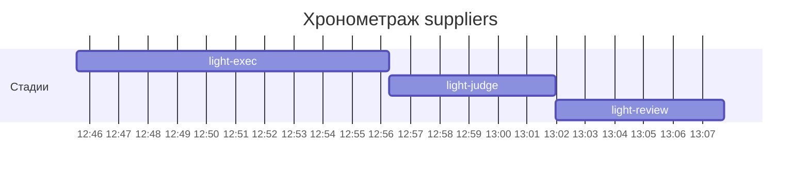

# Хронометраж: suppliers

Обновлено: 2026-10-07T13:07:45+05:00

## Стадии

| Стадия | Начало | Конец | Длит. | Ожидание | Чистое | Рестарты | Переделки |
|---|---|---|---|---|---|---|---|
| light-exec | 07.10 12:45 | 07.10 12:56 | 10м 42с | — | 10м 42с | — | — |
| light-judge | 07.10 12:56 | 07.10 13:01 | 5м 43с | — | 5м 43с | — | 3м 12с |
| light-review | 07.10 13:01 | 07.10 13:07 | 5м 47с | — | 5м 47с | — | 41с |
| **Итого (union)** | 07.10 12:45 | 07.10 13:07 | **22м 12с** | **0с** | **22м 12с** |  | **3м 53с** |

Wall-clock (первое→последнее событие журнала): **22м 12с**; застаймлено (union стадий): 22м 12с.

## События (fix-loop / повторные гейты / ошибки)

| Стадия | Тип | Событие | Начало | Длит. | Статус |
|---|---|---|---|---|---|
| light-judge | other | integration | 07.10 12:57 | 1м 33с | ok |
| light-judge | other | e2e-run | 07.10 12:59 | 53с | ok |
| light-judge | other | e2e-run | 07.10 13:00 | 46с | ok |
| light-review | other | e2e-run | 07.10 13:06 | 41с | ok |

## Инструменты (тайминги гейтов/чекеров)

| Время | Инструмент | Статус | Итого | Шаги (по убыванию) |
|---|---|---|---|---|
| 07.10 12:56 | review_bundle | FAIL | 1с | rule_usage 0.7s · go_naming 0.1s · api_conventions 0.1s · contract 0.1s · date_bound 0.1s · +5 шагов (0.2s) |
| 07.10 13:01 | e2e_evidence | PASS | 0с | status:passed 0s |
| 07.10 13:01 | review_bundle | FAIL | 1с | rule_usage 0.6s · api_conventions 0.1s · contract 0.1s · date_bound 0.1s · live_suite 0.1s · +5 шагов (0.1s) |
| 07.10 13:07 | e2e_evidence | PASS | 0с | status:passed 0s |

## Пайп-передачи (§3.6: бандлы, контракты)

| Время | Стадия | Вид | Артефакт | Размер | Детали |
|---|---|---|---|---|---|
| 07.10 12:45 | — | passport | 0-setup/passport.md | 3KB | — |
| 07.10 12:56 | 8-code-review | bundle | 8-code-review/input-bundle.md | 11KB | чекеры 8✅/2❌/0⚠; патчи 99KB |
| 07.10 13:01 | 8-code-review | bundle | 8-code-review/input-bundle.md | 11KB | чекеры 8✅/2❌/0⚠; патчи 100KB |

Бандлов: 2, суммарно 23KB — весь документный контекст, переданный между стадиями.
Нарушений пайп-контракта не зафиксировано (context-violations.jsonl отсутствует).

## Ожидание пользователя

Пауз не было.

## Диаграмма

