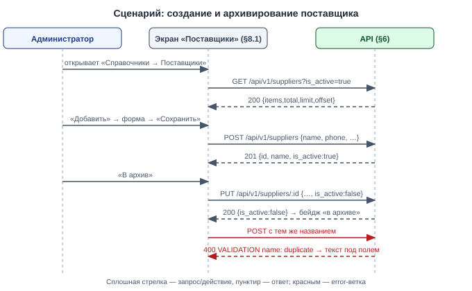

# Draft Spec: Справочник «Поставщики»

**Tier:** S · **Совместимость:** MVP · **Режим:** new

**Дата:** 2026-10-07 | **Статус:** draft → final (после подтверждения пользователя) | **Tier:** S
**Совместимость:** MVP (DS-027 — контекст, реализуется в `transfers-core`) — живых данных нет
**UI-scope:** swagger:no | adaptive:min | themes:both (DS-028 — контекст, реализуется в `transfers-core`)
**Источник:** мастер-спека `docs/features/transfers/draft-spec.md` (§4.3, §6.10–§6.12, §8.2) + её журнал `docs/features/transfers/draft-spec-decisions.md`
**Часть 1 из 6 мастер-спеки `transfers`; зависит от: —** (независима). Номера DS и TS — мастер-идентификаторы, не перенумерованы.

> После мержа этой части: справочник «Поставщики» работает (список, создание, правка, архив), но нигде не используется — документы «поставщик → склад» появятся в части 4 `transfers-partners`.

## §1. Суть задачи
Справочник поставщиков для будущих документов «поставщик → склад». Для администратора.

**Бизнес (что делает пользователь/процесс):**
1. Администратор заводит поставщика: название, контактное лицо, телефон, адрес, примечание (§8.1) — DS-007.
2. Отправляет поставщика в архив и возвращает из архива; удаления нет (§8.1) — DS-007.

**Логика (правила системы):**
1. Название обязательно и уникально без учёта регистра, включая архивные — DS-007.
2. Время: `f:created_at`, `f:updated_at` хранятся в UTC (`timestamptz`); на экране справочника даты не показываются — DS-031 (контекст, реализуется в `user-timezone`).
3. Конкурентный доступ: правка поставщика → last-write-wins, версии нет (как `t:warehouses`); создание с тем же названием → второй запрос получает 400 `name: duplicate` (уникальный индекс) — DS-043.

**Техника (API/данные/интеграции):**
1. Таблица `t:suppliers` (§4.1), своя миграция.
2. API `e:/api/v1/suppliers`: список, создание, правка (§6.1–§6.3).
3. Новый пакет `internal/features/suppliers`; внешних систем нет.

**UI (графическая часть):**
1. Пункт меню «Справочники → Поставщики» (`/suppliers`), только администратор: таблица, поиск, toggle архивных, форма (§8.1).

Out-of-scope:
1. Использование поставщика в документах перемещения (`f:supplier_id`, запрет архивного в новом документе) — часть 4 `transfers-partners`.
2. Удаление поставщика — нет, только архив (DS-007).
3. Закупочные цены, договоры, реквизиты — не ведём (DS-016 — контекст, реализуется в `transfers-partners`).
4. Демо-поставщики в seed-demo — добавляются в части `transfers-partners` вместе с документами от поставщика.

## §2. Интеграции и master-data
Не применимо: внешних систем нет; `t:suppliers` сам является справочником, источник правды — эта фича, ведёт администратор (DS-007).

## §3. Нефункциональные требования

**Конкурентность (К-3 — по операциям):**
1. **Правка поставщика (`e:PUT /api/v1/suppliers/:id`):**
   - last-write-wins, колонки версии нет — DS-043
   - конкурент ничего не получает: сохраняется последняя запись
2. **Создание (`e:POST /api/v1/suppliers`):**
   - уникальность названия держит индекс `i:suppliers_name_lower_uq`; проигравший параллельный запрос → 400 `name: duplicate` — DS-007
3. **Архивирование:** тот же `e:PUT`, last-write-wins — DS-043

**Аудит:**
- отдельного аудита нет; slog мутаций (id поставщика, пользователь) — DS-051 (контекст, реализуется в `transfers-core`)

**Время/таймзоны (К-13):**
- хранение: UTC, `timestamptz`
- на экране даты не показываются; диапазонов дат и отчётов нет

**Метрики/таймстемпы:**
- `f:created_at`, `f:updated_at`; метрик и алертов нет

**Offline / деградация / восстановление:**
- offline-режима нет; после reload список читается с сервера, несохранённая форма теряется

**Логирование и чувствительные данные:**
- телефон и контактное лицо поставщика — служебные данные, доступны только администратору; в slog пишется только id

**Формат ошибок:**
- только `pkg/errorspkg`: `{code, message, details}`; 400 → `details.fields[]`

**Abuse cases (вход для adversarial E2E TD-4):**
1. Исполнитель вызывает любой `e:/api/v1/suppliers` → 403; открывает `/suppliers` → страница «Нет доступа».
2. Название из 201 символа, примечание из 1001 символа → 400, запись не создана.
3. Дубль названия в другом регистре и с пробелами по краям → 400 `name: duplicate`.
4. Правка несуществующего id → 404, не 500.

**Применённые zap-дефолты** (zap-list — стандарты проекта из CLAUDE.md, применяются автоматически, без вопросов; в §9 — источник `zap`):
- 404 / 403 — стандартные статусы; ошибки только `pkg/errorspkg` (zap)
- синхронная обработка (zap)
- миграции — только `make migrate-up` (zap)

## §4. Данные
Легенда колонки «Обяз.»: `да` — клиент обязан передать при создании/правке; `нет` — опционально; `авто` — заполняет система (PK, дефолты, таймстемпы, значения из URL/сессии); `условно` — зависит от правила, оно указано в Описании. NULL — DDL-факт, Обяз. — семантика заполнения.

### §4.1. `t:suppliers`
Справочник поставщиков.

| Поле | Тип | NULL | Default | Обяз. | Описание | DS |
|---|---|---|---|---|---|---|
| `f:id` | uuid | нет | `gen_random_uuid()` | авто | PK | DS-007 |
| `f:name` | text | нет | — | да | Название, 1–200 символов после trim; уникально без учёта регистра, включая архивные | DS-007 |
| `f:contact_name` | text | нет | `''` | нет | Контактное лицо, 0–200 символов | DS-007 |
| `f:phone` | text | нет | `''` | нет | Телефон — строка (не число), 0–50 символов; если непустой — содержит хотя бы одну цифру | DS-007 |
| `f:address` | text | нет | `''` | нет | Адрес, 0–500 символов | DS-007 |
| `f:note` | text | нет | `''` | нет | Примечание, 0–1000 символов | DS-007 |
| `f:is_active` | boolean | нет | `true` | нет | `false` — в архиве: не выбирается в новых документах, в существующих остаётся | DS-007 |
| `f:created_at` | timestamptz | нет | `now()` | авто | — | DS-031 |
| `f:updated_at` | timestamptz | нет | `now()` | авто | — | DS-031 |

Ключи и индексы:
- PK: `f:id`
- UNIQUE `i:suppliers_name_lower_uq` (`lower(btrim(name))`) — уникальность названия, включая архивные

Связи (одна связь = одна строка):
- связей в этой части нет; в части `transfers-partners` появится 1→N `t:transfers` (`f:supplier_id`) — RESTRICT (контекст)

Поведение при действиях (одно действие = одна строка):
- Создание/изменение: только admin — DS-007
- Удаление: запрещено; архивирование через `f:is_active = false`, свободное (в части `transfers-partners`: открытые документы поставщика дорабатываются) — DS-007, DS-043

Инварианты (правило → чем держится → DS):
- название уникально → `i:suppliers_name_lower_uq` (400 `name: duplicate`) → DS-007
- архивный не выбирается в новых документах → валидатор сервиса документа (400 `supplier_id: archived`) → DS-007 — контекст, реализуется в `transfers-partners`

## §5. Статусная модель
Не применимо: статусов нет. Единственный признак состояния — `f:is_active` (`true` — действующий, `false` — в архиве), переключается в обе стороны администратором через `e:PUT /api/v1/suppliers/:id` без ограничений (DS-007, DS-043).

## §6. API
> Режим B «API + фронтенд». Базовый URL стенда: `http://localhost:8080`. Авторизация — сессионная cookie `sid` (плейсхолдер `<SID>`). Копируй curl в терминал или в Postman: Import → Raw text. Тело ошибки — формат `pkg/errorspkg`: `{code, message, details}`; при 400 — `details.fields[]` с `name` и `message`. Ключи — snake_case, URL — kebab-case (CLAUDE.md §API-1).

### §6.1. `e:GET /api/v1/suppliers`
- Назначение: список поставщиков (экран справочника; выбор в документе — контекст, появится в `transfers-partners`).
- Authz: только admin; executor → 403 — DS-007.
- Идемпотентность/повтор: чтение, безопасно.
- Side effects: нет.

Request:

| Параметр | Где | Тип | Обязателен | Валидация |
|---|---|---|---|---|
| `f:is_active` | query | boolean | нет | `true` / `false`; не задан — все; иное → 400 |
| `f:q` | query | string | нет | поиск по названию (подстрока, без учёта регистра), 0–200 символов |
| `f:limit` | query | integer | нет | 1–500, по умолчанию 50 |
| `f:offset` | query | integer | нет | ≥ 0, по умолчанию 0 |

Сортировка: активные раньше архивных, затем по названию.

Response 200:

| Поле | Тип | Описание |
|---|---|---|
| `f:items` | array | поставщики |
| `f:items[].id` | uuid | id |
| `f:items[].name` | string | название |
| `f:items[].contact_name` | string | контактное лицо |
| `f:items[].phone` | string | телефон |
| `f:items[].address` | string | адрес |
| `f:items[].note` | string | примечание |
| `f:items[].is_active` | boolean | не в архиве |
| `f:items[].created_at` | datetime | создан |
| `f:items[].updated_at` | datetime | изменён |
| `f:total` | integer | всего под фильтрами |
| `f:limit` | integer | лимит |
| `f:offset` | integer | смещение |

Ошибки:

| Код | Условие | Сообщение пользователю |
|---|---|---|
| 400 `VALIDATION` | `is_active: invalid` | «Некорректный фильтр» |
| 403 `FORBIDDEN` | executor | `admin only` |

as-built: `f:is_active` — строго `true` / `false`; `f:q` длиннее 200 символов либо с недопустимыми символами → 400 (`q: too_long` / `q: invalid_text`); `f:limit` вне 1–500 не даёт 400: ≤ 0 → 50, больше 500 → 500; отрицательный `f:offset` → 0.

Успех:
```bash
curl -s -b 'sid=<SID>' 'http://localhost:8080/api/v1/suppliers?is_active=true'
```
```json
{
  "items": [ { "id": "d4e5f6a7-b8c9-4d01-8e2f-3a4b5c6d7e8f", "name": "ТОО «Картридж-Опт»", "contact_name": "Айдар", "phone": "+7 701 000 00 00", "address": "Алматы, ул. Абая 1", "note": "", "is_active": true, "created_at": "2026-10-07T05:00:00Z", "updated_at": "2026-10-07T05:00:00Z" } ],
  "total": 1, "limit": 50, "offset": 0
}
```
Ошибка (FORBIDDEN → 403):
```bash
curl -s -b 'sid=<SID_EXECUTOR>' 'http://localhost:8080/api/v1/suppliers'
```
```json
{
  "code": "FORBIDDEN",
  "message": "admin only"
}
```
DS: DS-007.

### §6.2. `e:POST /api/v1/suppliers`
- Назначение: создать поставщика.
- Authz: только admin.
- Идемпотентность/повтор: повтор с тем же названием → 400 `name: duplicate` (дубль не создаётся).
- Side effects: вставка в `t:suppliers`.

Request:

| Параметр | Где | Тип | Обязателен | Валидация |
|---|---|---|---|---|
| `f:name` | body | string | да | 1–200 символов после trim; уникально без учёта регистра, включая архивные |
| `f:contact_name` | body | string | нет | 0–200 символов |
| `f:phone` | body | string | нет | 0–50 символов; непустой — содержит цифру |
| `f:address` | body | string | нет | 0–500 символов |
| `f:note` | body | string | нет | 0–1000 символов |

Response 201 — объект поставщика:

| Поле | Тип | Описание |
|---|---|---|
| `f:id` | uuid | id |
| `f:name` | string | название |
| `f:contact_name` | string | контактное лицо |
| `f:phone` | string | телефон |
| `f:address` | string | адрес |
| `f:note` | string | примечание |
| `f:is_active` | boolean | `true` |
| `f:created_at` | datetime | создан |
| `f:updated_at` | datetime | изменён |

Ошибки:

| Код | Условие | Сообщение пользователю |
|---|---|---|
| 400 `VALIDATION` | `name: required` / `too_long` | «Укажите название (до 200 символов)» |
| 400 `VALIDATION` | `name: duplicate` | «Поставщик с таким названием уже есть» |
| 400 `VALIDATION` | `contact_name: too_long` | «Слишком длинное имя контакта» |
| 400 `VALIDATION` | `phone: invalid` / `too_long` | «Проверьте телефон» |
| 400 `VALIDATION` | `address: too_long` | «Слишком длинный адрес» |
| 400 `VALIDATION` | `note: too_long` | «Слишком длинное примечание» |
| 400 `VALIDATION` | `name` / `contact_name` / `phone` / `address` / `note`: `invalid_text` (as-built: недопустимые символы, например NUL) | по полю |
| 403 `FORBIDDEN` | executor | `admin only` |

Успех:
```bash
curl -s -b 'sid=<SID>' -H 'Content-Type: application/json' -X POST 'http://localhost:8080/api/v1/suppliers' -d '{"name":"ТОО «Картридж-Опт»","contact_name":"Айдар","phone":"+7 701 000 00 00","address":"Алматы, ул. Абая 1","note":""}'
```
```json
{ "id": "d4e5f6a7-b8c9-4d01-8e2f-3a4b5c6d7e8f", "name": "ТОО «Картридж-Опт»", "contact_name": "Айдар", "phone": "+7 701 000 00 00", "address": "Алматы, ул. Абая 1", "note": "", "is_active": true, "created_at": "2026-10-07T05:00:00Z", "updated_at": "2026-10-07T05:00:00Z" }
```
Ошибка (VALIDATION → 400):
```bash
curl -s -b 'sid=<SID>' -H 'Content-Type: application/json' -X POST 'http://localhost:8080/api/v1/suppliers' -d '{"name":"тоо «картридж-опт»"}'
```
```json
{
  "code": "VALIDATION",
  "message": "Проверьте поля",
  "details": { "fields": [ { "name": "name", "message": "duplicate" } ] }
}
```
DS: DS-007.

### §6.3. `e:PUT /api/v1/suppliers/:id`
- Назначение: изменить поставщика, отправить в архив или вернуть из архива.
- Authz: только admin.
- Идемпотентность/повтор: повтор безопасен (то же итоговое состояние); конкурентная правка — last-write-wins (DS-043).
- Side effects: обновление `t:suppliers`.

Request:

| Параметр | Где | Тип | Обязателен | Валидация |
|---|---|---|---|---|
| `f:id` | path | uuid | да | существующий поставщик; не uuid → 404 |
| `f:name` | body | string | да | 1–200 символов после trim; уникально без учёта регистра, включая архивные (кроме самого себя) |
| `f:contact_name` | body | string | нет | 0–200 символов |
| `f:phone` | body | string | нет | 0–50 символов; непустой — содержит цифру |
| `f:address` | body | string | нет | 0–500 символов |
| `f:note` | body | string | нет | 0–1000 символов |
| `f:is_active` | body | boolean | да | `false` — в архив, `true` — из архива |

Response 200 — объект поставщика (поля — таблица «Response 201» §6.2).

Ошибки:

| Код | Условие | Сообщение пользователю |
|---|---|---|
| 400 `VALIDATION` | `name`: `required`, `too_long`, `duplicate` | по полю, тексты §6.2 |
| 400 `VALIDATION` | `contact_name: too_long`, `phone: invalid`, `phone: too_long`, `address: too_long`, `note: too_long`; `invalid_text` у любого текстового поля (as-built) | по полю, тексты §6.2 |
| 400 `VALIDATION` | `is_active: required` | «Обновите страницу» |
| 403 `FORBIDDEN` | executor | `admin only` |
| 404 `SUPPLIER_NOT_FOUND` | нет поставщика | «Поставщик не найден» |

Успех:
```bash
curl -s -b 'sid=<SID>' -H 'Content-Type: application/json' -X PUT 'http://localhost:8080/api/v1/suppliers/d4e5f6a7-b8c9-4d01-8e2f-3a4b5c6d7e8f' -d '{"name":"ТОО «Картридж-Опт»","contact_name":"Айдар","phone":"+7 701 000 00 00","address":"Алматы, ул. Абая 1","note":"","is_active":false}'
```
```json
{ "id": "d4e5f6a7-b8c9-4d01-8e2f-3a4b5c6d7e8f", "name": "ТОО «Картридж-Опт»", "contact_name": "Айдар", "phone": "+7 701 000 00 00", "address": "Алматы, ул. Абая 1", "note": "", "is_active": false, "created_at": "2026-10-07T05:00:00Z", "updated_at": "2026-10-07T11:00:00Z" }
```
Ошибка (SUPPLIER_NOT_FOUND → 404):
```bash
curl -s -b 'sid=<SID>' -H 'Content-Type: application/json' -X PUT 'http://localhost:8080/api/v1/suppliers/00000000-0000-4000-8000-000000000000' -d '{"name":"X","is_active":true}'
```
```json
{
  "code": "SUPPLIER_NOT_FOUND",
  "message": "Поставщик не найден"
}
```
DS: DS-007, DS-043.

## §7. UX/UI + API (сквозной флоу)


Полнота покрытия (endpoint → экраны §8):
| Endpoint | Экраны |
|---|---|
| `e:GET /api/v1/suppliers` | §8.1 |
| `e:POST /api/v1/suppliers` | §8.1 |
| `e:PUT /api/v1/suppliers/:id` | §8.1 |

Непокрытых endpoints и UI-действий без endpoint нет.

## §8. UI-иерархия
- Справочники → **Поставщики** (`/suppliers`) → список → форма — §8.1

UI-конвенции (DS-052 — контекст, реализуется в `transfers-core`; здесь применяются как есть на экранах проекта): ошибка поля — красный текст под полем + красная рамка (`is-invalid` Bootstrap), текст из `details.fields[]`; глобальная ошибка и успех — тост в правом верхнем углу, 5 секунд; на время запроса кнопка действия заблокирована. Адаптив — минимальный: нет горизонтальной прокрутки страницы.

### §8.1. Экран/форма «Поставщики»
- Маршрут: `/suppliers` (список), `/suppliers?id=<uuid>` (форма правки), `/suppliers?new=1` (форма создания)

**Как попадаем:**
- **Путь:** меню «Справочники → Поставщики»
- **URL:** `/suppliers`
- **Роли:** admin (executor — пункта меню нет, прямой URL → страница «Нет доступа») · **Устройство:** десктоп; телефон — без горизонтальной прокрутки
- **При открытии:** `GET §6.1` → `/api/v1/suppliers?limit=50&offset=0`
- **200:** таблица поставщиков · **Пусто:** «Поставщиков нет» + кнопка «Добавить» · **4xx:** 403 — страница «Нет доступа»

**Что на странице (сверху вниз):**
1. Заголовок «Поставщики», кнопка «Добавить» (основная, справа).
2. Панель фильтров; комбинация — «И»:

   | Фильтр | Контрол | Источник значений | API-параметр §6.1 | Пример |
   |---|---|---|---|---|
   | Поиск | текстовый инпут | ввод | `q` | `картридж` |
   | Показать архивные | toggle | выкл → `is_active=true`; вкл → параметр не передаётся | `is_active` | `true` |
3. Таблица: «Название», «Контактное лицо», «Телефон», «Адрес», бейдж «в архиве»; клик по строке — форма.
4. Форма (справа либо модалка), поля сверху вниз:
   1. Название (`name`) — текстовый инпут, обязательное.
   2. Контактное лицо (`contact_name`) — текстовый инпут.
   3. Телефон (`phone`) — текстовый инпут.
   4. Адрес (`address`) — текстовый инпут.
   5. Примечание (`note`) — textarea.
5. Кнопки формы (внизу справа): «Сохранить» (основная), «В архив» / «Вернуть из архива» (второстепенная, только у существующего), «Отмена».

**Интерактив:**
1. **Поиск / toggle архивных**
   - **Элемент:** текстовый инпут, toggle в панели фильтров
   - **UI:** debounce 300 мс
   - **Вызов:** `GET §6.1` → `/api/v1/suppliers?q=…&is_active=true&limit=50&offset=0`
   - **200:** `{ items, total, limit, offset }` → таблица перерисована
   - **400:** тост «Некорректный фильтр»
2. **«Сохранить» (новый)**
   - **Элемент:** кнопка основная, внизу справа
   - **UI:** кнопка заблокирована
   - **Вызов:** `POST §6.2` → `/api/v1/suppliers`, body: `{ name, contact_name, phone, address, note }`
   - **201:** `{ id, name, … }` → строка в таблице, тост «Сохранено»
   - **400 (name: required / too_long):** под полем «Название» — «Укажите название (до 200 символов)»
   - **400 (name: duplicate):** под полем «Название» — «Поставщик с таким названием уже есть»
   - **400 (phone):** под полем «Телефон» — «Проверьте телефон»
   - **400 (contact_name / address / note: too_long):** под соответствующим полем
3. **«Сохранить» (правка), «В архив», «Вернуть из архива»**
   - **Элемент:** кнопки формы
   - **UI:** кнопки заблокированы
   - **Вызов:** `PUT §6.3` → `/api/v1/suppliers/<uuid>`, body: `{ name, contact_name, phone, address, note, is_active }`
   - **200:** `{ id, is_active, … }` → строка обновлена, бейдж «в архиве» появился/исчез (под названием в строке таблицы)
   - **400 (поля):** под соответствующим полем, тексты как при создании
   - **404:** тост «Поставщик не найден», таблица перезапрашивается

**Состояния:** потеря связи — тост «Нет связи»; reload — список с сервера; одновременная правка двумя администраторами — сохраняется последняя (DS-043).

## §9. Решения (DS-index)
| DS | Формулировка | Источник | Статус |
|---|---|---|---|
| DS-007 | Справочник «Поставщики»: название (обязательное, уникальное), контактное лицо, телефон, адрес, примечание; только администратор; без удаления — архивирование | мастер, батч 1 | closed |
| DS-043 | Поставщики: last-write-wins без версии; архивирование свободное | мастер, inferred (по образцу складов) | closed |
| DS-016 | В документе от поставщика цен нет; товары только из каталога | мастер, батч 3 | closed — контекст, реализуется в `transfers-partners` |
| DS-027 | Совместимость — MVP | мастер, батч 6 | closed — контекст, реализуется в `transfers-core` |
| DS-028 | UI-scope: swagger:no, adaptive:min, themes:both | мастер, батч 6 | closed — контекст, реализуется в `transfers-core` |
| DS-031 | Время храним в UTC, показываем по поясу пользователя | мастер, батч 6 | closed — контекст, реализуется в `user-timezone` |
| DS-051 | Отдельной таблицы аудита нет | мастер, zap | closed — контекст, реализуется в `transfers-core` |
| DS-052 | UI-конвенции: ошибка под полем, тост справа вверху 5 с, блокировка кнопки | мастер, inferred | closed — контекст, реализуется в `transfers-core` |

## §10. Открытые вопросы (status: open)
Открытых вопросов нет.

## §11. Тестовые сценарии (черновик — вход для design-e2e-strategy, TD-6.8)
UI-scope: swagger-сценариев нет; адаптив и темы — проверяются общими сценариями TS-045, TS-046 части `transfers-core`; здесь — одна проверка overflow в составе TS-035.

### Unit / Integration (Go)
- **TS-020.** Поставщики: `name` required / 200 символов / уникальность без регистра и с пробелами по краям, включая архивные; `phone` без цифр → 400, 51 символ → 400; длины `contact_name` (200), `address` (500), `note` (1000); `is_active` обязателен в `PUT`; параллельное создание с одним названием → ровно один 201; executor → 403 на все три endpoint'а; фильтры списка `q`, `is_active`, конверт `{items,total,limit,offset}` — DS-007, DS-043
  - негатив: несуществующий id → 404 `SUPPLIER_NOT_FOUND`; `is_active=maybe` → 400
  - не входит в эту часть: «архивный поставщик в новом документе → 400 `supplier_id: archived`» — проверяется в `transfers-partners`

### E2E (Playwright)
- **TS-035.** Справочник «Поставщики» — экран §8.1 — DS-007
  - шаги: admin → «Справочники → Поставщики» → «Добавить» → заполнить → «Сохранить» → открыть → «В архив» → включить «Показать архивные» → «Вернуть из архива»; проверка: строка в таблице, бейдж «в архиве» появляется и исчезает, при вьюпорте 375×812 нет горизонтальной прокрутки; негатив: дубль названия → под полем «Поставщик с таким названием уже есть»; executor: пункта меню нет, прямой URL `/suppliers` → «Нет доступа»
  - не входит в эту часть: «архивного поставщика нет в select нового документа» — проверяется в `transfers-partners`

### Фикстуры и сиды (АКЦЕНТ — хронический пропуск)
- Новый page-object `e2e/pages/SuppliersPage.ts`; payload'ы e2e-хелперов типизировать wire-типами из исходников, не сырыми ключами (§TD-6.2).
- seed-demo в этой части не меняется; демо-поставщики — в `transfers-partners` (TS-F1 — контекст, реализуется в `transfers-core`).

## §Impact — точки касания существующего кода
Источник: `impact_scan.py --sample internal/features/suppliers --terms suppliers,supplier_id,/suppliers` → NO-FINDINGS (каталога образца ещё нет, термы в репозитории не встречаются); строки ниже — реестры, куда новая фича обязана вписаться.

| # | Класс | Что задеваем (file:line / объект) | Дельта фичи | Решение | DS |
|---|---|---|---|---|---|
| 1 | ENUMERATION | `internal/server/router.go` | регистрация пакета `suppliers` | добавить | DS-007 |
| 2 | ENUMERATION | `internal/ssr/menu.go:27-31` (группа «Справочники») | пункт «Поставщики», `/suppliers`, `AdminOnly: true` | добавить | DS-007 |
| 3 | FK | `migrations/` | новая миграция с `t:suppliers` (номер — следующий свободный на момент мержа) | добавить | DS-007 |
| 4 | CONFIG | env-ключи | не задеваются | — | — |
| 5 | MONITORING | дашборды/алерты | не задеваются | — | — |

**Вне каталога фичи:** есть — internal/server/router.go, internal/ssr/menu.go, migrations, e2e
