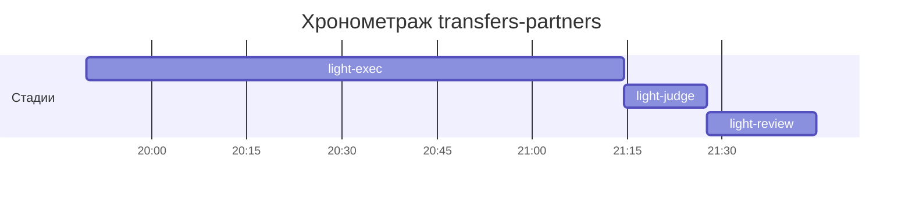

# Хронометраж: transfers-partners

Обновлено: 2026-10-07T21:44:53+05:00

## Стадии

| Стадия | Начало | Конец | Длит. | Ожидание | Чистое | Рестарты | Переделки |
|---|---|---|---|---|---|---|---|
| light-exec | 07.10 19:49 | 07.10 21:14 | 1ч 24м | — | 1ч 24м | — | — |
| light-judge | 07.10 21:14 | 07.10 21:27 | 13м 02с | — | 13м 02с | — | 10м 53с |
| light-review | 07.10 21:27 | 07.10 21:44 | 17м 15с | — | 17м 15с | — | 3м 40с |
| **Итого (union)** | 07.10 19:49 | 07.10 21:44 | **1ч 55м** | **0с** | **1ч 55м** |  | **14м 33с** |

Wall-clock (первое→последнее событие журнала): **1ч 55м**; застаймлено (union стадий): 1ч 55м.

## События (fix-loop / повторные гейты / ошибки)

| Стадия | Тип | Событие | Начало | Длит. | Статус |
|---|---|---|---|---|---|
| light-judge | other | integration | 07.10 21:14 | 1м 27с | ok |
| light-judge | other | e2e-run | 07.10 21:16 | 4м 40с | ok |
| light-judge | other | e2e-run | 07.10 21:22 | 4м 46с | ok |
| light-review | other | integration | 07.10 21:41 | 1м 07с | ok |
| light-review | other | e2e-run | 07.10 21:42 | 2м 33с | ok |

## Инструменты (тайминги гейтов/чекеров)

| Время | Инструмент | Статус | Итого | Шаги (по убыванию) |
|---|---|---|---|---|
| 07.10 21:14 | review_bundle | FAIL | 2с | rule_usage 1.3s · api_conventions 0.1s · date_bound 0.1s · live_suite 0.1s · fixture_sync 0.1s · +5 шагов (0.0s) |
| 07.10 21:27 | e2e_evidence | PASS | 0с | status:passed 0s |
| 07.10 21:27 | review_bundle | FAIL | 2с | rule_usage 1.3s · go_naming 0.1s · api_conventions 0.1s · date_bound 0.1s · live_suite 0.1s · +5 шагов (0.1s) |

## ⚠ BLIND-GAP — интервалы без записей журнала (>5 мин)

Тяжёлый прогон обязан обрамляться `event-start`/`event-end` (§EE anti-polling):
без них нельзя отличить фоновый прогон от sleep-поллинга.

| Стадия | Начало | Конец | Длит. |
|---|---|---|---|
| light-review | 07.10 21:27 | 07.10 21:41 | 13м 27с |

Суммарно вне наблюдения: **13м 27с** (1 интервал(ов)).

## Пайп-передачи (§3.6: бандлы, контракты)

| Время | Стадия | Вид | Артефакт | Размер | Детали |
|---|---|---|---|---|---|
| 07.10 19:49 | — | passport | 0-setup/passport.md | 11KB | — |
| 07.10 21:14 | 8-code-review | bundle | 8-code-review/input-bundle.md | 26KB | чекеры 9✅/1❌/0⚠; патчи 440KB |
| 07.10 21:27 | 8-code-review | bundle | 8-code-review/input-bundle.md | 27KB | чекеры 9✅/1❌/0⚠; патчи 442KB |

Бандлов: 2, суммарно 53KB — весь документный контекст, переданный между стадиями.
Нарушений пайп-контракта не зафиксировано (context-violations.jsonl отсутствует).

## Ожидание пользователя

Пауз не было.

## Диаграмма

