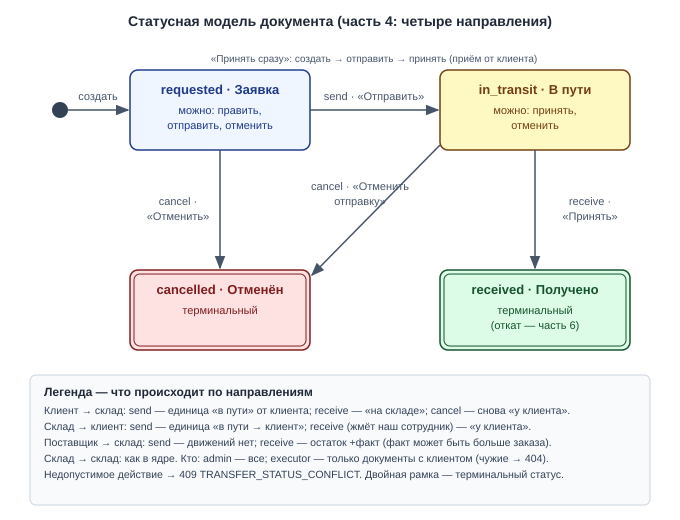
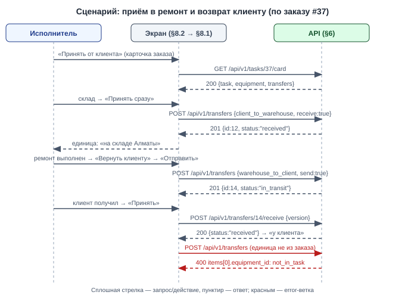

# Draft Spec: Перемещения — клиент и поставщик (направления, заказ, права исполнителя)

**Tier:** M · **Совместимость:** MVP · **Режим:** new

**Дата:** 2026-10-07 | **Статус:** draft → final (после подтверждения пользователя) | **Tier:** M
**Совместимость:** MVP (DS-027 — контекст, реализуется в `transfers-core`) — живых данных нет
**UI-scope:** swagger:no | adaptive:min | themes:both (DS-028 — контекст, реализуется в `transfers-core`)
**Источник:** мастер-спека `docs/features/transfers/draft-spec.md` (§1, §4.1, §4.2, §4.6, §5, §6.1–§6.8, §6.14, §6.15, §8.1, §8.3) + её журнал `docs/features/transfers/draft-spec-decisions.md`
**Часть 4 из 6 мастер-спеки `transfers`; зависит от: `suppliers` (1), `user-timezone` (2), `transfers-core` (3).** Номера DS и TS — мастер-идентификаторы, не перенумерованы.

> Эта спека — дельта поверх `transfers-core`: документ, строки, занятие единицы, optimistic lock и экран «Перемещения» уже существуют. После мержа этой части: оборудование принимается от клиента и возвращается клиенту документом по заказу; товары заказываются у поставщика и принимаются по факту; исполнитель работает с документами с клиентом; в списке есть фильтр «период». Чего ещё нет: товара с ценой в документе «склад → клиент» (часть 5 — пока клиенту уходит только оборудование, товар идёт через услуги заказа, итог заказа не меняется); отката «Получено» и удаления документа (часть 6); удаление заказа с документами отвечает 409 с общим текстом.

## §1. Суть задачи
Документ «Перемещение» получает направление и контрагента: клиент и поставщик становятся точками маршрута. Для администратора и исполнителя.

**Бизнес (что делает пользователь/процесс):**
1. Принимает оборудование клиента в ремонт документом «клиент → склад», всегда по заказу; если клиент принёс сам — создаёт и принимает одним действием (§8.2 → §8.1) — DS-002, DS-012, DS-013.
2. Возвращает оборудование клиенту документом «склад → клиент» по заказу; «Принять» нажимает наш сотрудник, когда клиент получил (§8.1) — DS-013.
3. Администратор заказывает товары у поставщика документом «поставщик → склад» и принимает по факту: меньше или больше заказанного (§8.1) — DS-015.
4. Исполнитель создаёт и проводит документы с клиентом и видит в списке только их (§8.1) — DS-018.
5. Ищет документы за период по дате создания (§8.1) — DS-034.

**Логика (правила системы):**
1. Четыре направления `f:direction`: `s:client_to_warehouse`, `s:warehouse_to_client`, `s:warehouse_to_warehouse`, `s:supplier_to_warehouse`; после создания не меняется — DS-002.
2. Состав строк по направлениям — DS-004:
   - `s:client_to_warehouse`: только единицы оборудования этого заказа;
   - `s:warehouse_to_client`: только единицы оборудования этого заказа (товар с ценой добавит часть 5, DS-011);
   - `s:warehouse_to_warehouse`: единицы оборудования любых клиентов + товары (как в ядре);
   - `s:supplier_to_warehouse`: только товары, без цен — DS-016.
3. Для направлений с клиентом заказ обязателен; клиент документа выводится сервером из заказа; единица строки должна входить в оборудование заказа — DS-012, DS-035.
4. Три шага «Заявка → В пути → Получено» для всех направлений — DS-013.
5. При добавлении единицы в заказ склад больше не выбирается: единица остаётся там, где числится; на склад её приводит документ «клиент → склад» — DS-045.
6. Приход от поставщика: остаток растёт на факт при приёмке; при отправке движений нет; на «Остатках» в колонке «в пути» учитывается — DS-040, DS-047.
7. Документ чужого направления для исполнителя — «не найдено» (404) — DS-042.
8. Время: хранение UTC; границы дня фильтра «период» — по часовому поясу пользователя (`users.timezone`, часть 2), сервер переводит их в UTC и применяет к `f:created_at` — DS-034; показ времени — общим форматтером по поясу пользователя (DS-031 — контекст, реализуется в `user-timezone`).
9. Конкурентный доступ (краткий дубль §3):
   - правка и переходы документа → optimistic lock `f:version` + 409, как в ядре (DS-048 — контекст, реализуется в `transfers-core`);
   - отправка «клиент → склад» → guard «единица у клиента» под `FOR NO KEY UPDATE` строки `t:equipment` (as-built, D75; не `FOR UPDATE`); отправка «склад → клиент» → guard «единица на складе отправления» — DS-013;
   - приход от поставщика → `FOR UPDATE` строк `t:product_stock` склада назначения в порядке product_id — DS-040;
   - удаление заказа при существующих документах → 409, заказ не удаляется — DS-012.

**Техника (API/данные/интеграции):**
1. `t:transfers`: новые `f:direction`, `f:task_id`, `f:client_id`, `f:supplier_id`; `f:from_warehouse_id` и `f:to_warehouse_id` становятся необязательными по направлению; CHECK маршрута (§4.1).
2. `t:stock_movements.reason`: три новых значения (§4.3).
3. API `e:/api/v1/transfers`: дельты семи endpoint'ов ядра (§6.1–§6.7); дельта карточки заказа (§6.8); прочие дельты (§6.9).
4. Пакет `internal/features/transfers`; читает `t:suppliers`, `t:task_equipment`, `users.timezone`.

**UI (графическая часть):**
1. «Перемещения» (`/transfers`): виден исполнителю; меню выбора направления; поля «Заказ» и «Поставщик»; фильтры «Направление», «Поставщик», «Заказ», «Период» (§8.1).
2. Карточка заказа: блок «Перемещения заказа» с кнопками «Принять от клиента» и «Вернуть клиенту»; из формы добавления единицы убран select «Склад приёма» (§8.2).

Out-of-scope:
1. Товар с ценой в документе «склад → клиент», сумма накладной, итог заказа — часть 5 `transfers-sales` (DS-011, DS-014, DS-038, DS-039).
2. «Отменить проведение», удаление документа, человеческое сообщение при удалении заказа с документами и удаление отменённых документов вместе с заказом — часть 6 `transfers-revert` (DS-017, DS-025, DS-050).
3. Статус товара заказа «ждёт поставку» и заказ у поставщика под заказ клиента — отдельная задача после мастер-спеки; связь прихода от поставщика со строками товаров заказа не закладывается (DS-024).
4. Закупочные цены; создание товара каталога из документа — нет (DS-016).
5. Возврат товара от клиента — нет: от клиента принимается только его оборудование (DS-004).

## §2. Интеграции и master-data
Внешних интеграций нет.

Справочники (master-data, таблицей):
| Справочник | Источник правды | Синхронизация | Где используется |
|---|---|---|---|
| Поставщики (`t:suppliers`) | часть 1 `suppliers`, ведёт администратор | нет | `f:supplier_id` документа «поставщик → склад»; архивный не выбирается в новом документе |
| Заказы (`t:tasks`) | фича `board` | нет | `f:task_id` документов с клиентом |
| Клиенты (`t:clients`) | фича `clients` | нет | `f:client_id` (выводится из заказа) |
| Оборудование заказа (`t:task_equipment`) | фича `board` | нет | проверка «единица входит в оборудование заказа» |
| Склады (`t:warehouses`) | фича `warehouses` | нет | `f:from_warehouse_id`, `f:to_warehouse_id` |
| Часовой пояс (`users.timezone`) | часть 2 `user-timezone` | нет | границы дня фильтра «период» |

## §3. Нефункциональные требования

**Конкурентность (К-3 — по операциям):**
1. **Правка и переходы документа:** без изменений относительно ядра — обязательный `f:version`, сверка до статуса, 409 `TRANSFER_VERSION_CONFLICT` / `TRANSFER_STATUS_CONFLICT` (DS-048 — контекст, реализуется в `transfers-core`).
2. **Отправка документа с клиентом:**
   - `s:client_to_warehouse`: под `FOR NO KEY UPDATE` (as-built, D75; не `FOR UPDATE`) строки `t:equipment` — единица `s:at_client`; иначе 409 `TRANSFER_EQUIPMENT_NOT_AT_SOURCE` — DS-013
   - `s:warehouse_to_client`: единица `s:at_warehouse` на складе отправления; иначе тот же 409 — DS-013
3. **Создание и приём одним действием (`receive: true`):** создание, отправка и приёмка — одна транзакция; при любой ошибке не создаётся ничего — DS-013
4. **Приход от поставщика:** при приёмке Lock Order — `t:transfers` FOR UPDATE → строки `t:product_stock` склада назначения FOR UPDATE в порядке product_id; двойной «Принять» → второй 409, остаток вырос один раз — DS-015, DS-040
5. **Удаление заказа с документами:** проверка в транзакции удаления; есть хоть один документ заказа → 409 `CONFLICT`, ничего не удалено (FK `f:task_id` RESTRICT — страховка) — DS-012
6. **Добавление единицы в заказ:** местоположение больше не пишется — гонки с документом нет — DS-045
7. **as-built (D75) — блокировки и их порядок:** документ (`FOR UPDATE`) → заказ (`FOR KEY SHARE` — при создании/правке документа с клиентом, до чтения оборудования заказа) → `t:product_stock` (`FOR UPDATE`, по product_id) → `t:equipment` (`FOR NO KEY UPDATE`, по id); при удалении заказа блокируется только заказ, его документы не блокируются
8. **as-built (D84) — смена клиента заказа:** пока у заказа есть хотя бы один документ в любом статусе (включая «Получено» и «Отменён»), `PUT /api/v1/tasks/:id` с другим `client_id` → 409 `TASK_CLIENT_LOCKED_BY_TRANSFERS` «У заказа есть перемещения — сменить клиента нельзя», `details.transfer_ids` — номера по возрастанию; проверка под блокировкой заказа, до любых изменений (`f:client_id` документа — снимок клиента заказа)

**Аудит:**
- как в ядре: `f:created_by`, `f:sent_by`, `f:received_by`, `f:cancelled_by` + `*_at`; движения — `t:stock_movements` с `f:transfer_id`

**Время/таймзоны (К-13):**
- хранение: UTC, `timestamptz`
- фильтр «период»: `created_from` / `created_to` — календарные даты в поясе пользователя; сервер вычисляет границы `[начало дня created_from; конец дня created_to]` в `users.timezone` запрашивающего, переводит в UTC и сравнивает с `f:created_at` — DS-034
- показ времени — по поясу пользователя (DS-031 — контекст, реализуется в `user-timezone`)
- источник времени: сервер БД (`now()`); as-built (D76): `f:received_at` = `clock_timestamp()`
- as-built (D81): единый формат показа «ДД.ММ.ГГГГ ЧЧ:ММ» на всех экранах

**Метрики/таймстемпы:**
- новых нет

**Offline / деградация / восстановление:**
- как в ядре; параметры `new`, `direction`, `task_id` в URL позволяют после reload снова открыть форму нового документа из карточки заказа

**Логирование и чувствительные данные:**
- slog: мутации документа (id, направление, действие, пользователь); чувствительных данных нет

**Формат ошибок:**
- только `pkg/errorspkg`: `{code, message, details}`; 400 → `details.fields[]`

**Abuse cases (вход для adversarial E2E TD-4):**
1. Исполнитель открывает по прямому id документ «склад → склад» или «поставщик → склад» → 404; создаёт такой документ → 403 — DS-018, DS-042.
2. Исполнитель передаёт фильтр `direction=supplier_to_warehouse` → пустой список, не чужие документы — DS-018.
3. В теле передан `client_id` чужого клиента → игнорируется, клиент выводится из заказа — DS-012.
4. В документ заказа подставлена единица другого заказа или другого клиента → 400 `not_in_task` — DS-035.
5. В документ «поставщик → склад» подставлена строка-единица, в «клиент → склад» — товарная строка → 400 `not_allowed` — DS-004.
6. `created_from=2026-13-40`, `created_to` раньше `created_from` → 400 — DS-034.

**Применённые zap-дефолты** (zap-list — стандарты проекта из CLAUDE.md, применяются автоматически, без вопросов; в §9 — источник `zap`):
- 404 / 403 / 409 — стандартные статусы; ошибки только `pkg/errorspkg` (zap)
- синхронная обработка (zap)
- миграции — только `make migrate-up` (zap)

## §4. Данные
Легенда колонки «Обяз.»: `да` — клиент обязан передать при создании/правке; `нет` — опционально; `авто` — заполняет система (PK, дефолты, таймстемпы, значения из URL/сессии); `условно` — зависит от правила, оно указано в Описании. NULL — DDL-факт, Обяз. — семантика заполнения.

Одна новая миграция (ALTER поверх состояния после `transfers-core`), режим MVP.

### §4.1. `t:transfers`
Шапка документа. Дельта: направление и контрагенты. Таблица приведена целиком в состоянии после этой части.

| Поле | Тип | NULL | Default | Обяз. | Описание | DS |
|---|---|---|---|---|---|---|
| `f:id` | bigserial | нет | sequence | авто | PK, сквозной номер #N (без изменений) | DS-002 |
| **`f:direction`** | text | нет | — | да | НОВОЕ. Направление: `s:client_to_warehouse`, `s:warehouse_to_client`, `s:warehouse_to_warehouse`, `s:supplier_to_warehouse`; после создания не меняется; существующие строки при миграции → `s:warehouse_to_warehouse` | DS-002 |
| `f:from_warehouse_id` | uuid | да | — | условно | ИЗМЕНЕНО: было NOT NULL. FK → `t:warehouses(id)` `ON DELETE RESTRICT`. Обязателен для `s:warehouse_to_client`, `s:warehouse_to_warehouse`; иначе NULL | DS-002 |
| `f:to_warehouse_id` | uuid | да | — | условно | ИЗМЕНЕНО: было NOT NULL. FK → `t:warehouses(id)` `ON DELETE RESTRICT`. Обязателен для `s:client_to_warehouse`, `s:warehouse_to_warehouse`, `s:supplier_to_warehouse`; иначе NULL | DS-002 |
| **`f:task_id`** | bigint | да | — | условно | НОВОЕ. FK → `t:tasks(id)` `ON DELETE RESTRICT`. Обязателен для `s:client_to_warehouse`, `s:warehouse_to_client`; иначе NULL; после создания не меняется | DS-012 |
| **`f:client_id`** | uuid | да | — | авто | НОВОЕ. FK → `t:clients(id)` `ON DELETE RESTRICT`. Сервер выводит из заказа (`tasks.client_id`); от клиента не принимается | DS-012 |
| **`f:supplier_id`** | uuid | да | — | условно | НОВОЕ. FK → `t:suppliers(id)` `ON DELETE RESTRICT`. Обязателен для `s:supplier_to_warehouse`; иначе NULL | DS-002 |
| `f:status` | text | нет | `requested` | авто | `s:requested`, `s:in_transit`, `s:received`, `s:cancelled` (без изменений) | DS-013 |
| `f:note` | text | нет | `''` | нет | Примечание, 0–1000 символов (без изменений) | DS-002 |
| `f:created_by` | uuid | нет | — | авто | FK → `t:users(id)` `ON DELETE RESTRICT`, из сессии (без изменений) | DS-018 |
| `f:sent_by` | uuid | да | — | авто | FK → `t:users(id)` `ON DELETE RESTRICT` (без изменений) | DS-018 |
| `f:sent_at` | timestamptz | да | — | авто | Момент отправки (без изменений) | DS-013 |
| `f:received_by` | uuid | да | — | авто | FK → `t:users(id)` `ON DELETE RESTRICT` (без изменений) | DS-018 |
| `f:received_at` | timestamptz | да | — | авто | Момент приёмки (без изменений) | DS-013 |
| `f:cancelled_by` | uuid | да | — | авто | FK → `t:users(id)` `ON DELETE RESTRICT` (без изменений) | DS-018 |
| `f:cancelled_at` | timestamptz | да | — | авто | Момент отмены (без изменений) | DS-013 |
| `f:created_at` | timestamptz | нет | `now()` | авто | Используется фильтром «период» | DS-034 |
| `f:updated_at` | timestamptz | нет | `now()` | авто | (без изменений) | DS-034 |
| `f:version` | int | нет | `1` | авто | Optimistic lock (без изменений) | DS-013 |

Ключи и индексы:
- PK: `f:id`
- UNIQUE: нет
- `i:transfers_status_idx`, `i:transfers_from_warehouse_id_idx`, `i:transfers_to_warehouse_id_idx` — без изменений
- `i:transfers_direction_idx` (`f:direction`) — НОВОЕ: фильтр списка и скоуп исполнителя
- `i:transfers_task_id_idx` (`f:task_id`) — НОВОЕ: блок «Перемещения заказа», проверка при удалении заказа
- `i:transfers_supplier_id_idx` (`f:supplier_id`) — НОВОЕ: фильтр «поставщик»
- `i:transfers_created_at_idx` (`f:created_at`) — НОВОЕ: фильтр «период»
- CHECK `i:transfers_route_check` — НОВОЕ, заменяет `x:transfers_distinct_warehouses`: набор заполненных `f:from_warehouse_id` / `f:to_warehouse_id` / `f:task_id` / `f:client_id` / `f:supplier_id` соответствует `f:direction`; для `s:warehouse_to_warehouse` — `from_warehouse_id <> to_warehouse_id`

Связи (одна связь = одна строка):
- N→1 `t:tasks` (`f:task_id`) — RESTRICT — заказ с документами не удалить
- N→1 `t:clients` (`f:client_id`) — RESTRICT
- N→1 `t:suppliers` (`f:supplier_id`) — RESTRICT
- остальные связи (`t:transfer_items`, `t:stock_movements`, `t:equipment`, `t:warehouses`, `t:users`) — без изменений

Поведение при действиях (одно действие = одна строка):
- Создание: admin — любое направление; executor — только `s:client_to_warehouse`, `s:warehouse_to_client` — DS-018
- Изменение: только в `s:requested`; `f:direction` и `f:task_id` не меняются — DS-002, DS-012
- Отправка: `s:client_to_warehouse` — единицы `s:at_client` → `s:in_transit`; `s:warehouse_to_client` — единицы со склада отправления → `s:in_transit`; `s:supplier_to_warehouse` — движений остатка нет — DS-013, DS-040
- Приёмка: `s:client_to_warehouse` — единицы → `s:at_warehouse` на складе назначения; `s:warehouse_to_client` — единицы → `s:at_client`, склад пуст; `s:supplier_to_warehouse` — остаток склада назначения растёт на факт (`s:supplier_in`) — DS-013, DS-015
- Отмена «в пути»: `s:client_to_warehouse` — единицы → `s:at_client`; `s:warehouse_to_client` — единицы → склад отправления; `s:supplier_to_warehouse` — движений нет — DS-013
- Удаление заказа при существующих документах: запрещено (409) — DS-012

Инварианты (правило → чем держится → DS):
- маршрут соответствует направлению → CHECK `i:transfers_route_check` + валидатор → DS-002
- документ с клиентом всегда по заказу, клиент = клиент заказа → валидатор сервиса + вывод `f:client_id` сервером → DS-012
- единица строки документа с клиентом входит в оборудование заказа → проверка по `t:task_equipment` (400 `items[i].equipment_id: not_in_task`) → DS-035
- состав строк соответствует направлению → валидатор сервиса (400 `items[i].kind: not_allowed`) → DS-004
- исполнитель не видит и не меняет документы без клиента → скоуп в запросах сервиса (404 / 403) → DS-018, DS-042

### §4.2. `t:transfer_items`
Строки документа. Колонки не меняются; меняется одно правило приёмки. Таблица приведена целиком.

| Поле | Тип | NULL | Default | Обяз. | Описание | DS |
|---|---|---|---|---|---|---|
| `f:id` | uuid | нет | `gen_random_uuid()` | авто | PK (без изменений) | DS-004 |
| `f:transfer_id` | bigint | нет | — | авто | FK → `t:transfers(id)` `ON DELETE CASCADE` (без изменений) | DS-004 |
| `f:position` | int | нет | — | авто | Порядок строки (без изменений) | DS-004 |
| `f:kind` | text | нет | — | да | `s:product`, `s:equipment`; допустимость — по направлению документа (§1 Логика п.2) | DS-004 |
| `f:product_id` | uuid | да | — | условно | FK → `t:products(id)` `ON DELETE RESTRICT`; при `s:product` (без изменений) | DS-004 |
| `f:equipment_id` | uuid | да | — | условно | FK → `t:equipment(id)` `ON DELETE RESTRICT`; при `s:equipment`; для документов с клиентом — единица из оборудования заказа | DS-035 |
| `f:qty_sent` | numeric(12,3) | да | — | условно | Количество (для прихода от поставщика — заказанное), > 0; при `s:product` (без изменений) | DS-015 |
| `f:qty_received` | numeric(12,3) | да | — | условно | ИЗМЕНЕНО (правило): факт ≥ 0; для `s:supplier_to_warehouse` может превышать `f:qty_sent` (максимум 999999999.999), для `s:warehouse_to_warehouse` — ≤ `f:qty_sent`; в документах с клиентом — NULL | DS-015 |

Ключи и индексы:
- PK, оба UNIQUE, `i:transfer_items_product_id_idx`, `i:transfer_items_equipment_id_idx`, CHECK `i:transfer_items_kind_check` — без изменений
- CHECK `x:qty_received <= qty_sent` (остался от `migrations/0009_stock_transfers.up.sql:32`) — УДАЛЯЕТСЯ; остаётся `qty_received >= 0`; верхнюю границу по направлению держит валидатор сервиса

Инварианты (правило → чем держится → DS):
- факт ≤ отправленного вне прихода от поставщика → валидатор сервиса (400 `exceeds_sent`) → DS-015

### §4.3. `t:stock_movements` (общая таблица, чужая — фича использует, не владеет)
Журнал движений остатка; владелец — фича `board` (StockEngine). Дельта: расширение набора причин.

| Поле | Тип | NULL | Default | Обяз. | Описание | DS |
|---|---|---|---|---|---|---|
| `f:id` | uuid | нет | `gen_random_uuid()` | авто | PK (as-is) | DS-040 |
| `f:product_id` | uuid | нет | — | авто | FK → `t:products(id)` `ON DELETE RESTRICT` (as-is) | DS-040 |
| `f:task_id` | bigint | да | — | авто | Заказ движения списания/возврата услуги (as-is; тип — по миграции `0005_board`) | DS-040 |
| `f:warehouse_id` | uuid | нет | `default_warehouse_id()` | авто | FK → `t:warehouses(id)` `ON DELETE RESTRICT` (as-is) | DS-040 |
| `f:transfer_id` | bigint | да | — | авто | FK → `t:transfers(id)` `ON DELETE SET NULL` (as-is) | DS-040 |
| `f:qty_delta` | numeric(12,3) | нет | — | авто | Дельта остатка, ≠ 0 (as-is) | DS-040 |
| `f:reason` | text | нет | — | авто | Причина. As-is: `s:task_consume`, `s:task_return` (board), `s:manual` (board, «Остатки»), `s:transfer_out`, `s:transfer_in`, `s:transfer_loss`, `s:transfer_return` (перемещения). НОВЫЕ (CHECK расширяется в этой части сразу тремя значениями): `s:supplier_in` — приход факта от поставщика, пишется с этой части; `s:client_out` — списание товара клиенту, начнёт писаться в части 5 `transfers-sales`; `s:transfer_unreceive` — компенсирующее движение при откате, начнёт писаться в части 6 `transfers-revert` | DS-040 |
| `f:user_id` | uuid | нет | — | авто | FK → `t:users(id)` `ON DELETE RESTRICT` (as-is) | DS-040 |
| `f:created_at` | timestamptz | нет | `now()` | авто | (as-is) | DS-040 |

Ключи и индексы:
- PK: `f:id`; `i:stock_movements_product_id_idx`, `i:stock_movements_warehouse_id_idx`, `i:stock_movements_transfer_id_idx` — as-is; CHECK `i:stock_movements_reason_check` — расширяется значениями `supplier_in`, `client_out`, `transfer_unreceive`

Поведение при действиях (движения этой части, одна транзакция с переходом документа) — DS-040:
- Отправка `s:supplier_to_warehouse`: движений нет (товар ещё не наш)
- Приёмка `s:supplier_to_warehouse`: `s:supplier_in` +`f:qty_received` на складе назначения; при факте 0 движение не пишется
- Отмена `s:supplier_to_warehouse` (заявка или «в пути»): движений нет
- Документы с клиентом в этой части товарных строк не содержат — движений нет
- `s:warehouse_to_warehouse` — без изменений (ядро)

Используется в модулях (used by):
| Модуль | Ключ-дискриминатор (если есть) | Роль (writer/reader) | Что делает | Путь |
|---|---|---|---|---|
| transfers (эта часть) | `f:reason` = supplier_in | writer | приход от поставщика | `internal/features/transfers` |
| transfers (ядро) | `f:reason` ∈ transfer_out, transfer_in, transfer_loss, transfer_return | writer | склад → склад | `internal/features/transfers` |
| board (StockEngine, «Остатки») | `f:reason` ∈ task_consume, task_return, manual | writer | списание услугами, ручная корректировка | `internal/features/board/stock_engine.go`, `stock_repo.go` |
| seeddemo | все | writer | демо-движения | `internal/seeddemo/seeddemo.go` |

### §4.4. Прочие таблицы (структура не меняется)
- `t:equipment` (структура — `transfers-core`): новые переходы местоположения `s:at_client` → `s:in_transit` → `s:at_warehouse` (приём) и `s:at_warehouse` → `s:in_transit` → `s:at_client` (возврат); запись склада при добавлении единицы в заказ прекращается — DS-013, DS-045
- `t:task_equipment`: читается для проверки DS-035; не меняется
- `t:suppliers`: читается (`f:is_active`, `f:name`); не меняется
- `t:users`: читается `f:timezone` запрашивающего для фильтра «период»; не меняется

## §5. Статусная модель


Статусы — те же четыре, что в ядре; «Получено» и «Отменён» по-прежнему терминальные (откат — часть 6). Дельта — кто действует и что происходит по направлениям.

Детали переходов (guard = атомарное условие; что при гонке; каждый запрет = 409 + негативный тест):
| Из | В | Триггер | Кто | Guard / конкурентный исход | Side effects |
|---|---|---|---|---|---|
| — | `s:requested` | `e:POST /api/v1/transfers` | admin — любое направление; executor — `s:client_to_warehouse`, `s:warehouse_to_client` | единицы свободны, иначе 409 `EQUIPMENT_IN_TRANSFER`; единицы документа с клиентом входят в оборудование заказа | единицы занимаются; `f:client_id` выведен из заказа |
| `s:requested` | `s:in_transit` | `e:POST /api/v1/transfers/:id/send` либо `send: true` | как создание | версия + статус; `s:client_to_warehouse` — единица `s:at_client`; `s:warehouse_to_client` — единица на складе отправления; иначе 409 `TRANSFER_EQUIPMENT_NOT_AT_SOURCE` | единицы → `s:in_transit`; для `s:supplier_to_warehouse` движений нет |
| `s:in_transit` | `s:received` | `e:POST /api/v1/transfers/:id/receive` либо `receive: true` при создании `s:client_to_warehouse` | как создание | версия + статус; второй одновременный запрос — 409 | `s:client_to_warehouse` — единицы на склад назначения; `s:warehouse_to_client` — единицы `s:at_client`; `s:supplier_to_warehouse` — `s:supplier_in` на факт |
| `s:requested` | `s:cancelled` | `e:POST /api/v1/transfers/:id/cancel` | как создание | версия + статус | единицы освобождаются |
| `s:in_transit` | `s:cancelled` | `e:POST /api/v1/transfers/:id/cancel` | как создание | версия + статус | единицы возвращаются в источник (`s:at_client` либо склад отправления) и освобождаются |

Переходы `s:requested` → `s:requested` (правка) и направление `s:warehouse_to_warehouse` — без изменений относительно ядра.

## §6. API
> Режим B «API + фронтенд». Базовый URL стенда: `http://localhost:8080`. Авторизация — сессионная cookie `sid` (плейсхолдеры `<SID>`, `<SID_EXECUTOR>`). Копируй curl в терминал или в Postman: Import → Raw text. Тело ошибки — формат `pkg/errorspkg`. Ключи — snake_case, URL — kebab-case (CLAUDE.md §API-1).
> Endpoint'ы существуют после `transfers-core`; для каждого приведены таблицы параметров и ошибок в состоянии после этой части, изменённое помечено «НОВОЕ» / «ИЗМЕНЕНО».
> as-built (D76): количества (`qty_sent`, `qty_received`) — JSON-числа в запросе и в ответе, не строки. `client_id` в теле создания/правки принимается разбором и игнорируется. Исполнитель: `POST /transfers/:id/unreceive` и `DELETE /transfers/:id` (часть 6) → 403 всегда; документ чужого направления в остальных endpoint'ах → 404.

### §6.1. `e:GET /api/v1/transfers`
- Назначение: список документов.
- Authz: ИЗМЕНЕНО — admin видит все документы; executor — только `s:client_to_warehouse`, `s:warehouse_to_client` (скоуп накладывает сервер; запрос чужого направления фильтром → пустой список) — DS-018.
- Идемпотентность/повтор: чтение, безопасно.
- Side effects: нет.

Request:

| Параметр | Где | Тип | Обязателен | Валидация |
|---|---|---|---|---|
| `f:status` | query | string | нет | `requested`, `in_transit`, `received`, `cancelled`; иное → 400 (без изменений) |
| `f:warehouse_id` | query | uuid | нет | склад отправления ИЛИ назначения; не uuid → 400 (без изменений) |
| `f:direction` | query | string | нет | НОВОЕ. `client_to_warehouse`, `warehouse_to_client`, `warehouse_to_warehouse`, `supplier_to_warehouse`; иное → 400 |
| `f:task_id` | query | integer | нет | НОВОЕ. 1–9223372036854775807; иное → 400 |
| `f:supplier_id` | query | uuid | нет | НОВОЕ. не uuid → 400 |
| `f:created_from` | query | date | нет | НОВОЕ. `YYYY-MM-DD`; начало дня в поясе пользователя; иное → 400 |
| `f:created_to` | query | date | нет | НОВОЕ. `YYYY-MM-DD`; конец дня включительно в поясе пользователя; раньше `f:created_from` → 400 |
| `f:limit` | query | integer | нет | 1–500, по умолчанию 50 (без изменений) |
| `f:offset` | query | integer | нет | ≥ 0, по умолчанию 0 (без изменений) |

Фильтры комбинируются по «И». Сортировка: `f:id` по убыванию.

Response 200:

| Поле | Тип | Описание |
|---|---|---|
| `f:items` | array | элементы списка |
| `f:items[].id` | integer | номер документа |
| `f:items[].direction` | string | НОВОЕ: направление |
| `f:items[].status` | string | статус |
| `f:items[].from_warehouse_id` | uuid \| null | ИЗМЕНЕНО: может быть null |
| `f:items[].from_warehouse_name` | string \| null | ИЗМЕНЕНО: может быть null |
| `f:items[].to_warehouse_id` | uuid \| null | ИЗМЕНЕНО: может быть null |
| `f:items[].to_warehouse_name` | string \| null | ИЗМЕНЕНО: может быть null |
| `f:items[].task_id` | integer \| null | НОВОЕ: заказ |
| `f:items[].client_id` | uuid \| null | НОВОЕ: клиент |
| `f:items[].client_name` | string \| null | НОВОЕ: название клиента |
| `f:items[].supplier_id` | uuid \| null | НОВОЕ: поставщик |
| `f:items[].supplier_name` | string \| null | НОВОЕ: название поставщика |
| `f:items[].note` | string | примечание |
| `f:items[].items_count` | integer | число строк |
| `f:items[].created_by_name` | string | автор |
| `f:items[].created_at` | datetime (UTC, RFC 3339) | создан |
| `f:items[].updated_at` | datetime (UTC, RFC 3339) | изменён |
| `f:items[].version` | integer | версия |
| `f:total` | integer | всего под фильтрами |
| `f:limit` | integer | применённый лимит |
| `f:offset` | integer | применённое смещение |

Ошибки:

| Код | Условие | Сообщение пользователю |
|---|---|---|
| 400 `VALIDATION` | `status: invalid` | «Некорректный статус» |
| 400 `VALIDATION` | `direction: invalid` | «Некорректное направление» |
| 400 `VALIDATION` | `warehouse_id: invalid`, `supplier_id: invalid`, `task_id: invalid` | «Некорректное значение фильтра» |
| 400 `VALIDATION` | `created_from: invalid`, `created_to: invalid`, `created_to: before_from` | «Некорректный период» |
| 401 `UNAUTHORIZED` | нет сессии | переход на вход |

Успех:
```bash
curl -s -b 'sid=<SID>' 'http://localhost:8080/api/v1/transfers?direction=client_to_warehouse&created_from=2026-10-07&created_to=2026-10-07&limit=50&offset=0'
```
```json
{
  "items": [
    { "id": 12, "direction": "client_to_warehouse", "status": "received",
      "from_warehouse_id": null, "from_warehouse_name": null,
      "to_warehouse_id": "5b0c1c0e-6a55-4c0e-9c37-3d2f6f1f7a11", "to_warehouse_name": "Алматы",
      "task_id": 37, "client_id": "a3f1d6c2-0c5e-4a52-8f0e-6f3c4a0b9d21", "client_name": "ТОО «Принт-Сервис»",
      "supplier_id": null, "supplier_name": null,
      "note": "", "items_count": 1, "created_by_name": "Петров Иван",
      "created_at": "2026-10-06T19:30:00Z", "updated_at": "2026-10-06T19:30:00Z", "version": 1 }
  ],
  "total": 1, "limit": 50, "offset": 0
}
```
Ошибка (VALIDATION → 400):
```bash
curl -s -b 'sid=<SID>' 'http://localhost:8080/api/v1/transfers?created_from=2026-10-07&created_to=2026-10-01'
```
```json
{
  "code": "VALIDATION",
  "message": "Проверьте поля",
  "details": { "fields": [ { "name": "created_to", "message": "before_from" } ] }
}
```
DS: DS-018, DS-034.

### §6.2. `e:POST /api/v1/transfers`
- Назначение: создать документ любого из четырёх направлений; опционально сразу отправить и (для приёма от клиента) принять.
- Authz: ИЗМЕНЕНО — admin — любое `f:direction`; executor — только `s:client_to_warehouse`, `s:warehouse_to_client`, иначе 403 — DS-018.
- Спец-механика: `send: true` — создать и отправить; НОВОЕ `receive: true` — создать, отправить и принять одной транзакцией, только для `s:client_to_warehouse` (клиент принёс сам) — DS-013.
- Идемпотентность/повтор: как в ядре; повтор документа с единицами → 409 `EQUIPMENT_IN_TRANSFER`.
- Side effects: одна транзакция — `t:transfers`, `t:transfer_items`, `t:equipment.active_transfer_id`; при `send` / `receive` — эффекты §6.5 / §6.6.

Request:

| Параметр | Где | Тип | Обязателен | Валидация |
|---|---|---|---|---|
| `f:direction` | body | string | да | НОВОЕ. `client_to_warehouse`, `warehouse_to_client`, `warehouse_to_warehouse`, `supplier_to_warehouse`; отсутствует → 400 `required`; иное → 400 `invalid` |
| `f:from_warehouse_id` | body | uuid | условно | ИЗМЕНЕНО. Обязателен для `warehouse_to_client`, `warehouse_to_warehouse`; активный склад; для остальных направлений передан → 400 `not_allowed` |
| `f:to_warehouse_id` | body | uuid | условно | ИЗМЕНЕНО. Обязателен для `client_to_warehouse`, `warehouse_to_warehouse`, `supplier_to_warehouse`; активный склад; для `warehouse_to_client` передан → 400 `not_allowed`; равен `f:from_warehouse_id` → 400 `same_warehouse` |
| `f:task_id` | body | integer | условно | НОВОЕ. Обязателен для `client_to_warehouse`, `warehouse_to_client`; существующий заказ (нет → 400 `not_found`); для остальных передан → 400 `not_allowed` |
| `f:supplier_id` | body | uuid | условно | НОВОЕ. Обязателен для `supplier_to_warehouse`; существующий активный поставщик (нет → 400 `not_found`, архивный → 400 `archived`); для остальных передан → 400 `not_allowed` |
| `f:note` | body | string | нет | 0–1000 символов (без изменений) |
| `f:items` | body | array | да | 1–200 строк (без изменений) |
| `f:items[].kind` | body | string | да | `product`, `equipment`; ИЗМЕНЕНО: недопустимый для направления → 400 `not_allowed` (товар — только `warehouse_to_warehouse`, `supplier_to_warehouse`; единица — только `client_to_warehouse`, `warehouse_to_client`, `warehouse_to_warehouse`) |
| `f:items[].product_id` | body | uuid | условно | при `product`; активный товар; дубль → 400 `duplicate` (без изменений) |
| `f:items[].equipment_id` | body | uuid | условно | при `equipment`; дубль → 400 `duplicate`; НОВОЕ: для документов с клиентом — входит в оборудование заказа, иначе 400 `not_in_task` |
| `f:items[].qty_sent` | body | decimal | условно | при `product`; > 0, до 3 знаков, ≤ 999999999.999 (без изменений) |
| `f:send` | body | boolean | нет | по умолчанию `false` (без изменений) |
| `f:receive` | body | boolean | нет | НОВОЕ. По умолчанию `false`; `true` допустим только для `client_to_warehouse` → иначе 400 `not_allowed` |

Поле `f:client_id` от клиента не принимается: сервер выводит его из заказа (DS-012).

Response 201 — объект документа; поля ядра без изменений (`id`, `status`, `note`, `created_by`, `created_by_name`, `sent_by`, `sent_by_name`, `sent_at`, `received_by`, `received_by_name`, `received_at`, `cancelled_by`, `cancelled_by_name`, `cancelled_at`, `created_at`, `updated_at`, `version`, `items[].id`, `items[].kind`, `items[].product_id`, `items[].product_name`, `items[].unit`, `items[].equipment_id`, `items[].equipment_name`, `items[].equipment_serial`, `items[].qty_sent`, `items[].qty_received`, `warnings[].product_id`, `warnings[].warehouse_id`, `warnings[].warehouse_name`, `warnings[].name`, `warnings[].stock`, `warnings[].min_stock`, `warnings[].kind`); новые и изменённые:

| Поле | Тип | Описание |
|---|---|---|
| `f:direction` | string | НОВОЕ: направление |
| `f:from_warehouse_id` | uuid \| null | ИЗМЕНЕНО: может быть null |
| `f:from_warehouse_name` | string \| null | ИЗМЕНЕНО: может быть null |
| `f:to_warehouse_id` | uuid \| null | ИЗМЕНЕНО: может быть null |
| `f:to_warehouse_name` | string \| null | ИЗМЕНЕНО: может быть null |
| `f:task_id` | integer \| null | НОВОЕ: заказ |
| `f:task_title` | string \| null | НОВОЕ: название заказа |
| `f:client_id` | uuid \| null | НОВОЕ: клиент |
| `f:client_name` | string \| null | НОВОЕ: название клиента |
| `f:supplier_id` | uuid \| null | НОВОЕ: поставщик |
| `f:supplier_name` | string \| null | НОВОЕ: название поставщика |

Ошибки (новые и изменённые; ошибки строк ядра — `items: required`, `items: too_many`, `items[i].product_id`, `items[i].qty_sent`, `note: too_long` — без изменений):

| Код | Условие | Сообщение пользователю |
|---|---|---|
| 400 `VALIDATION` | `direction: required` / `invalid` | «Укажите направление» |
| 400 `VALIDATION` | `from_warehouse_id` / `to_warehouse_id`: `required`, `invalid`, `not_found`, `archived` | «Проверьте склад» |
| 400 `VALIDATION` | `from_warehouse_id` / `to_warehouse_id`: `not_allowed` | «Этот склад не указывается для выбранного направления» |
| 400 `VALIDATION` | `task_id`: `required`, `not_found` | «Укажите заказ» |
| 400 `VALIDATION` | `task_id: not_allowed` | «Заказ указывается только для документов с клиентом» |
| 400 `VALIDATION` | `supplier_id`: `required`, `not_found` | «Укажите поставщика» |
| 400 `VALIDATION` | `supplier_id: archived` | «Поставщик в архиве» |
| 400 `VALIDATION` | `supplier_id: not_allowed` | «Поставщик указывается только для прихода от поставщика» |
| 400 `VALIDATION` | `items[i].kind: not_allowed` | «Этот тип строки недопустим для направления» |
| 400 `VALIDATION` | `items[i].equipment_id: not_in_task` | «Оборудование не из этого заказа» |
| 400 `VALIDATION` | `receive: not_allowed` | «Принять сразу можно только приём от клиента» |
| 403 `FORBIDDEN` | executor создаёт `warehouse_to_warehouse` / `supplier_to_warehouse` | «Нет доступа» |
| 409 `EQUIPMENT_IN_TRANSFER` | единица уже в незавершённом документе | «Оборудование уже в перемещении #N» |
| 409 `TRANSFER_EQUIPMENT_NOT_AT_SOURCE` | при `send` / `receive`, `client_to_warehouse`: единица не «у клиента» | «Оборудование уже не у клиента» |
| 409 `TRANSFER_EQUIPMENT_NOT_AT_SOURCE` | при `send`, `warehouse_to_client`: единица не на складе отправления | «Оборудование находится не на складе отправления» |

Успех (исполнитель принимает оборудование, клиент принёс сам):
```bash
curl -s -b 'sid=<SID_EXECUTOR>' -H 'Content-Type: application/json' -X POST 'http://localhost:8080/api/v1/transfers' -d '{
  "direction": "client_to_warehouse",
  "to_warehouse_id": "5b0c1c0e-6a55-4c0e-9c37-3d2f6f1f7a11",
  "task_id": 37,
  "items": [ {"kind": "equipment", "equipment_id": "0d9a4c1b-7e2f-4b63-9a51-2c8e5f7d3a90"} ],
  "receive": true
}'
```
```json
{
  "id": 12, "direction": "client_to_warehouse", "status": "received",
  "from_warehouse_id": null, "from_warehouse_name": null,
  "to_warehouse_id": "5b0c1c0e-6a55-4c0e-9c37-3d2f6f1f7a11", "to_warehouse_name": "Алматы",
  "task_id": 37, "task_title": "Ремонт принтера HP", "client_id": "a3f1d6c2-0c5e-4a52-8f0e-6f3c4a0b9d21", "client_name": "ТОО «Принт-Сервис»",
  "supplier_id": null, "supplier_name": null, "note": "",
  "sent_at": "2026-10-07T06:20:00Z", "received_at": "2026-10-07T06:20:00Z", "version": 1,
  "items": [ {"id": "e1a2b3c4-d5e6-4f70-8a9b-0c1d2e3f4a5b", "kind": "equipment", "equipment_id": "0d9a4c1b-7e2f-4b63-9a51-2c8e5f7d3a90", "equipment_name": "Принтер HP LaserJet 1020", "equipment_serial": "CNC1234567", "qty_sent": null, "qty_received": null} ],
  "warnings": []
}
```
Ошибка (VALIDATION → 400, единица не из заказа):
```bash
curl -s -b 'sid=<SID_EXECUTOR>' -H 'Content-Type: application/json' -X POST 'http://localhost:8080/api/v1/transfers' -d '{"direction":"client_to_warehouse","to_warehouse_id":"5b0c1c0e-6a55-4c0e-9c37-3d2f6f1f7a11","task_id":37,"items":[{"kind":"equipment","equipment_id":"11111111-2222-4333-8444-555555555555"}]}'
```
```json
{
  "code": "VALIDATION",
  "message": "Проверьте поля",
  "details": { "fields": [ { "name": "items[0].equipment_id", "message": "not_in_task" } ] }
}
```
Спец-механика (приход от поставщика, заявка):
```bash
curl -s -b 'sid=<SID>' -H 'Content-Type: application/json' -X POST 'http://localhost:8080/api/v1/transfers' -d '{"direction":"supplier_to_warehouse","to_warehouse_id":"5b0c1c0e-6a55-4c0e-9c37-3d2f6f1f7a11","supplier_id":"d4e5f6a7-b8c9-4d01-8e2f-3a4b5c6d7e8f","items":[{"kind":"product","product_id":"c7e2a9f4-1b3d-4e6a-8c2f-9d0b5a4e3f12","qty_sent":10}]}'
```
```json
{ "id": 17, "direction": "supplier_to_warehouse", "status": "requested", "supplier_id": "d4e5f6a7-b8c9-4d01-8e2f-3a4b5c6d7e8f", "supplier_name": "ТОО «Картридж-Опт»", "version": 1, "warnings": [] }
```
DS: DS-002, DS-004, DS-012, DS-013, DS-018, DS-035.

### §6.3. `e:GET /api/v1/transfers/:id`
- Назначение: один документ со строками.
- Authz: ИЗМЕНЕНО — admin — любой; executor — только `s:client_to_warehouse`, `s:warehouse_to_client`; документ другого направления для executor → 404 (существование не раскрывается) — DS-018, DS-042.
- Идемпотентность/повтор: чтение, безопасно.
- Side effects: нет.

Request:

| Параметр | Где | Тип | Обязателен | Валидация |
|---|---|---|---|---|
| `f:id` | path | integer | да | 1–9223372036854775807; не число → 404 (без изменений) |

Response 200 — объект документа: поля ядра + новые поля из таблицы §6.2 (`direction`, `task_id`, `task_title`, `client_id`, `client_name`, `supplier_id`, `supplier_name`; склады могут быть null).

Ошибки:

| Код | Условие | Сообщение пользователю |
|---|---|---|
| 404 `TRANSFER_NOT_FOUND` | нет документа / id не число | «Перемещение не найдено» |
| 404 `TRANSFER_NOT_FOUND` | executor запрашивает `warehouse_to_warehouse` / `supplier_to_warehouse` | «Перемещение не найдено» |

Успех:
```bash
curl -s -b 'sid=<SID_EXECUTOR>' 'http://localhost:8080/api/v1/transfers/12'
```
```json
{ "id": 12, "direction": "client_to_warehouse", "status": "received", "task_id": 37, "client_name": "ТОО «Принт-Сервис»", "to_warehouse_name": "Алматы", "version": 1, "items": [], "warnings": [] }
```
Ошибка (TRANSFER_NOT_FOUND → 404, исполнитель открывает приход от поставщика):
```bash
curl -s -b 'sid=<SID_EXECUTOR>' 'http://localhost:8080/api/v1/transfers/17'
```
```json
{
  "code": "TRANSFER_NOT_FOUND",
  "message": "Перемещение не найдено"
}
```
DS: DS-018, DS-042.

### §6.4. `e:PUT /api/v1/transfers/:id`
- Назначение: изменить заявку.
- Authz: ИЗМЕНЕНО — как создание (§6.2); чужое направление для executor → 404.
- Идемпотентность/повтор: без изменений (повтор с той же версией → 409).
- Side effects: без изменений (шапка, полная замена строк, занятие/освобождение единиц).

Request:

| Параметр | Где | Тип | Обязателен | Валидация |
|---|---|---|---|---|
| `f:id` | path | integer | да | существующий документ (без изменений) |
| `f:version` | body | integer | да | ≥ 1 (без изменений) |
| `f:from_warehouse_id` | body | uuid | условно | ИЗМЕНЕНО: правила §6.2 для направления документа |
| `f:to_warehouse_id` | body | uuid | условно | ИЗМЕНЕНО: правила §6.2 для направления документа |
| `f:supplier_id` | body | uuid | условно | НОВОЕ. Обязателен для `supplier_to_warehouse`; активный либо уже стоящий в документе архивный |
| `f:note` | body | string | нет | 0–1000 символов (без изменений) |
| `f:items` | body | array | да | 1–200 строк (без изменений) |
| `f:items[].kind` | body | string | да | ИЗМЕНЕНО: допустимость по направлению документа (§6.2) |
| `f:items[].product_id` | body | uuid | условно | при `product` (без изменений) |
| `f:items[].equipment_id` | body | uuid | условно | при `equipment`; НОВОЕ: для документов с клиентом — из оборудования заказа |
| `f:items[].qty_sent` | body | decimal | условно | при `product` (без изменений) |

`f:direction` и `f:task_id` в теле не принимаются: переданы → 400 `not_allowed` (не меняются после создания).

Response 200 — объект документа (ядро + новые поля §6.2).

Ошибки (новые; ошибки ядра — `version`, склады, строки, 409 по версии / статусу / `EQUIPMENT_IN_TRANSFER` — без изменений):

| Код | Условие | Сообщение пользователю |
|---|---|---|
| 400 `VALIDATION` | `direction: not_allowed`, `task_id: not_allowed` | «Направление и заказ изменить нельзя» |
| 400 `VALIDATION` | `supplier_id`: `required`, `not_found`, `archived`, `not_allowed` | по полю, тексты §6.2 |
| 400 `VALIDATION` | `items[i].kind: not_allowed` | «Этот тип строки недопустим для направления» |
| 400 `VALIDATION` | `items[i].equipment_id: not_in_task` | «Оборудование не из этого заказа» |
| 404 `TRANSFER_NOT_FOUND` | чужое направление для executor | «Перемещение не найдено» |

Успех:
```bash
curl -s -b 'sid=<SID>' -H 'Content-Type: application/json' -X PUT 'http://localhost:8080/api/v1/transfers/17' -d '{"version":1,"to_warehouse_id":"5b0c1c0e-6a55-4c0e-9c37-3d2f6f1f7a11","supplier_id":"d4e5f6a7-b8c9-4d01-8e2f-3a4b5c6d7e8f","note":"","items":[{"kind":"product","product_id":"c7e2a9f4-1b3d-4e6a-8c2f-9d0b5a4e3f12","qty_sent":12}]}'
```
```json
{ "id": 17, "direction": "supplier_to_warehouse", "status": "requested", "version": 2, "items": [ { "id": "b7c8d9e0-f1a2-4b34-8c5d-6e7f8a9b0c1d", "kind": "product", "qty_sent": 12.000 } ], "warnings": [] }
```
Ошибка (VALIDATION → 400):
```bash
curl -s -b 'sid=<SID>' -H 'Content-Type: application/json' -X PUT 'http://localhost:8080/api/v1/transfers/17' -d '{"version":2,"direction":"warehouse_to_warehouse","to_warehouse_id":"5b0c1c0e-6a55-4c0e-9c37-3d2f6f1f7a11","supplier_id":"d4e5f6a7-b8c9-4d01-8e2f-3a4b5c6d7e8f","items":[{"kind":"product","product_id":"c7e2a9f4-1b3d-4e6a-8c2f-9d0b5a4e3f12","qty_sent":12}]}'
```
```json
{
  "code": "VALIDATION",
  "message": "Проверьте поля",
  "details": { "fields": [ { "name": "direction", "message": "not_allowed" } ] }
}
```
DS: DS-002, DS-012, DS-018.

### §6.5. `e:POST /api/v1/transfers/:id/send`
- Назначение: отправить заявку.
- Authz: ИЗМЕНЕНО — как создание (§6.2); чужое направление для executor → 404.
- Идемпотентность/повтор: без изменений (повтор → 409).
- Side effects: ИЗМЕНЕНО по направлениям — `s:client_to_warehouse`: единицы `s:at_client` → `s:in_transit`; `s:warehouse_to_client`: единицы со склада отправления → `s:in_transit`; `s:supplier_to_warehouse`: только статус, `f:sent_by`, `f:sent_at` (движений остатка нет); `s:warehouse_to_warehouse` — как в ядре.

Request:

| Параметр | Где | Тип | Обязателен | Валидация |
|---|---|---|---|---|
| `f:id` | path | integer | да | существующий документ (без изменений) |
| `f:version` | body | integer | да | ≥ 1 (без изменений) |

Response 200 — объект документа (ядро + новые поля §6.2).

Ошибки (новые; `version: required`, 409 по версии и статусу — без изменений):

| Код | Условие | Сообщение пользователю |
|---|---|---|
| 404 `TRANSFER_NOT_FOUND` | чужое направление для executor | «Перемещение не найдено» |
| 409 `TRANSFER_EQUIPMENT_NOT_AT_SOURCE` | `client_to_warehouse`: единица не «у клиента» (`details.equipment_id`) | «Оборудование уже не у клиента» |
| 409 `TRANSFER_EQUIPMENT_NOT_AT_SOURCE` | `warehouse_to_client`: единица не на складе отправления | «Оборудование находится не на складе отправления» |

Успех:
```bash
curl -s -b 'sid=<SID_EXECUTOR>' -H 'Content-Type: application/json' -X POST 'http://localhost:8080/api/v1/transfers/14/send' -d '{"version":1}'
```
```json
{ "id": 14, "direction": "warehouse_to_client", "status": "in_transit", "sent_at": "2026-10-07T07:00:00Z", "version": 2, "warnings": [] }
```
Ошибка (TRANSFER_EQUIPMENT_NOT_AT_SOURCE → 409):
```bash
curl -s -b 'sid=<SID_EXECUTOR>' -H 'Content-Type: application/json' -X POST 'http://localhost:8080/api/v1/transfers/13/send' -d '{"version":1}'
```
```json
{
  "code": "TRANSFER_EQUIPMENT_NOT_AT_SOURCE",
  "message": "Оборудование уже не у клиента",
  "details": { "equipment_id": "0d9a4c1b-7e2f-4b63-9a51-2c8e5f7d3a90" }
}
```
DS: DS-013, DS-040.

### §6.6. `e:POST /api/v1/transfers/:id/receive`
- Назначение: принять документ.
- Authz: ИЗМЕНЕНО — как создание (§6.2); чужое направление для executor → 404.
- Спец-механика: НОВОЕ — для `s:supplier_to_warehouse` факт может быть больше заказанного (DS-015); для документов с клиентом факт не вводится.
- Идемпотентность/повтор: без изменений (повтор → 409; остаток дважды не растёт).
- Side effects: ИЗМЕНЕНО по направлениям — `s:client_to_warehouse`: единицы → `s:at_warehouse` на складе назначения; `s:warehouse_to_client`: единицы → `s:at_client`, `f:warehouse_id` = NULL; `s:supplier_to_warehouse`: `t:transfer_items.qty_received`, `t:product_stock` +факт, `t:stock_movements` (`s:supplier_in`); во всех случаях единицы освобождаются.

Request:

| Параметр | Где | Тип | Обязателен | Валидация |
|---|---|---|---|---|
| `f:id` | path | integer | да | существующий документ (без изменений) |
| `f:version` | body | integer | да | ≥ 1 (без изменений) |
| `f:items` | body | array | нет | факт по товарным строкам; строка без записи — факт = `qty_sent`; ИЗМЕНЕНО: для `client_to_warehouse`, `warehouse_to_client` непустой → 400 `not_allowed` |
| `f:items[].id` | body | uuid | да | id товарной строки документа (без изменений) |
| `f:items[].qty_received` | body | decimal | да | ≥ 0, до 3 знаков; ИЗМЕНЕНО: для `warehouse_to_warehouse` ≤ `qty_sent` (иначе 400 `exceeds_sent`); для `supplier_to_warehouse` ≤ 999999999.999 (иначе 400 `invalid`) |

Response 200 — объект документа (ядро + новые поля §6.2).

Ошибки (новые; ошибки ядра — `version`, `items[i].id`, отрицательный факт, 409 по версии / статусу, `STOCK_OVERFLOW` — без изменений):

| Код | Условие | Сообщение пользователю |
|---|---|---|
| 400 `VALIDATION` | `items: not_allowed` | «Для этого направления факт не вводится» |
| 400 `VALIDATION` | `items[i].qty_received: exceeds_sent` (только `warehouse_to_warehouse`) | «Факт больше отправленного» |
| 404 `TRANSFER_NOT_FOUND` | чужое направление для executor | «Перемещение не найдено» |

Успех (приход от поставщика: заказано 10, пришло 12):
```bash
curl -s -b 'sid=<SID>' -H 'Content-Type: application/json' -X POST 'http://localhost:8080/api/v1/transfers/17/receive' -d '{"version":3,"items":[{"id":"b7c8d9e0-f1a2-4b34-8c5d-6e7f8a9b0c1d","qty_received":12}]}'
```
```json
{ "id": 17, "direction": "supplier_to_warehouse", "status": "received", "received_at": "2026-10-07T09:30:00Z", "version": 4, "items": [ { "id": "b7c8d9e0-f1a2-4b34-8c5d-6e7f8a9b0c1d", "kind": "product", "qty_sent": 10.000, "qty_received": 12.000 } ], "warnings": [] }
```
Ошибка (VALIDATION → 400, факт в документе с клиентом):
```bash
curl -s -b 'sid=<SID_EXECUTOR>' -H 'Content-Type: application/json' -X POST 'http://localhost:8080/api/v1/transfers/14/receive' -d '{"version":2,"items":[{"id":"e1a2b3c4-d5e6-4f70-8a9b-0c1d2e3f4a5b","qty_received":1}]}'
```
```json
{
  "code": "VALIDATION",
  "message": "Проверьте поля",
  "details": { "fields": [ { "name": "items", "message": "not_allowed" } ] }
}
```
DS: DS-013, DS-015, DS-040.

### §6.7. `e:POST /api/v1/transfers/:id/cancel`
- Назначение: отменить заявку или документ «в пути».
- Authz: ИЗМЕНЕНО — как создание (§6.2); чужое направление для executor → 404.
- Идемпотентность/повтор: без изменений (повтор → 409).
- Side effects: ИЗМЕНЕНО по направлениям, из «В пути» — `s:client_to_warehouse`: единицы → `s:at_client`; `s:warehouse_to_client`: единицы → `s:at_warehouse` на складе отправления; `s:supplier_to_warehouse`: только статус; единицы освобождаются.

Request:

| Параметр | Где | Тип | Обязателен | Валидация |
|---|---|---|---|---|
| `f:id` | path | integer | да | существующий документ (без изменений) |
| `f:version` | body | integer | да | ≥ 1 (без изменений) |

Response 200 — объект документа (ядро + новые поля §6.2).

Ошибки (новая одна; `version: required`, 409 по версии и статусу — без изменений):

| Код | Условие | Сообщение пользователю |
|---|---|---|
| 404 `TRANSFER_NOT_FOUND` | чужое направление для executor | «Перемещение не найдено» |

Успех:
```bash
curl -s -b 'sid=<SID_EXECUTOR>' -H 'Content-Type: application/json' -X POST 'http://localhost:8080/api/v1/transfers/14/cancel' -d '{"version":2}'
```
```json
{ "id": 14, "direction": "warehouse_to_client", "status": "cancelled", "cancelled_at": "2026-10-07T08:00:00Z", "version": 3, "warnings": [] }
```
Ошибка (TRANSFER_NOT_FOUND → 404):
```bash
curl -s -b 'sid=<SID_EXECUTOR>' -H 'Content-Type: application/json' -X POST 'http://localhost:8080/api/v1/transfers/17/cancel' -d '{"version":2}'
```
```json
{
  "code": "TRANSFER_NOT_FOUND",
  "message": "Перемещение не найдено"
}
```
DS: DS-013, DS-018.

### §6.8. `e:GET /api/v1/tasks/:id/card` (существующий, дельта)
- Назначение: карточка заказа; дельта — документы заказа.
- Authz: без изменений — любой авторизованный.
- Идемпотентность/повтор: чтение, безопасно.
- Side effects: нет.

Request:

| Параметр | Где | Тип | Обязателен | Валидация |
|---|---|---|---|---|
| `f:id` | path | integer | да | существующий заказ; иначе 404 |

Response 200 — только новые и изменённые поля:

| Поле | Тип | Описание |
|---|---|---|
| `f:transfers` | array | НОВОЕ: документы заказа, новые сверху (всегда массив) |
| `f:transfers[].id` | integer | номер документа |
| `f:transfers[].direction` | string | `client_to_warehouse` \| `warehouse_to_client` |
| `f:transfers[].status` | string | статус |
| `f:transfers[].warehouse_name` | string | склад назначения (приём) либо отправления (возврат) |
| `f:transfers[].items_count` | integer | число строк |
| `f:transfers[].created_at` | datetime | создан |
| `f:equipment[].transit_to_name` | string \| null | ИЗМЕНЕНО: название склада назначения либо «клиент» |
| `f:equipment[].active_transfer_direction` | string \| null | as-built: направление незавершённого документа единицы (null — документа нет); исполнителю «перемещение #N» — ссылка только у документов с клиентом |
| `f:transfers[].amount` | number | as-built (часть 5): сумма документа |

Ошибки:

| Код | Условие | Сообщение пользователю |
|---|---|---|
| 404 `TASK_NOT_FOUND` | нет заказа | «Заказ не найден» |

Успех:
```bash
curl -s -b 'sid=<SID>' 'http://localhost:8080/api/v1/tasks/37/card'
```
```json
{
  "task": { "id": 37, "has_in_transit": true },
  "equipment": [ { "equipment_id": "0d9a4c1b-7e2f-4b63-9a51-2c8e5f7d3a90", "location_status": "in_transit", "warehouse_id": null, "warehouse_name": null, "active_transfer_id": 14, "transit_to_name": "клиент", "active_transfer_direction": "warehouse_to_client" } ],
  "transfers": [ { "id": 14, "direction": "warehouse_to_client", "status": "in_transit", "warehouse_name": "Алматы", "items_count": 1, "created_at": "2026-10-07T06:20:00Z" }, { "id": 12, "direction": "client_to_warehouse", "status": "received", "warehouse_name": "Алматы", "items_count": 1, "created_at": "2026-10-06T19:30:00Z" } ]
}
```
Ошибка (TASK_NOT_FOUND → 404):
```bash
curl -s -b 'sid=<SID>' 'http://localhost:8080/api/v1/tasks/999999/card'
```
```json
{
  "code": "TASK_NOT_FOUND",
  "message": "Заказ не найден"
}
```
DS: DS-012.

### §6.9. Прочие изменения существующих endpoints (дельта)
Формат каждой строки: endpoint — что меняется — ошибка — DS.

| Endpoint | Изменение | Новая ошибка | DS |
|---|---|---|---|
| `e:POST /api/v1/tasks/:id/equipment` | параметр `x:warehouse_id` удаляется (передан — игнорируется); местоположение единицы не меняется | — | DS-045 |
| `e:DELETE /api/v1/tasks/:id` | запрет, пока у заказа есть хоть один документ (в любом статусе); временное общее сообщение — до части 6 | 409 `CONFLICT` «У заказа есть перемещения — удалить нельзя» | DS-012 |
| `e:PUT /api/v1/tasks/:id` | as-built (D84): смена `client_id` запрещена, пока у заказа есть документ в любом статусе (`details.transfer_ids`) | 409 `TASK_CLIENT_LOCKED_BY_TRANSFERS` «У заказа есть перемещения — сменить клиента нельзя» | DS-012 |
| `e:GET /api/v1/stock` («Остатки») | «в пути» = `qty_sent` товарных строк документов `in_transit` направлений `warehouse_to_warehouse` и `supplier_to_warehouse`, входящих в склад | — | DS-047 |
| `e:GET /api/v1/tasks` | фильтр `f:warehouse_id`: единица «в пути» учитывается для склада назначения документа; единица в пути к клиенту ни под один склад не попадает | — | DS-013 |
| SSR `/transfers` и пункт меню «Перемещения» | доступны исполнителю (снять `AdminOnly`) | — | DS-018 |

Ошибка (CONFLICT → 409, удаление заказа с документами):
```json
{
  "code": "CONFLICT",
  "message": "У заказа есть перемещения — удалить нельзя"
}
```

## §7. UX/UI + API (сквозной флоу)


Полнота покрытия (endpoint → экраны §8):
| Endpoint | Экраны |
|---|---|
| `e:GET /api/v1/transfers` | §8.1 |
| `e:POST /api/v1/transfers` | §8.1, §8.2 |
| `e:GET /api/v1/transfers/:id` | §8.1, §8.2 |
| `e:PUT /api/v1/transfers/:id` | §8.1 |
| `e:POST /api/v1/transfers/:id/send` | §8.1 |
| `e:POST /api/v1/transfers/:id/receive` | §8.1 |
| `e:POST /api/v1/transfers/:id/cancel` | §8.1 |
| `e:GET /api/v1/tasks/:id/card` | §8.2; §8.1 (поле «Заказ» и список оборудования заказа) |
| `e:GET /api/v1/suppliers` (часть 1) | §8.1 (select «Поставщик», только admin) |

Непокрытых endpoints и UI-действий без endpoint нет.

## §8. UI-иерархия
- Работа → **Перемещения** (`/transfers`) → список + документ → модалки «Приёмка», «Отмена» — §8.1
- Доска → **Карточка заказа** → блок «Перемещения заказа» — §8.2

UI-конвенции (DS-052 — контекст, реализуется в `transfers-core`): ошибка под полем, тост в правом верхнем углу на 5 секунд, модальный `KT.uiDialog`, блокировка кнопки на время запроса. as-built: ошибки карточки заказа — ошибка в шапке карточки (`#task-error`) либо диалог `KT.uiAlert`, не тост; время — «ДД.ММ.ГГГГ ЧЧ:ММ» (D81).

### §8.1. Экран/форма «Перемещения»
- Маршрут: `/transfers`, `/transfers?id=N`, НОВОЕ `/transfers?new=1&direction=…&task_id=…` (новый документ из карточки заказа)

**Как попадаем:**
- **Путь:** меню «Работа → Перемещения» (ИЗМЕНЕНО: пункт виден исполнителю); ссылка «#N» и кнопки «Принять от клиента» / «Вернуть клиенту» в карточке заказа (§8.2)
- **URL:** `/transfers`, параметры `id`, `new`, `direction`, `task_id`
- **Роли:** admin, executor · **Устройство:** десктоп; телефон — без горизонтальной прокрутки
- **При открытии:** `GET §6.1` → `/api/v1/transfers?limit=50&offset=0`; при `?id=N` — `GET §6.3` → `/api/v1/transfers/N`; при `?new=1&task_id=37` — `GET §6.8` → `/api/v1/tasks/37/card` (название заказа, клиент, оборудование заказа)
- **200:** список и документ либо форма нового документа · **Пусто:** «Перемещений нет» · **4xx:** 404 по `?id` — тост «Перемещение не найдено»; 404 по `task_id` — под полем «Заказ» — «Заказ не найден»

**Что на странице (дельта, сверху вниз):**
1. Кнопка «Новое перемещение» открывает меню выбора направления: admin — «Приём от клиента», «Возврат клиенту», «Склад → склад», «Приход от поставщика»; executor — первые два.
2. Панель фильтров; комбинация — «И»; «Сбросить» справа:

   | Фильтр | Контрол | Источник значений | API-параметр §6.1 | Пример |
   |---|---|---|---|---|
   | Статус | select | enum §5 (без изменений) | `status` | `in_transit` |
   | Склад | select | SSR-список складов (без изменений) | `warehouse_id` | uuid |
   | Направление | select | enum `f:direction`; executor видит два значения | `direction` | `warehouse_to_client` |
   | Поставщик | select (только admin) | `GET /api/v1/suppliers?limit=500` — все, архивные с пометкой | `supplier_id` | uuid |
   | Заказ | текстовый инпут, номер | ввод | `task_id` | `37` |
   | Период с | date | ввод | `created_from` | `2026-10-01` |
   | Период по | date | ввод | `created_to` | `2026-10-07` |
3. Строка списка: добавлен бейдж направления; маршрут — «Клиент → Алматы», «Алматы → Клиент», «Алматы → Москва», «Поставщик → Алматы»; под маршрутом — клиент и «заказ #N» либо название поставщика.
4. Шапка документа — поля по направлению, сверху вниз:
   1. Направление (`direction`) — текст, только чтение.
   2. Заказ (`task_id`) — только документы с клиентом: поле номера; под ним название заказа и клиент; после создания — только чтение, ссылка на карточку.
   3. Поставщик (`supplier_id`) — только «приход от поставщика»: select активных поставщиков.
   4. Склад отправления (`from_warehouse_id`) — «возврат клиенту», «склад → склад».
   5. Склад назначения (`to_warehouse_id`) — «приём от клиента», «склад → склад», «приход от поставщика».
   6. Примечание (`note`).
5. Под таблицей строк: «+ Товар» — только «склад → склад» и «приход от поставщика»; «+ Оборудование» — для документов с клиентом это список оборудования заказа с бейджем местоположения (единицы не из источника неактивны), для «склад → склад» — поиск ядра; в «приходе от поставщика» кнопки нет.
6. Кнопки действий: для «приёма от клиента» в «Заявке» добавлена «Принять сразу» (основная, рядом с «Отправить»).
7. Колонка «Кол-во» в «приходе от поставщика» подписана «Заказано».

**Интерактив (дельта к ядру; действия «Выбор документа», «Отменить» — без изменений):**
1. **Смена фильтра**
   - **Элемент:** select / date / текстовый инпут в панели фильтров
   - **UI:** debounce 300 мс для номера заказа; список затеняется
   - **Вызов:** `GET §6.1` → `/api/v1/transfers?status=…&warehouse_id=…&direction=…&supplier_id=…&task_id=…&created_from=…&created_to=…&limit=50&offset=0`
   - **200:** `{ items, total, limit, offset }` → список перерисован
   - **400 (период):** красный текст под полями периода — «Некорректный период»
   - **400 (остальные фильтры):** тост «Некорректное значение фильтра»
2. **Ввод номера заказа (новый документ с клиентом)**
   - **Элемент:** текстовый инпут «Заказ» в шапке
   - **UI:** debounce 300 мс; до ответа «+ Оборудование» недоступна
   - **Вызов:** `GET §6.8` → `/api/v1/tasks/37/card`
   - **200:** `{ task, equipment, transfers }` → под полем название заказа и клиент; «+ Оборудование» показывает единицы заказа
   - **404:** под полем — «Заказ не найден»
3. **Выбор поставщика**
   - **Элемент:** select «Поставщик» в шапке (только admin)
   - **UI:** список загружается при открытии формы
   - **Вызов:** `GET` → `/api/v1/suppliers?is_active=true&limit=500` (часть 1)
   - **200:** `{ items, total, limit, offset }` → опции select
   - **403:** не возникает — executor этого направления не создаёт
4. **«Сохранить» / «Отправить»**
   - **Элемент:** кнопки внизу справа (как в ядре)
   - **UI:** кнопки заблокированы
   - **Вызов:** `POST §6.2` → `/api/v1/transfers`, body: `{ direction, from_warehouse_id, to_warehouse_id, task_id, supplier_id, note, items, send }`; `PUT §6.4` → `/api/v1/transfers/N`, body: `{ version, from_warehouse_id, to_warehouse_id, supplier_id, note, items }`; `POST §6.5` → `/api/v1/transfers/N/send`, body: `{ version }`
   - **200/201:** `{ id, direction, status, version, … }` → тост «Сохранено» либо бейдж «В пути»
   - **400 (task_id):** под полем «Заказ» — «Укажите заказ»
   - **400 (supplier_id: required / not_found):** под select — «Укажите поставщика»
   - **400 (supplier_id: archived):** под select — «Поставщик в архиве»
   - **400 (items[i].kind: not_allowed):** в строке — «Этот тип строки недопустим для направления»
   - **400 (items[i].equipment_id: not_in_task):** в строке — «Оборудование не из этого заказа»
   - **403:** тост «Нет доступа»
   - **409 (TRANSFER_EQUIPMENT_NOT_AT_SOURCE, приём):** в строке единицы — «Оборудование уже не у клиента»
   - **409 (TRANSFER_EQUIPMENT_NOT_AT_SOURCE, возврат):** в строке единицы — «Оборудование находится не на складе отправления»
   - **409 (версия, статус, EQUIPMENT_IN_TRANSFER):** как в ядре
5. **«Принять сразу» (приём от клиента)**
   - **Элемент:** кнопка основная, внизу справа, только новая заявка «приём от клиента»
   - **UI:** кнопки заблокированы
   - **Вызов:** `POST §6.2` → `/api/v1/transfers`, body: `{ direction: "client_to_warehouse", to_warehouse_id, task_id, note, items, receive: true }`
   - **201:** `{ id, status: "received" }` → документ «Получено»; в карточке заказа единицы «на складе …»
   - **400 (поля):** как у «Сохранить»
   - **409 (EQUIPMENT_IN_TRANSFER):** в строке единицы — «уже в перемещении #N»
   - **409 (TRANSFER_EQUIPMENT_NOT_AT_SOURCE):** в строке единицы — «Оборудование уже не у клиента»
6. **«Принять»**
   - **Элемент:** кнопка основная; «приход от поставщика» и «склад → склад» — модалка «Приёмка» с полем «Факт» по товарным строкам; документы с клиентом — `KT.uiDialog` без полей («Клиент получил оборудование?» / «Оборудование на складе?»)
   - **UI:** кнопка модалки заблокирована
   - **Вызов:** `POST §6.6` → `/api/v1/transfers/N/receive`, body: `{ version, items: [{ id, qty_received }] }` (для документов с клиентом — `{ version }`)
   - **200:** `{ status: "received", items, … }` → бейдж «Получено»; в «приходе от поставщика» строка «заказано 10 / получено 12», расхождение в любую сторону подсвечено
   - **400 (exceeds_sent, только склад → склад):** под полем «Факт» — «Факт больше отправленного»
   - **400 (negative / invalid):** под полем «Факт» — «Факт не может быть отрицательным»
   - **409 (версия, статус, STOCK_OVERFLOW):** как в ядре

**Состояния:** как в ядре; документ открыт исполнителем, а администратор его отменил — при следующем действии 409 по версии, документ перечитывается.

### §8.2. Экран/форма «Карточка заказа»
- Маршрут: карточка заказа на доске (существующая), дельта

**Как попадаем:**
- **Путь:** доска → клик по заказу
- **URL:** существующий URL карточки заказа
- **Роли:** admin, executor · **Устройство:** десктоп; телефон — без горизонтальной прокрутки
- **При открытии:** `GET §6.8` → `/api/v1/tasks/37/card`
- **200:** карточка с блоком «Перемещения заказа» · **Пусто:** в блоке — «Перемещений нет» · **4xx:** 404 — «Заказ не найден»

**Что на странице (дельта, сверху вниз):**
1. Блок «Оборудование»:
   1. Из формы добавления единицы убран select `x:«Склад приёма»` и подпись под ним (DS-045).
   2. Бейдж местоположения получает значение «в пути → клиент».
   3. «перемещение #N» — теперь ссылка и для исполнителя.
2. НОВЫЙ блок «Перемещения заказа» (под «Оборудованием»):
   1. Кнопки справа в заголовке блока: «Принять от клиента» (основная), «Вернуть клиенту» (второстепенная).
   2. Список документов: «#N» (ссылка), направление, склад, бейдж статуса, число строк, дата.

**Интерактив:**
1. **«Принять от клиента»**
   - **Элемент:** кнопка основная, в заголовке блока «Перемещения заказа»
   - **UI:** переход на `/transfers?new=1&direction=client_to_warehouse&task_id=37`; в форме предвыбраны единицы заказа со статусом «у клиента» и первый активный склад; кнопка неактивна с подсказкой «Нет оборудования у клиента», если таких единиц нет
   - **Вызов:** на экране §8.1 — `POST §6.2` → `/api/v1/transfers`, body: `{ direction: "client_to_warehouse", to_warehouse_id, task_id, items, receive: true }`
   - **201:** `{ id, status: "received" }` → в карточке единицы «на складе …», документ в блоке
   - **409 (EQUIPMENT_IN_TRANSFER):** в форме, в строке единицы — «уже в перемещении #N»
   - **409 (TRANSFER_EQUIPMENT_NOT_AT_SOURCE):** в строке единицы — «Оборудование уже не у клиента»
2. **«Вернуть клиенту»**
   - **Элемент:** кнопка второстепенная, в заголовке блока
   - **UI:** переход на `/transfers?new=1&direction=warehouse_to_client&task_id=37`; предвыбраны единицы заказа, числящиеся на складе; склад отправления — склад первой такой единицы (единицы с другого склада неактивны); кнопка неактивна с подсказкой «Нет оборудования на складе», если таких единиц нет
   - **Вызов:** на экране §8.1 — `POST §6.2` → `/api/v1/transfers`, body: `{ direction: "warehouse_to_client", from_warehouse_id, task_id, items, send: true }`
   - **201:** `{ id, status: "in_transit" }` → в карточке единицы «в пути → клиент»
   - **409 (TRANSFER_EQUIPMENT_NOT_AT_SOURCE):** в строке единицы — «Оборудование находится не на складе отправления»
3. **Ссылка «#N»**
   - **Элемент:** ссылка в строке документа и у единицы
   - **UI:** переход на `/transfers?id=N`
   - **Вызов:** `GET §6.3` → `/api/v1/transfers/N`
   - **200:** документ открыт на экране §8.1
   - **404:** тост «Перемещение не найдено» (в т.ч. исполнитель открыл документ «склад → склад»)
4. **Удаление заказа (admin)**
   - **Элемент:** существующая кнопка карточки
   - **UI:** без изменений
   - **Вызов:** `DELETE` → `/api/v1/tasks/37` (§6.9)
   - **200:** без изменений
   - **409 (CONFLICT):** тост «У заказа есть перемещения — удалить нельзя»
   - as-built: отказ удаления показывается в шапке карточки заказа (`#task-error`), не тостом; с части 6 — код `TASK_HAS_TRANSFERS` со ссылками на документы
5. **Смена клиента заказа (as-built, D84)**
   - **Элемент:** существующий выбор клиента в карточке
   - **Вызов:** `PUT` → `/api/v1/tasks/37` (§6.9)
   - **409 (TASK_CLIENT_LOCKED_BY_TRANSFERS):** ошибка в шапке карточки со ссылками на документы, выбранный клиент возвращается к сохранённому

**Состояния:** документ проведён другим пользователем, пока карточка открыта — блок и бейджи обновятся при следующем открытии карточки либо после любого действия в ней (re-fetch).

## §9. Решения (DS-index)
| DS | Формулировка | Источник | Статус |
|---|---|---|---|
| DS-002 | Контрагент — точка маршрута; направления: клиент → склад, склад → клиент, склад → склад, поставщик → склад | мастер, батч 0 | closed |
| DS-004 | Состав строк по направлениям: от клиента — только присланное клиентом; клиенту — его оборудование (+ товар — в части 5); между складами — оборудование и товары; от поставщика — товары | мастер, батч 0 | closed |
| DS-012 | Для направлений с клиентом заказ обязателен; клиент документа выводится сервером из заказа; заказ с документами не удалить | мастер, батч 2 | closed |
| DS-013 | Три шага «Заявка → В пути → Получено» для всех направлений; «Принять» у «склад → клиент» нажимает наш сотрудник; «клиент → склад» можно создать и принять одним действием | мастер, батч 2 | closed |
| DS-015 | Приход от поставщика: приёмка по факту; недопоставка закрывает документ, довоз — новым документом; факт больше заказанного разрешён только для этого направления | мастер, батч 3 | closed |
| DS-016 | В документе от поставщика цен нет; товары только из каталога | мастер, батч 3 | closed |
| DS-018 | Исполнитель создаёт и проводит документы с клиентом и видит в списке только их; «склад → склад», «поставщик → склад» — только администратор | мастер, батч 4 | closed |
| DS-024 | «Ждёт поставку» — отдельная задача; связь прихода от поставщика со строками товаров заказа не закладывается | мастер, батч 5 | closed (вне объёма, реализации нет) |
| DS-034 | В списке перемещений фильтр «период» (дата создания, с — по); границы дня — по поясу пользователя, в SQL — в UTC | мастер, батч 6 (уточнение 3) | closed |
| DS-035 | Единица в документе с клиентом должна входить в оборудование заказа документа | мастер, inferred | closed |
| DS-040 | Новые причины движений остатка: `supplier_in` (пишется здесь), `client_out` (часть 5), `transfer_unreceive` (часть 6); CHECK расширяется здесь сразу тремя; от поставщика при отправке движений нет | мастер, inferred | closed |
| DS-042 | Документ чужого направления для исполнителя → 404; удаление документа — только администратор (endpoint удаления — часть 6) | мастер, батч 7 | closed |
| DS-045 | При добавлении единицы в заказ склад не выбирается; единица остаётся там, где числится | мастер, inferred | closed |
| DS-047 | «В пути» на «Остатках» включает приход от поставщика в статусе «В пути» | мастер, inferred | closed |
| DS-007 | Справочник «Поставщики» | мастер, батч 1 | closed — контекст, реализуется в `suppliers` |
| DS-011 | Товар с ценой в документе «склад → клиент» | мастер, батч 2 | closed — контекст, реализуется в `transfers-sales` |
| DS-017 | «Отменить проведение» | мастер, батч 3 | closed — контекст, реализуется в `transfers-revert` |
| DS-025 | Удаление документа; сообщение с номерами при удалении заказа с документами | мастер, батч 5 | closed — контекст, реализуется в `transfers-revert` |
| DS-050 | Отменённые документы удаляются вместе с заказом | мастер, батч 7 | closed — контекст, реализуется в `transfers-revert` |
| DS-027 | Совместимость — MVP | мастер, батч 6 | closed — контекст, реализуется в `transfers-core` |
| DS-028 | UI-scope: swagger:no, adaptive:min, themes:both | мастер, батч 6 | closed — контекст, реализуется в `transfers-core` |
| DS-031 | Показ времени по поясу пользователя | мастер, батч 6 | closed — контекст, реализуется в `user-timezone` |
| DS-048 | Конкурентность документа: `version`, 409 | мастер, as-is | closed — контекст, реализуется в `transfers-core` |
| DS-052 | UI-конвенции | мастер, inferred | closed — контекст, реализуется в `transfers-core` |

## §10. Открытые вопросы (status: open)
Открытых вопросов нет.

## §11. Тестовые сценарии (черновик — вход для design-e2e-strategy, TD-6.8)
UI-scope: swagger-сценариев нет; адаптив и темы — общие сценарии TS-045, TS-046 части `transfers-core` расширяются формой документа с клиентом и блоком «Перемещения заказа» (в составе TS-029).

### Unit / Integration (Go)
- **TS-001.** Валидатор создания документа: `direction` required/enum; набор `from_warehouse_id` / `to_warehouse_id` / `task_id` / `supplier_id` по каждому из четырёх направлений (лишнее поле → `not_allowed`, недостающее → `required`); `same_warehouse`; `direction` и `task_id` в `PUT` → `not_allowed` — DS-002, DS-012
  - негатив: `client_to_warehouse` без `task_id` → 400 `task_id: required`
- **TS-002.** Валидатор строк: матрица «направление × kind» (товар в `client_to_warehouse` и в `warehouse_to_client` → `not_allowed`; единица в `supplier_to_warehouse` → `not_allowed`) — DS-004
  - негатив: `items[0].kind: not_allowed`
- **TS-004.** Единица не из заказа документа → 400 `items[i].equipment_id: not_in_task`; единица другого клиента → 400 — DS-035
  - негатив: `client_id` в теле игнорируется, берётся из заказа (DS-012)
- **TS-007.** Движения остатка (integration): приход от поставщика — при отправке движений нет, при приёмке `supplier_in` +факт на складе назначения, при отмене движений нет; документы с клиентом движений не создают; остаток `product_stock` сходится с суммой движений — DS-040
  - негатив: факт 0 — движение не пишется, документ «Получено»
  - не входит в эту часть: `client_out` — `transfers-sales` (TS-030); `transfer_unreceive` — `transfers-revert` (TS-010)
- **TS-008.** Приёмка: `warehouse_to_warehouse` факт > отправленного → 400 `exceeds_sent`; `supplier_to_warehouse` факт > заказанного → 200, остаток +факт; факт < заказанного → остаток +факт; `items` у `warehouse_to_client` и `client_to_warehouse` → 400 `not_allowed`; `receive: true` вне `client_to_warehouse` → 400 — DS-015, DS-013
  - негатив: отрицательный факт → 400; двойной параллельный `receive` прихода → остаток вырос один раз
- **TS-015.** Права: executor — `POST` `warehouse_to_warehouse` / `supplier_to_warehouse` → 403; `GET`, `PUT`, `send`, `receive`, `cancel` документа чужого направления → 404; список не содержит чужих направлений даже с фильтром `direction` — DS-018, DS-042
  - негатив: executor создаёт и проводит `client_to_warehouse` → 201 / 200
  - не входит в эту часть: `unreceive`, `DELETE` → 403 — `transfers-revert`; `/suppliers` → 403 — `suppliers` (TS-020)
- **TS-023.** Фильтр «период», граница суток: документ создан `2026-10-06T19:30:00Z` (00:30 7 октября по Алматы, 22:30 6 октября по Москве). Пользователь с `Asia/Almaty`: `created_from=2026-10-07&created_to=2026-10-07` — найден, `2026-10-06` — нет. Пользователь с `Europe/Moscow`: `2026-10-06` — найден, `2026-10-07` — нет — DS-034
  - негатив: `created_to` раньше `created_from` → 400; `2026-13-40` → 400
- **TS-025.** «Остатки»: «в пути» включает `supplier_to_warehouse` в `in_transit` для склада назначения — DS-047
  - негатив: заявка от поставщика (`requested`) в «в пути» не входит

Хвосты сценариев других частей, реализуемые здесь (без новых номеров):
- TS-006 (ядро): отправка `client_to_warehouse`, когда единица не «у клиента» → 409 `TRANSFER_EQUIPMENT_NOT_AT_SOURCE`.
- TS-027 (ядро): `POST /tasks/:id/equipment` с `warehouse_id` — поле игнорируется, единица остаётся «у клиента».
- TS-020 (`suppliers`): архивный поставщик в новом документе → 400 `supplier_id: archived`; в уже созданном остаётся.
- Удаление заказа с документом → 409 `CONFLICT`, заказ и документ на месте (DS-012).

### E2E (Playwright)
- **TS-029.** Приём в ремонт из карточки заказа — экран §8.2 → §8.1 — DS-012, DS-013
  - шаги: исполнитель → карточка заказа → «Принять от клиента» → склад → «Принять сразу»; проверка: документ «Получено» в блоке «Перемещения заказа», бейдж единицы «на складе Алматы»; затем «Вернуть клиенту» → «Отправить» → «Принять»: бейдж «у клиента»; блок и форма без горизонтальной прокрутки при 375×812, читаемы в обеих темах; негатив: повторное «Принять от клиента» той же единицы в незавершённом документе → «уже в перемещении #N»
- **TS-032.** Приход от поставщика — экран §8.1 — DS-015
  - шаги: admin → «Приход от поставщика» → поставщик, товар 10 → «Отправить» → «Принять», факт 12; проверка: «Получено», «заказано 10 / получено 12», остаток +12; негатив: кнопки «+ Оборудование» в этом направлении нет; архивного поставщика нет в select (хвост TS-035)
- **TS-034.** Права исполнителя — экран §8.1 — DS-018
  - шаги: executor → «Перемещения»; проверка: в меню «Новое перемещение» два направления, в списке только документы с клиентом, фильтра «Поставщик» нет; негатив: прямой URL `/transfers?id=<склад→склад>` → «Перемещение не найдено»
- **TS-039.** Фильтры списка, включая «период» — экран §8.1 — DS-034
  - шаги: статус + направление + период; проверка: список соответствует, «Сбросить» возвращает всё; негатив: «по» раньше «с» → «Некорректный период»

Хвост TS-036 (ядро), реализуемый здесь: в форме добавления единицы в заказ нет select «Склад приёма».

### Фикстуры и сиды (АКЦЕНТ — хронический пропуск)
- seed-demo (`internal/seeddemo/seeddemo.go`, владелец TS-F1 — `transfers-core`): дополнить в той же фазе, что миграция — два поставщика (один в архиве); документы трёх новых направлений: приём от клиента `received`, возврат клиенту `in_transit`, приход от поставщика `received` с расхождением и один `in_transit`; у существующих документов `direction = warehouse_to_warehouse`; единицы заказов в последней колонке доски — «у клиента» через проведённую пару «приём + возврат».
- e2e (`e2e/fixtures/board-types.ts`, владелец TS-F2 — `transfers-core`): wire-типы — `transfers[]` карточки, `direction`, `task_id`, `client_*`, `supplier_*` документа; хелпер `addTaskEquipment` без `warehouse_id`; payload'ы типизировать wire-типами из исходников (§TD-6.2).
- Фикстура времени TS-F5 (владелец — `user-timezone`) переиспользуется для TS-023.

## §Impact — точки касания существующего кода
Источник: `impact_scan.py` мастера (213 находок) — строки, относящиеся к этой части, в состоянии после `transfers-core`; отдельный прогон не делался: пакет `internal/features/transfers` на момент написания спеки не существует.

| # | Класс | Что задеваем (file:line / объект) | Дельта фичи | Решение | DS |
|---|---|---|---|---|---|
| 1 | SHARED-DEP | `internal/features/transfers/*` (после ядра; сейчас `internal/features/stocktransfers`) | направления, контрагенты, скоуп исполнителя, приёмка от поставщика, фильтры | править | DS-002, DS-018, DS-015 |
| 2 | ENUMERATION | `internal/features/transfers/routes.go` (сейчас `stocktransfers/routes.go:12,24` — `RequireAdmin` на группе API и SSR) | снять admin-guard с группы; права — в сервисе по направлению | править | DS-018 |
| 3 | ENUMERATION | `internal/ssr/menu.go:25` | снять `AdminOnly` у «Перемещения» | править | DS-018 |
| 4 | SHARED-DEP | `internal/features/board/task_equipment_service.go`, `task_equipment_validate.go`, DTO добавления единицы | убрать `warehouse_id` и запись склада | править | DS-045 |
| 5 | SHARED-DEP | `internal/features/board/card_repo.go`, `card_dto.go` | `transfers[]`, `transit_to_name` = «клиент» | править | DS-012 |
| 6 | SHARED-DEP | `internal/features/board/tasks_service.go:332` (`Delete`) | 409 при наличии документов заказа | править | DS-012 |
| 7 | SHARED-DEP | `internal/features/board/stock_repo.go` (CTE «в пути»), `tasks_repo.go` (фильтр доски) | приход от поставщика в «в пути»; единица в пути к клиенту | править | DS-047, DS-013 |
| 8 | SHARED-DEP | `internal/features/suppliers` (часть 1) | чтение поставщика, проверка `is_active` | использовать | DS-002 |
| 9 | SHARED-DEP | `users.timezone` (часть 2), `internal/server/middleware/auth.go` (`Viewer`) | пояс запрашивающего для фильтра «период» | использовать | DS-034 |
| 10 | FRONTEND | `web/ssr/_shared/js/transfers.js` (после ядра), шаблон страницы | меню направлений, поля шапки, фильтры, «Принять сразу» | править | DS-002, DS-034 |
| 11 | FRONTEND | `web/ssr/_shared/js/task-card.js` | блок «Перемещения заказа», кнопки; убрать select «Склад приёма» | править | DS-012, DS-045 |
| 12 | FK | `migrations/` | новая миграция: колонки и CHECK маршрута `t:transfers`, DROP CHECK `qty_received <= qty_sent`, расширение `stock_movements_reason_check` (сейчас `migrations/0008_warehouses.up.sql:70-72`) | добавить | DS-002, DS-015, DS-040 |
| 13 | ENUMERATION | `internal/seeddemo/seeddemo.go`, `e2e/fixtures/board-types.ts`, `e2e/fixtures/board.ts:8` (`addTaskEquipment`), `e2e/pages/OrderCardPage.ts`, `e2e/tests/order-card.spec.ts` | сид, wire-типы, хелпер без `warehouse_id` | править | DS-045 |
| 14 | CONFIG | env-ключи | не задеваются | — | — |
| 15 | MONITORING | дашборды/алерты | не задеваются | — | — |

**Вне каталога фичи:** есть — internal/features/board, internal/features/transfers, internal/ssr/menu.go, internal/seeddemo, web/ssr/_shared/js, migrations, e2e
