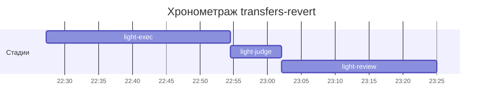

# Хронометраж: transfers-revert

Обновлено: 2026-10-07T23:25:00+05:00

## Стадии

| Стадия | Начало | Конец | Длит. | Ожидание | Чистое | Рестарты | Переделки |
|---|---|---|---|---|---|---|---|
| light-exec | 07.10 22:27 | 07.10 22:54 | 27м 12с | — | 27м 12с | — | — |
| light-judge | 07.10 22:54 | 07.10 23:02 | 7м 37с | — | 7м 37с | — | 7м 02с |
| light-review | 07.10 23:02 | 07.10 23:25 | 22м 54с | — | 22м 54с | — | 6м 51с |
| **Итого (union)** | 07.10 22:27 | 07.10 23:25 | **57м 43с** | **0с** | **57м 43с** |  | **13м 53с** |

Wall-clock (первое→последнее событие журнала): **57м 43с**; застаймлено (union стадий): 57м 43с.

## События (fix-loop / повторные гейты / ошибки)

| Стадия | Тип | Событие | Начало | Длит. | Статус |
|---|---|---|---|---|---|
| light-judge | other | integration | 07.10 22:54 | 1м 29с | ok |
| light-judge | other | e2e-run | 07.10 22:56 | 5м 33с | ok |
| light-review | other | integration | 07.10 23:17 | 1м 09с | ok |
| light-review | other | e2e-run | 07.10 23:19 | 5м 42с | ok |

## Инструменты (тайминги гейтов/чекеров)

| Время | Инструмент | Статус | Итого | Шаги (по убыванию) |
|---|---|---|---|---|
| 07.10 22:54 | review_bundle | FAIL | 2с | rule_usage 1.5s · api_conventions 0.1s · date_bound 0.1s · live_suite 0.1s · fixture_sync 0.1s · +5 шагов (0.0s) |
| 07.10 23:01 | e2e_evidence | PASS | 0с | status:passed 0s |
| 07.10 23:24 | e2e_evidence | PASS | 0с | status:passed 0s |

## ⚠ BLIND-GAP — интервалы без записей журнала (>5 мин)

Тяжёлый прогон обязан обрамляться `event-start`/`event-end` (§EE anti-polling):
без них нельзя отличить фоновый прогон от sleep-поллинга.

| Стадия | Начало | Конец | Длит. |
|---|---|---|---|
| light-review | 07.10 23:02 | 07.10 23:17 | 15м 49с |
| light-review | 07.10 23:19 | 07.10 23:24 | 5м 42с |
| light-judge | 07.10 22:56 | 07.10 23:01 | 5м 33с |

Суммарно вне наблюдения: **27м 04с** (3 интервал(ов)).

## Пайп-передачи (§3.6: бандлы, контракты)

| Время | Стадия | Вид | Артефакт | Размер | Детали |
|---|---|---|---|---|---|
| 07.10 22:27 | — | passport | 0-setup/passport.md | 9KB | — |
| 07.10 22:54 | 8-code-review | bundle | 8-code-review/input-bundle.md | 22KB | чекеры 9✅/1❌/0⚠; патчи 170KB |

Бандлов: 1, суммарно 22KB — весь документный контекст, переданный между стадиями.
Нарушений пайп-контракта не зафиксировано (context-violations.jsonl отсутствует).

## Ожидание пользователя

Пауз не было.

## Диаграмма

