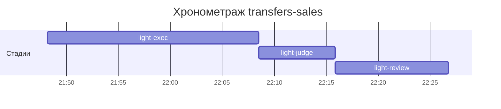

# Хронометраж: transfers-sales

Обновлено: 2026-10-07T22:26:45+05:00

## Стадии

| Стадия | Начало | Конец | Длит. | Ожидание | Чистое | Рестарты | Переделки |
|---|---|---|---|---|---|---|---|
| light-exec | 07.10 21:48 | 07.10 22:08 | 20м 18с | — | 20м 18с | — | — |
| light-judge | 07.10 22:08 | 07.10 22:15 | 7м 23с | — | 7м 23с | — | 6м 07с |
| light-review | 07.10 22:15 | 07.10 22:26 | 10м 53с | — | 10м 53с | — | 2м 41с |
| **Итого (union)** | 07.10 21:48 | 07.10 22:26 | **38м 34с** | **0с** | **38м 34с** |  | **8м 48с** |

Wall-clock (первое→последнее событие журнала): **38м 34с**; застаймлено (union стадий): 38м 34с.

## События (fix-loop / повторные гейты / ошибки)

| Стадия | Тип | Событие | Начало | Длит. | Статус |
|---|---|---|---|---|---|
| light-judge | other | integration | 07.10 22:08 | 1м 26с | ok |
| light-judge | other | e2e-run | 07.10 22:10 | 4м 41с | ok |
| light-review | other | integration | 07.10 22:23 | 1м 05с | ok |
| light-review | other | e2e-run | 07.10 22:24 | 1м 36с | ok |

## Инструменты (тайминги гейтов/чекеров)

| Время | Инструмент | Статус | Итого | Шаги (по убыванию) |
|---|---|---|---|---|
| 07.10 22:08 | review_bundle | FAIL | 2с | rule_usage 1.4s · api_conventions 0.1s · date_bound 0.1s · live_suite 0.1s · fixture_sync 0.1s · +5 шагов (0.0s) |
| 07.10 22:14 | e2e_evidence | PASS | 0с | status:passed 0s |

## ⚠ BLIND-GAP — интервалы без записей журнала (>5 мин)

Тяжёлый прогон обязан обрамляться `event-start`/`event-end` (§EE anti-polling):
без них нельзя отличить фоновый прогон от sleep-поллинга.

| Стадия | Начало | Конец | Длит. |
|---|---|---|---|
| light-review | 07.10 22:15 | 07.10 22:23 | 7м 57с |

Суммарно вне наблюдения: **7м 57с** (1 интервал(ов)).

## Пайп-передачи (§3.6: бандлы, контракты)

| Время | Стадия | Вид | Артефакт | Размер | Детали |
|---|---|---|---|---|---|
| 07.10 21:48 | — | passport | 0-setup/passport.md | 5KB | — |
| 07.10 22:08 | 8-code-review | bundle | 8-code-review/input-bundle.md | 17KB | чекеры 9✅/1❌/0⚠; патчи 161KB |

Бандлов: 1, суммарно 17KB — весь документный контекст, переданный между стадиями.
Нарушений пайп-контракта не зафиксировано (context-violations.jsonl отсутствует).

## Ожидание пользователя

Пауз не было.

## Диаграмма

