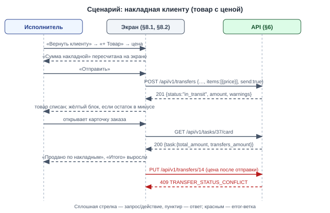

# Draft Spec: Перемещения — накладная клиенту (товар с ценой, сумма, итог заказа)

**Tier:** S · **Совместимость:** MVP · **Режим:** new

**Дата:** 2026-10-07 | **Статус:** draft → final (после подтверждения пользователя) | **Tier:** S
**Совместимость:** MVP (DS-027 — контекст, реализуется в `transfers-core`) — живых данных нет
**UI-scope:** swagger:no | adaptive:min | themes:both (DS-028 — контекст, реализуется в `transfers-core`)
**Источник:** мастер-спека `docs/features/transfers/draft-spec.md` (§4.2, §4.6, §6.1, §6.2, §6.14, §8.1, §8.3) + её журнал `docs/features/transfers/draft-spec-decisions.md`
**Часть 5 из 6 мастер-спеки `transfers`; зависит от: `transfers-partners` (4)** (и через неё от частей 1–3). Номера DS и TS — мастер-идентификаторы, не перенумерованы.

> Эта спека — дельта поверх `transfers-partners`: документ «склад → клиент» уже существует, но везёт только оборудование. После мержа этой части: в него можно добавить товар с ценой продажи — документ становится накладной; товар списывается со склада при отправке; сумма накладной видна в документе, в списке и в карточке заказа и входит в итог заказа. Чего ещё нет: отката «Получено» и удаления документа (часть 6) — ошибочно отправленную накладную можно отменить, пока она «в пути»; полученную исправить нельзя до части 6.

## §1. Суть задачи
Продажа дополнительного товара клиенту тем же документом, которым ему возвращают оборудование. Для администратора и исполнителя.

**Бизнес (что делает пользователь/процесс):**
1. В документ «склад → клиент» добавляет товар каталога с количеством и ценой продажи (§8.1) — DS-011.
2. Видит сумму накладной в документе и в списке перемещений (§8.1) — DS-011.
3. В карточке заказа видит строку «Продано по накладным» и итог заказа с её учётом; отметка «Оплачен» у заказа одна (§8.2) — DS-014.

**Логика (правила системы):**
1. Товарная строка в `s:warehouse_to_client` разрешена и несёт цену `f:price`; в остальных направлениях цены нет — DS-011.
2. Цена не передана → цена товара из каталога (`products.price`); в документе правится — DS-039.
3. Сумма накладной = Σ `price × qty_sent` товарных строк; факт по товару для этого направления не вводится — DS-038.
4. Товар списывается со склада отправления при отправке (`s:client_out`); при отмене «в пути» возвращается (`s:transfer_return`); при приёмке движений нет — DS-011.
5. Итог заказа = услуги + товары услуг + накладные заказа в статусах `s:in_transit`, `s:received`; заявка и отменённая накладная в сумму не входят — DS-014.
6. Товары, уже списанные услугами заказа, в накладную повторно не вносят — это правило пользователя, система не проверяет (один и тот же товар может законно продаваться и услугой, и накладной) — DS-011.
7. Время: новых дат нет; хранение и показ — как в частях 2–4 (DS-031 — контекст, реализуется в `user-timezone`).
8. Конкурентный доступ (краткий дубль §3):
   - правка цены и строк → optimistic lock `f:version` документа + 409 (DS-048 — контекст, реализуется в `transfers-core`);
   - списание при отправке → `FOR UPDATE` строк `t:product_stock` склада отправления в порядке product_id; отправка в минус разрешена с `f:warnings` — DS-011;
   - итог заказа не хранится, считается запросом при чтении — гонки нет — DS-014.

**Техника (API/данные/интеграции):**
1. `t:transfer_items.price` — новая колонка (§4.1).
2. Дельты `e:POST /api/v1/transfers`, `e:PUT /api/v1/transfers/:id` (цена, товар в накладной), ответов документа и списка (`f:amount`, `f:price`, `f:line_total`), карточки заказа и списка заказов (`f:transfers_amount`, `f:total_amount`) — §6.
3. Выражение итога заказа — одно на проект: `totalAmountSelectSQL` (`internal/features/board/tasks_repo.go:112`), используется карточкой (`:277`) и доской (`:365`).

**UI (графическая часть):**
1. Документ «возврат клиенту»: кнопка «+ Товар», колонки «Цена» и «Сумма», итог «Сумма накладной» (§8.1).
2. Список перемещений: сумма в строке накладной (§8.1).
3. Карточка заказа: сумма в строках блока «Перемещения заказа», строка «Продано по накладным» в итогах; печатная форма «Выдача» — та же строка (§8.2).

Out-of-scope:
1. Отдельная отметка оплаты накладной — нет: «Оплачен» у заказа одна (DS-014).
2. «Отменить проведение» накладной и пересчёт при откате — часть 6 `transfers-revert` (DS-017, DS-023).
3. Закупочные цены в приходе от поставщика — нет (DS-016 — контекст, реализуется в `transfers-partners`).
4. Возврат проданного товара от клиента — нет (DS-004 — контекст, реализуется в `transfers-partners`).
5. Скидки, НДС, валюта — не ведём; сумма в той же единице, что цены заказа.

## §2. Интеграции и master-data
Внешних интеграций нет.

Справочники (master-data, таблицей):
| Справочник | Источник правды | Синхронизация | Где используется |
|---|---|---|---|
| Товары (`t:products`) | фича `catalog` | нет | товарная строка накладной; `products.price` — цена по умолчанию (копируется в строку в момент сохранения, дальнейшие правки каталога на документ не влияют) |

## §3. Нефункциональные требования

**Конкурентность (К-3 — по операциям):**
1. **Правка цены и строк накладной (`e:PUT /api/v1/transfers/:id`):**
   - optimistic lock документа: `f:version`, 409 `TRANSFER_VERSION_CONFLICT` (DS-048 — контекст, реализуется в `transfers-core`)
   - только в `s:requested`: после отправки цена не меняется → 409 `TRANSFER_STATUS_CONFLICT` — DS-011
2. **Списание товара при отправке:**
   - Lock Order: `t:transfers` FOR UPDATE → строки `t:product_stock` склада отправления FOR UPDATE в порядке product_id; двойная отправка → второй запрос 409, списание одно — DS-011
   - as-built (D75): полный порядок блокировок — документ → заказ (`FOR KEY SHARE`, при создании/правке документа с клиентом) → `t:product_stock` (по product_id) → `t:equipment` (по id, `FOR NO KEY UPDATE`)
   - остаток может уйти в минус — ответ несёт `f:warnings` (как у перемещения между складами)
3. **Итог заказа при одновременной отправке накладной и чтении карточки:** сумма считается одним запросом; читатель видит состояние до либо после транзакции отправки — DS-014
4. **Правка цены товара в каталоге одновременно с сохранением документа:** в строку попадает цена, прочитанная в транзакции сохранения; позже не пересчитывается — DS-039

**Аудит:**
- движения `s:client_out`, `s:transfer_return` в `t:stock_movements` с `f:transfer_id`; отдельного журнала цен нет

**Время/таймзоны (К-13):**
- новых полей дат и фильтров по датам нет; хранение UTC, показ по поясу пользователя — как в частях 2–4

**Метрики/таймстемпы:**
- новых нет

**Offline / деградация / восстановление:**
- как в ядре; несохранённые цены теряются при reload

**Логирование и чувствительные данные:**
- цены продажи видны обеим ролям (исполнитель правит цены заказа и сейчас, D19); в slog суммы не пишутся

**Формат ошибок:**
- только `pkg/errorspkg`: `{code, message, details}`; 400 → `details.fields[]`

**Abuse cases (вход для adversarial E2E TD-4):**
1. Цена `-1`, `1e12`, `1.999`, строка `abc` → 400, документ не сохранён.
2. Цена передана в строке-единице оборудования либо в товарной строке «склад → склад» → 400 `not_allowed`.
3. Правка цены в документе «В пути» / «Получено» → 409, итог заказа не изменился.
4. Накладная создана по заказу A, в фильтре карточки заказа B её суммы нет (сумма считается по `task_id`).

**Применённые zap-дефолты** (zap-list — стандарты проекта из CLAUDE.md, применяются автоматически, без вопросов; в §9 — источник `zap`):
- 409 — стандартный статус; ошибки только `pkg/errorspkg` (zap)
- миграции — только `make migrate-up` (zap)

## §4. Данные
Легенда колонки «Обяз.»: `да` — клиент обязан передать при создании/правке; `нет` — опционально; `авто` — заполняет система (PK, дефолты, таймстемпы, значения из URL/сессии); `условно` — зависит от правила, оно указано в Описании. NULL — DDL-факт, Обяз. — семантика заполнения.

Одна новая миграция (ALTER поверх состояния после `transfers-partners`), режим MVP.

### §4.1. `t:transfer_items`
Строки документа. Дельта: цена продажи. Таблица приведена целиком в состоянии после этой части.

| Поле | Тип | NULL | Default | Обяз. | Описание | DS |
|---|---|---|---|---|---|---|
| `f:id` | uuid | нет | `gen_random_uuid()` | авто | PK (без изменений) | DS-011 |
| `f:transfer_id` | bigint | нет | — | авто | FK → `t:transfers(id)` `ON DELETE CASCADE` (без изменений) | DS-011 |
| `f:position` | int | нет | — | авто | Порядок строки (без изменений) | DS-011 |
| `f:kind` | text | нет | — | да | `s:product`, `s:equipment`; ИЗМЕНЕНО (правило): `s:product` теперь допустим и в `s:warehouse_to_client` | DS-011 |
| `f:product_id` | uuid | да | — | условно | FK → `t:products(id)` `ON DELETE RESTRICT`; при `s:product` (без изменений) | DS-011 |
| `f:equipment_id` | uuid | да | — | условно | FK → `t:equipment(id)` `ON DELETE RESTRICT`; при `s:equipment` (без изменений) | DS-011 |
| `f:qty_sent` | numeric(12,3) | да | — | условно | Количество, > 0; при `s:product` (без изменений) | DS-038 |
| `f:qty_received` | numeric(12,3) | да | — | условно | Факт; в `s:warehouse_to_client` не вводится — NULL и после приёмки (без изменений) | DS-038 |
| **`f:price`** | numeric(12,2) | да | — | условно | НОВОЕ. Цена продажи за единицу, 0–9999999999.99, до 2 знаков. Только товарные строки направления `s:warehouse_to_client`: не передана → `products.price` на момент сохранения; в остальных случаях NULL. Существующие строки при миграции → NULL | DS-011, DS-039 |

Ключи и индексы:
- PK, оба UNIQUE, оба индекса — без изменений
- CHECK `i:transfer_items_kind_check` — ИЗМЕНЕНО: при `s:equipment` дополнительно `f:price` NULL
- CHECK `i:transfer_items_price_check` — НОВОЕ: `price IS NULL OR price >= 0`

Поведение при действиях (одно действие = одна строка):
- Создание/замена строк: только в `s:requested`; цена сохраняется в строке — DS-011
- Отправка / приёмка / отмена: цена не меняется — DS-011

Инварианты (правило → чем держится → DS):
- цена только у товара в накладной клиенту → валидатор сервиса (400 `items[i].price: not_allowed`) + CHECK для строк-единиц → DS-011
- у каждой товарной строки накладной цена заполнена → сервис подставляет `products.price`, если не передана → DS-039
- сумма накладной = Σ `price × qty_sent` → вычисляется запросом, не хранится → DS-038

### §4.2. `t:stock_movements` (общая таблица, чужая — фича использует, не владеет)
Журнал движений остатка; владелец — фича `board`. Структура и CHECK причин не меняются (значение `s:client_out` добавлено в CHECK частью 4); эта часть начинает его писать.

| Поле | Тип | NULL | Default | Обяз. | Описание | DS |
|---|---|---|---|---|---|---|
| `f:id` | uuid | нет | `gen_random_uuid()` | авто | PK (as-is) | DS-011 |
| `f:product_id` | uuid | нет | — | авто | FK → `t:products(id)` `ON DELETE RESTRICT` (as-is) | DS-011 |
| `f:task_id` | bigint | да | — | авто | Заказ движения списания/возврата услуги (as-is); для движений накладной не заполняется — связь с заказом идёт через `f:transfer_id` | DS-011 |
| `f:warehouse_id` | uuid | нет | `default_warehouse_id()` | авто | FK → `t:warehouses(id)` `ON DELETE RESTRICT` (as-is) | DS-011 |
| `f:transfer_id` | bigint | да | — | авто | FK → `t:transfers(id)` `ON DELETE SET NULL` (as-is) | DS-011 |
| `f:qty_delta` | numeric(12,3) | нет | — | авто | Дельта остатка, ≠ 0 (as-is) | DS-011 |
| `f:reason` | text | нет | — | авто | Причина. Набор значений после части 4: `s:task_consume`, `s:task_return`, `s:manual` (board), `s:transfer_out`, `s:transfer_in`, `s:transfer_loss`, `s:transfer_return` (перемещения между складами), `s:supplier_in` (приход от поставщика), `s:client_out` (списание клиенту — НАЧИНАЕТ ПИСАТЬСЯ в этой части), `s:transfer_unreceive` (откат — часть 6) | DS-011 |
| `f:user_id` | uuid | нет | — | авто | FK → `t:users(id)` `ON DELETE RESTRICT` (as-is) | DS-011 |
| `f:created_at` | timestamptz | нет | `now()` | авто | (as-is) | DS-011 |

Ключи и индексы:
- без изменений

Поведение при действиях (движения накладной, одна транзакция с переходом документа) — DS-011:
- Отправка `s:warehouse_to_client`: `s:client_out` −`f:qty_sent` на складе отправления по каждой товарной строке
- Приёмка `s:warehouse_to_client`: движений нет (товар списан при отправке)
- Отмена «в пути» `s:warehouse_to_client`: `s:transfer_return` +`f:qty_sent` на склад отправления
- Отмена заявки: движений нет

Используется в модулях (used by):
| Модуль | Ключ-дискриминатор (если есть) | Роль (writer/reader) | Что делает | Путь |
|---|---|---|---|---|
| transfers (эта часть) | `f:reason` ∈ client_out, transfer_return | writer | списание и возврат товара накладной | `internal/features/transfers` |
| transfers (части 3, 4) | `f:reason` ∈ transfer_out, transfer_in, transfer_loss, transfer_return, supplier_in | writer | склад → склад, приход от поставщика | `internal/features/transfers` |
| board (StockEngine, «Остатки») | `f:reason` ∈ task_consume, task_return, manual | writer | списание услугами, ручная корректировка | `internal/features/board/stock_engine.go`, `stock_repo.go` |
| seeddemo | все | writer | демо-движения | `internal/seeddemo/seeddemo.go` |

## §5. Статусная модель
Не применимо: статусы и переходы документа не меняются (модель — `transfers-partners` §5). Дельта этой части — только побочные эффекты переходов накладной `s:warehouse_to_client`:

| Из | В | Триггер | Кто | Guard / конкурентный исход | Side effects |
|---|---|---|---|---|---|
| `s:requested` | `s:in_transit` | `e:POST /api/v1/transfers/:id/send` | admin, executor | без изменений | НОВОЕ: `s:client_out` −`f:qty_sent`; сумма накладной входит в итог заказа |
| `s:in_transit` | `s:received` | `e:POST /api/v1/transfers/:id/receive` | admin, executor | без изменений | движений остатка нет; сумма остаётся в итоге заказа |
| `s:in_transit` | `s:cancelled` | `e:POST /api/v1/transfers/:id/cancel` | admin, executor | без изменений | НОВОЕ: `s:transfer_return` +`f:qty_sent`; сумма выходит из итога заказа |
| `s:requested` | `s:cancelled` | `e:POST /api/v1/transfers/:id/cancel` | admin, executor | без изменений | движений нет; в итог заказа сумма не входила |

## §6. API
> Режим B «API + фронтенд». Базовый URL стенда: `http://localhost:8080`. Авторизация — сессионная cookie `sid` (плейсхолдеры `<SID>`, `<SID_EXECUTOR>`). Копируй curl в терминал или в Postman: Import → Raw text. Тело ошибки — формат `pkg/errorspkg`. Ключи — snake_case, URL — kebab-case (CLAUDE.md §API-1).
> Endpoint'ы существуют после `transfers-partners`; приведены только новые и изменённые параметры, поля и ошибки, остальное без изменений.
> as-built (D76): количества и деньги (`qty_sent`, `qty_received`, `price`, `line_total`, `amount`, `transfers_amount`, `total_amount`) — JSON-числа и в запросе, и в ответе, не строки; значение в кавычках в теле запроса → 400 на разборе тела без `details.fields` (в UI нечисловая цена ловится на клиенте — «Некорректная цена»). `transfers_amount` есть в `GET /tasks/:id` и ответах мутаций заказа, в элементах списка `GET /tasks` его нет.

### §6.1. `e:POST /api/v1/transfers`
- Назначение: создание документа; дельта — товар с ценой в `s:warehouse_to_client`.
- Authz: без изменений (admin — любое направление; executor — документы с клиентом).
- Идемпотентность/повтор: без изменений.
- Side effects: без изменений + при `send: true` для `s:warehouse_to_client` — списание `s:client_out` (§4.2).

Request (новые и изменённые параметры; остальные — `direction`, `from_warehouse_id`, `to_warehouse_id`, `task_id`, `supplier_id`, `note`, `items`, `items[].product_id`, `items[].equipment_id`, `items[].qty_sent`, `send`, `receive` — без изменений):

| Параметр | Где | Тип | Обязателен | Валидация |
|---|---|---|---|---|
| `f:items[].kind` | body | string | да | ИЗМЕНЕНО: `product` допустим в `warehouse_to_client` (было 400 `not_allowed`); в `client_to_warehouse` по-прежнему 400 `not_allowed` |
| `f:items[].price` | body | decimal | нет | НОВОЕ. Только `kind: product` в `warehouse_to_client`: 0–9999999999.99, до 2 знаков после запятой; не передан либо `null` → цена каталога; отрицательный → 400 `negative`; больше 2 знаков, не число, больше максимума → 400 `invalid`; передан в строке-единице либо в другом направлении → 400 `not_allowed` |

Response 201 — объект документа; новые поля (остальные без изменений):

| Поле | Тип | Описание |
|---|---|---|
| `f:amount` | number | сумма накладной: Σ `price × qty_sent` товарных строк, 2 знака; `0.00` вне `warehouse_to_client` и для накладной без товаров |
| `f:items[].price` | number \| null | цена продажи; null у строк-единиц и вне `warehouse_to_client` |
| `f:items[].line_total` | number \| null | `price × qty_sent`, округление до 2 знаков; null там же, где `price` |

Ошибки (новые; остальные без изменений):

| Код | Условие | Сообщение пользователю |
|---|---|---|
| 400 `VALIDATION` | `items[i].price: invalid` | «Некорректная цена» |
| 400 `VALIDATION` | `items[i].price: negative` | «Цена не может быть отрицательной» |
| 400 `VALIDATION` | `items[i].price: not_allowed` | «Цена указывается только у товара в накладной клиенту» |

Успех:
```bash
curl -s -b 'sid=<SID_EXECUTOR>' -H 'Content-Type: application/json' -X POST 'http://localhost:8080/api/v1/transfers' -d '{
  "direction": "warehouse_to_client",
  "from_warehouse_id": "5b0c1c0e-6a55-4c0e-9c37-3d2f6f1f7a11",
  "task_id": 37,
  "note": "Возврат после ремонта + картридж",
  "items": [
    {"kind": "equipment", "equipment_id": "0d9a4c1b-7e2f-4b63-9a51-2c8e5f7d3a90"},
    {"kind": "product", "product_id": "c7e2a9f4-1b3d-4e6a-8c2f-9d0b5a4e3f12", "qty_sent": 1, "price": 18500.00}
  ],
  "send": true
}'
```
```json
{
  "id": 14, "direction": "warehouse_to_client", "status": "in_transit",
  "from_warehouse_id": "5b0c1c0e-6a55-4c0e-9c37-3d2f6f1f7a11", "from_warehouse_name": "Алматы",
  "task_id": 37, "task_title": "Ремонт принтера HP", "client_name": "ТОО «Принт-Сервис»",
  "amount": 18500.00, "version": 1,
  "items": [
    {"id": "e1a2b3c4-d5e6-4f70-8a9b-0c1d2e3f4a5b", "kind": "equipment", "equipment_id": "0d9a4c1b-7e2f-4b63-9a51-2c8e5f7d3a90", "qty_sent": null, "price": null, "line_total": null},
    {"id": "f2b3c4d5-e6f7-4081-9bac-1d2e3f4a5b6c", "kind": "product", "product_id": "c7e2a9f4-1b3d-4e6a-8c2f-9d0b5a4e3f12", "product_name": "Картридж Q2612A", "unit": "шт", "qty_sent": 1.000, "qty_received": null, "price": 18500.00, "line_total": 18500.00}
  ],
  "warnings": []
}
```
Ошибка (VALIDATION → 400):
```bash
curl -s -b 'sid=<SID>' -H 'Content-Type: application/json' -X POST 'http://localhost:8080/api/v1/transfers' -d '{"direction":"warehouse_to_warehouse","from_warehouse_id":"5b0c1c0e-6a55-4c0e-9c37-3d2f6f1f7a11","to_warehouse_id":"9e8d7c6b-5a49-4382-b170-6f5e4d3c2b1a","items":[{"kind":"product","product_id":"c7e2a9f4-1b3d-4e6a-8c2f-9d0b5a4e3f12","qty_sent":1,"price":100}]}'
```
```json
{
  "code": "VALIDATION",
  "message": "Проверьте поля",
  "details": { "fields": [ { "name": "items[0].price", "message": "not_allowed" } ] }
}
```
DS: DS-011, DS-039.

### §6.2. `e:PUT /api/v1/transfers/:id`
- Назначение: правка заявки; дельта — цена и товарные строки накладной.
- Authz: без изменений.
- Идемпотентность/повтор: без изменений (повтор с той же версией → 409).
- Side effects: без изменений (полная замена строк, включая цены).

Request (новые и изменённые; остальные — `id`, `version`, `from_warehouse_id`, `to_warehouse_id`, `supplier_id`, `note`, `items`, `items[].product_id`, `items[].equipment_id`, `items[].qty_sent` — без изменений):

| Параметр | Где | Тип | Обязателен | Валидация |
|---|---|---|---|---|
| `f:items[].kind` | body | string | да | ИЗМЕНЕНО: `product` допустим в документе `warehouse_to_client` |
| `f:items[].price` | body | decimal | нет | НОВОЕ. Правила §6.1; не передан у товарной строки накладной → цена каталога (ранее сохранённая цена этой строки не наследуется: строки заменяются целиком) |

Response 200 — объект документа с `f:amount`, `f:items[].price`, `f:items[].line_total` (§6.1).

Ошибки (новые; остальные без изменений):

| Код | Условие | Сообщение пользователю |
|---|---|---|
| 400 `VALIDATION` | `items[i].price`: `invalid`, `negative`, `not_allowed` | тексты §6.1 |
| 409 `TRANSFER_STATUS_CONFLICT` | правка цены в статусе `in_transit` | «Перемещение уже отправлено — править нельзя» |
| 409 `TRANSFER_STATUS_CONFLICT` | правка цены в статусе `received` | «Перемещение уже получено — править нельзя» |
| 409 `TRANSFER_STATUS_CONFLICT` | правка цены в статусе `cancelled` | «Перемещение отменено — править нельзя» |

Успех:
```bash
curl -s -b 'sid=<SID>' -H 'Content-Type: application/json' -X PUT 'http://localhost:8080/api/v1/transfers/18' -d '{"version":1,"from_warehouse_id":"5b0c1c0e-6a55-4c0e-9c37-3d2f6f1f7a11","note":"","items":[{"kind":"product","product_id":"c7e2a9f4-1b3d-4e6a-8c2f-9d0b5a4e3f12","qty_sent":2,"price":17000.00}]}'
```
```json
{ "id": 18, "direction": "warehouse_to_client", "status": "requested", "amount": 34000.00, "version": 2, "items": [ { "id": "c3d4e5f6-a7b8-4c90-8d1e-2f3a4b5c6d7e", "kind": "product", "qty_sent": 2.000, "price": 17000.00, "line_total": 34000.00 } ], "warnings": [] }
```
Ошибка (TRANSFER_STATUS_CONFLICT → 409):
```bash
curl -s -b 'sid=<SID>' -H 'Content-Type: application/json' -X PUT 'http://localhost:8080/api/v1/transfers/14' -d '{"version":1,"from_warehouse_id":"5b0c1c0e-6a55-4c0e-9c37-3d2f6f1f7a11","items":[{"kind":"product","product_id":"c7e2a9f4-1b3d-4e6a-8c2f-9d0b5a4e3f12","qty_sent":1,"price":1.00}]}'
```
```json
{
  "code": "TRANSFER_STATUS_CONFLICT",
  "message": "Перемещение уже отправлено — править нельзя"
}
```
DS: DS-011, DS-039.

### §6.3. `e:GET /api/v1/tasks/:id/card` (существующий, дельта)
- Назначение: карточка заказа; дельта — суммы накладных и итог.
- Authz: без изменений — любой авторизованный.
- Идемпотентность/повтор: чтение, безопасно.
- Side effects: нет.

Request:

| Параметр | Где | Тип | Обязателен | Валидация |
|---|---|---|---|---|
| `f:id` | path | integer | да | существующий заказ; иначе 404 |

Response 200 — только новые и изменённые поля:

| Поле | Тип | Описание |
|---|---|---|
| `f:task.total_amount` | number | ИЗМЕНЕНО: услуги + товары услуг + `f:task.transfers_amount` |
| `f:task.transfers_amount` | number | НОВОЕ: Σ сумм накладных `warehouse_to_client` этого заказа в статусах `in_transit`, `received`; `0.00`, если таких нет |
| `f:transfers[].amount` | number | НОВОЕ: сумма документа (`0.00` для приёма от клиента и накладной без товаров) |

Ошибки:

| Код | Условие | Сообщение пользователю |
|---|---|---|
| 404 `TASK_NOT_FOUND` | нет заказа | «Заказ не найден» |

Успех:
```bash
curl -s -b 'sid=<SID>' 'http://localhost:8080/api/v1/tasks/37/card'
```
```json
{
  "task": { "id": 37, "total_amount": 43500.00, "transfers_amount": 18500.00, "is_paid": false },
  "transfers": [ { "id": 14, "direction": "warehouse_to_client", "status": "in_transit", "warehouse_name": "Алматы", "items_count": 2, "amount": 18500.00, "created_at": "2026-10-07T06:20:00Z" } ]
}
```
Ошибка (TASK_NOT_FOUND → 404):
```bash
curl -s -b 'sid=<SID>' 'http://localhost:8080/api/v1/tasks/999999/card'
```
```json
{
  "code": "TASK_NOT_FOUND",
  "message": "Заказ не найден"
}
```
DS: DS-014.

### §6.4. Прочие изменения существующих endpoints (дельта)
Формат каждой строки: endpoint — что меняется — ошибка — DS.

| Endpoint | Изменение | Новая ошибка | DS |
|---|---|---|---|
| `e:GET /api/v1/transfers` | новое поле `f:items[].amount` (сумма накладной; `0.00` вне `warehouse_to_client`) | — | DS-011 |
| `e:GET /api/v1/transfers/:id` | объект документа с `f:amount`, `f:items[].price`, `f:items[].line_total` (§6.1) | — | DS-011 |
| `e:POST /api/v1/transfers/:id/send` | для `warehouse_to_client` с товарами: списание `s:client_out`; `f:warnings` — товары, ушедшие в минус или ниже минимума | — | DS-011 |
| `e:POST /api/v1/transfers/:id/cancel` | для `warehouse_to_client` «в пути»: `s:transfer_return` на склад отправления | — | DS-011 |
| `e:POST /api/v1/transfers/:id/receive` | для `warehouse_to_client` поведение прежнее: `items` → 400 `not_allowed`, `qty_received` товарных строк остаётся NULL | — | DS-038 |
| `e:GET /api/v1/tasks` | `f:total_amount` элементов списка включает накладные (то же выражение, что в карточке) | — | DS-014 |
| Печатная форма «Выдача» (SSR `print-handover`) | строка «Продано по накладным» перед итогом; итог = `f:task.total_amount` | — | DS-014 |

Ошибка (TRANSFER_STATUS_CONFLICT → 409, повторная отправка накладной — списание не удваивается):
```json
{
  "code": "TRANSFER_STATUS_CONFLICT",
  "message": "Перемещение уже отправлено"
}
```

## §7. UX/UI + API (сквозной флоу)


Полнота покрытия (endpoint → экраны §8):
| Endpoint | Экраны |
|---|---|
| `e:POST /api/v1/transfers` | §8.1 |
| `e:PUT /api/v1/transfers/:id` | §8.1 |
| `e:GET /api/v1/transfers`, `e:GET /api/v1/transfers/:id` | §8.1 |
| `e:GET /api/v1/tasks/:id/card` | §8.2 |
| `e:GET /api/v1/tasks` | доска (сумма на карточке заказа — существующий элемент, новое значение) |

Непокрытых endpoints и UI-действий без endpoint нет.

## §8. UI-иерархия
- Работа → **Перемещения** (`/transfers`) → документ «возврат клиенту» — §8.1
- Доска → **Карточка заказа** → блок «Перемещения заказа», итоги — §8.2

UI-конвенции (DS-052 — контекст, реализуется в `transfers-core`): ошибка под полем либо в строке таблицы, тост в правом верхнем углу на 5 секунд, блокировка кнопки на время запроса; суммы — справа, 2 знака, разделитель тысяч как в карточке заказа.

### §8.1. Экран/форма «Перемещения»
- Маршрут: `/transfers`, `/transfers?id=N`, `/transfers?new=1&direction=warehouse_to_client&task_id=…` (без изменений)

**Как попадаем:**
- **Путь:** без изменений (меню; кнопка «Вернуть клиенту» в карточке заказа)
- **URL:** без изменений
- **Роли:** admin, executor · **Устройство:** десктоп; телефон — без горизонтальной прокрутки
- **При открытии:** `GET` → `/api/v1/transfers?limit=50&offset=0`; `GET` → `/api/v1/transfers/N`
- **200:** как раньше + суммы · **Пусто:** без изменений · **4xx:** без изменений

**Что на странице (дельта, сверху вниз):**
1. Строка списка: у документов «возврат клиенту» с товарами — сумма справа под маршрутом.
2. Документ «возврат клиенту», таблица строк: новые колонки «Цена» (текстовый инпут с `inputmode="decimal"` в «Заявке», иначе текст) и «Сумма» (`line_total`, только чтение); у строк-единиц обе ячейки пустые.
3. Под таблицей: кнопка «+ Товар» теперь есть и в «возврате клиенту» (combobox по каталогу; при выборе цена подставляется из каталога).
4. Справа под таблицей: «Сумма накладной: N» (`amount`); пересчитывается на клиенте при вводе, после сохранения — значение сервера.
5. Жёлтый блок предупреждений над строками после отправки, если товар ушёл в минус или ниже минимума.

**Интерактив (дельта):**
1. **Ввод цены**
   - **Элемент:** текстовый инпут в колонке «Цена» строки товара (только «Заявка»)
   - **UI:** запятая заменяется на точку; «Сумма» строки и «Сумма накладной» пересчитываются сразу, без запроса
   - **Вызов:** отдельного вызова нет — цена уходит с «Сохранить» / «Отправить»: `POST §6.1` → `/api/v1/transfers`, body: `{ …, items: [{ kind, product_id, qty_sent, price }] }` либо `PUT §6.2` → `/api/v1/transfers/N`, body: `{ version, …, items }`
   - **200/201:** `{ amount, items: [{ price, line_total }] }` → значения из ответа в колонках «Цена», «Сумма» и в «Сумме накладной»
   - **400 (price: invalid):** под полем цены в строке — «Некорректная цена»
   - **400 (price: negative):** под полем цены — «Цена не может быть отрицательной»
   - **400 (price: not_allowed):** тост «Цена указывается только у товара в накладной клиенту» (в UI недостижимо — страховка)
   - **409 (статус: отправлено):** тост «Перемещение уже отправлено — править нельзя», документ перечитывается
   - **409 (статус: получено):** тост «Перемещение уже получено — править нельзя», документ перечитывается
   - **409 (статус: отменено):** тост «Перемещение отменено — править нельзя», документ перечитывается
2. **«Отправить» накладную**
   - **Элемент:** кнопка основная, внизу справа (без изменений)
   - **UI:** кнопки заблокированы
   - **Вызов:** `POST` → `/api/v1/transfers/N/send`, body: `{ version }`
   - **200:** `{ status: "in_transit", amount, warnings }` → бейдж «В пути»; `warnings` — жёлтый блок над строками («Картридж Q2612A: остаток −2 на складе Алматы»)
   - **409 (версия / статус / TRANSFER_EQUIPMENT_NOT_AT_SOURCE):** без изменений

**Состояния:** без изменений; цена товара в каталоге изменилась после сохранения заявки — в документе остаётся сохранённая цена.

### §8.2. Экран/форма «Карточка заказа»
- Маршрут: карточка заказа на доске (существующая), дельта

**Как попадаем:**
- **Путь:** доска → клик по заказу
- **URL:** существующий URL карточки заказа
- **Роли:** admin, executor · **Устройство:** десктоп; телефон — без горизонтальной прокрутки
- **При открытии:** `GET §6.3` → `/api/v1/tasks/37/card`
- **200:** карточка с суммами накладных · **Пусто:** накладных нет — строка «Продано по накладным» не показывается · **4xx:** 404 — «Заказ не найден»

**Что на странице (дельта, сверху вниз):**
1. Блок «Перемещения заказа»: в строке документа «возврат клиенту» справа — сумма (`amount`), если она больше нуля.
2. Итоги заказа: новая строка «Продано по накладным» (`transfers_amount`) над «Итого», показывается при сумме больше нуля; «Итого» (`total_amount`) включает её.
3. Сумма на карточке заказа на доске — то же значение `total_amount`.

**Интерактив:**
1. **Открытие карточки / возврат с экрана документа**
   - **Элемент:** карточка заказа (re-fetch при открытии)
   - **UI:** без изменений
   - **Вызов:** `GET §6.3` → `/api/v1/tasks/37/card`
   - **200:** `{ task: { total_amount, transfers_amount }, transfers: [{ amount }] }` → строка «Продано по накладным» в итогах, суммы в блоке «Перемещения заказа»
   - **404:** «Заказ не найден»

**Состояния:** накладная отправлена или отменена другим пользователем, пока карточка открыта — итог обновится при следующем открытии карточки либо после любого действия в ней (re-fetch).

## §9. Решения (DS-index)
| DS | Формулировка | Источник | Статус |
|---|---|---|---|
| DS-011 | В документе «склад → клиент» у товарных строк цена продажи, у документа — сумма (накладная); товар списывается со склада при отправке | мастер, батч 2 | closed |
| DS-014 | Сумма накладной входит в итог заказа (услуги + товары услуг + накладные), блок «Продано по накладным», отметка «Оплачен» одна; в сумму идут накладные «В пути» и «Получено» | мастер, батч 3 | closed |
| DS-038 | Для «склад → клиент» факт по товару не вводится; сумма накладной = Σ цена × отправленное количество | мастер, inferred | closed |
| DS-039 | Цена строки по умолчанию — цена товара из каталога, редактируется в документе | мастер, inferred | closed |
| DS-004 | Состав строк по направлениям | мастер, батч 0 | closed — контекст, реализуется в `transfers-partners` |
| DS-016 | В документе от поставщика цен нет | мастер, батч 3 | closed — контекст, реализуется в `transfers-partners` |
| DS-040 | Причины движений остатка (`client_out` добавлен в CHECK частью 4) | мастер, inferred | closed — контекст, реализуется в `transfers-partners` |
| DS-017 | «Отменить проведение» | мастер, батч 3 | closed — контекст, реализуется в `transfers-revert` |
| DS-023 | Откат не блокируется оплатой заказа; итог пересчитывается | мастер, батч 5 | closed — контекст, реализуется в `transfers-revert` |
| DS-027 | Совместимость — MVP | мастер, батч 6 | closed — контекст, реализуется в `transfers-core` |
| DS-028 | UI-scope: swagger:no, adaptive:min, themes:both | мастер, батч 6 | closed — контекст, реализуется в `transfers-core` |
| DS-031 | Показ времени по поясу пользователя | мастер, батч 6 | closed — контекст, реализуется в `user-timezone` |
| DS-048 | Конкурентность документа: `version`, 409 | мастер, as-is | closed — контекст, реализуется в `transfers-core` |
| DS-052 | UI-конвенции | мастер, inferred | closed — контекст, реализуется в `transfers-core` |

## §10. Открытые вопросы (status: open)
Открытых вопросов нет.

## §11. Тестовые сценарии (черновик — вход для design-e2e-strategy, TD-6.8)
UI-scope: swagger-сценариев нет; адаптив и темы — в составе TS-030 (таблица строк с колонками цены при 375×812 без горизонтальной прокрутки страницы; суммы читаемы в обеих темах).

### Unit / Integration (Go)
- **TS-003.** Валидатор цены: только товар в `warehouse_to_client`; отрицательная → `negative`; 3 знака после запятой, не число, больше 9999999999.99 → `invalid`; в `warehouse_to_warehouse`, `supplier_to_warehouse` и в строке-единице → `not_allowed`; не передана либо `null` → цена каталога на момент сохранения — DS-011, DS-039
  - негатив: `price` в `warehouse_to_warehouse` → 400; правка цены в `in_transit` → 409 `TRANSFER_STATUS_CONFLICT`
- **TS-014.** Итог заказа: `total_amount` = услуги + товары услуг + накладные в `in_transit` / `received`; заявка и отменённая не входят; `transfers_amount` в карточке; `total_amount` в `GET /tasks` совпадает с карточкой; `amount` в объекте документа и в списке = Σ `price × qty_sent`; накладная без товаров → `0.00` — DS-014, DS-038
  - негатив: накладная другого заказа не влияет; отмена накладной «в пути» убирает её сумму из `total_amount`; `is_paid` заказа при отправке накладной не меняется

Хвосты сценариев других частей, реализуемые здесь (без новых номеров):
- TS-007 (`transfers-partners`): отправка накладной → `client_out` −`qty_sent` на складе отправления; отмена «в пути» → `transfer_return` +`qty_sent`; приёмка — без движений; остаток `product_stock` сходится с суммой движений; двойная параллельная отправка → списание одно.
- TS-002 (`transfers-partners`): товар в `warehouse_to_client` теперь допустим (201), в `client_to_warehouse` по-прежнему `not_allowed`.

### E2E (Playwright)
- **TS-030.** Возврат клиенту с продажей товара — экран §8.2 → §8.1 — DS-011, DS-014
  - шаги: карточка заказа → «Вернуть клиенту» → «+ Товар», цена подставилась из каталога → изменить цену → «Отправить» → «Принять»; проверка: бейдж единицы «у клиента», «Сумма накладной» в документе, строка «Продано по накладным» и «Итого» в карточке выросли на сумму накладной, остаток товара на «Остатках» уменьшился; при 375×812 нет горизонтальной прокрутки страницы; суммы читаемы в светлой и тёмной теме; негатив: отрицательная цена → ошибка под полем; отмена накладной «в пути» → строка «Продано по накладным» исчезла, остаток вернулся

### Фикстуры и сиды (АКЦЕНТ — хронический пропуск)
- seed-demo (`internal/seeddemo/seeddemo.go`, владелец TS-F1 — `transfers-core`): дополнить в той же фазе, что миграция — одна накладная с товаром и ценой в оплаченном заказе (`received`), одна — «в пути» в неоплаченном; движения `client_out` и остатки правятся теми же дельтами.
- e2e (`e2e/fixtures/board-types.ts`, владелец TS-F2 — `transfers-core`): wire-типы — `amount`, `items[].price`, `items[].line_total` документа, `transfers_amount` и `transfers[].amount` карточки; payload'ы типизировать wire-типами из исходников (§TD-6.2).
- Существующие Go-тесты итога заказа (`internal/features/board/order_card_http_live_test.go:819`, `print_http_live_test.go:231,263`) — ожидания не меняются для заказов без накладных; добавить случай с накладной.

## §Impact — точки касания существующего кода
Источник: поиск `total_amount` по `internal/` (fff) + строки `impact_scan.py` мастера, относящиеся к этой части; отдельный прогон не делался: пакета `internal/features/transfers` на момент написания спеки нет.

| # | Класс | Что задеваем (file:line / объект) | Дельта фичи | Решение | DS |
|---|---|---|---|---|---|
| 1 | SHARED-DEP | `internal/features/board/tasks_repo.go:110-112` (`totalAmountSelectSQL`), использования `:277` (карточка) и `:365` (доска) | в выражение итога добавить накладные заказа в `in_transit` / `received` — одно место на оба экрана | править | DS-014 |
| 2 | SHARED-DEP | `internal/features/board/card_dto.go:12`, `card_repo.go`, `tasks_dto.go:31` | `transfers_amount`, `transfers[].amount` | править | DS-014 |
| 3 | SHARED-DEP | `internal/features/transfers/*` (после частей 3–4) | цена, сумма, товар в накладной, списание `client_out`, возврат при отмене | править | DS-011 |
| 4 | SHARED-DEP | `web/ssr/board/templates/pages/print-handover.html` + `internal/features/board/print_ssr.go` | строка «Продано по накладным» | править | DS-014 |
| 5 | FRONTEND | `web/ssr/_shared/js/transfers.js` (после ядра) | колонки «Цена», «Сумма», «Сумма накладной», «+ Товар» в возврате | править | DS-011 |
| 6 | FRONTEND | `web/ssr/_shared/js/task-card.js` (итоги заказа, блок «Перемещения заказа») | строка «Продано по накладным», суммы | править | DS-014 |
| 7 | FK | `migrations/` | новая миграция: `transfer_items.price`, CHECK цены, обновление CHECK `transfer_items_kind_check` | добавить | DS-011 |
| 8 | ENUMERATION | `internal/features/board/order_card_http_live_test.go:148,819,875`, `print_http_live_test.go:231,263`, `internal/seeddemo/seeddemo.go`, `e2e/fixtures/board-types.ts` | тесты итога, сид, wire-типы | дополнить | DS-014 |
| 9 | SHARED-DEP | `internal/features/executorpayouts/dto.go` | проверено поиском: `total_amount` в `internal/` встречается только в пакете `board` — отчёт «Выплаты» итог заказа не использует | не задевается | — |
| 10 | CONFIG | env-ключи | не задеваются | — | — |
| 11 | MONITORING | дашборды/алерты | не задеваются | — | — |

**Вне каталога фичи:** есть — internal/features/board, internal/features/transfers, internal/seeddemo, web/ssr/board, web/ssr/_shared/js, migrations, e2e
