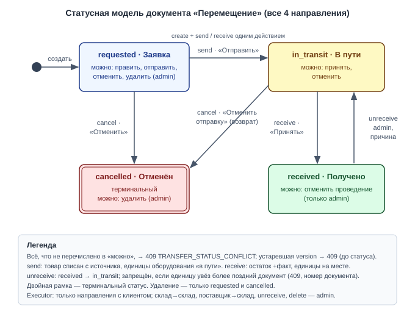
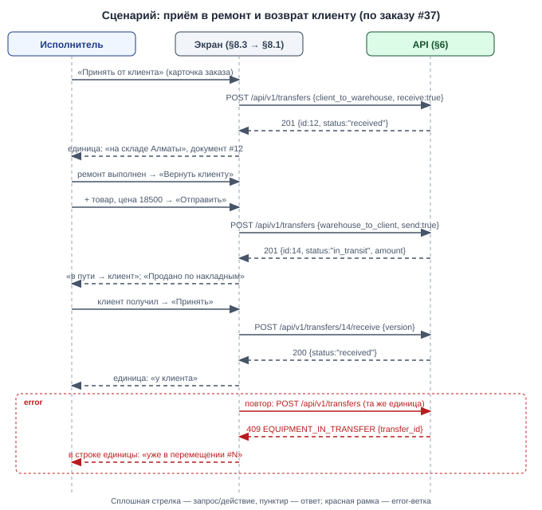

# Draft Spec: Перемещения (товары и оборудование клиентов)

**Tier:** L · **Совместимость:** MVP · **Режим:** new

**Дата:** 2026-10-07 | **Статус:** draft → final (после подтверждения пользователя) | **Tier:** L
**Совместимость:** MVP (DS-027) — живых данных нет: таблицы и адреса меняем свободно, без down-совместимости и переходного периода
**UI-scope:** swagger:no | adaptive:min | themes:both (DS-028)
**Источник:** черновик пользователя + интервью (draft-spec-decisions.md, батчи 0–6) + as-is факты кода (`migrations/0009_stock_transfers.up.sql`, `migrations/0010_task_equipment_warehouses.up.sql`, `internal/features/stocktransfers`, `docs/plan.md` D45–D61)
**Реализуется частями:** suppliers, user-timezone, transfers-core, transfers-partners, transfers-sales, transfers-revert (по порядку; каждая — `docs/features/{имя}/draft-spec.md`, номера DS и TS общие с этой мастер-спекой)

> Пересматривает решения `docs/plan.md`: D51 (финальность «Получено», имена API), D55 (местоположение на строке заказа), D56 (склад приёма при добавлении единицы в заказ), D57 (кнопки перемещения в карточке заказа — отменяется), D59 (источник данных фильтра доски), D60 (seed-demo), D61 (запрет удаления «в пути»).

## §1. Суть задачи
Документ «Перемещение» становится единой сущностью для движения товаров и оборудования клиентов между складами, клиентами и поставщиками; каждое движение отслеживается по статусам. Для администратора и исполнителя сервисного центра.

**Бизнес (что делает пользователь/процесс):**
1. Принимает оборудование клиента в ремонт документом «клиент → склад», всегда по заказу (§5, §8.1) — DS-002, DS-012.
2. Возвращает оборудование клиенту документом «склад → клиент» и тем же документом продаёт дополнительный товар по цене (накладная) — DS-004, DS-011.
3. Перевозит между складами товары и оборудование клиентов документом «склад → склад» — DS-004.
4. Заказывает товары у поставщика документом «поставщик → склад» и принимает по факту — DS-002, DS-015.
5. Ведёт справочник поставщиков (§8.2) — DS-007.
6. Исправляет ошибочно проведённый документ действием «Отменить проведение» — DS-017.
7. В карточке заказа видит местоположение каждой единицы, ссылки на документы и сумму накладных в итоге заказа (§8.3) — DS-003, DS-014.

**Логика (правила системы):**
1. Один документ, четыре направления, смешанные строки: товар (количество) и единица оборудования клиента — DS-001, DS-010.
2. Состав строк по направлениям — DS-004, DS-010:
   - «клиент → склад»: только единицы оборудования этого заказа;
   - «склад → клиент»: единицы оборудования этого заказа + товары с ценой;
   - «склад → склад»: единицы оборудования любых клиентов + товары;
   - «поставщик → склад»: только товары, без цен.
3. «Наше оборудование» — товар каталога с количеством; поштучных единиц без клиента нет — DS-005, DS-009.
4. Статусы одинаковы для всех направлений: «Заявка» → «В пути» → «Получено»; «Отменён» из «Заявки» и «В пути»; «Отменить проведение» возвращает «Получено» в «В пути» (§5) — DS-013, DS-017.
5. Местоположение — одно на единицу оборудования: «у клиента» / «на складе X» / «в пути (документ #N)» — DS-008.
6. Единица оборудования — только в одном незавершённом документе — DS-019.
7. Сумма накладной входит в итог заказа, пока документ «В пути» или «Получено» — DS-014.
8. Время: хранение UTC (`timestamptz`); показ — по часовому поясу из настройки пользователя на всех экранах системы (краткий дубль §3) — DS-031, DS-032.
9. Конкурентный доступ (краткий дубль §3):
   - правка и переходы документа → optimistic lock `f:version` + 409;
   - остатки товара → `FOR UPDATE` строк `t:product_stock` в порядке (product_id, warehouse_id);
   - занятие единицы документом → guard-UPDATE `f:active_transfer_id`;
   - as-built (D75): строки `t:equipment` — `FOR NO KEY UPDATE`; заказ — `FOR KEY SHARE` при создании/правке документа с клиентом; порядок: документ → заказ → `t:product_stock` → `t:equipment`;
   - справочник поставщиков → last-write-wins.

**Техника (API/данные/интеграции):**
1. Таблицы: `t:transfers` и `t:transfer_items` (переименование и расширение `x:stock_transfers` / `x:stock_transfer_items`), новая `t:suppliers`; ALTER `t:equipment`, `t:users`, `t:stock_movements`, `t:task_equipment`; удаляется `x:task_equipment_movements` — DS-029, DS-030.
2. API: `e:/api/v1/transfers` (9 endpoints), `e:/api/v1/suppliers` (3), `e:PUT /api/v1/users/me/timezone`; изменения `e:GET /api/v1/tasks/:id/card`, `e:GET /api/v1/tasks`, `e:DELETE /api/v1/tasks/:id`; удаляются три endpoint'а перемещения оборудования в заказе (§6.15).
3. Пакет `internal/features/transfers` (переименование `internal/features/stocktransfers`), новый пакет `internal/features/suppliers`.
4. Внешних систем нет.

**UI (графическая часть):**
1. «Работа → Перемещения» (`/transfers`): список с фильтрами + документ (master-detail) — виден и исполнителю, но только документы с клиентом (§8.1).
2. «Справочники → Поставщики» (`/suppliers`): список + форма, только администратор (§8.2).
3. Карточка заказа: у оборудования — местоположение и ссылка на документ вместо кнопок «Отправить / Принять / Отменить отправку»; блок «Перемещения заказа» с кнопками «Принять от клиента» и «Вернуть клиенту»; строка «Продано по накладным» в итогах (§8.3).
4. Настройка часового пояса пользователя (§8.4); все экраны системы показывают дату и время по ней (DS-032).

Out-of-scope:
1. Мягкое удаление с восстановлением и отчёт «Удалённые заказы» — отдельная следующая задача (DS-022); до неё действуют запреты удаления DS-025, DS-026.
2. Статус товара заказа «ждёт поставку» и заказ у поставщика под заказ клиента — отдельная задача после перемещений; связь документа «поставщик → склад» со строками товаров заказа не закладывается (DS-024).
3. Закупочные цены и сумма документа от поставщика — не ведём (DS-016).
4. Создание нового товара каталога из документа — товар сначала заводится в «Каталоге» (DS-016).
5. Возврат проданного товара от клиента — нет: от клиента принимается только его оборудование (DS-004).
6. Поштучный учёт собственного оборудования с серийными номерами — нет (DS-009).
7. Отдельная отметка оплаты накладной — нет: отметка «Оплачен» у заказа одна (DS-014).

## §2. Интеграции и master-data
Внешних интеграций нет.

Потоки (таблицей):
| Система | Направление | Что передаётся | Когда | Формат / канал / валидация | Статус |
|---|---|---|---|---|---|
| — | — | Не применимо: документы создаются вручную в UI, наружу ничего не уходит | — | — | — |

Справочники (master-data, таблицей):
| Справочник | Источник правды | Синхронизация | Где используется |
|---|---|---|---|
| Поставщики (`t:suppliers`) | эта фича, ведёт администратор (DS-007) | нет | `f:supplier_id` документа «поставщик → склад» |
| Склады (`t:warehouses`) | фича `warehouses` (D45) | нет | `f:from_warehouse_id`, `f:to_warehouse_id`, `f:warehouse_id` единицы |
| Клиенты (`t:clients`) | фича `clients` | нет | `f:client_id` документа (выводится из заказа) |
| Товары (`t:products`) | фича `catalog` | нет | товарные строки, цена продажи по умолчанию |
| Оборудование клиентов (`t:equipment`) | фича `clients` (заводится вручную, DS-009) | нет | строки-единицы, местоположение |
| Заказы (`t:tasks`) | фича `board` | нет | `f:task_id` документов с клиентом |

## §3. Нефункциональные требования

**Конкурентность (К-3 — по операциям):**
1. **Правка и переходы документа (`e:PUT`, send, receive, cancel, unreceive, `e:DELETE`):**
   - optimistic lock: обязательный `f:version` в теле; строка `t:transfers` берётся `FOR UPDATE` — DS-048
   - устаревшая версия → 409 `TRANSFER_VERSION_CONFLICT`; версия сверяется ДО статуса; недопустимый переход → 409 `TRANSFER_STATUS_CONFLICT` — DS-048
2. **Остатки товара (send, receive, cancel, unreceive):**
   - Lock Order: `t:transfers` FOR UPDATE → строки `t:product_stock` FOR UPDATE в порядке (product_id, warehouse_id) — as-is D50, DS-048
   - отправка в минус разрешена, ответ несёт `f:warnings` — DS-023
3. **Занятие единицы оборудования документом:**
   - guard-UPDATE `UPDATE equipment SET active_transfer_id = :id WHERE id = :eq AND active_transfer_id IS NULL`; 0 строк → 409 `EQUIPMENT_IN_TRANSFER` с номером мешающего документа — DS-019, DS-041
   - Lock Order: после `t:product_stock` — строки `t:equipment` FOR NO KEY UPDATE в порядке id
   - as-built (D75): `FOR NO KEY UPDATE`, а не `FOR UPDATE` — вставка строки документа держит на единице `FOR KEY SHARE`, иначе параллельные создания взаимно блокируются; заказ блокируется `FOR KEY SHARE` при создании/правке документа с клиентом; порядок блокировок: документ → заказ → `t:product_stock` (по product_id) → `t:equipment` (по id); при удалении заказа его документы НЕ блокируются (блокируется только заказ; страховка — FK `transfers.task_id` RESTRICT), отменённые документы удаляет board SQL-запросом в транзакции удаления
4. **Смена местоположения единицы (send, receive, cancel, unreceive):**
   - guard по фактическому местоположению под блокировкой строки `t:equipment`; не совпало → 409 `TRANSFER_EQUIPMENT_NOT_AT_SOURCE` — DS-036
5. **Итог заказа:** не хранится, считается запросом при чтении — расхождения невозможны — DS-014
6. **Справочник поставщиков:** last-write-wins, версии нет (как `t:warehouses`) — DS-043
7. **Часовой пояс пользователя:** last-write-wins — DS-031
   - as-built (D82): смена своего пояса обновляет `users.updated_at`; `version` не проверяется и не увеличивается

**Аудит:**
- кто и когда: `f:created_by`, `f:sent_by`, `f:received_by`, `f:cancelled_by` + соответствующие `*_at` на документе — as-is
- «Отменить проведение»: `f:unreceived_by`, `f:unreceived_at`, `f:unreceive_reason` (последний откат) + запись slog — DS-044
- движения остатков — журнал `t:stock_movements` с `f:transfer_id` — as-is
- отдельной таблицы аудита и аудита чтения нет (zap) — DS-051

**Время/таймзоны (К-13):**
- хранение: UTC, `timestamptz` — DS-031
- показ дат и времени: по `f:timezone` пользователя (IANA), не по браузеру — DS-031
- охват: все экраны системы, где показывается дата или время (перемещения, доска, карточка заказа, история оборудования, остатки, выплаты, печатные формы) — DS-032
- фильтр «период» списка перемещений: границы дня — по поясу пользователя; сервер переводит их в UTC и применяет к `f:created_at` — DS-034
- кто меняет пояс: сам пользователь у себя и администратор любому пользователю в «Пользователях»; умолчание `Asia/Almaty` — DS-033, DS-056
- источник времени: сервер БД (`now()`); порядок событий — по `f:id` документа и `f:received_at`
- as-built (D76): `f:received_at` = `clock_timestamp()`, а не `now()` — порядок приёмок документов с общей единицей совпадает с порядком взятия блокировки её строки (на нём стоит правило обратного порядка отката)
- as-built (D81): единый формат показа времени «ДД.ММ.ГГГГ ЧЧ:ММ» без запятой на всех экранах

**Метрики/таймстемпы:**
- `f:created_at`, `f:sent_at`, `f:received_at`, `f:cancelled_at`, `f:unreceived_at`
- отчётов по длительностям и алертов нет

**Offline / деградация / восстановление:**
- offline-режима нет; после перезагрузки страницы документ читается с сервера заново (`?id=N`)
- несохранённые правки заявки теряются; повтор действия после сбоя сети безопасен: вторая попытка получит 409 по версии или статусу — DS-055

**Логирование и чувствительные данные:**
- slog: мутации документа (id, действие, пользователь), причина отката
- чувствительных данных нет; цены продажи видны обеим ролям (исполнитель правит цены заказа и сейчас, D19)

**Формат ошибок:**
- только `pkg/errorspkg`: `{code, message, details}`; 400 → `details.fields[]` (`name`, `message`)

**Abuse cases (вход для adversarial E2E TD-4):**
1. Исполнитель открывает по прямому id документ «склад → склад» или «поставщик → склад» → 404 — DS-042.
2. Исполнитель вызывает `e:POST /api/v1/transfers/:id/unreceive` → 403 — DS-018.
3. Клиент передаёт в теле `f:client_id` чужого клиента → игнорируется, клиент выводится сервером из заказа — DS-012.
4. В документ заказа подставлена единица оборудования другого заказа или другого клиента → 400 — DS-035.
5. Двойной клик «Принять» → второй запрос 409, остаток не удваивается — DS-048.

**Применённые zap-дефолты** (zap-list — стандарты проекта из CLAUDE.md, применяются автоматически, без вопросов; в §9 — источник `zap`):
- 404 / 403 / 409 — стандартные статусы; ошибки только `pkg/errorspkg` (zap)
- синхронная обработка, без очередей (zap)
- отдельный аудит-лог не заводится (zap) — DS-051
- миграции применяются только `make migrate-up` (zap)

## §4. Данные
Легенда колонки «Обяз.»: `да` — клиент обязан передать при создании/правке; `нет` — опционально; `авто` — заполняет система (PK, дефолты, таймстемпы, значения из URL/сессии); `условно` — зависит от правила, оно указано в Описании. NULL — DDL-факт, Обяз. — семантика заполнения.

Миграция — одна новая (`0012_transfers`), режим MVP: переименование и ALTER без сохранения совместимости (DS-027, DS-029, DS-030).

### §4.1. `t:transfers`
Документ «Перемещение» (шапка). Переименование `x:stock_transfers` + новые колонки направления и контрагентов.

| Поле | Тип | NULL | Default | Обяз. | Описание | DS |
|---|---|---|---|---|---|---|
| `f:id` | bigserial | нет | sequence | авто | PK, сквозной номер #N | DS-001 |
| `f:direction` | text | нет | — | да | Направление: `s:client_to_warehouse`, `s:warehouse_to_client`, `s:warehouse_to_warehouse`, `s:supplier_to_warehouse`; после создания не меняется | DS-002 |
| `f:from_warehouse_id` | uuid | да | — | условно | FK → `t:warehouses(id)` `ON DELETE RESTRICT`. Обязателен для `s:warehouse_to_client`, `s:warehouse_to_warehouse`; иначе NULL | DS-002 |
| `f:to_warehouse_id` | uuid | да | — | условно | FK → `t:warehouses(id)` `ON DELETE RESTRICT`. Обязателен для `s:client_to_warehouse`, `s:warehouse_to_warehouse`, `s:supplier_to_warehouse`; иначе NULL | DS-002 |
| `f:task_id` | bigint | да | — | условно | FK → `t:tasks(id)` `ON DELETE RESTRICT`. Обязателен для `s:client_to_warehouse`, `s:warehouse_to_client`; иначе NULL | DS-012, DS-025 |
| `f:client_id` | uuid | да | — | авто | FK → `t:clients(id)` `ON DELETE RESTRICT`. Сервер выводит из заказа (`tasks.client_id`); от клиента не принимается | DS-012 |
| `f:supplier_id` | uuid | да | — | условно | FK → `t:suppliers(id)` `ON DELETE RESTRICT`. Обязателен для `s:supplier_to_warehouse`; иначе NULL | DS-007 |
| `f:status` | text | нет | `requested` | авто | `s:requested`, `s:in_transit`, `s:received`, `s:cancelled` | DS-013 |
| `f:note` | text | нет | `''` | нет | Примечание, 0–1000 символов | DS-049 |
| `f:created_by` | uuid | нет | — | авто | FK → `t:users(id)` `ON DELETE RESTRICT`, из сессии | DS-048 |
| `f:sent_by` | uuid | да | — | авто | FK → `t:users(id)` `ON DELETE RESTRICT` | DS-048 |
| `f:sent_at` | timestamptz | да | — | авто | Момент отправки | DS-048 |
| `f:received_by` | uuid | да | — | авто | FK → `t:users(id)` `ON DELETE RESTRICT`; обнуляется при «Отменить проведение» | DS-017 |
| `f:received_at` | timestamptz | да | — | авто | Момент приёмки; обнуляется при «Отменить проведение» | DS-017 |
| `f:cancelled_by` | uuid | да | — | авто | FK → `t:users(id)` `ON DELETE RESTRICT` | DS-048 |
| `f:cancelled_at` | timestamptz | да | — | авто | Момент отмены | DS-048 |
| `f:unreceived_by` | uuid | да | — | авто | FK → `t:users(id)` `ON DELETE RESTRICT`; кто последним отменил проведение | DS-044 |
| `f:unreceived_at` | timestamptz | да | — | авто | Когда последний раз отменено проведение | DS-044 |
| `f:unreceive_reason` | text | нет | `''` | условно | Причина последней отмены проведения, 1–500 символов; обязательна в `e:POST /api/v1/transfers/:id/unreceive` | DS-017, DS-053 |
| `f:created_at` | timestamptz | нет | `now()` | авто | — | DS-031 |
| `f:updated_at` | timestamptz | нет | `now()` | авто | — | DS-031 |
| `f:version` | int | нет | `1` | авто | Optimistic lock, +1 на каждую мутацию | DS-048 |

Ключи и индексы:
- PK: `f:id`
- UNIQUE: нет
- `i:transfers_status_idx` (`f:status`) — фильтр списка
- `i:transfers_direction_idx` (`f:direction`) — фильтр списка и скоуп исполнителя
- `i:transfers_from_warehouse_id_idx`, `i:transfers_to_warehouse_id_idx` — фильтр «склад», «в пути» на остатках
- `i:transfers_task_id_idx` (`f:task_id`) — блок перемещений карточки заказа, итог заказа
- `i:transfers_supplier_id_idx` (`f:supplier_id`) — фильтр «поставщик»
- `i:transfers_created_at_idx` (`f:created_at`) — фильтр «период»
- CHECK `i:transfers_route_check` — набор заполненных `f:from_warehouse_id` / `f:to_warehouse_id` / `f:task_id` / `f:client_id` / `f:supplier_id` соответствует `f:direction`; для `s:warehouse_to_warehouse` — `from_warehouse_id <> to_warehouse_id`

Связи (одна связь = одна строка):
- 1→N `t:transfer_items` — CASCADE — строки документа
- 1→N `t:stock_movements` (`f:transfer_id`) — SET NULL — журнал остатков переживает удаление документа
- 1→N `t:equipment` (`f:active_transfer_id`) — SET NULL — занятие единицы
- N→1 `t:tasks`, `t:clients`, `t:suppliers`, `t:warehouses`, `t:users` — RESTRICT

Поведение при действиях (одно действие = одна строка):
- Создание: admin — любое направление; executor — только `s:client_to_warehouse`, `s:warehouse_to_client`; статус `s:requested`; единицы строк занимаются (`f:active_transfer_id`) — DS-018, DS-019
- Изменение: только в `s:requested`; строки заменяются целиком; `f:direction` и `f:task_id` не меняются — DS-048
- Отправка (`s:requested` → `s:in_transit`): товар списывается с источника, единицы уходят «в пути» — одна транзакция — DS-013
- Приёмка (`s:in_transit` → `s:received`): остаток получателя растёт на факт, единицы получают новое местоположение — одна транзакция — DS-013, DS-015
- Отмена (`s:requested` или `s:in_transit` → `s:cancelled`): товар и единицы возвращаются в источник, единицы освобождаются — DS-013
- Отмена проведения (`s:received` → `s:in_transit`): только admin, обязательная причина; компенсирующие движения остатка, единицы снова «в пути» — DS-017, DS-023
- Удаление: hard delete, только `s:requested` или `s:cancelled`, только admin; проведённый документ сначала откатывают и отменяют — DS-025, DS-042

Инварианты (правило → чем держится → DS):
- маршрут соответствует направлению → CHECK `i:transfers_route_check` → DS-002
- документ с клиентом всегда по заказу → CHECK + NOT NULL-условие сервиса → DS-012
- заказ с документами не удалить → FK `f:task_id` RESTRICT + проверка сервиса (409 `TASK_HAS_TRANSFERS`) → DS-025
- версия растёт на каждую мутацию → `UPDATE … SET version = version + 1` под `FOR UPDATE` → DS-048

### §4.2. `t:transfer_items`
Строки документа: товар с количеством либо единица оборудования клиента. Переименование `x:stock_transfer_items` + тип строки, единица, цена.

| Поле | Тип | NULL | Default | Обяз. | Описание | DS |
|---|---|---|---|---|---|---|
| `f:id` | uuid | нет | `gen_random_uuid()` | авто | PK | DS-001 |
| `f:transfer_id` | bigint | нет | — | авто | FK → `t:transfers(id)` `ON DELETE CASCADE`, из URL | DS-001 |
| `f:position` | int | нет | — | авто | Порядок строки = порядок в запросе, с 1 | DS-049 |
| `f:kind` | text | нет | — | да | Тип строки: `s:product`, `s:equipment` | DS-001 |
| `f:product_id` | uuid | да | — | условно | FK → `t:products(id)` `ON DELETE RESTRICT`. Обязателен при `s:product`; иначе NULL | DS-001 |
| `f:equipment_id` | uuid | да | — | условно | FK → `t:equipment(id)` `ON DELETE RESTRICT`. Обязателен при `s:equipment`; иначе NULL | DS-010 |
| `f:qty_sent` | numeric(12,3) | да | — | условно | Количество к отправке, > 0, до 3 знаков после запятой, максимум 999999999.999. Обязательно при `s:product`; при `s:equipment` — NULL | DS-049 |
| `f:qty_received` | numeric(12,3) | да | — | условно | Факт приёмки, ≥ 0. Заполняется при приёмке товарной строки; для `s:supplier_to_warehouse` может превышать `f:qty_sent`, для остальных направлений ≤ `f:qty_sent`; при `s:equipment` — NULL | DS-015 |
| `f:price` | numeric(12,2) | да | — | условно | Цена продажи за единицу, ≥ 0, максимум 9999999999.99. Только товарные строки направления `s:warehouse_to_client`; не передана → цена товара из каталога (`products.price`); в остальных случаях NULL | DS-011, DS-039 |

Ключи и индексы:
- PK: `f:id`
- UNIQUE (`f:transfer_id`, `f:product_id`) — дубль товара в документе запрещён
- UNIQUE (`f:transfer_id`, `f:equipment_id`) — дубль единицы в документе запрещён
- `i:transfer_items_product_id_idx` (`f:product_id`) — RESTRICT-проверка товара, «в пути» на остатках
- `i:transfer_items_equipment_id_idx` (`f:equipment_id`) — история единицы, проверка порядка отката
- CHECK `i:transfer_items_kind_check` — при `s:product`: `f:product_id` и `f:qty_sent` заполнены, `f:equipment_id` NULL; при `s:equipment`: `f:equipment_id` заполнен, `f:product_id`, `f:qty_sent`, `f:qty_received`, `f:price` NULL

Связи (одна связь = одна строка):
- N→1 `t:transfers` — CASCADE — строки удаляются с документом
- N→1 `t:products` — RESTRICT
- N→1 `t:equipment` — RESTRICT — единицу с документами не удалить из справочника (DS-026)

Поведение при действиях (одно действие = одна строка):
- Создание/замена: вместе с документом, только в `s:requested`; не более 200 строк — DS-049
- Приёмка: `f:qty_received` по товарным строкам; строка без записи в запросе — факт = `f:qty_sent` — DS-015
- Отмена проведения: `f:qty_received` обнуляется — DS-017

Инварианты (правило → чем держится → DS):
- состав строк соответствует направлению → валидатор сервиса (400 `items[i].kind: not_allowed`) → DS-004, DS-010
- единица строки документа с клиентом входит в оборудование заказа → проверка сервиса по `t:task_equipment` (400 `items[i].equipment_id: not_in_task`) → DS-035
- факт ≤ отправленного вне прихода от поставщика → валидатор сервиса (400 `exceeds_sent`) → DS-015
- цена только у товара в накладной клиенту → CHECK + валидатор → DS-011

### §4.3. `t:suppliers`
Справочник поставщиков.

| Поле | Тип | NULL | Default | Обяз. | Описание | DS |
|---|---|---|---|---|---|---|
| `f:id` | uuid | нет | `gen_random_uuid()` | авто | PK | DS-007 |
| `f:name` | text | нет | — | да | Название, 1–200 символов после trim; уникально без учёта регистра, включая архивные | DS-007 |
| `f:contact_name` | text | нет | `''` | нет | Контактное лицо, 0–200 символов | DS-007 |
| `f:phone` | text | нет | `''` | нет | Телефон — строка (не число), 0–50 символов; если непустой — содержит хотя бы одну цифру | DS-007 |
| `f:address` | text | нет | `''` | нет | Адрес, 0–500 символов | DS-007 |
| `f:note` | text | нет | `''` | нет | Примечание, 0–1000 символов | DS-007 |
| `f:is_active` | boolean | нет | `true` | нет | `false` — в архиве: не выбирается в новых документах, в существующих остаётся | DS-007 |
| `f:created_at` | timestamptz | нет | `now()` | авто | — | DS-031 |
| `f:updated_at` | timestamptz | нет | `now()` | авто | — | DS-031 |

Ключи и индексы:
- PK: `f:id`
- UNIQUE `i:suppliers_name_lower_uq` (`lower(btrim(name))`) — уникальность названия, включая архивные

Связи (одна связь = одна строка):
- 1→N `t:transfers` (`f:supplier_id`) — RESTRICT

Поведение при действиях (одно действие = одна строка):
- Создание/изменение: только admin — DS-007
- Удаление: запрещено; архивирование через `f:is_active = false`, свободное (открытые документы поставщика дорабатываются) — DS-007, DS-043

Инварианты (правило → чем держится → DS):
- название уникально → `i:suppliers_name_lower_uq` (400 `name: duplicate`) → DS-007
- архивный не выбирается в новых документах → валидатор сервиса (400 `supplier_id: archived`) → DS-007

### §4.4. `t:equipment` (общая таблица, чужая — фича использует, не владеет)
Единицы оборудования клиентов; владелец — фича `clients`. Дельта: местоположение переезжает сюда с `t:task_equipment`.

| Поле | Тип | NULL | Default | Обяз. | Описание | DS |
|---|---|---|---|---|---|---|
| `f:id` | uuid | нет | `gen_random_uuid()` | авто | PK (as-is) | DS-008 |
| `f:client_id` | uuid | нет | — | да | FK → `t:clients(id)` `ON DELETE CASCADE` (as-is); остаётся NOT NULL — единиц без клиента нет | DS-005 |
| `f:type_id` | uuid | нет | — | да | FK → `t:equipment_types(id)` `ON DELETE RESTRICT` (as-is) | DS-008 |
| `f:brand` | text | нет | `''` | нет | Марка (as-is) | DS-008 |
| `f:model` | text | нет | — | да | Модель, непустая (as-is) | DS-008 |
| `f:sku` | text | нет | `''` | нет | Артикул — строка (as-is) | DS-008 |
| `f:serial` | text | нет | `''` | нет | Серийный номер — строка (as-is) | DS-008 |
| `f:specs` | jsonb | нет | `'[]'` | нет | Характеристики, массив (as-is) | DS-008 |
| `f:note` | text | нет | `''` | нет | Примечание (as-is) | DS-008 |
| `f:created_at` | timestamptz | нет | `now()` | авто | (as-is) | DS-008 |
| `f:updated_at` | timestamptz | нет | `now()` | авто | (as-is) | DS-008 |
| **`f:location_status`** | text | нет | `at_client` | авто | НОВОЕ. Местоположение: `s:at_client`, `s:at_warehouse`, `s:in_transit`; меняют только переходы документа | DS-008 |
| **`f:warehouse_id`** | uuid | да | — | авто | НОВОЕ. FK → `t:warehouses(id)` `ON DELETE RESTRICT`. Заполнен только при `s:at_warehouse` | DS-008 |
| **`f:active_transfer_id`** | bigint | да | — | авто | НОВОЕ. FK → `t:transfers(id)` `ON DELETE SET NULL`. Незавершённый документ (`s:requested` или `s:in_transit`), в котором стоит единица; NULL — свободна | DS-019, DS-041 |

Ключи и индексы:
- PK: `f:id`
- `i:equipment_client_id_idx`, `i:equipment_type_id_idx` — as-is
- `i:equipment_warehouse_id_idx` (`f:warehouse_id`) — фильтр доски по складу, запрет архивирования склада
- `i:equipment_active_transfer_id_idx` (`f:active_transfer_id`) — освобождение единиц документа
- CHECK `i:equipment_location_check` — `s:at_warehouse` ⇔ `f:warehouse_id` заполнен; `s:in_transit` ⇒ `f:active_transfer_id` заполнен

Связи (одна связь = одна строка):
- N→1 `t:warehouses` — RESTRICT
- N→1 `t:transfers` (`f:active_transfer_id`) — SET NULL
- 1→N `t:transfer_items` — RESTRICT

Поведение при действиях (одно действие = одна строка):
- Создание единицы: `s:at_client`, склад пуст — DS-008
- Отправка документа: `s:client_to_warehouse` — `s:at_client` → `s:in_transit`; `s:warehouse_to_client`, `s:warehouse_to_warehouse` — `s:at_warehouse` (склад отправления) → `s:in_transit`, `f:warehouse_id` = NULL — DS-013
- Приёмка: `s:client_to_warehouse`, `s:warehouse_to_warehouse` → `s:at_warehouse` (склад назначения); `s:warehouse_to_client` → `s:at_client`; `f:active_transfer_id` = NULL — DS-013
- Отмена документа «в пути»: возврат в источник (`s:at_client` либо `s:at_warehouse` на складе отправления); `f:active_transfer_id` = NULL — DS-013
- Удаление единицы из справочника: 409 `EQUIPMENT_HAS_TRANSFERS`, если есть хоть одна строка документа — DS-026
- as-built: тот же 409 `EQUIPMENT_HAS_TRANSFERS` — при удалении клиента (`DELETE /api/v1/clients/:id`), у оборудования которого есть строки документов
- Миграция (DS-029, DS-054): завершённый заказ = заказ в ПОСЛЕДНЕЙ колонке доски — колонка с наибольшим `columns.position` (`migrations/0005_board.up.sql:11`; порядок колонок — индекс `columns_position_idx (position, id)`, там же `:15`); SQL-условие миграции: `tasks.column_id = (SELECT id FROM columns ORDER BY position DESC, id DESC LIMIT 1)` (при равных `position` — колонка с большим `id`). Единица, стоящая хотя бы в одном НЕзавершённом заказе, → `s:at_warehouse`, склад — из её строки `t:task_equipment` самого свежего незавершённого заказа (наибольший `tasks.id`): `x:warehouse_id`, а для «в пути» — `x:transit_from_warehouse_id`. Единица, стоящая только в завершённых заказах, → `s:at_client`. Единица без заказов → `s:at_client`. Края: колонка на доске одна — она же последняя, все заказы завершённые, все единицы → `s:at_client`; заказа без колонки не бывает (`tasks.column_id` NOT NULL, `migrations/0005_board.up.sql:27`). Признак `columns.is_final` в миграции не используется

Инварианты (правило → чем держится → DS):
- одно местоположение на единицу → колонки на `t:equipment` + `i:equipment_location_check` → DS-008
- единица только в одном незавершённом документе → guard-UPDATE `f:active_transfer_id IS NULL` → DS-019
- отправить можно только оттуда, где единица числится → guard под `FOR NO KEY UPDATE` (as-built, D75) (409 `TRANSFER_EQUIPMENT_NOT_AT_SOURCE`) → DS-036

Используется в модулях (used by):
| Модуль | Ключ-дискриминатор (если есть) | Роль (writer/reader) | Что делает | Путь |
|---|---|---|---|---|
| transfers (эта фича) | — | writer | пишет `f:location_status`, `f:warehouse_id`, `f:active_transfer_id` | `internal/features/transfers` |
| clients | — | writer | CRUD единицы, история | `internal/features/clients` |
| board | — | reader | карточка заказа, фильтр доски по складу, склад по умолчанию строки товара | `internal/features/board` |

### §4.5. `t:users` (общая таблица, чужая — фича использует, не владеет)
Пользователи; владелец — фича `users`. Дельта: настройка часового пояса.

| Поле | Тип | NULL | Default | Обяз. | Описание | DS |
|---|---|---|---|---|---|---|
| `f:id` | uuid | нет | `gen_random_uuid()` | авто | PK (as-is) | DS-031 |
| `f:login` | text | нет | — | да | Логин, уникален без учёта регистра (as-is) | DS-031 |
| `f:password_hash` | text | нет | — | авто | (as-is) | DS-031 |
| `f:name` | text | нет | `''` | нет | Имя (as-is) | DS-031 |
| `f:is_active` | boolean | нет | `true` | нет | (as-is) | DS-031 |
| `f:role` | text | нет | `executor` | да | `s:admin`, `s:executor` (as-is) | DS-018 |
| `f:phone` | text | нет | `''` | нет | Телефон — строка (as-is) | DS-031 |
| `f:version` | bigint | нет | `1` | авто | (as-is) | DS-031 |
| `f:created_at` | timestamptz | нет | `now()` | авто | (as-is) | DS-031 |
| `f:updated_at` | timestamptz | нет | `now()` | авто | (as-is) | DS-031 |
| **`f:timezone`** | text | нет | `Asia/Almaty` | нет | НОВОЕ. Часовой пояс IANA (`Asia/Almaty`, `Europe/Moscow`), 1–64 символа; должен распознаваться `time.LoadLocation`, иначе 400. Меняет сам пользователь (`e:PUT /api/v1/users/me/timezone`); умолчание `Asia/Almaty` для новых и существующих пользователей | DS-031, DS-033 |

Ключи и индексы:
- PK: `f:id`; UNIQUE `i:users_login_lower_uq` — as-is; новых индексов нет

Используется в модулях (used by):
| Модуль | Ключ-дискриминатор (если есть) | Роль (writer/reader) | Что делает | Путь |
|---|---|---|---|---|
| transfers (эта фича) | — | reader | читает `f:timezone` для показа дат и границ периода | `internal/features/transfers` |
| users | — | writer | CRUD пользователей, запись `f:timezone` | `internal/features/users` |
| auth | — | reader | сессия; отдаёт `f:timezone` в layout | `internal/features/auth` |
| board, executorpayouts, clients, catalog, warehouses | — | reader | имена пользователей, права | `internal/features/*` |

### §4.6. `t:stock_movements` (общая таблица, чужая — фича использует, не владеет)
Журнал движений остатка; владелец — фича `board` (StockEngine). Дельта: новые причины движений.

| Поле | Тип | NULL | Default | Обяз. | Описание | DS |
|---|---|---|---|---|---|---|
| `f:id` | uuid | нет | `gen_random_uuid()` | авто | PK (as-is) | DS-040 |
| `f:product_id` | uuid | нет | — | авто | FK → `t:products(id)` `ON DELETE RESTRICT` (as-is) | DS-040 |
| `f:task_id` | bigint | да | — | авто | Заказ движения списания/возврата услуги (as-is; тип — по миграции `0005_board`) | DS-040 |
| `f:warehouse_id` | uuid | нет | `default_warehouse_id()` | авто | FK → `t:warehouses(id)` `ON DELETE RESTRICT` (as-is) | DS-040 |
| `f:transfer_id` | bigint | да | — | авто | FK → `t:transfers(id)` `ON DELETE SET NULL` (as-is, FK переезжает на переименованную таблицу) | DS-030 |
| `f:qty_delta` | numeric(12,3) | нет | — | авто | Дельта остатка, ≠ 0 (as-is) | DS-040 |
| `f:reason` | text | нет | — | авто | Причина. As-is: `s:task_consume`, `s:task_return` (board), `s:manual` (board, «Остатки»), `s:transfer_out`, `s:transfer_in`, `s:transfer_loss`, `s:transfer_return` (перемещения). НОВЫЕ: `s:client_out` — списание товара клиенту при отправке накладной; `s:supplier_in` — приход факта от поставщика; `s:transfer_unreceive` — компенсирующее движение при «Отменить проведение» | DS-040 |
| `f:user_id` | uuid | нет | — | авто | FK → `t:users(id)` `ON DELETE RESTRICT` (as-is) | DS-040 |
| `f:created_at` | timestamptz | нет | `now()` | авто | (as-is) | DS-040 |

Ключи и индексы:
- PK: `f:id`; `i:stock_movements_product_id_idx`, `i:stock_movements_warehouse_id_idx`, `i:stock_movements_transfer_id_idx` — as-is; CHECK `i:stock_movements_reason_check` — расширяется тремя новыми значениями

Поведение при действиях (движения по направлениям, одна транзакция с переходом документа) — DS-040:
- Отправка `s:warehouse_to_warehouse`: `s:transfer_out` −`f:qty_sent` на складе отправления (as-is)
- Отправка `s:warehouse_to_client`: `s:client_out` −`f:qty_sent` на складе отправления
- Отправка `s:supplier_to_warehouse`: движений нет (товар ещё не наш)
- Приёмка `s:warehouse_to_warehouse`: `s:transfer_in` +`f:qty_sent` и при недостаче `s:transfer_loss` −(`f:qty_sent` − `f:qty_received`) на складе назначения (as-is)
- Приёмка `s:supplier_to_warehouse`: `s:supplier_in` +`f:qty_received` на складе назначения
- Приёмка `s:warehouse_to_client`: движений нет (товар списан при отправке)
- Отмена «в пути» `s:warehouse_to_warehouse`, `s:warehouse_to_client`: `s:transfer_return` +`f:qty_sent` на склад отправления
- Отмена «в пути» `s:supplier_to_warehouse`, отмена заявки любого направления: движений нет
- Отмена проведения `s:warehouse_to_warehouse`, `s:supplier_to_warehouse`: `s:transfer_unreceive` −`f:qty_received` на складе назначения; `s:warehouse_to_client` — движений нет

Используется в модулях (used by):
| Модуль | Ключ-дискриминатор (если есть) | Роль (writer/reader) | Что делает | Путь |
|---|---|---|---|---|
| transfers (эта фича) | `f:reason` ∈ transfer_*, client_out, supplier_in | writer | движения документов | `internal/features/transfers` |
| board (StockEngine, «Остатки») | `f:reason` ∈ task_consume, task_return, manual | writer | списание услугами, ручная корректировка | `internal/features/board/stock_engine.go`, `stock_repo.go` |
| seeddemo | все | writer | демо-движения | `internal/seeddemo/seeddemo.go` |

### §4.7. `t:task_equipment` (общая таблица, чужая — фича использует, не владеет)
Оборудование заказа; владелец — фича `board`. Дельта: местоположение уезжает на `t:equipment`.

| Поле | Тип | NULL | Default | Обяз. | Описание | DS |
|---|---|---|---|---|---|---|
| `f:task_id` | bigint | нет | — | авто | FK → `t:tasks(id)` `ON DELETE CASCADE`, часть PK (as-is) | DS-008 |
| `f:equipment_id` | uuid | нет | — | да | FK → `t:equipment(id)` `ON DELETE RESTRICT`, часть PK (as-is) | DS-008 |
| `f:completeness` | text | нет | `''` | нет | Комплектность (as-is) | DS-008 |
| `f:condition` | text | нет | `''` | нет | Состояние (as-is) | DS-008 |
| `x:warehouse_id` | uuid | — | — | — | УДАЛЯЕТСЯ: переезжает на `t:equipment` | DS-008 |
| `x:status` | text | — | — | — | УДАЛЯЕТСЯ (`s:at_warehouse`, `s:in_transit`): заменён `equipment.location_status` | DS-008 |
| `x:transit_from_warehouse_id` | uuid | — | — | — | УДАЛЯЕТСЯ: маршрут «в пути» берётся из документа | DS-008 |
| `x:transit_to_warehouse_id` | uuid | — | — | — | УДАЛЯЕТСЯ: маршрут «в пути» берётся из документа | DS-008 |

Ключи и индексы:
- PK (`f:task_id`, `f:equipment_id`) — as-is
- удаляются `x:task_equipment_warehouse_id_idx`, `x:task_equipment_transit_to_warehouse_id_idx`, CHECK `x:task_equipment_status_check`, CHECK `x:task_equipment_location_check`

Поведение при действиях (одно действие = одна строка):
- Добавление единицы в заказ: склад не выбирается и не назначается; единица остаётся там, где числится — DS-045
- Удаление единицы из заказа: 409 `EQUIPMENT_IN_TRANSFER`, пока единица стоит в незавершённом документе — DS-026
- Таблица `x:task_equipment_movements` (журнал `s:received`, `s:sent`, `s:arrived`, `s:cancelled`) удаляется целиком; историю ведут документы — DS-029

Используется в модулях (used by):
| Модуль | Ключ-дискриминатор (если есть) | Роль (writer/reader) | Что делает | Путь |
|---|---|---|---|---|
| transfers (эта фича) | — | reader | проверка «единица входит в оборудование заказа» | `internal/features/transfers` |
| board | — | writer | оборудование карточки заказа | `internal/features/board/task_equipment_repo.go`, `task_equipment_service.go` |
| clients | — | reader | история единицы по заказам | `internal/features/clients/history.go` |
| seeddemo | — | writer | демо-заказы | `internal/seeddemo/seeddemo.go` |

## §5. Статусная модель


Статусы документа `t:transfers.status` одинаковы для всех четырёх направлений (DS-013). Что можно в каждом статусе (всё остальное → 409 `TRANSFER_STATUS_CONFLICT`):
- `s:requested` («Заявка»): править, отправить, отменить, удалить
- `s:in_transit` («В пути»): принять, отменить
- `s:received` («Получено»): отменить проведение (только admin)
- `s:cancelled` («Отменён», терминальный): удалить

Детали переходов (guard = атомарное условие; что при гонке; каждый запрет = 409 + негативный тест):
| Из | В | Триггер | Кто | Guard / конкурентный исход | Side effects |
|---|---|---|---|---|---|
| — | `s:requested` | `e:POST /api/v1/transfers` | admin — любое направление; executor — `s:client_to_warehouse`, `s:warehouse_to_client` | единицы строк свободны (`f:active_transfer_id IS NULL`), иначе 409 `EQUIPMENT_IN_TRANSFER` | единицы занимаются документом |
| `s:requested` | `s:requested` | `e:PUT /api/v1/transfers/:id` | как создание | `f:version` совпал, статус `s:requested`; проигравший — 409 `TRANSFER_VERSION_CONFLICT` | строки заменены; снятые единицы освобождены, новые заняты |
| `s:requested` | `s:in_transit` | `e:POST /api/v1/transfers/:id/send` либо `send: true` при создании | как создание | версия + статус; каждая единица числится в источнике, иначе 409 `TRANSFER_EQUIPMENT_NOT_AT_SOURCE` | движения остатка (§4.6); единицы → `s:in_transit`; `f:sent_by`, `f:sent_at`; сумма накладной входит в итог заказа |
| `s:in_transit` | `s:received` | `e:POST /api/v1/transfers/:id/receive` либо `receive: true` при создании (`s:client_to_warehouse`) | как создание | версия + статус; второй одновременный запрос — 409 | движения остатка по факту (§4.6); единицы → место назначения и освобождаются; `f:received_by`, `f:received_at` |
| `s:requested` | `s:cancelled` | `e:POST /api/v1/transfers/:id/cancel` | как создание | версия + статус | единицы освобождаются; движений нет; `f:cancelled_by`, `f:cancelled_at` |
| `s:in_transit` | `s:cancelled` | `e:POST /api/v1/transfers/:id/cancel` | как создание | версия + статус | возврат товара (§4.6); единицы → источник и освобождаются; сумма накладной выходит из итога заказа |
| `s:received` | `s:in_transit` | `e:POST /api/v1/transfers/:id/unreceive` | только admin | версия + статус; ни одну единицу документа не увёз более поздний документ и она не стоит в другом незавершённом, иначе 409 `TRANSFER_UNRECEIVE_BLOCKED` с номером мешающего документа | компенсирующие движения (§4.6), остаток может уйти в минус — `f:warnings`; единицы → `s:in_transit` и снова заняты этим документом; `f:received_by`, `f:received_at`, `f:qty_received` обнуляются; `f:unreceived_by`, `f:unreceived_at`, `f:unreceive_reason` |
| `s:requested`, `s:cancelled` | (удалён) | `e:DELETE /api/v1/transfers/:id` | только admin | версия + статус | строки удаляются каскадом; у движений `f:transfer_id` → NULL; единицы заявки освобождаются |

Местоположение единицы `t:equipment.location_status` (DS-008) — производное от переходов документа: `s:at_client` ⇄ `s:in_transit` ⇄ `s:at_warehouse`; напрямую, минуя документ, не меняется (DS-003).

## §6. API
> Режим B «API + фронтенд». Базовый URL стенда: `http://localhost:8080`. Авторизация — сессионная cookie `sid` (плейсхолдер `<SID>`). Копируй curl в терминал или в Postman: Import → Raw text. Тело ошибки — формат `pkg/errorspkg`: `{code, message, details}`; при 400 — `details.fields[]` с `name` и `message`. Все ключи — snake_case, URL — kebab-case (CLAUDE.md §API-1).
> as-built (D76, D80): количества и деньги (`qty_sent`, `qty_received`, `price`, `line_total`, `amount`, `transfers_amount`, `total_amount`, `warnings[].stock`, `warnings[].min_stock`) — JSON-числа в запросе и в ответе, не строки. Текстовые поля с недопустимыми символами (например NUL в `note`, `reason`, полях поставщика) → 400 `invalid_text`. Текст отказа в доступе единый — «Нет доступа» (страница отказа и собственные 403 API перемещений); `admin only` — технический текст middleware admin-only API. Документ чужого направления для исполнителя → 404; `unreceive` и `DELETE` документа для исполнителя → 403 всегда (роль проверяется первой, в т.ч. для несуществующего документа).

### §6.1. `e:GET /api/v1/transfers`
- Назначение: список документов для экрана «Перемещения».
- Authz: admin — все документы; executor — только направления `s:client_to_warehouse`, `s:warehouse_to_client` (скоуп накладывает сервер; запрос чужого направления фильтром → пустой список) — DS-018.
- Идемпотентность/повтор: чтение, безопасно.
- Side effects: нет.

Request:

| Параметр | Где | Тип | Обязателен | Валидация |
|---|---|---|---|---|
| `f:status` | query | string | нет | `requested`, `in_transit`, `received`, `cancelled`; иное → 400 |
| `f:direction` | query | string | нет | `client_to_warehouse`, `warehouse_to_client`, `warehouse_to_warehouse`, `supplier_to_warehouse`; иное → 400 |
| `f:warehouse_id` | query | uuid | нет | склад отправления ИЛИ назначения; не uuid → 400 |
| `f:task_id` | query | integer | нет | 1–9223372036854775807; иное → 400 |
| `f:supplier_id` | query | uuid | нет | не uuid → 400 |
| `f:created_from` | query | date | нет | `YYYY-MM-DD`; начало дня в поясе пользователя; иное → 400 (DS-034) |
| `f:created_to` | query | date | нет | `YYYY-MM-DD`; конец дня включительно в поясе пользователя; раньше `f:created_from` → 400 (DS-034) |
| `f:limit` | query | integer | нет | 1–500, по умолчанию 50; больше → 500 |
| `f:offset` | query | integer | нет | ≥ 0, по умолчанию 0 |

Фильтры комбинируются по «И». Сортировка: `f:id` по убыванию.

Response 200:

| Поле | Тип | Описание |
|---|---|---|
| `f:items` | array | элементы списка (поля ниже) |
| `f:items[].id` | integer | номер документа |
| `f:items[].direction` | string | направление |
| `f:items[].status` | string | статус |
| `f:items[].from_warehouse_id` | uuid \| null | склад отправления |
| `f:items[].from_warehouse_name` | string \| null | его название |
| `f:items[].to_warehouse_id` | uuid \| null | склад назначения |
| `f:items[].to_warehouse_name` | string \| null | его название |
| `f:items[].task_id` | integer \| null | заказ |
| `f:items[].client_id` | uuid \| null | клиент |
| `f:items[].client_name` | string \| null | название клиента |
| `f:items[].supplier_id` | uuid \| null | поставщик |
| `f:items[].supplier_name` | string \| null | название поставщика |
| `f:items[].note` | string | примечание |
| `f:items[].items_count` | integer | число строк |
| `f:items[].amount` | number | сумма накладной (`0.00` вне `s:warehouse_to_client`) |
| `f:items[].created_by_name` | string | автор |
| `f:items[].unreceived_at` | datetime \| null | as-built: последняя отмена проведения (значок «↩» у документа, возвращённого откатом в «В пути») |
| `f:items[].created_at` | datetime (UTC, RFC 3339) | создан |
| `f:items[].updated_at` | datetime (UTC, RFC 3339) | изменён |
| `f:items[].version` | integer | версия |
| `f:total` | integer | всего под фильтрами |
| `f:limit` | integer | применённый лимит |
| `f:offset` | integer | применённое смещение |

Ошибки:

| Код | Условие | Сообщение пользователю |
|---|---|---|
| 400 `VALIDATION` | невалидный `f:status` | «Некорректный статус» |
| 400 `VALIDATION` | невалидный `f:direction` | «Некорректное направление» |
| 400 `VALIDATION` | `f:warehouse_id` / `f:supplier_id` не uuid, `f:task_id` не число | «Некорректное значение фильтра» |
| 400 `VALIDATION` | `f:created_from` / `f:created_to` не дата либо «по» раньше «с» | «Некорректный период» |
| 401 `UNAUTHORIZED` | нет сессии | переход на вход |

Успех:
```bash
curl -s -b 'sid=<SID>' 'http://localhost:8080/api/v1/transfers?status=in_transit&direction=warehouse_to_client&limit=50&offset=0'
```
```json
{
  "items": [
    {
      "id": 14, "direction": "warehouse_to_client", "status": "in_transit",
      "from_warehouse_id": "5b0c1c0e-6a55-4c0e-9c37-3d2f6f1f7a11", "from_warehouse_name": "Алматы",
      "to_warehouse_id": null, "to_warehouse_name": null,
      "task_id": 37, "client_id": "a3f1d6c2-0c5e-4a52-8f0e-6f3c4a0b9d21", "client_name": "ТОО «Принт-Сервис»",
      "supplier_id": null, "supplier_name": null,
      "note": "", "items_count": 2, "amount": 18500.00,
      "created_by_name": "Админ", "created_at": "2026-10-07T06:15:00Z", "updated_at": "2026-10-07T06:20:00Z", "version": 2
    }
  ],
  "total": 1, "limit": 50, "offset": 0
}
```
Ошибка (VALIDATION → 400):
```bash
curl -s -b 'sid=<SID>' 'http://localhost:8080/api/v1/transfers?status=done'
```
```json
{
  "code": "VALIDATION",
  "message": "Проверьте поля",
  "details": { "fields": [ { "name": "status", "message": "invalid" } ] }
}
```
DS: DS-018, DS-030, DS-034.

### §6.2. `e:POST /api/v1/transfers`
- Назначение: создать документ; опционально сразу отправить и (для приёма от клиента) принять.
- Authz: admin — любое `f:direction`; executor — только `s:client_to_warehouse`, `s:warehouse_to_client`, иначе 403 — DS-018.
- Спец-механика: `send: true` — создать и отправить; `receive: true` — создать, отправить и принять одним действием, только для `s:client_to_warehouse` (клиент принёс сам) — DS-013.
- Идемпотентность/повтор: ключа дедупликации нет; повтор создаст второй документ — но единицы уже заняты первым → 409 `EQUIPMENT_IN_TRANSFER`; для чисто товарных документов риск дубля принят (кнопка блокируется на время запроса) — DS-055.
- Side effects: одна транзакция — `t:transfers`, `t:transfer_items`, `t:equipment.active_transfer_id`; при `send`/`receive` — дополнительно эффекты §6.6 / §6.7.

Request:

| Параметр | Где | Тип | Обязателен | Валидация |
|---|---|---|---|---|
| `f:direction` | body | string | да | `client_to_warehouse`, `warehouse_to_client`, `warehouse_to_warehouse`, `supplier_to_warehouse`; иное → 400 |
| `f:from_warehouse_id` | body | uuid | условно | обязателен для `warehouse_to_client`, `warehouse_to_warehouse`; активный склад; для остальных направлений должен отсутствовать → иначе 400 `not_allowed` |
| `f:to_warehouse_id` | body | uuid | условно | обязателен для `client_to_warehouse`, `warehouse_to_warehouse`, `supplier_to_warehouse`; активный склад; равен `f:from_warehouse_id` → 400 `same_warehouse` |
| `f:task_id` | body | integer | условно | обязателен для `client_to_warehouse`, `warehouse_to_client`; существующий заказ; для остальных должен отсутствовать |
| `f:supplier_id` | body | uuid | условно | обязателен для `supplier_to_warehouse`; активный поставщик (архивный → 400 `archived`) |
| `f:note` | body | string | нет | 0–1000 символов |
| `f:items` | body | array | да | 1–200 строк; пустой → 400 `required`; больше 200 → 400 `too_many` |
| `f:items[].kind` | body | string | да | `product`, `equipment`; недопустимый для направления (§1 Логика п.2) → 400 `not_allowed` |
| `f:items[].product_id` | body | uuid | условно | обязателен при `product`; активный товар каталога; дубль в документе → 400 `duplicate` |
| `f:items[].equipment_id` | body | uuid | условно | обязателен при `equipment`; существующая единица; дубль → 400 `duplicate`; для документов с клиентом — входит в оборудование заказа, иначе 400 `not_in_task` |
| `f:items[].qty_sent` | body | decimal | условно | обязателен при `product`; > 0, до 3 знаков после запятой, ≤ 999999999.999; при `equipment` должен отсутствовать |
| `f:items[].price` | body | decimal | нет | только `product` в `warehouse_to_client`; 0–9999999999.99, до 2 знаков; не передан → цена каталога; в других случаях передан → 400 `not_allowed` |
| `f:send` | body | boolean | нет | по умолчанию `false` |
| `f:receive` | body | boolean | нет | по умолчанию `false`; `true` допустим только для `client_to_warehouse` → иначе 400 `not_allowed` |

Поле `f:client_id` от клиента не принимается: сервер выводит его из заказа (DS-012).

Response 201 — объект документа:

| Поле | Тип | Описание |
|---|---|---|
| `f:id` | integer | номер документа |
| `f:direction` | string | направление |
| `f:status` | string | статус |
| `f:from_warehouse_id` | uuid \| null | склад отправления |
| `f:from_warehouse_name` | string \| null | его название |
| `f:to_warehouse_id` | uuid \| null | склад назначения |
| `f:to_warehouse_name` | string \| null | его название |
| `f:task_id` | integer \| null | заказ |
| `f:task_title` | string \| null | название заказа |
| `f:client_id` | uuid \| null | клиент |
| `f:client_name` | string \| null | название клиента |
| `f:supplier_id` | uuid \| null | поставщик |
| `f:supplier_name` | string \| null | название поставщика |
| `f:note` | string | примечание |
| `f:amount` | number | сумма накладной: Σ `price × qty_sent` товарных строк (`0.00` вне `warehouse_to_client`) |
| `f:created_by` | uuid | автор |
| `f:created_by_name` | string | имя автора |
| `f:sent_by` | uuid \| null | кто отправил |
| `f:sent_by_name` | string \| null | имя |
| `f:sent_at` | datetime \| null | когда отправлен |
| `f:received_by` | uuid \| null | кто принял |
| `f:received_by_name` | string \| null | имя |
| `f:received_at` | datetime \| null | когда принят |
| `f:cancelled_by` | uuid \| null | кто отменил |
| `f:cancelled_by_name` | string \| null | имя |
| `f:cancelled_at` | datetime \| null | когда отменён |
| `f:unreceived_by` | uuid \| null | кто отменил проведение |
| `f:unreceived_by_name` | string \| null | имя |
| `f:unreceived_at` | datetime \| null | когда отменено проведение |
| `f:unreceive_reason` | string | причина последней отмены проведения |
| `f:created_at` | datetime | создан |
| `f:updated_at` | datetime | изменён |
| `f:version` | integer | версия |
| `f:items` | array | строки (поля ниже) |
| `f:items[].id` | uuid | id строки |
| `f:items[].kind` | string | `product` \| `equipment` |
| `f:items[].product_id` | uuid \| null | товар |
| `f:items[].product_name` | string \| null | название товара |
| `f:items[].unit` | string \| null | единица измерения |
| `f:items[].equipment_id` | uuid \| null | единица оборудования |
| `f:items[].equipment_name` | string \| null | «тип марка модель» |
| `f:items[].equipment_serial` | string \| null | серийный номер |
| `f:items[].equipment_client_name` | string \| null | as-built: клиент-владелец единицы (null у товарной строки) |
| `f:items[].qty_sent` | number \| null | количество |
| `f:items[].qty_received` | number \| null | факт |
| `f:items[].price` | number \| null | цена продажи |
| `f:items[].line_total` | number \| null | `price × qty_sent` |
| `f:warnings` | array | предупреждения по остатку (всегда массив) |
| `f:warnings[].product_id` | uuid | товар |
| `f:warnings[].warehouse_id` | uuid | склад |
| `f:warnings[].warehouse_name` | string | название склада |
| `f:warnings[].name` | string | название товара |
| `f:warnings[].stock` | number | остаток после операции |
| `f:warnings[].min_stock` | number | минимум |
| `f:warnings[].kind` | string | `negative` \| `below_min` |

Ошибки:

| Код | Условие | Сообщение пользователю |
|---|---|---|
| 400 `VALIDATION` | `direction: invalid` / `required` | «Укажите направление» |
| 400 `VALIDATION` | `from_warehouse_id` / `to_warehouse_id`: `required`, `invalid`, `not_found`, `archived`, `not_allowed` | «Проверьте склад» |
| 400 `VALIDATION` | `to_warehouse_id: same_warehouse` | «Склады должны различаться» |
| 400 `VALIDATION` | `task_id`: `required`, `not_found`, `not_allowed` | «Укажите заказ» |
| 400 `VALIDATION` | `supplier_id`: `required`, `not_found`, `archived`, `not_allowed` | «Укажите поставщика» |
| 400 `VALIDATION` | `items: required` / `too_many` | «Добавьте строки (не более 200)» |
| 400 `VALIDATION` | `items[i].kind: not_allowed` | «Этот тип строки недопустим для направления» |
| 400 `VALIDATION` | `items[i].product_id`: `required`, `not_found`, `archived`, `duplicate` | «Проверьте товар» |
| 400 `VALIDATION` | `items[i].equipment_id`: `required`, `not_found`, `duplicate` | «Проверьте оборудование» |
| 400 `VALIDATION` | `items[i].equipment_id: not_in_task` | «Оборудование не из этого заказа» |
| 400 `VALIDATION` | `items[i].qty_sent`: `required`, `invalid`, `not_positive` | «Количество должно быть больше нуля» |
| 400 `VALIDATION` | `items[i].price`: `invalid`, `negative`, `not_allowed` | «Проверьте цену» |
| 400 `VALIDATION` | `receive: not_allowed` | «Принять сразу можно только приём от клиента» |
| 403 `FORBIDDEN` | executor создаёт `warehouse_to_warehouse` / `supplier_to_warehouse` | «Нет доступа» |
| 409 `EQUIPMENT_IN_TRANSFER` | единица уже в незавершённом документе (`details.transfer_id`) | «Оборудование уже в перемещении #N» |
| 409 `TRANSFER_EQUIPMENT_NOT_AT_SOURCE` | при `send`: единица числится не в источнике | «Оборудование находится не там, откуда его отправляют» |

Успех:
```bash
curl -s -b 'sid=<SID>' -H 'Content-Type: application/json' -X POST 'http://localhost:8080/api/v1/transfers' -d '{
  "direction": "warehouse_to_client",
  "from_warehouse_id": "5b0c1c0e-6a55-4c0e-9c37-3d2f6f1f7a11",
  "task_id": 37,
  "note": "Возврат после ремонта + картридж",
  "items": [
    {"kind": "equipment", "equipment_id": "0d9a4c1b-7e2f-4b63-9a51-2c8e5f7d3a90"},
    {"kind": "product", "product_id": "c7e2a9f4-1b3d-4e6a-8c2f-9d0b5a4e3f12", "qty_sent": 1, "price": 18500.00}
  ],
  "send": true
}'
```
```json
{
  "id": 14, "direction": "warehouse_to_client", "status": "in_transit",
  "from_warehouse_id": "5b0c1c0e-6a55-4c0e-9c37-3d2f6f1f7a11", "from_warehouse_name": "Алматы",
  "to_warehouse_id": null, "to_warehouse_name": null,
  "task_id": 37, "task_title": "Ремонт принтера HP", "client_id": "a3f1d6c2-0c5e-4a52-8f0e-6f3c4a0b9d21", "client_name": "ТОО «Принт-Сервис»",
  "supplier_id": null, "supplier_name": null,
  "note": "Возврат после ремонта + картридж", "amount": 18500.00,
  "created_by": "1f6b0c3a-2d4e-4f5a-9b7c-8e1d2a3b4c5d", "created_by_name": "Админ",
  "sent_by": "1f6b0c3a-2d4e-4f5a-9b7c-8e1d2a3b4c5d", "sent_by_name": "Админ", "sent_at": "2026-10-07T06:20:00Z",
  "received_by": null, "received_by_name": null, "received_at": null,
  "cancelled_by": null, "cancelled_by_name": null, "cancelled_at": null,
  "unreceived_by": null, "unreceived_by_name": null, "unreceived_at": null, "unreceive_reason": "",
  "created_at": "2026-10-07T06:20:00Z", "updated_at": "2026-10-07T06:20:00Z", "version": 1,
  "items": [
    {"id": "e1a2b3c4-d5e6-4f70-8a9b-0c1d2e3f4a5b", "kind": "equipment", "product_id": null, "product_name": null, "unit": null,
     "equipment_id": "0d9a4c1b-7e2f-4b63-9a51-2c8e5f7d3a90", "equipment_name": "Принтер HP LaserJet 1020", "equipment_serial": "CNC1234567", "equipment_client_name": "ТОО «Принт-Сервис»",
     "qty_sent": null, "qty_received": null, "price": null, "line_total": null},
    {"id": "f2b3c4d5-e6f7-4081-9bac-1d2e3f4a5b6c", "kind": "product", "product_id": "c7e2a9f4-1b3d-4e6a-8c2f-9d0b5a4e3f12", "product_name": "Картридж Q2612A", "unit": "шт",
     "equipment_id": null, "equipment_name": null, "equipment_serial": null, "equipment_client_name": null,
     "qty_sent": 1.000, "qty_received": null, "price": 18500.00, "line_total": 18500.00}
  ],
  "warnings": []
}
```
Ошибка (EQUIPMENT_IN_TRANSFER → 409):
```bash
curl -s -b 'sid=<SID>' -H 'Content-Type: application/json' -X POST 'http://localhost:8080/api/v1/transfers' -d '{"direction":"warehouse_to_warehouse","from_warehouse_id":"5b0c1c0e-6a55-4c0e-9c37-3d2f6f1f7a11","to_warehouse_id":"9e8d7c6b-5a49-4382-b170-6f5e4d3c2b1a","items":[{"kind":"equipment","equipment_id":"0d9a4c1b-7e2f-4b63-9a51-2c8e5f7d3a90"}]}'
```
```json
{
  "code": "EQUIPMENT_IN_TRANSFER",
  "message": "Оборудование уже в перемещении #14",
  "details": { "transfer_id": 14, "equipment_id": "0d9a4c1b-7e2f-4b63-9a51-2c8e5f7d3a90" }
}
```
Спец-механика (`receive: true`, клиент принёс сам):
```bash
curl -s -b 'sid=<SID>' -H 'Content-Type: application/json' -X POST 'http://localhost:8080/api/v1/transfers' -d '{"direction":"client_to_warehouse","to_warehouse_id":"5b0c1c0e-6a55-4c0e-9c37-3d2f6f1f7a11","task_id":37,"items":[{"kind":"equipment","equipment_id":"0d9a4c1b-7e2f-4b63-9a51-2c8e5f7d3a90"}],"receive":true}'
```
```json
{ "id": 12, "direction": "client_to_warehouse", "status": "received", "task_id": 37, "version": 1, "warnings": [] }
```
DS: DS-001, DS-002, DS-004, DS-010, DS-011, DS-012, DS-013, DS-018, DS-019, DS-035, DS-039.

### §6.3. `e:GET /api/v1/transfers/:id`
- Назначение: один документ со строками.
- Authz: admin — любой; executor — только `s:client_to_warehouse`, `s:warehouse_to_client`; документ другого направления для executor → 404 (существование не раскрывается) — DS-018, DS-042.
- Идемпотентность/повтор: чтение, безопасно.
- Side effects: нет.

Request:

| Параметр | Где | Тип | Обязателен | Валидация |
|---|---|---|---|---|
| `f:id` | path | integer | да | 1–9223372036854775807; не число → 404 |

Response 200 — объект документа: полный перечень полей — таблица «Response 201» в §6.2 (тот же объект).

Ошибки:

| Код | Условие | Сообщение пользователю |
|---|---|---|
| 404 `TRANSFER_NOT_FOUND` | нет документа с таким id / id не число | «Перемещение не найдено» |
| 404 `TRANSFER_NOT_FOUND` | executor запрашивает `warehouse_to_warehouse` / `supplier_to_warehouse` | «Перемещение не найдено» |

Успех:
```bash
curl -s -b 'sid=<SID>' 'http://localhost:8080/api/v1/transfers/14'
```
```json
{ "id": 14, "direction": "warehouse_to_client", "status": "in_transit", "task_id": 37, "amount": 18500.00, "version": 1, "items": [], "warnings": [] }
```
Ошибка (TRANSFER_NOT_FOUND → 404):
```bash
curl -s -b 'sid=<SID>' 'http://localhost:8080/api/v1/transfers/999999'
```
```json
{
  "code": "TRANSFER_NOT_FOUND",
  "message": "Перемещение не найдено"
}
```
DS: DS-018, DS-042.

### §6.4. `e:PUT /api/v1/transfers/:id`
- Назначение: изменить заявку (шапка + строки целиком).
- Authz: как создание (§6.2); чужое направление для executor → 404.
- Идемпотентность/повтор: повтор с той же `f:version` после успеха → 409 `TRANSFER_VERSION_CONFLICT`.
- Side effects: одна транзакция — `t:transfers`, полная замена `t:transfer_items`, освобождение снятых и занятие добавленных единиц (`t:equipment.active_transfer_id`).

Request:

| Параметр | Где | Тип | Обязателен | Валидация |
|---|---|---|---|---|
| `f:id` | path | integer | да | существующий документ |
| `f:version` | body | integer | да | ≥ 1; отсутствует → 400 `required`; не совпала → 409 |
| `f:from_warehouse_id` | body | uuid | условно | правила §6.2 для направления документа |
| `f:to_warehouse_id` | body | uuid | условно | правила §6.2 для направления документа |
| `f:supplier_id` | body | uuid | условно | обязателен для `supplier_to_warehouse`; активный либо уже стоящий в документе архивный |
| `f:note` | body | string | нет | 0–1000 символов |
| `f:items` | body | array | да | 1–200 строк; правила строк — §6.2 |
| `f:items[].kind` | body | string | да | `product`, `equipment`; по направлению |
| `f:items[].product_id` | body | uuid | условно | при `product`; архивный товар, уже бывший в заявке, допустим |
| `f:items[].equipment_id` | body | uuid | условно | при `equipment` |
| `f:items[].qty_sent` | body | decimal | условно | при `product`; > 0, до 3 знаков |
| `f:items[].price` | body | decimal | нет | только `product` в `warehouse_to_client`; 0–9999999999.99 |

`f:direction` и `f:task_id` в теле не принимаются (не меняются после создания).

Response 200 — объект документа (поля — таблица «Response 201» §6.2).

Ошибки:

| Код | Условие | Сообщение пользователю |
|---|---|---|
| 400 `VALIDATION` | `version: required` | «Обновите страницу» |
| 400 `VALIDATION` | ошибки шапки и строк — те же имена и сообщения, что в §6.2 (`from_warehouse_id`, `to_warehouse_id`, `supplier_id`, `items`, `items[i].kind`, `items[i].product_id`, `items[i].equipment_id`, `items[i].qty_sent`, `items[i].price`) | по полю |
| 404 `TRANSFER_NOT_FOUND` | нет документа / чужое направление для executor | «Перемещение не найдено» |
| 409 `TRANSFER_VERSION_CONFLICT` | версия устарела | «Перемещение уже изменено, обновите» |
| 409 `TRANSFER_STATUS_CONFLICT` | статус `in_transit` | «Перемещение уже отправлено — править нельзя» |
| 409 `TRANSFER_STATUS_CONFLICT` | статус `received` | «Перемещение уже получено — править нельзя» |
| 409 `TRANSFER_STATUS_CONFLICT` | статус `cancelled` | «Перемещение отменено — править нельзя» |
| 409 `EQUIPMENT_IN_TRANSFER` | добавленная единица занята другим документом | «Оборудование уже в перемещении #N» |

Успех:
```bash
curl -s -b 'sid=<SID>' -H 'Content-Type: application/json' -X PUT 'http://localhost:8080/api/v1/transfers/15' -d '{"version":1,"from_warehouse_id":"5b0c1c0e-6a55-4c0e-9c37-3d2f6f1f7a11","to_warehouse_id":"9e8d7c6b-5a49-4382-b170-6f5e4d3c2b1a","note":"","items":[{"kind":"product","product_id":"c7e2a9f4-1b3d-4e6a-8c2f-9d0b5a4e3f12","qty_sent":5}]}'
```
```json
{ "id": 15, "direction": "warehouse_to_warehouse", "status": "requested", "version": 2, "items": [ { "id": "a1b2c3d4-e5f6-4a70-8b9c-0d1e2f3a4b5c", "kind": "product", "qty_sent": 5.000 } ], "warnings": [] }
```
Ошибка (TRANSFER_VERSION_CONFLICT → 409):
```bash
curl -s -b 'sid=<SID>' -H 'Content-Type: application/json' -X PUT 'http://localhost:8080/api/v1/transfers/15' -d '{"version":1,"items":[]}'
```
```json
{
  "code": "TRANSFER_VERSION_CONFLICT",
  "message": "Перемещение уже изменено, обновите"
}
```
DS: DS-048, DS-019.

### §6.5. `e:DELETE /api/v1/transfers/:id`
- Назначение: удалить документ, не влияющий на учёт.
- Authz: только admin; executor → 403 — DS-042. as-built (D76): 403 всегда — роль проверяется первой (в т.ч. документ с клиентом и несуществующий).
- Идемпотентность/повтор: повтор → 404.
- Side effects: одна транзакция — удаление `t:transfers` (строки каскадом), `t:stock_movements.transfer_id` → NULL, единицы заявки освобождаются.

Request:

| Параметр | Где | Тип | Обязателен | Валидация |
|---|---|---|---|---|
| `f:id` | path | integer | да | существующий документ |
| `f:version` | query | integer | да | ≥ 1; отсутствует → 400 `required` |

Response 200:

| Поле | Тип | Описание |
|---|---|---|
| `f:id` | integer | номер удалённого документа |

Ошибки:

| Код | Условие | Сообщение пользователю |
|---|---|---|
| 400 `VALIDATION` | `version: required` / `invalid` | «Обновите страницу» |
| 403 `FORBIDDEN` | executor | «Нет доступа» |
| 404 `TRANSFER_NOT_FOUND` | нет документа | «Перемещение не найдено» |
| 409 `TRANSFER_VERSION_CONFLICT` | версия устарела | «Перемещение уже изменено, обновите» |
| 409 `TRANSFER_STATUS_CONFLICT` | статус `in_transit` | «Перемещение в пути — сначала отмените его» |
| 409 `TRANSFER_STATUS_CONFLICT` | статус `received` | «Перемещение получено — сначала отмените проведение, затем отмените» |

Успех:
```bash
curl -s -b 'sid=<SID>' -X DELETE 'http://localhost:8080/api/v1/transfers/15?version=2'
```
```json
{ "id": 15 }
```
Ошибка (TRANSFER_STATUS_CONFLICT → 409):
```bash
curl -s -b 'sid=<SID>' -X DELETE 'http://localhost:8080/api/v1/transfers/14?version=1'
```
```json
{
  "code": "TRANSFER_STATUS_CONFLICT",
  "message": "Перемещение в пути — сначала отмените его"
}
```
DS: DS-025, DS-042.

### §6.6. `e:POST /api/v1/transfers/:id/send`
- Назначение: отправить заявку («Заявка» → «В пути»).
- Authz: как создание (§6.2); чужое направление для executor → 404.
- Идемпотентность/повтор: повтор → 409 (версия либо статус); остаток дважды не списывается.
- Side effects: одна транзакция — `t:transfers` (статус, `f:sent_by`, `f:sent_at`, версия), `t:product_stock` и `t:stock_movements` (§4.6), `t:equipment` (`f:location_status` = `in_transit`, `f:warehouse_id` = NULL).

Request:

| Параметр | Где | Тип | Обязателен | Валидация |
|---|---|---|---|---|
| `f:id` | path | integer | да | существующий документ |
| `f:version` | body | integer | да | ≥ 1; отсутствует → 400 `required` |

Response 200 — объект документа (поля — таблица «Response 201» §6.2); `f:warnings` — товары, ушедшие в минус или ниже минимума на складе отправления.

Ошибки:

| Код | Условие | Сообщение пользователю |
|---|---|---|
| 400 `VALIDATION` | `version: required` | «Обновите страницу» |
| 404 `TRANSFER_NOT_FOUND` | нет документа / чужое направление | «Перемещение не найдено» |
| 409 `TRANSFER_VERSION_CONFLICT` | версия устарела | «Перемещение уже изменено, обновите» |
| 409 `TRANSFER_STATUS_CONFLICT` | статус `in_transit` | «Перемещение уже отправлено» |
| 409 `TRANSFER_STATUS_CONFLICT` | статус `received` | «Перемещение уже получено» |
| 409 `TRANSFER_STATUS_CONFLICT` | статус `cancelled` | «Перемещение отменено» |
| 409 `TRANSFER_EQUIPMENT_NOT_AT_SOURCE` | `client_to_warehouse`: единица не «у клиента» (`details.equipment_id`) | «Оборудование уже не у клиента» |
| 409 `TRANSFER_EQUIPMENT_NOT_AT_SOURCE` | `warehouse_to_client`, `warehouse_to_warehouse`: единица не на складе отправления | «Оборудование находится не на складе отправления» |

Успех:
```bash
curl -s -b 'sid=<SID>' -H 'Content-Type: application/json' -X POST 'http://localhost:8080/api/v1/transfers/15/send' -d '{"version":2}'
```
```json
{ "id": 15, "status": "in_transit", "sent_at": "2026-10-07T07:00:00Z", "version": 3, "warnings": [ { "product_id": "c7e2a9f4-1b3d-4e6a-8c2f-9d0b5a4e3f12", "warehouse_id": "5b0c1c0e-6a55-4c0e-9c37-3d2f6f1f7a11", "warehouse_name": "Алматы", "name": "Картридж Q2612A", "stock": -2.000, "min_stock": 3.000, "kind": "negative" } ] }
```
Ошибка (TRANSFER_EQUIPMENT_NOT_AT_SOURCE → 409):
```bash
curl -s -b 'sid=<SID>' -H 'Content-Type: application/json' -X POST 'http://localhost:8080/api/v1/transfers/16/send' -d '{"version":1}'
```
```json
{
  "code": "TRANSFER_EQUIPMENT_NOT_AT_SOURCE",
  "message": "Оборудование находится не на складе отправления",
  "details": { "equipment_id": "0d9a4c1b-7e2f-4b63-9a51-2c8e5f7d3a90" }
}
```
DS: DS-013, DS-036, DS-040.

### §6.7. `e:POST /api/v1/transfers/:id/receive`
- Назначение: принять документ («В пути» → «Получено»), для товаров — с фактом по строкам.
- Authz: как создание (§6.2); чужое направление для executor → 404.
- Спец-механика: для `s:supplier_to_warehouse` факт может быть больше заказанного (DS-015); для `s:warehouse_to_client` и строк-единиц факт не вводится.
- Идемпотентность/повтор: повтор → 409; остаток дважды не растёт.
- Side effects: одна транзакция — `t:transfers` (статус, `f:received_by`, `f:received_at`, версия), `t:transfer_items.qty_received`, `t:product_stock` и `t:stock_movements` (§4.6), `t:equipment` (новое местоположение, `f:active_transfer_id` = NULL).

Request:

| Параметр | Где | Тип | Обязателен | Валидация |
|---|---|---|---|---|
| `f:id` | path | integer | да | существующий документ |
| `f:version` | body | integer | да | ≥ 1 |
| `f:items` | body | array | нет | факт по товарным строкам; строка без записи — факт = `qty_sent`; для `warehouse_to_client` и `client_to_warehouse` должен отсутствовать или быть пустым → иначе 400 `not_allowed` |
| `f:items[].id` | body | uuid | да | id товарной строки этого документа; чужой → 400 `not_found`; строка-единица → 400 `not_allowed`; дубль → 400 `duplicate` |
| `f:items[].qty_received` | body | decimal | да | ≥ 0, до 3 знаков; для `warehouse_to_warehouse` ≤ `qty_sent` → иначе 400 `exceeds_sent`; для `supplier_to_warehouse` верхняя граница 999999999.999 |

Response 200 — объект документа (поля — таблица «Response 201» §6.2).

Ошибки:

| Код | Условие | Сообщение пользователю |
|---|---|---|
| 400 `VALIDATION` | `version: required` | «Обновите страницу» |
| 400 `VALIDATION` | `items: not_allowed` | «Для этого направления факт не вводится» |
| 400 `VALIDATION` | `items[i].id`: `not_found`, `not_allowed`, `duplicate` | «Проверьте строки приёмки» |
| 400 `VALIDATION` | `items[i].qty_received`: `invalid`, `negative` | «Факт не может быть отрицательным» |
| 400 `VALIDATION` | `items[i].qty_received: exceeds_sent` | «Факт больше отправленного» |
| 404 `TRANSFER_NOT_FOUND` | нет документа / чужое направление | «Перемещение не найдено» |
| 409 `TRANSFER_VERSION_CONFLICT` | версия устарела | «Перемещение уже изменено, обновите» |
| 409 `TRANSFER_STATUS_CONFLICT` | статус `requested` | «Перемещение ещё не отправлено» |
| 409 `TRANSFER_STATUS_CONFLICT` | статус `received` | «Перемещение уже получено» |
| 409 `TRANSFER_STATUS_CONFLICT` | статус `cancelled` | «Перемещение отменено» |
| 409 `STOCK_OVERFLOW` | остаток получателя вышел бы за numeric(12,3) | «Слишком большое количество на складе» |

Успех (приход от поставщика, заказано 10, пришло 8):
```bash
curl -s -b 'sid=<SID>' -H 'Content-Type: application/json' -X POST 'http://localhost:8080/api/v1/transfers/17/receive' -d '{"version":2,"items":[{"id":"b7c8d9e0-f1a2-4b34-8c5d-6e7f8a9b0c1d","qty_received":8}]}'
```
```json
{ "id": 17, "direction": "supplier_to_warehouse", "status": "received", "received_at": "2026-10-07T09:30:00Z", "version": 3, "items": [ { "id": "b7c8d9e0-f1a2-4b34-8c5d-6e7f8a9b0c1d", "kind": "product", "qty_sent": 10.000, "qty_received": 8.000 } ], "warnings": [] }
```
Ошибка (VALIDATION → 400, факт больше отправленного между складами):
```bash
curl -s -b 'sid=<SID>' -H 'Content-Type: application/json' -X POST 'http://localhost:8080/api/v1/transfers/15/receive' -d '{"version":3,"items":[{"id":"a1b2c3d4-e5f6-4a70-8b9c-0d1e2f3a4b5c","qty_received":7}]}'
```
```json
{
  "code": "VALIDATION",
  "message": "Проверьте поля",
  "details": { "fields": [ { "name": "items[0].qty_received", "message": "exceeds_sent" } ] }
}
```
DS: DS-013, DS-015, DS-038, DS-040.

### §6.8. `e:POST /api/v1/transfers/:id/cancel`
- Назначение: отменить заявку или документ «в пути».
- Authz: как создание (§6.2); чужое направление для executor → 404.
- Идемпотентность/повтор: повтор → 409.
- Side effects: одна транзакция — `t:transfers` (статус, `f:cancelled_by`, `f:cancelled_at`, версия); из «В пути» — возврат товара (`t:product_stock`, `t:stock_movements`, §4.6) и единиц в источник; единицы освобождаются.

Request:

| Параметр | Где | Тип | Обязателен | Валидация |
|---|---|---|---|---|
| `f:id` | path | integer | да | существующий документ |
| `f:version` | body | integer | да | ≥ 1 |

Response 200 — объект документа (поля — таблица «Response 201» §6.2).

Ошибки:

| Код | Условие | Сообщение пользователю |
|---|---|---|
| 400 `VALIDATION` | `version: required` | «Обновите страницу» |
| 404 `TRANSFER_NOT_FOUND` | нет документа / чужое направление | «Перемещение не найдено» |
| 409 `TRANSFER_VERSION_CONFLICT` | версия устарела | «Перемещение уже изменено, обновите» |
| 409 `TRANSFER_STATUS_CONFLICT` | статус `received` | «Перемещение получено — сначала отмените проведение» |
| 409 `TRANSFER_STATUS_CONFLICT` | статус `cancelled` | «Перемещение уже отменено» |

Успех:
```bash
curl -s -b 'sid=<SID>' -H 'Content-Type: application/json' -X POST 'http://localhost:8080/api/v1/transfers/14/cancel' -d '{"version":1}'
```
```json
{ "id": 14, "status": "cancelled", "cancelled_at": "2026-10-07T08:00:00Z", "version": 2, "warnings": [] }
```
Ошибка (TRANSFER_STATUS_CONFLICT → 409):
```bash
curl -s -b 'sid=<SID>' -H 'Content-Type: application/json' -X POST 'http://localhost:8080/api/v1/transfers/17/cancel' -d '{"version":3}'
```
```json
{
  "code": "TRANSFER_STATUS_CONFLICT",
  "message": "Перемещение получено — сначала отмените проведение"
}
```
DS: DS-013.

### §6.9. `e:POST /api/v1/transfers/:id/unreceive`
- Назначение: «Отменить проведение» — вернуть полученный документ в «В пути».
- Authz: только admin; executor → 403 — DS-018. as-built (D76): 403 всегда — роль проверяется первой (в т.ч. документ с клиентом и несуществующий).
- Спец-механика: откат в обратном порядке — если единицу оборудования документа увёз более поздний документ либо она стоит в другом незавершённом, откат запрещён, ответ называет мешающий документ; оплата заказа и уход остатка в минус откат не блокируют — DS-023.
- Идемпотентность/повтор: повтор → 409.
- Side effects: одна транзакция — `t:transfers` (статус `in_transit`, `f:received_by` и `f:received_at` = NULL, `f:unreceived_by`, `f:unreceived_at`, `f:unreceive_reason`, версия), `t:transfer_items.qty_received` = NULL, компенсирующие движения `s:transfer_unreceive` (§4.6), `t:equipment` (`f:location_status` = `in_transit`, `f:warehouse_id` = NULL, `f:active_transfer_id` = id документа); итог заказа не меняется (накладная «в пути» по-прежнему входит в сумму), отметка «Оплачен» не трогается.

Request:

| Параметр | Где | Тип | Обязателен | Валидация |
|---|---|---|---|---|
| `f:id` | path | integer | да | существующий документ |
| `f:version` | body | integer | да | ≥ 1 |
| `f:reason` | body | string | да | 1–500 символов после trim; пусто → 400 `required`; длиннее → 400 `too_long`; недопустимые символы → 400 `invalid_text` (as-built) |

Response 200 — объект документа (поля — таблица «Response 201» §6.2); `f:warnings` — товары, ушедшие в минус на складе назначения.

Ошибки:

| Код | Условие | Сообщение пользователю |
|---|---|---|
| 400 `VALIDATION` | `version: required` | «Обновите страницу» |
| 400 `VALIDATION` | `reason: required` / `too_long` | «Укажите причину (до 500 символов)» |
| 403 `FORBIDDEN` | executor | «Нет доступа» |
| 404 `TRANSFER_NOT_FOUND` | нет документа | «Перемещение не найдено» |
| 409 `TRANSFER_VERSION_CONFLICT` | версия устарела | «Перемещение уже изменено, обновите» |
| 409 `TRANSFER_STATUS_CONFLICT` | статус `requested` | «Перемещение ещё не проведено» |
| 409 `TRANSFER_STATUS_CONFLICT` | статус `in_transit` | «Перемещение ещё не получено» |
| 409 `TRANSFER_STATUS_CONFLICT` | статус `cancelled` | «Перемещение отменено» |
| 409 `TRANSFER_UNRECEIVE_BLOCKED` | единицу увёз более поздний документ либо она в другом незавершённом (`details.transfer_id`, `details.equipment_id`) | «Сначала отмените перемещение #N» |

as-built (D77): тексты различаются — более поздний полученный документ → «Сначала отмените проведение перемещения #N» (называется САМЫЙ поздний полученный документ с единицей), другой незавершённый документ → «Сначала отмените перемещение #N»; единица не на месте без мешающего документа → тот же код без `details.transfer_id`, текст «Оборудование находится не там, куда его привезло это перемещение».

Успех:
```bash
curl -s -b 'sid=<SID>' -H 'Content-Type: application/json' -X POST 'http://localhost:8080/api/v1/transfers/17/unreceive' -d '{"version":3,"reason":"Приняли не тот товар"}'
```
```json
{ "id": 17, "status": "in_transit", "received_at": null, "unreceived_at": "2026-10-07T10:00:00Z", "unreceive_reason": "Приняли не тот товар", "version": 4, "warnings": [] }
```
Ошибка (TRANSFER_UNRECEIVE_BLOCKED → 409):
```bash
curl -s -b 'sid=<SID>' -H 'Content-Type: application/json' -X POST 'http://localhost:8080/api/v1/transfers/12/unreceive' -d '{"version":1,"reason":"Ошибка склада"}'
```
```json
{
  "code": "TRANSFER_UNRECEIVE_BLOCKED",
  "message": "Сначала отмените перемещение #14",
  "details": { "transfer_id": 14, "equipment_id": "0d9a4c1b-7e2f-4b63-9a51-2c8e5f7d3a90" }
}
```
DS: DS-017, DS-023, DS-044, DS-053.

### §6.10. `e:GET /api/v1/suppliers`
- Назначение: список поставщиков (экран справочника и выбор в документе).
- Authz: только admin; executor → 403 — DS-007.
- Идемпотентность/повтор: чтение, безопасно.
- Side effects: нет.

Request:

| Параметр | Где | Тип | Обязателен | Валидация |
|---|---|---|---|---|
| `f:is_active` | query | boolean | нет | `true` / `false`; не задан — все; иное → 400 |
| `f:q` | query | string | нет | поиск по названию (подстрока, без учёта регистра), 0–200 символов |
| `f:limit` | query | integer | нет | 1–500, по умолчанию 50 |
| `f:offset` | query | integer | нет | ≥ 0, по умолчанию 0 |

Сортировка: активные раньше архивных, затем по названию.

Response 200:

| Поле | Тип | Описание |
|---|---|---|
| `f:items` | array | поставщики |
| `f:items[].id` | uuid | id |
| `f:items[].name` | string | название |
| `f:items[].contact_name` | string | контактное лицо |
| `f:items[].phone` | string | телефон |
| `f:items[].address` | string | адрес |
| `f:items[].note` | string | примечание |
| `f:items[].is_active` | boolean | не в архиве |
| `f:items[].created_at` | datetime | создан |
| `f:items[].updated_at` | datetime | изменён |
| `f:total` | integer | всего под фильтрами |
| `f:limit` | integer | лимит |
| `f:offset` | integer | смещение |

Ошибки:

| Код | Условие | Сообщение пользователю |
|---|---|---|
| 400 `VALIDATION` | `is_active: invalid` | «Некорректный фильтр» |
| 403 `FORBIDDEN` | executor | `admin only` |

Успех:
```bash
curl -s -b 'sid=<SID>' 'http://localhost:8080/api/v1/suppliers?is_active=true'
```
```json
{
  "items": [ { "id": "d4e5f6a7-b8c9-4d01-8e2f-3a4b5c6d7e8f", "name": "ТОО «Картридж-Опт»", "contact_name": "Айдар", "phone": "+7 701 000 00 00", "address": "Алматы, ул. Абая 1", "note": "", "is_active": true, "created_at": "2026-10-07T05:00:00Z", "updated_at": "2026-10-07T05:00:00Z" } ],
  "total": 1, "limit": 50, "offset": 0
}
```
Ошибка (FORBIDDEN → 403):
```bash
curl -s -b 'sid=<SID_EXECUTOR>' 'http://localhost:8080/api/v1/suppliers'
```
```json
{
  "code": "FORBIDDEN",
  "message": "admin only"
}
```
DS: DS-007.

### §6.11. `e:POST /api/v1/suppliers`
- Назначение: создать поставщика.
- Authz: только admin.
- Идемпотентность/повтор: повтор с тем же названием → 400 `name: duplicate` (дубль не создаётся).
- Side effects: вставка в `t:suppliers`.

Request:

| Параметр | Где | Тип | Обязателен | Валидация |
|---|---|---|---|---|
| `f:name` | body | string | да | 1–200 символов после trim; уникально без учёта регистра, включая архивные |
| `f:contact_name` | body | string | нет | 0–200 символов |
| `f:phone` | body | string | нет | 0–50 символов; непустой — содержит цифру |
| `f:address` | body | string | нет | 0–500 символов |
| `f:note` | body | string | нет | 0–1000 символов |

Response 201 — объект поставщика:

| Поле | Тип | Описание |
|---|---|---|
| `f:id` | uuid | id |
| `f:name` | string | название |
| `f:contact_name` | string | контактное лицо |
| `f:phone` | string | телефон |
| `f:address` | string | адрес |
| `f:note` | string | примечание |
| `f:is_active` | boolean | `true` |
| `f:created_at` | datetime | создан |
| `f:updated_at` | datetime | изменён |

Ошибки:

| Код | Условие | Сообщение пользователю |
|---|---|---|
| 400 `VALIDATION` | `name: required` / `too_long` | «Укажите название (до 200 символов)» |
| 400 `VALIDATION` | `name: duplicate` | «Поставщик с таким названием уже есть» |
| 400 `VALIDATION` | `contact_name: too_long` | «Слишком длинное имя контакта» |
| 400 `VALIDATION` | `phone: invalid` / `too_long` | «Проверьте телефон» |
| 400 `VALIDATION` | `address: too_long` | «Слишком длинный адрес» |
| 400 `VALIDATION` | `note: too_long` | «Слишком длинное примечание» |
| 403 `FORBIDDEN` | executor | `admin only` |

Успех:
```bash
curl -s -b 'sid=<SID>' -H 'Content-Type: application/json' -X POST 'http://localhost:8080/api/v1/suppliers' -d '{"name":"ТОО «Картридж-Опт»","contact_name":"Айдар","phone":"+7 701 000 00 00","address":"Алматы, ул. Абая 1","note":""}'
```
```json
{ "id": "d4e5f6a7-b8c9-4d01-8e2f-3a4b5c6d7e8f", "name": "ТОО «Картридж-Опт»", "contact_name": "Айдар", "phone": "+7 701 000 00 00", "address": "Алматы, ул. Абая 1", "note": "", "is_active": true, "created_at": "2026-10-07T05:00:00Z", "updated_at": "2026-10-07T05:00:00Z" }
```
Ошибка (VALIDATION → 400):
```bash
curl -s -b 'sid=<SID>' -H 'Content-Type: application/json' -X POST 'http://localhost:8080/api/v1/suppliers' -d '{"name":"тоо «картридж-опт»"}'
```
```json
{
  "code": "VALIDATION",
  "message": "Проверьте поля",
  "details": { "fields": [ { "name": "name", "message": "duplicate" } ] }
}
```
DS: DS-007.

### §6.12. `e:PUT /api/v1/suppliers/:id`
- Назначение: изменить поставщика, отправить в архив или вернуть из архива.
- Authz: только admin.
- Идемпотентность/повтор: повтор безопасен (то же итоговое состояние); конкурентная правка — last-write-wins (DS-043).
- Side effects: обновление `t:suppliers`.

Request:

| Параметр | Где | Тип | Обязателен | Валидация |
|---|---|---|---|---|
| `f:id` | path | uuid | да | существующий поставщик; не uuid → 404 |
| `f:name` | body | string | да | 1–200 символов после trim; уникально без учёта регистра, включая архивные (кроме самого себя) |
| `f:contact_name` | body | string | нет | 0–200 символов |
| `f:phone` | body | string | нет | 0–50 символов; непустой — содержит цифру |
| `f:address` | body | string | нет | 0–500 символов |
| `f:note` | body | string | нет | 0–1000 символов |
| `f:is_active` | body | boolean | да | `false` — в архив, `true` — из архива |

Response 200 — объект поставщика (поля — таблица «Response 201» §6.11).

Ошибки:

| Код | Условие | Сообщение пользователю |
|---|---|---|
| 400 `VALIDATION` | `name`: `required`, `too_long`, `duplicate` | по полю, тексты §6.11 |
| 400 `VALIDATION` | `contact_name: too_long`, `phone: invalid`, `phone: too_long`, `address: too_long`, `note: too_long` | по полю, тексты §6.11 |
| 400 `VALIDATION` | `is_active: required` | «Обновите страницу» |
| 403 `FORBIDDEN` | executor | `admin only` |
| 404 `SUPPLIER_NOT_FOUND` | нет поставщика | «Поставщик не найден» |

Успех:
```bash
curl -s -b 'sid=<SID>' -H 'Content-Type: application/json' -X PUT 'http://localhost:8080/api/v1/suppliers/d4e5f6a7-b8c9-4d01-8e2f-3a4b5c6d7e8f' -d '{"name":"ТОО «Картридж-Опт»","contact_name":"Айдар","phone":"+7 701 000 00 00","address":"Алматы, ул. Абая 1","note":"","is_active":false}'
```
```json
{ "id": "d4e5f6a7-b8c9-4d01-8e2f-3a4b5c6d7e8f", "name": "ТОО «Картридж-Опт»", "contact_name": "Айдар", "phone": "+7 701 000 00 00", "address": "Алматы, ул. Абая 1", "note": "", "is_active": false, "created_at": "2026-10-07T05:00:00Z", "updated_at": "2026-10-07T11:00:00Z" }
```
Ошибка (SUPPLIER_NOT_FOUND → 404):
```bash
curl -s -b 'sid=<SID>' -H 'Content-Type: application/json' -X PUT 'http://localhost:8080/api/v1/suppliers/00000000-0000-4000-8000-000000000000' -d '{"name":"X","is_active":true}'
```
```json
{
  "code": "SUPPLIER_NOT_FOUND",
  "message": "Поставщик не найден"
}
```
DS: DS-007, DS-043.

### §6.13. `e:PUT /api/v1/users/me/timezone`
- Назначение: пользователь меняет свой часовой пояс.
- Authz: любой авторизованный — только себе; id пользователя берётся из сессии, в теле не принимается — DS-033. Чужой пояс этим endpoint'ом не изменить; администратор меняет пояс любому пользователю через `e:PUT /api/v1/users/:id` (§6.15) — DS-056.
- Идемпотентность/повтор: безопасен; last-write-wins.
- Side effects: `t:users.timezone`; `e:GET /api/v1/auth/me` и SSR-layout начинают отдавать новое значение.

Request:

| Параметр | Где | Тип | Обязателен | Валидация |
|---|---|---|---|---|
| `f:timezone` | body | string | да | имя IANA, 1–64 символа, паттерн `^[A-Za-z0-9_+\-/]+$`, распознаётся `time.LoadLocation`; иное → 400 `invalid` |

Response 200:

| Поле | Тип | Описание |
|---|---|---|
| `f:timezone` | string | сохранённый пояс |

Ошибки:

| Код | Условие | Сообщение пользователю |
|---|---|---|
| 400 `VALIDATION` | `timezone: required` | «Выберите часовой пояс» |
| 400 `VALIDATION` | `timezone: invalid` | «Неизвестный часовой пояс» |
| 401 `UNAUTHORIZED` | нет сессии | переход на вход |

Успех:
```bash
curl -s -b 'sid=<SID>' -H 'Content-Type: application/json' -X PUT 'http://localhost:8080/api/v1/users/me/timezone' -d '{"timezone":"Europe/Moscow"}'
```
```json
{ "timezone": "Europe/Moscow" }
```
Ошибка (VALIDATION → 400):
```bash
curl -s -b 'sid=<SID>' -H 'Content-Type: application/json' -X PUT 'http://localhost:8080/api/v1/users/me/timezone' -d '{"timezone":"Mars/Olympus"}'
```
```json
{
  "code": "VALIDATION",
  "message": "Проверьте поля",
  "details": { "fields": [ { "name": "timezone", "message": "invalid" } ] }
}
```
DS: DS-031, DS-033, DS-056.

### §6.14. `e:GET /api/v1/tasks/:id/card` (существующий, дельта)
- Назначение: карточка заказа; дельта — местоположение единиц с `t:equipment`, блок документов заказа, сумма накладных в итоге.
- Authz: без изменений — любой авторизованный (D19).
- Идемпотентность/повтор: чтение, безопасно.
- Side effects: нет.

Request:

| Параметр | Где | Тип | Обязателен | Валидация |
|---|---|---|---|---|
| `f:id` | path | integer | да | существующий заказ; иначе 404 |

Response 200 — только изменяемые и новые поля (остальные поля карточки без изменений):

| Поле | Тип | Описание |
|---|---|---|
| `f:task.total_amount` | number | ИЗМЕНЕНО: услуги + товары услуг + `f:transfers_amount` (DS-014) |
| `f:task.transfers_amount` | number | НОВОЕ: Σ сумм накладных `warehouse_to_client` заказа в статусах `in_transit`, `received` |
| `f:task.has_in_transit` | boolean | ИЗМЕНЕНО (источник): есть единица заказа с `location_status = in_transit` |
| `f:equipment[].location_status` | string | НОВОЕ: `at_client`, `at_warehouse`, `in_transit` |
| `f:equipment[].warehouse_id` | uuid \| null | ИЗМЕНЕНО (источник): склад единицы с `t:equipment` |
| `f:equipment[].warehouse_name` | string \| null | название склада |
| `f:equipment[].active_transfer_id` | integer \| null | НОВОЕ: незавершённый документ единицы (ссылка «в перемещении #N») |
| `f:equipment[].transit_to_name` | string \| null | НОВОЕ: куда едет (название склада либо «клиент») — из документа |
| `f:equipment[].active_transfer_direction` | string \| null | as-built: направление незавершённого документа единицы (null — документа нет); исполнителю «перемещение #N» — ссылка только у документов с клиентом |
| `x:equipment[].equipment_status` | — | УДАЛЕНО: заменено `f:equipment[].location_status` |
| `x:equipment[].movements` | — | УДАЛЕНО: журнал перемещений единицы в заказе |
| `f:transfers` | array | НОВОЕ: документы заказа, новые сверху (всегда массив) |
| `f:transfers[].id` | integer | номер документа |
| `f:transfers[].direction` | string | `client_to_warehouse` \| `warehouse_to_client` |
| `f:transfers[].status` | string | статус |
| `f:transfers[].warehouse_name` | string | склад назначения либо отправления |
| `f:transfers[].items_count` | integer | число строк |
| `f:transfers[].amount` | number | сумма накладной |
| `f:transfers[].created_at` | datetime | создан |

Ошибки:

| Код | Условие | Сообщение пользователю |
|---|---|---|
| 404 `TASK_NOT_FOUND` | нет заказа | «Заказ не найден» |

Успех:
```bash
curl -s -b 'sid=<SID>' 'http://localhost:8080/api/v1/tasks/37/card'
```
```json
{
  "task": { "id": 37, "total_amount": 43500.00, "transfers_amount": 18500.00, "has_in_transit": true },
  "equipment": [ { "equipment_id": "0d9a4c1b-7e2f-4b63-9a51-2c8e5f7d3a90", "location_status": "in_transit", "warehouse_id": null, "warehouse_name": null, "active_transfer_id": 14, "transit_to_name": "клиент", "active_transfer_direction": "warehouse_to_client" } ],
  "transfers": [ { "id": 14, "direction": "warehouse_to_client", "status": "in_transit", "warehouse_name": "Алматы", "items_count": 2, "amount": 18500.00, "created_at": "2026-10-07T06:20:00Z" } ]
}
```
Ошибка (TASK_NOT_FOUND → 404):
```bash
curl -s -b 'sid=<SID>' 'http://localhost:8080/api/v1/tasks/999999/card'
```
```json
{
  "code": "TASK_NOT_FOUND",
  "message": "Заказ не найден"
}
```
DS: DS-003, DS-008, DS-014.

### §6.15. Прочие изменения существующих endpoints (дельта)
Формат каждой строки: endpoint — что меняется — ошибка — DS.

| Endpoint | Изменение | Новая ошибка | DS |
|---|---|---|---|
| `x:POST /api/v1/tasks/:id/equipment/:equipment_id/send` | УДАЛЯЕТСЯ | — | DS-003 |
| `x:POST /api/v1/tasks/:id/equipment/:equipment_id/receive` | УДАЛЯЕТСЯ | — | DS-003 |
| `x:POST /api/v1/tasks/:id/equipment/:equipment_id/cancel-transit` | УДАЛЯЕТСЯ | — | DS-003 |
| `x:/api/v1/stock-transfers` (7 endpoints), страница `x:/stock-transfers` | УДАЛЯЮТСЯ, заменены `e:/api/v1/transfers` и `/transfers` | — | DS-030 |
| `e:POST /api/v1/tasks/:id/equipment` | параметр `x:warehouse_id` удаляется; журнал `received` не пишется | — | DS-045 |
| `e:DELETE /api/v1/tasks/:id/equipment/:equipment_id` | запрет, пока единица в незавершённом документе; код `x:TASK_EQUIPMENT_IN_TRANSIT` заменён | 409 `EQUIPMENT_IN_TRANSFER` «Оборудование в перемещении #N — сначала отмените его» | DS-026 |
| `e:DELETE /api/v1/tasks/:id` | запрет, пока у заказа есть документ в `requested`, `in_transit`, `received`; отменённые документы заказа удаляются вместе с ним | 409 `TASK_HAS_TRANSFERS` «Сначала отмените перемещения: #N, #M» (`details.transfer_ids`) | DS-025, DS-050 |
| `e:PUT /api/v1/tasks/:id` | as-built (D84): клиент заказа не меняется, пока у заказа есть хотя бы один документ в любом статусе (включая «Получено» и «Отменён»); проверка под блокировкой заказа, до любых изменений | 409 `TASK_CLIENT_LOCKED_BY_TRANSFERS` «У заказа есть перемещения — сменить клиента нельзя» (`details.transfer_ids` по возрастанию) | DS-012 |
| `e:DELETE /api/v1/equipment/:id` | запрет, если у единицы есть строки документов | 409 `EQUIPMENT_HAS_TRANSFERS` «У оборудования есть перемещения — удалить нельзя» | DS-026 |
| `e:DELETE /api/v1/clients/:id` | as-built: запрет, если у оборудования клиента есть строки документов | 409 `EQUIPMENT_HAS_TRANSFERS` | DS-026 |
| `e:PUT /api/v1/warehouses/:id` и SSR `POST /warehouses/:id/archive` | запрет архивирования, пока на складе числится оборудование либо есть документ в `requested`, `in_transit` с этим складом | 409 `WAREHOUSE_IN_USE` «На складе есть оборудование или незавершённые перемещения» | DS-026 |
| `e:GET /api/v1/tasks` | фильтр `f:warehouse_id` и `f:has_in_transit` считаются по `t:equipment` и `t:transfers` (единица на складе X либо в пути с назначением X); `f:total_amount` элементов включает накладные | — | DS-046, DS-014 |
| `e:GET /api/v1/equipment/:id/history` | вместо склада единицы «в каждом заказе» — текущее местоположение единицы и список её документов; as-built: ключи `f:location` (`location_status`, `warehouse_id`, `warehouse_name`, `active_transfer_id`, `transit_to_name`) и `f:transfers` (всегда массив: `id`, `status`, `from_warehouse_name`, `to_warehouse_name`, `created_at`) рядом с конвертом `{items,total,limit,offset}`; история видна всем ролям, включая исполнителя, со всеми документами единицы, в т.ч. межскладскими (D83 — осознанное исключение из DS-042) | — | DS-046 |
| `e:GET /api/v1/stock` («Остатки») | «в пути» = `qty_sent` строк документов `in_transit` направлений `warehouse_to_warehouse` и `supplier_to_warehouse`, входящих в склад | — | DS-047 |
| `e:GET /api/v1/auth/me` | новое поле `f:timezone` | — | DS-031 |
| `e:POST /api/v1/users` (только admin, as-is) | новое необязательное поле `f:timezone` (IANA, 1–64 символа, распознаётся `time.LoadLocation`); не передано → `Asia/Almaty`; в ответе — `f:timezone` | 400 `VALIDATION` `timezone: invalid` «Неизвестный часовой пояс» | DS-056 |
| DS-057 | Поиск единиц оборудования для строки документа (кнопка «+ Оборудование») — новый `e:GET /api/v1/equipment`: фильтры склад / местоположение / строка поиска, конверт `{items,total,limit,offset}`, доступен любому авторизованному; полное описание — `docs/features/transfers-core/draft-spec.md` §6.8 | inferred при нарезке, пробел мастера | closed |
| `e:PUT /api/v1/users/:id` (только admin, as-is; executor → 403) | новое необязательное поле `f:timezone` (правила те же); не передано → не меняется; в ответе — `f:timezone` | 400 `VALIDATION` `timezone: invalid` «Неизвестный часовой пояс» | DS-056 |
| `e:GET /api/v1/users`, `e:GET /api/v1/users/:id` | новое поле `f:timezone` в элементах и объекте | — | DS-056 |
| Печатная форма заказа (SSR) | строка «Продано по накладным»; дата печати — в поясе пользователя | — | DS-014, DS-032 |

Ошибка (TASK_HAS_TRANSFERS → 409):
```json
{
  "code": "TASK_HAS_TRANSFERS",
  "message": "Сначала отмените перемещения: #12, #14",
  "details": { "transfer_ids": [12, 14] }
}
```

## §7. UX/UI + API (сквозной флоу)


Сценарий диаграммы: исполнитель в карточке заказа жмёт «Принять от клиента» → документ создан и принят (`e:POST /api/v1/transfers`, `receive: true`) → единица «на складе» → ремонт → «Вернуть клиенту» с товаром и ценой (`e:POST /api/v1/transfers`, `send: true`) → «Принять» (`e:POST /api/v1/transfers/:id/receive`) → единица «у клиента»; error-ветка — 409 `EQUIPMENT_IN_TRANSFER`.

Полнота покрытия (endpoint → экраны §8):
| Endpoint | Экраны |
|---|---|
| `e:GET /api/v1/transfers` | §8.1 |
| `e:POST /api/v1/transfers` | §8.1, §8.3 |
| `e:GET /api/v1/transfers/:id` | §8.1 |
| `e:PUT /api/v1/transfers/:id` | §8.1 |
| `e:DELETE /api/v1/transfers/:id` | §8.1 |
| `e:POST /api/v1/transfers/:id/send` | §8.1 |
| `e:POST /api/v1/transfers/:id/receive` | §8.1 |
| `e:POST /api/v1/transfers/:id/cancel` | §8.1 |
| `e:POST /api/v1/transfers/:id/unreceive` | §8.1 |
| `e:GET /api/v1/suppliers` | §8.1 (выбор поставщика), §8.2 |
| `e:POST /api/v1/suppliers` | §8.2 |
| `e:PUT /api/v1/suppliers/:id` | §8.2 |
| `e:PUT /api/v1/users/me/timezone` | §8.4 |
| `e:GET /api/v1/tasks/:id/card` | §8.3 |

Непокрытых endpoints и UI-действий без endpoint нет.

## §8. UI-иерархия
- Работа → **Перемещения** (`/transfers`) → список + документ (master-detail) → модалки «Приёмка», «Отмена», «Отменить проведение» — §8.1
- Справочники → **Поставщики** (`/suppliers`) → список → форма — §8.2
- Доска → **Карточка заказа** → блок «Оборудование», блок «Перемещения заказа», итоги — §8.3
- Сайдбар (низ, рядом с «Тема» и «Выйти») → **Часовой пояс**; Пользователи → форма пользователя → поле «Часовой пояс» — §8.4

UI-конвенции (DS-052): ошибка поля — красный текст под полем + красная рамка (`is-invalid` Bootstrap), текст из `details.fields[]`; глобальная ошибка и успех — тост в правом верхнем углу, 5 секунд; подтверждения и ввод причины — модальный `KT.uiDialog` по центру, закрытие «Отмена» / Esc; на время запроса кнопка действия заблокирована; предупреждения по остатку (`f:warnings`) — жёлтый блок над строками документа. Все даты и время — в поясе пользователя (DS-032). Адаптив — минимальный: нет горизонтальной прокрутки страницы (DS-028). as-built: ошибки карточки заказа — ошибка в шапке карточки (`#task-error`) либо диалог `KT.uiAlert`, не тост (D77); диалог причины отката — отдельная Bootstrap-модалка экрана «Перемещения», не `KT.uiDialog` (D77); формат времени — «ДД.ММ.ГГГГ ЧЧ:ММ» (D81); `PUT /api/v1/users/me/timezone` обновляет `updated_at` (D82).

### §8.1. Экран/форма «Перемещения»
- Маршрут: `/transfers` (список), `/transfers?id=N` (открыт документ), `/transfers?new=1&direction=…&task_id=…` (новый документ из карточки заказа)

**Как попадаем:**
- **Путь:** меню «Работа → Перемещения»; ссылка «#N» в карточке заказа (§8.3); кнопки «Принять от клиента» / «Вернуть клиенту» в карточке заказа
- **URL:** `/transfers`, параметры `id`, `new`, `direction`, `task_id`
- **Роли:** admin, executor · **Устройство:** десктоп; телефон — без горизонтальной прокрутки
- **При открытии:** `GET §6.1` → `/api/v1/transfers?limit=50&offset=0`; при `?id=N` — дополнительно `GET §6.3` → `/api/v1/transfers/N`
- **200:** слева список, справа документ либо подсказка «Выберите перемещение» · **Пусто:** «Перемещений нет» + кнопка «Новое перемещение» · **4xx:** 404 по `?id` — тост «Перемещение не найдено», список остаётся
- as-built: экран открыт admin и executor — страницы отказа у него нет (страница «Нет доступа» — только у admin-only экранов: «Поставщики», «Пользователи» и др.); собственные 403 API перемещений показываются тостом «Нет доступа»

**Что на странице (сверху вниз):**
1. Заголовок «Перемещения» и кнопка «Новое перемещение» (основная, справа) — меню выбора направления: admin — четыре пункта; executor — «Приём от клиента», «Возврат клиенту».
2. Панель фильтров (над списком); комбинация — «И»; кнопка «Сбросить» справа:

   | Фильтр | Контрол | Источник значений | API-параметр §6.1 | Пример |
   |---|---|---|---|---|
   | Статус | select | enum §5: Заявка / В пути / Получено / Отменён | `status` | `in_transit` |
   | Направление | select | enum `f:direction`; executor видит два значения | `direction` | `warehouse_to_client` |
   | Склад | select | SSR-список складов (все, архивные с пометкой) | `warehouse_id` | uuid |
   | Поставщик | select (только admin) | `GET §6.10` | `supplier_id` | uuid |
   | Заказ | текстовый инпут, номер | ввод | `task_id` | `37` |
   | Период с | date | ввод | `created_from` | `2026-10-01` |
   | Период по | date | ввод | `created_to` | `2026-10-07` |
3. Список (слева): строка = «#N», бейдж направления, маршрут («Алматы → Москва», «Клиент → Алматы», «Алматы → Клиент», «Поставщик → Алматы»), бейдж статуса, число строк, сумма (если накладная), дата создания; под списком — «Показать ещё» (следующие 50).
4. Документ (справа), шапка:
   1. Направление (`direction`) — только чтение после выбора.
   2. Заказ (`task_id`) — для направлений с клиентом; поле номера + название заказа и клиент под ним; после создания — только чтение, ссылка на карточку.
   3. Поставщик (`supplier_id`) — select, только «поставщик → склад».
   4. Склад отправления (`from_warehouse_id`) — select, для «склад → клиент», «склад → склад».
   5. Склад назначения (`to_warehouse_id`) — select, для «клиент → склад», «склад → склад», «поставщик → склад».
   6. Примечание (`note`) — textarea.
5. Строки документа: таблица с колонками «Тип», «Наименование», «Кол-во», «Цена» (только накладная), «Сумма» (только накладная), «Факт» (после приёмки), кнопка удаления строки (в строке справа, только в «Заявке»).
6. Под таблицей (только «Заявка»): «+ Товар» (combobox по каталогу) и «+ Оборудование» (для документов с клиентом — список оборудования заказа с местоположением; для «склад → склад» — поиск единиц, числящихся на складе отправления: `e:GET /api/v1/equipment` → `/api/v1/equipment?warehouse_id=…&location_status=at_warehouse&q=…`, DS-057, описан в `transfers-core` §6.8); кнопки скрыты, если тип строки недопустим для направления.
7. Итог «Сумма накладной» — справа под таблицей, только «склад → клиент».
8. Кнопки действий (внизу справа) по статусу: «Заявка» — «Сохранить» (второстепенная), «Отправить» (основная), для приёма от клиента «Принять сразу» (основная), «Отменить» (второстепенная), «Удалить» (admin, красная); «В пути» — «Принять» (основная), «Отменить отправку»; «Получено» — «Отменить проведение» (admin); «Отменён» — «Удалить» (admin).
9. Сведения: создан / отправлен / получен / отменён — кто и когда; при откате — «Проведение отменено: кто, когда, причина».

**Интерактив:**
1. **Смена фильтра**
   - **Элемент:** select / date / текстовый инпут в панели фильтров
   - **UI:** debounce 300 мс для номера заказа; список затеняется
   - **Вызов:** `GET §6.1` → `/api/v1/transfers?status=…&direction=…&warehouse_id=…&supplier_id=…&task_id=…&created_from=…&created_to=…&limit=50&offset=0`
   - **200:** `{ items, total, limit, offset }` → список перерисован; счётчик «N из total» под списком
   - **400 (период):** красный текст под полями периода «Некорректный период»
2. **Выбор документа (строка списка)**
   - **Элемент:** строка списка
   - **UI:** строка подсвечена, URL → `?id=N`
   - **Вызов:** `GET §6.3` → `/api/v1/transfers/N`
   - **200:** `{ id, direction, status, items, version, … }` → документ справа
   - **404:** тост «Перемещение не найдено», список перезапрашивается
3. **«Сохранить» (заявка)**
   - **Элемент:** кнопка второстепенная, внизу справа
   - **UI:** кнопки заблокированы
   - **Вызов:** новый — `POST §6.2` → `/api/v1/transfers`, body: `{ direction, from_warehouse_id, to_warehouse_id, task_id, supplier_id, note, items }`; существующий — `PUT §6.4` → `/api/v1/transfers/N`, body: `{ version, from_warehouse_id, to_warehouse_id, supplier_id, note, items }`
   - **200/201:** `{ id, version, … }` → тост «Сохранено», URL → `?id=N`, строка списка обновлена
   - **400 (поля):** ошибка под соответствующим полем либо в строке таблицы (`items[i].…`)
   - **403:** тост «Нет доступа»
   - **409 (версия):** тост «Перемещение уже изменено, обновите», документ перечитывается
   - **409 (статус: отправлено / получено / отменено):** тост с текстом §6.4, документ перечитывается
   - **409 (EQUIPMENT_IN_TRANSFER):** красный текст в строке единицы «уже в перемещении #N» (ссылка)
4. **«Отправить»**
   - **Элемент:** кнопка основная, внизу справа
   - **UI:** несохранённые правки сначала сохраняются (вызов п.3), затем отправка; кнопки заблокированы
   - **Вызов:** `POST §6.6` → `/api/v1/transfers/N/send`, body: `{ version }`; для нового документа — `POST §6.2` с `send: true`
   - **200:** `{ status: "in_transit", warnings, … }` → бейдж «В пути»; `warnings` — жёлтый блок над строками
   - **409 (версия):** тост «Перемещение уже изменено, обновите»
   - **409 (статус: уже отправлено / получено / отменено):** тост с текстом §6.6
   - **409 (TRANSFER_EQUIPMENT_NOT_AT_SOURCE, «не у клиента»):** красный текст в строке единицы
   - **409 (TRANSFER_EQUIPMENT_NOT_AT_SOURCE, «не на складе отправления»):** красный текст в строке единицы
5. **«Принять» / «Принять сразу»**
   - **Элемент:** кнопка основная; для «склад → склад» и «поставщик → склад» открывает модалку «Приёмка» с полем «Факт» по каждой товарной строке (предзаполнено количеством); для направлений с клиентом — подтверждение без полей
   - **UI:** кнопка модалки заблокирована на время запроса
   - **Вызов:** `POST §6.7` → `/api/v1/transfers/N/receive`, body: `{ version, items: [{ id, qty_received }] }`; «Принять сразу» — `POST §6.2` с `receive: true`
   - **200:** `{ status: "received", items, … }` → бейдж «Получено», колонка «Факт» в таблице, расхождение подсвечено
   - **400 (exceeds_sent):** под полем «Факт» — «Факт больше отправленного»
   - **400 (negative / invalid):** под полем «Факт» — «Факт не может быть отрицательным»
   - **409 (версия):** тост, документ перечитывается
   - **409 (статус: не отправлено / уже получено / отменено):** тост с текстом §6.7
   - **409 (STOCK_OVERFLOW):** тост «Слишком большое количество на складе»
6. **«Отменить» / «Отменить отправку»**
   - **Элемент:** кнопка второстепенная → `KT.uiDialog` «Отменить перемещение #N?»
   - **UI:** кнопка диалога заблокирована
   - **Вызов:** `POST §6.8` → `/api/v1/transfers/N/cancel`, body: `{ version }`
   - **200:** `{ status: "cancelled", … }` → бейдж «Отменён»
   - **409 (версия):** тост, документ перечитывается
   - **409 (получено):** тост «Перемещение получено — сначала отмените проведение»
   - **409 (уже отменено):** тост «Перемещение уже отменено»
7. **«Отменить проведение» (admin)**
   - **Элемент:** кнопка второстепенная → `KT.uiDialog` с обязательной textarea «Причина»
   - as-built (D77): диалог причины — отдельная Bootstrap-модалка (как модалка приёмки), не `KT.uiDialog`: нужны ошибка под полем, блокировка кнопки на время запроса и ссылка на мешающий документ
   - **UI:** кнопка диалога заблокирована
   - **Вызов:** `POST §6.9` → `/api/v1/transfers/N/unreceive`, body: `{ version, reason }`
   - **200:** `{ status: "in_transit", warnings, … }` → бейдж «В пути»; в сведениях — «Проведение отменено: …»; `warnings` — жёлтый блок
   - **400 (reason):** под textarea — «Укажите причину (до 500 символов)»
   - **403:** тост «Нет доступа»
   - **409 (версия):** тост, документ перечитывается
   - **409 (статус: не проведено / не получено / отменено):** тост с текстом §6.9
   - **409 (TRANSFER_UNRECEIVE_BLOCKED):** в диалоге — «Сначала отмените перемещение #N» со ссылкой
8. **«Удалить» (admin)**
   - **Элемент:** кнопка красная → `KT.uiDialog` «Удалить перемещение #N?»
   - **UI:** кнопка диалога заблокирована
   - **Вызов:** `DELETE §6.5` → `/api/v1/transfers/N?version=V`
   - **200:** `{ id }` → документ закрыт, строка исчезла из списка, тост «Удалено»
   - **403:** тост «Нет доступа»
   - **409 (версия):** тост, документ перечитывается
   - **409 (в пути):** тост «Перемещение в пути — сначала отмените его»
   - **409 (получено):** тост «Перемещение получено — сначала отмените проведение, затем отмените»
9. **Выбор поставщика (admin)**
   - **Элемент:** select в шапке документа
   - **UI:** загрузка списка при открытии формы «поставщик → склад»
   - **Вызов:** `GET §6.10` → `/api/v1/suppliers?is_active=true&limit=500`
   - **200:** `{ items, total, limit, offset }` → опции select
   - **403:** select скрыт (executor этот документ не создаёт)

**Состояния:** потеря связи — тост «Нет связи», кнопки разблокируются, правки формы сохраняются в полях; reload — документ и список читаются с сервера, несохранённые правки заявки теряются; документ изменён другим пользователем — при следующем действии 409 по версии, документ перечитывается.

### §8.2. Экран/форма «Поставщики»
- Маршрут: `/suppliers` (список), `/suppliers?id=<uuid>` (форма правки), `/suppliers?new=1` (форма создания)

**Как попадаем:**
- **Путь:** меню «Справочники → Поставщики»
- **URL:** `/suppliers`
- **Роли:** admin (executor — пункта меню нет, прямой URL → страница «Нет доступа») · **Устройство:** десктоп; телефон — без горизонтальной прокрутки
- **При открытии:** `GET §6.10` → `/api/v1/suppliers?limit=50&offset=0`
- **200:** таблица поставщиков · **Пусто:** «Поставщиков нет» + кнопка «Добавить» · **4xx:** 403 — страница «Нет доступа»

**Что на странице (сверху вниз):**
1. Заголовок «Поставщики», кнопка «Добавить» (основная, справа).
2. Панель фильтров; комбинация — «И»:

   | Фильтр | Контрол | Источник значений | API-параметр §6.10 | Пример |
   |---|---|---|---|---|
   | Поиск | текстовый инпут | ввод | `q` | `картридж` |
   | Показать архивные | toggle | выкл → `is_active=true`; вкл → параметр не передаётся | `is_active` | `true` |
3. Таблица: «Название», «Контактное лицо», «Телефон», «Адрес», бейдж «в архиве»; клик по строке — форма.
4. Форма (справа либо модалка), поля сверху вниз:
   1. Название (`name`) — текстовый инпут, обязательное.
   2. Контактное лицо (`contact_name`) — текстовый инпут.
   3. Телефон (`phone`) — текстовый инпут.
   4. Адрес (`address`) — текстовый инпут.
   5. Примечание (`note`) — textarea.
5. Кнопки формы (внизу справа): «Сохранить» (основная), «В архив» / «Вернуть из архива» (второстепенная, только у существующего), «Отмена».

**Интерактив:**
1. **Поиск / toggle архивных**
   - **Элемент:** текстовый инпут, toggle в панели фильтров
   - **UI:** debounce 300 мс
   - **Вызов:** `GET §6.10` → `/api/v1/suppliers?q=…&is_active=true&limit=50&offset=0`
   - **200:** `{ items, total, limit, offset }` → таблица перерисована
   - **400:** тост «Некорректный фильтр»
2. **«Сохранить» (новый)**
   - **Элемент:** кнопка основная, внизу справа
   - **UI:** кнопка заблокирована
   - **Вызов:** `POST §6.11` → `/api/v1/suppliers`, body: `{ name, contact_name, phone, address, note }`
   - **201:** `{ id, name, … }` → строка в таблице, тост «Сохранено»
   - **400 (name: required / too_long):** под полем «Название» — «Укажите название (до 200 символов)»
   - **400 (name: duplicate):** под полем «Название» — «Поставщик с таким названием уже есть»
   - **400 (phone):** под полем «Телефон» — «Проверьте телефон»
   - **400 (contact_name / address / note: too_long):** под соответствующим полем
3. **«Сохранить» (правка), «В архив», «Вернуть из архива»**
   - **Элемент:** кнопки формы
   - **UI:** кнопки заблокированы
   - **Вызов:** `PUT §6.12` → `/api/v1/suppliers/<uuid>`, body: `{ name, contact_name, phone, address, note, is_active }`
   - **200:** `{ id, is_active, … }` → строка обновлена, бейдж «в архиве» появился/исчез
   - **400 (поля):** под соответствующим полем, тексты как при создании
   - **404:** тост «Поставщик не найден», таблица перезапрашивается

**Состояния:** потеря связи — тост «Нет связи»; reload — список с сервера; одновременная правка двумя администраторами — сохраняется последняя (DS-043).

### §8.3. Экран/форма «Карточка заказа»
- Маршрут: карточка заказа на доске (существующая), дельта трёх блоков

**Как попадаем:**
- **Путь:** доска → клик по заказу
- **URL:** существующий URL карточки заказа
- **Роли:** admin, executor · **Устройство:** десктоп; телефон — без горизонтальной прокрутки
- **При открытии:** `GET §6.14` → `/api/v1/tasks/37/card`
- **200:** карточка с новыми блоками · **Пусто:** блок «Перемещения заказа» — «Перемещений нет» · **4xx:** 404 — «Заказ не найден»

**Что на странице (дельта, сверху вниз):**
1. Блок «Оборудование», строка единицы:
   1. Убраны кнопки `x:«Отправить»`, `x:«Принять»`, `x:«Отменить отправку»` и select `x:«Склад приёма»` в форме добавления (DS-003, DS-045).
   2. Бейдж местоположения под названием единицы: «у клиента» / «на складе Алматы» / «в пути → Москва» / «в пути → клиент».
   3. Ссылка «перемещение #N» рядом с бейджем, если единица в незавершённом документе (`active_transfer_id`).
   4. Кнопка «Убрать» скрыта, пока единица в незавершённом документе.
2. Новый блок «Перемещения заказа» (под «Оборудованием»):
   1. Кнопки справа в заголовке блока: «Принять от клиента» (основная), «Вернуть клиенту» (второстепенная).
   2. Список документов: «#N» (ссылка), направление, склад, бейдж статуса, число строк, сумма, дата.
3. Итоги заказа: новая строка «Продано по накладным» (`transfers_amount`) над «Итого»; «Итого» включает её (DS-014).

**Интерактив:**
1. **«Принять от клиента»**
   - **Элемент:** кнопка основная, в заголовке блока «Перемещения заказа»
   - **UI:** переход на `/transfers?new=1&direction=client_to_warehouse&task_id=37`; в форме предвыбраны единицы заказа со статусом «у клиента» и склад по умолчанию
   - **Вызов:** на экране §8.1 — `POST §6.2` → `/api/v1/transfers`, body: `{ direction: "client_to_warehouse", to_warehouse_id, task_id, items, receive: true }`
   - **201:** `{ id, status: "received" }` → в карточке заказа единицы «на складе …», документ в блоке
   - **409 (EQUIPMENT_IN_TRANSFER):** в форме, в строке единицы — «уже в перемещении #N»
   - **409 (TRANSFER_EQUIPMENT_NOT_AT_SOURCE):** в строке единицы — «Оборудование уже не у клиента»
2. **«Вернуть клиенту»**
   - **Элемент:** кнопка второстепенная, в заголовке блока
   - **UI:** переход на `/transfers?new=1&direction=warehouse_to_client&task_id=37`; предвыбраны единицы заказа, числящиеся на складе; склад отправления — их склад
   - **Вызов:** на экране §8.1 — `POST §6.2` → `/api/v1/transfers`, body: `{ direction: "warehouse_to_client", from_warehouse_id, task_id, items, send: true }`
   - **201:** `{ id, status: "in_transit", amount }` → в карточке единицы «в пути → клиент», строка «Продано по накладным» обновлена
   - **409 (TRANSFER_EQUIPMENT_NOT_AT_SOURCE):** в строке единицы — «Оборудование находится не на складе отправления»
3. **Ссылка «#N»**
   - **Элемент:** ссылка в строке документа и у единицы
   - **UI:** переход на `/transfers?id=N`
   - **Вызов:** `GET §6.3` → `/api/v1/transfers/N`
   - **200:** документ открыт на экране §8.1
   - **404:** тост «Перемещение не найдено»
4. **«Убрать» единицу из заказа / удаление заказа**
   - **Элемент:** существующие кнопки карточки
   - **UI:** без изменений
   - **Вызов:** `DELETE` → `/api/v1/tasks/37/equipment/<uuid>` либо `DELETE` → `/api/v1/tasks/37` (§6.15)
   - **200:** без изменений
   - **409 (EQUIPMENT_IN_TRANSFER):** тост «Оборудование в перемещении #N — сначала отмените его»
   - **409 (TASK_HAS_TRANSFERS):** тост «Сначала отмените перемещения: #N, #M» со ссылками
   - as-built (D77): отказы карточки заказа показываются не тостом — `TASK_HAS_TRANSFERS` в шапке карточки (`#task-error`) со ссылками на документы, прочие ошибки — диалог `KT.uiAlert`
5. **Смена клиента заказа (as-built, D84)**
   - **Элемент:** существующий выбор клиента в карточке
   - **Вызов:** `PUT` → `/api/v1/tasks/37` (§6.15)
   - **409 (TASK_CLIENT_LOCKED_BY_TRANSFERS):** ошибка в шапке карточки со ссылками на документы, выбранный клиент возвращается к сохранённому

**Состояния:** документ проведён другим пользователем, пока карточка открыта — местоположение обновится при следующем открытии карточки либо после любого действия в ней (re-fetch).

### §8.4. Экран/форма «Часовой пояс»
- Маршрут: сайдбар всех страниц (`web/ssr/_layout/templates/layouts/base.html`, блок с кнопками «Тема» и «Выйти»); форма пользователя `/users/new`, `/users/:id`

**Как попадаем:**
- **Путь:** любой экран → низ сайдбара; admin — «Пользователи» → форма
- **URL:** любой; `/users/:id`
- **Роли:** сайдбар — admin, executor (свой пояс); форма пользователя — только admin · **Устройство:** десктоп, телефон
- **При открытии:** отдельного запроса нет — текущий пояс рендерит SSR-layout (атрибут `data-timezone` на `<body>`)
- **200:** select показывает текущий пояс · **Пусто:** не применимо · **4xx:** не применимо

**Что на странице (сверху вниз):**
1. Сайдбар: select «Часовой пояс» над кнопкой «Тема»; значения — список IANA-поясов с подписью смещения («Алматы (UTC+5)», «Москва (UTC+3)», далее остальные по алфавиту).
2. Форма пользователя (admin): поле «Часовой пояс» (`timezone`) — select с тем же списком, после поля «Телефон»; по умолчанию «Алматы (UTC+5)».

**Интерактив:**
1. **Смена своего пояса**
   - **Элемент:** select в сайдбаре
   - **UI:** select заблокирован на время запроса
   - **Вызов:** `PUT §6.13` → `/api/v1/users/me/timezone`, body: `{ timezone }`
   - **200:** `{ timezone }` → страница перезагружается, все даты показаны в новом поясе
   - **400 (invalid):** тост «Неизвестный часовой пояс», select возвращается к прежнему значению
2. **Смена пояса пользователю (admin)**
   - **Элемент:** select в форме пользователя + существующая кнопка «Сохранить»
   - **UI:** как у формы пользователя сейчас
   - **Вызов:** `PUT` → `/api/v1/users/<uuid>`, body: существующие поля + `timezone` (§6.15)
   - **200:** пользователь сохранён; его экраны покажут новый пояс при следующей загрузке страницы
   - **400 (timezone: invalid):** под полем — «Неизвестный часовой пояс»
   - **403 (executor):** страница «Нет доступа» (as-is)

**Состояния:** пояс изменён администратором, пока пользователь работает, — применится при следующей загрузке страницы.

## §9. Решения (DS-index)
| DS | Формулировка | Источник | Статус |
|---|---|---|---|
| DS-001 | Один документ «Перемещение» со смешанными строками (товар с количеством + единица оборудования); расширяем существующее перемещение, вторую сущность не заводим | батч 0 | closed |
| DS-002 | Контрагент — точка маршрута; направления: клиент → склад, склад → клиент, склад → склад, поставщик → склад | батч 0 | closed |
| DS-003 | Кнопки «Отправить / Принять / Отменить отправку» у оборудования в карточке заказа убираются (отмена D57); оборудование двигается только документом; в карточке — местоположение и ссылка | батч 0 | closed |
| DS-004 | Состав строк по направлениям: от клиента — только присланное клиентом; клиенту — его оборудование + дополнительный товар; между складами — оборудование и товары; от поставщика — товары | батч 0 | closed |
| DS-005 | Закупленное у поставщика («наше оборудование и комплектующие») — товар каталога с количеством, наш, без клиента, до продажи; `equipment.client_id` остаётся NOT NULL | батч 1, уточнён батчем 2 | closed |
| DS-006 | «Наша» единица при отправке клиенту становится его оборудованием | батч 1 | superseded by DS-011 |
| DS-007 | Справочник «Поставщики»: название (обязательное, уникальное), контактное лицо, телефон, адрес, примечание; только администратор; без удаления — архивирование | батч 1 | closed |
| DS-008 | Местоположение — на самой единице оборудования: «у клиента» / «на складе X» / «в пути (документ #N)»; новая единица — «у клиента» | батч 1 | closed |
| DS-009 | Всё от поставщика учитывается количеством, без серийников; карточка оборудования клиента заводится вручную, когда клиент принесёт технику в ремонт | батч 2 | closed |
| DS-010 | Строки-единицы — только оборудование клиентов; в документе «поставщик → склад» — только товарные строки | inferred (из DS-009) | closed |
| DS-011 | В документе «склад → клиент» у товарных строк цена продажи, у документа — сумма (накладная); товар списывается со склада при отправке | батч 2 | closed |
| DS-012 | Для направлений с клиентом заказ обязателен; клиент документа выводится сервером из заказа | батч 2 | closed |
| DS-013 | Три шага «Заявка → В пути → Получено» для всех направлений; «Принять» у «склад → клиент» нажимает наш сотрудник; «клиент → склад» можно создать и принять одним действием | батч 2 | closed |
| DS-014 | Сумма накладной входит в итог заказа (услуги + товары услуг + накладные), блок «Продано по накладным», отметка «Оплачен» одна; в сумму идут накладные «В пути» и «Получено» | батч 3 | closed |
| DS-015 | Приход от поставщика: приёмка по факту; недопоставка закрывает документ, довоз — новым документом; факт больше заказанного разрешён только для этого направления | батч 3 | closed |
| DS-016 | В документе от поставщика цен нет; товары только из каталога | батч 3 | closed |
| DS-017 | «Отменить проведение»: администратор возвращает полученный документ в «В пути» с обязательной причиной; остатки и местоположение откатываются (пересмотр финальности «Получено», D51) | батч 3 | closed |
| DS-018 | Исполнитель создаёт и проводит документы с клиентом и видит в списке только их; «склад → склад», «поставщик → склад», справочник поставщиков, «Отменить проведение» — только администратор | батч 4 | closed |
| DS-019 | Единица занимается документом сразу при добавлении в заявку: только один незавершённый документ; иначе «уже в перемещении #N» | батч 4 | closed |
| DS-020 | Принцип «всё можно менять»: откат не блокируется учётными причинами | батч 4 | closed |
| DS-021 | Принцип: мягкое удаление с восстановлением + отчёт «Удалённые заказы» | батч 4 | closed (вне объёма — DS-022) |
| DS-022 | Мягкое удаление и отчёт «Удалённые заказы» — отдельная следующая задача, вне объёма `transfers` | батч 4 (уточнение) | closed |
| DS-023 | Откат в обратном порядке: документ не отменить, пока его единицу увёз более поздний документ (система называет его); оплата заказа и уход остатка в минус откат не блокируют | батч 5 | closed |
| DS-024 | «Ждёт поставку» — отдельная задача после перемещений; связь прихода от поставщика со строками товаров заказа не закладывается | батч 5 | closed |
| DS-025 | До мягкого удаления: заказ с неотменёнными/неоткатанными документами не удаляется (сообщение перечисляет их); документ удаляется только в «Заявка» или «Отменён» | батч 5 | closed |
| DS-026 | Единицу нельзя убрать из заказа и удалить из справочника, пока она в незавершённом документе; единицу с документами удалить из справочника нельзя; склад нельзя архивировать, пока на нём числится оборудование или есть незавершённые документы | батч 5 | closed |
| DS-027 | Совместимость — MVP: живых данных нет, меняем свободно | батч 6 | closed |
| DS-028 | UI-scope: Swagger не ведём; адаптив минимальный; темы в автотестах — обе | батч 6 | closed |
| DS-029 | Миграция — сброс: все единицы, включая «в пути», считаются лежащими на складе отправления; старый журнал удаляется; демо-данные пересоздаются | батч 6 | closed |
| DS-030 | Переименование в `transfers`: страница `/transfers`, API `/api/v1/transfers`, таблицы и код; старые адреса убираются; пункт меню «Перемещения» | батч 6 | closed |
| DS-031 | Время храним в UTC, показываем по часовому поясу из настройки пользователя | батч 6 | closed |
| DS-032 | Пояс пользователя применяется на всех экранах системы, где показывается дата или время | батч 6 (уточнение) | closed |
| DS-033 | Пояс меняет сам пользователь; умолчание — Алматы (`Asia/Almaty`) для новых и существующих | батч 6 (уточнение 2) | closed |
| DS-034 | В списке перемещений фильтр «период» (дата создания, с — по); границы дня — по поясу пользователя, в SQL — в UTC | батч 6 (уточнение 3) | closed |
| DS-035 | Единица в документе с клиентом должна входить в оборудование заказа документа | inferred (из DS-004 + DS-012) | closed |
| DS-036 | Отправить единицу можно только оттуда, где она числится («у клиента» либо склад отправления) | inferred | closed |
| DS-037 | Строки-единицы принимаются целиком вместе с документом; «единица не приехала» — убрать строку до отправки либо отменить проведение | inferred, подтверждено правкой (батч 7) | closed |
| DS-038 | Для «склад → клиент» факт по товару не вводится; сумма накладной = Σ цена × отправленное количество | inferred | closed |
| DS-039 | Цена строки по умолчанию — цена товара из каталога, редактируется в документе | inferred | closed |
| DS-040 | Новые причины движений остатка: `client_out`, `supplier_in`, `transfer_unreceive`; от поставщика при отправке движений нет, при приёмке — приход на факт | inferred | closed |
| DS-041 | Занятие единицы хранится колонкой `equipment.active_transfer_id` (guard-UPDATE) | inferred | closed |
| DS-042 | Документ чужого направления для исполнителя → 404; удаление документа — только администратор | inferred, подтверждено правкой (батч 7) | closed |
| DS-043 | Поставщики: last-write-wins без версии; архивирование свободное (открытые документы дорабатываются) | inferred (по образцу складов) | closed |
| DS-044 | Откат фиксируется на документе: кто, когда, причина (последний откат) + slog | inferred | closed |
| DS-045 | При добавлении единицы в заказ склад не выбирается; единица остаётся там, где числится (пересмотр D56) | inferred (из DS-008) | closed |
| DS-046 | Фильтр доски по складу, бейдж «в пути», склад по умолчанию строки товара (D58, D59), история оборудования читают местоположение с единицы и документов | inferred (из DS-008) | closed |
| DS-047 | «В пути» на «Остатках» включает приход от поставщика в статусе «В пути» | inferred | closed |
| DS-048 | Конкурентность документа — как сейчас: `version` обязателен, сверяется до статуса, 409; Lock Order документ → остатки → единицы | as-is (D50, D51) | closed |
| DS-049 | Лимиты как сейчас: до 200 строк, примечание до 1000 символов, количество numeric(12,3) > 0, дубль товара/единицы — ошибка | as-is (D52) | closed |
| DS-050 | При удалении заказа его отменённые документы удаляются вместе с ним | inferred, подтверждено правкой (батч 7) | closed |
| DS-051 | Отдельной таблицы аудита и аудита чтения нет | zap | closed |
| DS-052 | UI-конвенции: ошибка под полем, тост справа вверху 5 с, модальный `KT.uiDialog`, блокировка кнопки на время запроса | inferred (as-is экранов) | closed |
| DS-053 | Причина отката — 1–500 символов | inferred | closed |
| DS-054 | Миграция местоположения: единица хотя бы в одном незавершённом заказе → «на складе» (склад из строки самого свежего незавершённого заказа; для «в пути» — склад отправления); единица только в завершённых заказах → «у клиента»; единица без заказов → «у клиента». Завершённый заказ = заказ в последней колонке доски (наибольший `columns.position`, `migrations/0005_board.up.sql:11`); единственная колонка считается последней | правка (батч 7) | closed |
| DS-055 | Ключа идемпотентности нет: повтор действия отсекается версией/статусом; дубль чисто товарной заявки при двойном создании — риск принят | inferred | closed |
| DS-056 | Пояс любому пользователю может менять и администратор — поле в форме создания/правки в «Пользователях»; исполнитель чужой пояс не меняет | батч 6 (уточнение 4) | closed |

## §10. Открытые вопросы (status: open)
Открытых вопросов нет.

## §11. Тестовые сценарии (черновик — вход для design-e2e-strategy, TD-6.8)
UI-scope (DS-028): swagger-сценариев нет; адаптив — один overflow-смок (TS-045); темы — обе (TS-046).

### Unit / Integration (Go)
- **TS-001.** Валидатор создания документа: `direction` required/enum; набор `from_warehouse_id` / `to_warehouse_id` / `task_id` / `supplier_id` по каждому из четырёх направлений (лишнее поле → `not_allowed`, недостающее → `required`); `same_warehouse` — DS-002, DS-012
  - негатив: `client_to_warehouse` без `task_id` → 400 `task_id: required`
- **TS-002.** Валидатор строк: матрица «направление × kind» (товар в `client_to_warehouse` → `not_allowed`; единица в `supplier_to_warehouse` → `not_allowed`); `qty_sent` required/>0/3 знака; дубль товара и дубль единицы; 0 строк и 201 строка — DS-004, DS-010, DS-049
  - негатив: `items[0].kind: not_allowed`
- **TS-003.** Валидатор цены: только товар в `warehouse_to_client`; отрицательная, 3 знака, в другом направлении → `not_allowed`; не передана → цена каталога — DS-011, DS-039
  - негатив: `price` в `warehouse_to_warehouse` → 400
- **TS-004.** Единица не из заказа документа → 400 `items[i].equipment_id: not_in_task`; единица другого клиента → 400 — DS-035
  - негатив: `client_id` в теле игнорируется, берётся из заказа (DS-012)
- **TS-005.** Занятие единицы: создание второй заявки с той же единицей → 409 `EQUIPMENT_IN_TRANSFER` с `details.transfer_id`; после отмены первой — успех — DS-019, DS-041
  - негатив: два параллельных `POST` с одной единицей → ровно один 201
- **TS-006.** Отправка: единица не в источнике → 409 `TRANSFER_EQUIPMENT_NOT_AT_SOURCE` (оба варианта: «не у клиента», «не на складе отправления») — DS-036
  - негатив: остатки и местоположение не изменились
- **TS-007.** Движения остатка по направлениям (integration): send/receive/cancel для `warehouse_to_warehouse`, `warehouse_to_client`, `supplier_to_warehouse` → причины и дельты §4.6; остаток `product_stock` сходится с суммой движений — DS-040
  - негатив: отправка от поставщика не создаёт движений
- **TS-008.** Приёмка: `warehouse_to_warehouse` факт > отправленного → 400 `exceeds_sent`; `supplier_to_warehouse` факт > заказанного → 200, остаток +факт; факт < заказанного → остаток +факт; `items` у `warehouse_to_client` → 400 `not_allowed` — DS-015, DS-038
  - негатив: отрицательный факт → 400
- **TS-009.** Версия и статус: устаревшая `version` → 409 `TRANSFER_VERSION_CONFLICT` (сверяется до статуса); каждый недопустимый переход из §5 → 409 `TRANSFER_STATUS_CONFLICT` со своим сообщением — DS-048
  - негатив: двойной параллельный `receive` → один 200, один 409, остаток вырос один раз
- **TS-010.** Отмена проведения: `received` → `in_transit`; компенсирующие движения `transfer_unreceive`; `qty_received`, `received_by`, `received_at` обнулены; единицы снова «в пути» и заняты документом; причина обязательна (пусто → 400, 501 символ → 400) — DS-017, DS-044, DS-053
  - негатив: executor → 403
- **TS-011.** Отмена проведения, товар израсходован: остаток уходит в минус, ответ 200 с `warnings[].kind = negative` — DS-023
  - негатив: откат не блокируется
- **TS-012.** Отмена проведения, единицу увёз более поздний документ → 409 `TRANSFER_UNRECEIVE_BLOCKED` с номером; после отката более позднего — успех (обратный порядок) — DS-023
  - негатив: единица в другой незавершённой заявке → тоже 409
- **TS-013.** Отмена проведения накладной при оплаченном заказе: 200, `is_paid` заказа не изменился, `total_amount` по-прежнему включает накладную («В пути») — DS-023, DS-014
  - негатив: отмена накладной (`cancel`) убирает её сумму из `total_amount`
- **TS-014.** Итог заказа: `total_amount` = услуги + товары услуг + накладные в `in_transit`/`received`; заявка и отменённая не входят; `transfers_amount` в карточке и сумма на доске — DS-014
  - негатив: накладная другого заказа не влияет
- **TS-015.** Права: executor — `POST` `warehouse_to_warehouse` → 403; `GET /transfers/:id` чужого направления → 404; список не содержит чужих направлений даже с фильтром `direction`; `unreceive`, `DELETE`, `/suppliers` → 403 — DS-018, DS-042
  - негатив: executor создаёт и проводит `client_to_warehouse` → 201/200
- **TS-016.** Удаление документа: `requested` и `cancelled` → 200, строки удалены, `stock_movements.transfer_id` = NULL, единицы заявки свободны; `in_transit` и `received` → 409 со своим сообщением — DS-025
  - негатив: без `version` → 400
- **TS-017.** Удаление заказа: документ в `requested`/`in_transit`/`received` → 409 `TASK_HAS_TRANSFERS` с `details.transfer_ids`; только отменённые → заказ и они удалены — DS-025, DS-050
  - негатив: остатки не изменились
- **TS-018.** Единица в незавершённом документе: `DELETE /tasks/:id/equipment/:equipment_id` → 409 `EQUIPMENT_IN_TRANSFER`; `DELETE /equipment/:id` при наличии строк документов → 409 `EQUIPMENT_HAS_TRANSFERS` — DS-026
  - негатив: после удаления документа-заявки единица убирается из заказа
- **TS-019.** Архивирование склада: на складе числится единица → 409 `WAREHOUSE_IN_USE`; есть заявка/в пути с этим складом → 409; иначе — как сейчас (в т.ч. `WAREHOUSE_LAST_ACTIVE`) — DS-026
  - негатив: склад только с завершёнными документами архивируется
- **TS-020.** Поставщики: `name` required/200/уникальность без регистра вкл. архивные; `phone` без цифр → 400; длины `contact_name`, `address`, `note`; архивный в новом документе → 400 `supplier_id: archived`, в уже созданном остаётся — DS-007, DS-043
  - негатив: несуществующий id → 404 `SUPPLIER_NOT_FOUND`
- **TS-021.** Часовой пояс, свой: `PUT /users/me/timezone` валидный → 200; `Mars/Olympus`, пустой, 65 символов → 400 `timezone: invalid`/`required`; `GET /auth/me` отдаёт новое значение — DS-031, DS-033
  - негатив: без сессии → 401
- **TS-022.** Часовой пояс, администратор другому: `PUT /users/:id` с `timezone` → 200; без поля — не меняется; `POST /users` без поля → `Asia/Almaty`; невалидный → 400 `details.fields[]` — DS-056
  - негатив: executor `PUT /users/:id` → 403
- **TS-023.** Фильтр «период», граница суток: документ создан 2026-10-06T19:30:00Z (00:30 7 октября по Алматы, 22:30 6 октября по Москве). Пользователь с `Asia/Almaty`: `created_from=2026-10-07&created_to=2026-10-07` — документ найден, `2026-10-06` — нет. Пользователь с `Europe/Moscow`: `2026-10-06` — найден, `2026-10-07` — нет — DS-034
  - негатив: `created_to` раньше `created_from` → 400; `2026-13-40` → 400
- **TS-024.** Доска: `GET /tasks?warehouse_id=X` — заказ с единицей на X и заказ с единицей в пути к X; `has_in_transit` — по `equipment.location_status` — DS-046
  - негатив: единица «у клиента» не попадает ни под один склад
- **TS-025.** «Остатки»: «в пути» включает `supplier_to_warehouse` в `in_transit` для склада назначения и не включает `warehouse_to_client` — DS-047
  - негатив: заявка от поставщика в «в пути» не входит
- **TS-026.** Миграция `0012` (integration): `x:stock_transfers` → `t:transfers` с `direction = warehouse_to_warehouse`; местоположение: (а) единица только в завершённом заказе (заказ в последней колонке доски — наибольший `columns.position`) → `at_client`, склад пуст; (б) единица в незавершённом заказе `at_warehouse` → `at_warehouse`, тот же склад; (в) единица в незавершённом заказе `in_transit` → `at_warehouse`, склад отправления; (г) единица и в завершённом, и в незавершённом заказе → `at_warehouse`, склад из незавершённого; (д) единица в двух незавершённых заказах → склад из заказа с большим `id`; (е) единица без заказов → `at_client`; `x:task_equipment_movements` отсутствует; CHECK'и `i:transfers_route_check`, `i:transfer_items_kind_check`, `i:equipment_location_check` отклоняют невалидные строки — DS-029, DS-030, DS-054
  - негатив: вставка `in_transit` без `active_transfer_id` отклонена; единица из завершённого заказа не получает склад; заказ в колонке с `is_final = true`, но не последней по `position`, считается незавершённым; при единственной колонке все единицы → `at_client`
- **TS-027.** Удалённые endpoints: `POST /tasks/:id/equipment/:equipment_id/send`, `/receive`, `/cancel-transit`, `/api/v1/stock-transfers` → 404 — DS-003, DS-030
  - негатив: `POST /tasks/:id/equipment` с `warehouse_id` — поле игнорируется, единица остаётся «у клиента»
- **TS-028.** Fuzz валидатора `POST /api/v1/transfers` (произвольный JSON) — без паники, только 201/400/403/409 — TD-4
  - негатив: 500 недопустим

### E2E (Playwright)
- **TS-029.** Приём в ремонт из карточки заказа — экран §8.3 → §8.1 — DS-012, DS-013
  - шаги: карточка заказа → «Принять от клиента» → склад → «Принять сразу»; проверка: документ «Получено» в блоке «Перемещения заказа», бейдж единицы «на складе Алматы»; негатив: повторное «Принять от клиента» той же единицы до завершения → «уже в перемещении #N»
- **TS-030.** Возврат клиенту с продажей товара — экран §8.3 → §8.1 — DS-011, DS-014
  - шаги: «Вернуть клиенту» → + товар, цена → «Отправить» → «Принять»; проверка: бейдж «у клиента», строка «Продано по накладным» и «Итого» в карточке выросли на сумму накладной, остаток товара уменьшился; негатив: отрицательная цена → ошибка под полем
- **TS-031.** Перевозка между складами: товар + оборудование клиента — экран §8.1 — DS-004
  - шаги: admin → «Новое перемещение» → «Склад → склад» → строки → «Отправить» → «Принять» с фактом меньше отправленного; проверка: расхождение подсвечено, единица «на складе Москва»; негатив: факт больше отправленного → «Факт больше отправленного»
- **TS-032.** Приход от поставщика — экран §8.1 — DS-015
  - шаги: admin → «Поставщик → склад» → поставщик, товар 10 → «Отправить» → «Принять», факт 12; проверка: «Получено», остаток +12; негатив: кнопки «+ Оборудование» в этом направлении нет
- **TS-033.** Отменить проведение — экран §8.1 — DS-017, DS-023
  - шаги: admin → полученный документ → «Отменить проведение» → причина → подтвердить; проверка: «В пути», в сведениях причина, остаток откатился; негатив: пустая причина → ошибка под полем; единицу увёз другой документ → «Сначала отмените перемещение #N»
- **TS-034.** Права исполнителя — экран §8.1 — DS-018
  - шаги: executor → «Перемещения»; проверка: в меню «Новое перемещение» два направления, в списке только документы с клиентом, кнопок «Отменить проведение» и «Удалить» нет; негатив: прямой URL `/transfers?id=<склад→склад>` → «Перемещение не найдено»; `/suppliers` → «Нет доступа»
- **TS-035.** Справочник «Поставщики» — экран §8.2 — DS-007
  - шаги: admin → «Добавить» → сохранить → «В архив»; проверка: бейдж «в архиве», в select нового документа поставщика нет; негатив: дубль названия → «Поставщик с таким названием уже есть»
- **TS-036.** Карточка заказа без кнопок перемещения — экран §8.3 — DS-003
  - шаги: открыть карточку с оборудованием; проверка: кнопок «Отправить», «Принять», «Отменить отправку» и select «Склад приёма» нет; есть бейдж местоположения и ссылка «перемещение #N»; негатив: «Убрать» скрыта у единицы в незавершённом документе
- **TS-037.** Запрет удаления заказа с документами — экран §8.3 — DS-025
  - шаги: admin → удалить заказ с проведённым документом; проверка: тост «Сначала отмените перемещения: #N»; негатив: после отката, отмены и удаления документа заказ удаляется
- **TS-038.** Удаление документа — экран §8.1 — DS-025
  - шаги: admin → заявка → «Удалить»; проверка: строка исчезла; негатив: у документа «В пути» кнопки «Удалить» нет
- **TS-039.** Фильтры списка, включая «период» — экран §8.1 — DS-034
  - шаги: статус + направление + период; проверка: список соответствует, «Сбросить» возвращает всё; негатив: «по» раньше «с» → «Некорректный период»
- **TS-040.** Смена своего часового пояса — экран §8.4 — DS-031, DS-033
  - шаги: сайдбар → «Москва»; проверка: время создания одного и того же документа сдвинулось на −2 часа относительно пояса Алматы; после reload сохраняется; негатив: нет
- **TS-041.** Пояс применяется во всей системе — экраны: карточка заказа (журнал услуг, дата оплаты исполнителю), «Выплаты», история оборудования, печатная форма — DS-032
  - шаги: пользователь с поясом Москва открывает каждый экран; проверка: времена на 2 часа меньше, чем у пользователя с поясом Алматы для тех же записей; негатив: метка срока заказа «сегодня/просрочен» на доске считается по поясу пользователя, не браузера
- **TS-042.** Администратор меняет пояс пользователю — экран §8.4 — DS-056
  - шаги: admin → «Пользователи» → форма → «Часовой пояс» → сохранить → вход этим пользователем; проверка: даты в его поясе; негатив: в форме создания по умолчанию «Алматы (UTC+5)»
- **TS-043.** Конкурентная правка документа — экран §8.1 — DS-048
  - шаги: два контекста открывают одну заявку, первый отправляет, второй сохраняет; проверка: у второго тост «Перемещение уже изменено, обновите», документ перечитан; негатив: данные первого не затёрты
- **TS-044.** Фильтр доски по складу и бейдж «в пути» — доска — DS-046
  - шаги: документ «склад → склад» отправлен; проверка: заказ виден под фильтром склада назначения, бейдж «в пути»; негатив: после приёмки бейджа нет
- **TS-045.** Overflow-смок (adaptive:min) — экраны §8.1, §8.2, §8.3 — DS-028
  - шаги: вьюпорт 375×812, открыть каждый экран с документом; проверка: `scrollWidth <= clientWidth` у документа; негатив: нет
- **TS-046.** Темы (themes:both) — экраны §8.1, §8.2 — DS-028
  - шаги: светлая и тёмная тема; проверка: бейджи статуса и местоположения читаемы, жёлтый блок предупреждений контрастен; негатив: нет

### Фикстуры и сиды (АКЦЕНТ — хронический пропуск)
- **TS-F1.** `internal/seeddemo/seeddemo.go` (+ `seeddemo_integration_test.go`): переписать под новую модель — местоположение на `t:equipment` (единицы заказов в последней колонке доски — «у клиента» с проведённой парой документов приём + возврат; единицы незавершённых заказов — «на складе» либо «в пути»; DS-054); документы всех четырёх направлений (по одному `received` и одному `in_transit`), одна накладная с ценой в оплаченном заказе, два поставщика (один в архиве), один откатанный документ с причиной; пользователи — `timezone` (админ `Asia/Almaty`, один исполнитель `Europe/Moscow`); строки `x:task_equipment_movements` убрать — DS-029
- **TS-F2.** `e2e/fixtures/auth.ts`, `e2e/fixtures/board-types.ts`: wire-типы карточки (`location_status`, `active_transfer_id`, `transfers[]`, `transfers_amount`), убрать `equipment_status`/`movements`; payload'ы типизировать wire-типами из исходников, не сырыми ключами (§TD-6.2) — DS-008, DS-014
- **TS-F3.** `e2e/pages/StockTransfersPage.ts` → `TransfersPage.ts`, `e2e/tests/stock-transfers.spec.ts` → `transfers.spec.ts`; `e2e/pages/OrderCardPage.ts` — убрать локаторы кнопок перемещения, добавить блок «Перемещения заказа»; новый `SuppliersPage.ts` — DS-030, DS-003
- **TS-F4.** Go-тесты под удаление/переписывание: `internal/features/board/equipment_warehouses_http_live_test.go`, `equipment_warehouses_migration_integration_test.go`, `equipment_warehouse_validate_test.go`, `order_card_http_live_test.go`, `warehouses_card_http_live_test.go`, `print_http_live_test.go`; `internal/features/stocktransfers/*_test.go` → пакет `transfers` — DS-003, DS-030
- **TS-F5.** Фикстура времени: документ с `created_at = 2026-10-06T19:30:00Z` и два пользователя с разными поясами — для TS-023, TS-040, TS-041 — DS-034

## §Impact — точки касания существующего кода
Источник: `python3 ~/.claude/tools/impact_scan.py` (sample `internal/features/stocktransfers`, 213 находок) + поиск мест форматирования времени (fff) + решения интервью.

| # | Класс | Что задеваем (file:line / объект) | Дельта фичи | Решение | DS |
|---|---|---|---|---|---|
| 1 | ENUMERATION | `internal/server/router.go` (11 вхождений) | регистрация пакета `transfers` вместо `stocktransfers`, новый `suppliers` | переименовать, добавить | DS-030, DS-007 |
| 2 | ENUMERATION | `internal/ssr/menu.go:25`, `:31` | URL пункта «Перемещения» → `/transfers`, снять `AdminOnly`; новый пункт «Поставщики» (admin) | править | DS-018, DS-030 |
| 3 | SHARED-DEP | `internal/features/stocktransfers/*` (dto, handler, repo, routes, service, ssr, validate) | переименование пакета, направления, строки-единицы, цена, unreceive, delete, скоуп исполнителя | переписать в `internal/features/transfers` | DS-001…DS-026 |
| 4 | ENUMERATION | `internal/features/board/routes.go:47-49` | удалить маршруты `send` / `receive` / `cancel-transit` | удалить | DS-003 |
| 5 | SHARED-DEP | `internal/features/board/task_equipment_service.go`, `task_equipment_repo.go`, `task_equipment_validate.go` | убрать переходы и склад приёма; запрет удаления по `active_transfer_id` | править | DS-003, DS-026, DS-045 |
| 6 | SHARED-DEP | `internal/features/board/card_repo.go`, `card_dto.go:12,107,125`, `card_service.go`, `card_handler.go` | местоположение с `t:equipment`, `transfers[]`, `transfers_amount`, итог заказа | править | DS-008, DS-014 |
| 7 | SHARED-DEP | `internal/features/board/tasks_repo.go`, `tasks_dto.go`, `tasks_filter.go`, `tasks_service.go:332` | фильтр `warehouse_id`, `has_in_transit`, `total_amount` на доске; запрет удаления заказа | править | DS-046, DS-014, DS-025 |
| 8 | SHARED-DEP | `internal/features/board/stock_repo.go` (CTE «в пути») | имена таблиц, приход от поставщика в «в пути» | править | DS-047, DS-030 |
| 9 | SHARED-DEP | пакет `internal/features/board` — склад по умолчанию строки товара (D58; точный файл определить при планировании: читает `task_equipment.warehouse_id`) | читать склад единицы с `t:equipment` | править | DS-046 |
| 10 | ENUMERATION | `internal/features/board/errors.go:756,758`, `enums.go` | убрать `TASK_EQUIPMENT_IN_TRANSIT`, `TASK_EQUIPMENT_NOT_IN_TRANSIT`; новые коды `EQUIPMENT_IN_TRANSFER`, `TASK_HAS_TRANSFERS` | править | DS-026, DS-025 |
| 11 | SHARED-DEP | `internal/features/clients/history.go`, `internal/features/clients` (удаление единицы) | история по документам; 409 `EQUIPMENT_HAS_TRANSFERS` | править | DS-046, DS-026 |
| 12 | SHARED-DEP | `internal/features/warehouses/service.go` (архивирование) | 409 `WAREHOUSE_IN_USE` | править | DS-026 |
| 13 | SHARED-DEP | `internal/features/users` (dto, validate, repo, ssr, шаблон формы), `internal/features/auth` (`/auth/me`, сессия) | поле `timezone`, endpoint `PUT /users/me/timezone` | править | DS-031, DS-033, DS-056 |
| 14 | FRONTEND | `web/ssr/_layout/templates/layouts/base.html:34-37` | select пояса в сайдбаре, `data-timezone` на `<body>` | править | DS-033 |
| 15 | FRONTEND | `web/ssr/_shared/js/stock-transfers.js:118-122` (`fmtDate`, `toLocaleString` без пояса) | переименовать в `transfers.js`, переписать экран, время по поясу | переписать | DS-030, DS-032 |
| 16 | FRONTEND | `web/ssr/_shared/js/task-card.js:529-533` (`fmtDateTime`), `:627-633` (`fmtDate`), `:411,492,567,578,832,879` (вызовы) | время по поясу пользователя; убрать кнопки перемещения и журнал `movementText`; блок «Перемещения заказа» | править | DS-032, DS-003 |
| 17 | FRONTEND | `web/ssr/_shared/js/executor-payouts.js:148-152,186` (`fmtDateTime`) | время по поясу | править | DS-032 |
| 18 | FRONTEND | `web/ssr/_shared/js/board.js:385-387` («сегодня» для срока заказа через `new Date()` браузера) | «сегодня/завтра» по поясу пользователя | править | DS-032 |
| 19 | FRONTEND | `web/ssr/_shared/js/equipment-history.js` | местоположение единицы и её документы; время по поясу | править | DS-046, DS-032 |
| 20 | SHARED-DEP | `internal/features/board/print_ssr.go:52`, `card_service.go:231` (`PrintedAt = time.Now()`) + шаблон печати | дата печати в поясе пользователя; строка «Продано по накладным» | править | DS-032, DS-014 |
| 21 | FRONTEND | общий форматтер времени (сейчас четыре копии в JS-файлах строк 15–18) | вынести один форматтер `KT.fmtDateTime(iso)` с `timeZone` из `data-timezone` | решение за планированием | DS-032 |
| 22 | FK | `migrations/0008` (CHECK причин), `0009` (таблицы, FK `stock_movements.transfer_id`), `0010` (колонки и журнал) | новая миграция `0012_transfers`: rename, ALTER, DROP `task_equipment_movements`, CHECK причин, `users.timezone`, `suppliers` | новая миграция, старые не правим | DS-029, DS-030 |
| 23 | ENUMERATION | `internal/seeddemo/seeddemo.go` (14), `seeddemo_integration_test.go` (5) | пересоздание демо под новую модель | переписать (TS-F1) | DS-029 |
| 24 | ENUMERATION | Go-тесты `internal/features/board/equipment_warehouses_*_test.go`, `order_card_http_live_test.go`, `print_http_live_test.go`, `warehouses_card_http_live_test.go`; `internal/features/stocktransfers/*_test.go` | удалить/переписать | TS-F4 | DS-003, DS-030 |
| 25 | ENUMERATION | `e2e/tests/stock-transfers.spec.ts` (21), `e2e/fixtures/auth.ts` (15), `e2e/fixtures/board-types.ts` (4), `e2e/pages/StockTransfersPage.ts` (6), `e2e/pages/OrderCardPage.ts` (2), `e2e/tests/board.spec.ts` | переименование и новые сценарии | TS-F2, TS-F3 | DS-030 |
| 26 | SHARED-DEP | `internal/features/executorpayouts/dto.go` (2 вхождения `total_amount`) | проверить: если это итог заказа — он теперь включает накладные | проверить при планировании | DS-014 |
| 27 | ENUMERATION | `docs/plan.md` (D51, D55–D61) | дописать решения-пересмотры | после реализации | DS-003, DS-017 |
| 28 | CONFIG | env-ключи | не задеваются | — | — |
| 29 | MONITORING | дашборды/алерты | не задеваются | — | — |

**Вне каталога фичи:** есть — internal/features/board, internal/features/clients, internal/features/warehouses, internal/features/users, internal/features/auth, internal/features/executorpayouts, internal/features/stocktransfers, internal/server/router.go, internal/ssr/menu.go, internal/seeddemo, web/ssr/_layout, web/ssr/_shared/js, migrations, e2e
