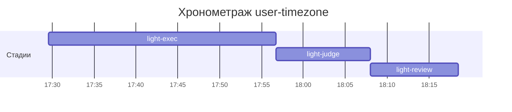

# Хронометраж: user-timezone

Обновлено: 2026-10-07T18:18:30+05:00

## Стадии

| Стадия | Начало | Конец | Длит. | Ожидание | Чистое | Рестарты | Переделки |
|---|---|---|---|---|---|---|---|
| light-exec | 07.10 17:29 | 07.10 17:56 | 27м 10с | — | 27м 10с | — | — |
| light-judge | 07.10 17:56 | 07.10 18:08 | 11м 18с | — | 11м 18с | — | 6м 41с |
| light-review | 07.10 18:08 | 07.10 18:18 | 10м 29с | — | 10м 29с | — | 34с |
| **Итого (union)** | 07.10 17:29 | 07.10 18:18 | **48м 57с** | **0с** | **48м 57с** |  | **7м 15с** |

Wall-clock (первое→последнее событие журнала): **48м 57с**; застаймлено (union стадий): 48м 57с.

## События (fix-loop / повторные гейты / ошибки)

| Стадия | Тип | Событие | Начало | Длит. | Статус |
|---|---|---|---|---|---|
| light-judge | other | integration | 07.10 17:57 | 1м 27с | ok |
| light-judge | other | integration | 07.10 18:02 | 1м 06с | ok |
| light-judge | other | e2e-run | 07.10 18:03 | 4м 08с | ok |
| light-review | other | e2e-run | 07.10 18:17 | 34с | ok |

## Инструменты (тайминги гейтов/чекеров)

| Время | Инструмент | Статус | Итого | Шаги (по убыванию) |
|---|---|---|---|---|
| 07.10 17:56 | review_bundle | FAIL | 2с | rule_usage 0.9s · api_conventions 0.1s · contract 0.1s · date_bound 0.1s · fuzz_verdict 0.1s · +5 шагов (0.2s) |
| 07.10 18:07 | e2e_evidence | PASS | 0с | status:passed 0s |
| 07.10 18:08 | review_bundle | FAIL | 1с | rule_usage 0.9s · api_conventions 0.1s · contract 0.1s · date_bound 0.1s · live_suite 0.1s · +5 шагов (0.1s) |
| 07.10 18:08 | review_bundle | FAIL | 1с | rule_usage 0.9s · go_naming 0.1s · api_conventions 0.1s · date_bound 0.1s · live_suite 0.1s · +5 шагов (0.1s) |
| 07.10 18:08 | review_bundle | FAIL | 1с | rule_usage 0.9s · api_conventions 0.1s · date_bound 0.1s · live_suite 0.1s · fixture_sync 0.1s · +5 шагов (0.0s) |

## ⚠ BLIND-GAP — интервалы без записей журнала (>5 мин)

Тяжёлый прогон обязан обрамляться `event-start`/`event-end` (§EE anti-polling):
без них нельзя отличить фоновый прогон от sleep-поллинга.

| Стадия | Начало | Конец | Длит. |
|---|---|---|---|
| light-review | 07.10 18:08 | 07.10 18:17 | 9м 30с |

Суммарно вне наблюдения: **9м 30с** (1 интервал(ов)).

## Пайп-передачи (§3.6: бандлы, контракты)

| Время | Стадия | Вид | Артефакт | Размер | Детали |
|---|---|---|---|---|---|
| 07.10 17:29 | — | passport | 0-setup/passport.md | 5KB | — |
| 07.10 17:56 | 8-code-review | bundle | 8-code-review/input-bundle.md | 19KB | чекеры 8✅/1❌/1⚠; патчи 142KB |
| 07.10 18:08 | 8-code-review | bundle | 8-code-review/input-bundle.md | 20KB | чекеры 8✅/1❌/1⚠; патчи 155KB |
| 07.10 18:08 | 8-code-review | bundle | 8-code-review/input-bundle.md | 20KB | чекеры 6✅/1❌/3⚠; патчи 155KB |
| 07.10 18:08 | 8-code-review | bundle | 8-code-review/input-bundle.md | 20KB | чекеры 9✅/1❌/0⚠; патчи 155KB |

Бандлов: 4, суммарно 80KB — весь документный контекст, переданный между стадиями.
Нарушений пайп-контракта не зафиксировано (context-violations.jsonl отсутствует).

## Ожидание пользователя

Пауз не было.

## Диаграмма

