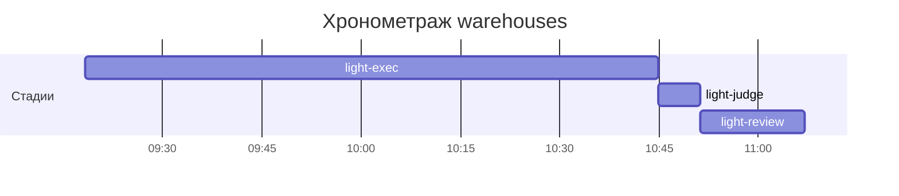

# Хронометраж: warehouses

Обновлено: 2026-10-02T11:06:57+05:00

## Стадии

| Стадия | Начало | Конец | Длит. | Ожидание | Чистое | Рестарты | Переделки |
|---|---|---|---|---|---|---|---|
| light-exec | 02.10 09:18 | 02.10 10:44 | 1ч 26м | — | 1ч 26м | — | 2м 22с |
| light-judge | 02.10 10:44 | 02.10 10:51 | 6м 19с | — | 6м 19с | — | 5м 10с |
| light-review | 02.10 10:51 | 02.10 11:06 | 15м 45с | — | 15м 45с | — | — |
| **Итого (union)** | 02.10 09:18 | 02.10 11:06 | **1ч 48м** | **0с** | **1ч 48м** |  | **7м 32с** |

Wall-clock (первое→последнее событие журнала): **1ч 48м**; застаймлено (union стадий): 1ч 48м.

## События (fix-loop / повторные гейты / ошибки)

| Стадия | Тип | Событие | Начало | Длит. | Статус |
|---|---|---|---|---|---|
| light-exec | other | e2e-run-A | 02.10 09:58 | 2м 22с | ok |
| light-judge | other | integration | 02.10 10:45 | 1м 25с | ok |
| light-judge | other | e2e-run | 02.10 10:47 | 3м 45с | ok |

## Инструменты (тайминги гейтов/чекеров)

| Время | Инструмент | Статус | Итого | Шаги (по убыванию) |
|---|---|---|---|---|
| 02.10 10:45 | review_bundle | FAIL | 1с | rule_usage 0.3s · go_naming 0.1s · api_conventions 0.1s · contract 0.1s · date_bound 0.1s · +5 шагов (0.2s) |
| 02.10 10:45 | review_bundle | FAIL | 1с | rule_usage 0.3s · go_naming 0.1s · api_conventions 0.1s · contract 0.1s · date_bound 0.1s · +5 шагов (0.2s) |
| 02.10 10:51 | e2e_evidence | PASS | 0с | status:passed 0s |
| 02.10 11:06 | e2e_evidence | PASS | 0с | status:passed 0s |

## ⚠ BLIND-GAP — интервалы без записей журнала (>5 мин)

Тяжёлый прогон обязан обрамляться `event-start`/`event-end` (§EE anti-polling):
без них нельзя отличить фоновый прогон от sleep-поллинга.

| Стадия | Начало | Конец | Длит. |
|---|---|---|---|
| light-review | 02.10 10:51 | 02.10 11:06 | 15м 45с |

Суммарно вне наблюдения: **15м 45с** (1 интервал(ов)).

## Пайп-передачи (§3.6: бандлы, контракты)

| Время | Стадия | Вид | Артефакт | Размер | Детали |
|---|---|---|---|---|---|
| 02.10 10:45 | 8-code-review | bundle | 8-code-review/input-bundle.md | 19KB | чекеры 9✅/1❌/0⚠; патчи 533KB |
| 02.10 10:45 | 8-code-review | bundle | 8-code-review/input-bundle.md | 18KB | чекеры 9✅/1❌/0⚠; патчи 533KB |

Бандлов: 2, суммарно 37KB — весь документный контекст, переданный между стадиями.
Нарушений пайп-контракта не зафиксировано (context-violations.jsonl отсутствует).

## Ожидание пользователя

Пауз не было.

## Диаграмма

